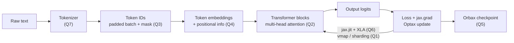

<Todo>Drafted 2026-11-15. Before publishing: (1) check the option numbers against your quiz screen, and paste the other answer choices if you want them shown (only the correct ones were available when this was written); (2) add a cover image (prompt and alt text in sites/jithendar.com/docs/knowledge-sharing/build-train-llm-jax/README.md); (3) add your own commentary and confirm the AI-assistance line against the AI use policy; (4) set status and publishedAt.</Todo>

Most of my career has been on the infrastructure side: Kubernetes clusters, CI/CD pipelines, observability, the platforms other people's code runs on. Lately more of that code is AI: agents, RAG services, model servers. I've been running them for a while, in [MOKS](/projects/moks) and [four AI systems on one cluster](/blog/four-ai-systems-one-cluster). What I didn't really understand was what goes on inside the model.

Calling an LLM API is easy. Understanding why a training job needs eight GPUs, why it recompiles when a batch changes shape, or why a checkpoint can be tens of gigabytes is harder. Those are exactly the questions a platform engineer gets asked. So I started DeepLearning.AI's short course [**Build and Train an LLM with JAX**](https://www.deeplearning.ai/courses/build-and-train-an-llm-with-jax).

This article covers the seven quiz questions from that course. For each one I explain the answer and show JAX code you can run on a laptop CPU. The goal is to understand the ideas, not to memorise answers.

> This is an independent learning article. It is not official course material and is not endorsed by DeepLearning.AI or Google. Everything I say about the course comes from its public course page.

## What the course covers

According to the [course page](https://www.deeplearning.ai/courses/build-and-train-an-llm-with-jax), the course:

- is built in partnership with **Google** and taught by **Chris Achard**, a Developer Relations Engineer on Google's TPU Software team;
- is an **intermediate** course of about **49 minutes**: seven video lessons, four code examples and one graded quiz;
- recommends familiarity with Python and basic machine learning;
- builds a **GPT-2 style model with about 20 million parameters** ("MiniGPT") from scratch, trained on a dataset of short stories;
- uses **JAX** with its ecosystem: **Flax NNX** (layers), **Grain** (data loading), **Optax** (optimisers) and **Orbax** (checkpoints).

The lessons are: Overview of JAX, Building the Architecture, Data Loading, Training and Saving, and Final MiniGPT, plus an introduction and a conclusion.

The code in this article is mine, not the course's. To keep each idea visible, I use plain JAX arrays instead of Flax NNX. I ran every example with JAX 0.10.2, Optax 0.2.9 and Orbax 0.12.10 on an arm64 Mac CPU.

## What is JAX?

[JAX](https://docs.jax.dev/) is a Python library for numerical computing from Google. `jax.numpy` looks almost exactly like NumPy, and on top of that JAX can transform your functions:

| Transformation | What it does |
| --- | --- |
| `jax.grad` | Returns a new function that computes the gradient (automatic differentiation) |
| `jax.jit` | Compiles a function with **XLA** into fast code for CPU, GPU or TPU |
| `jax.vmap` | Turns a function written for one example into one that runs on a whole batch |

JAX also differs from NumPy in two ways that confuse beginners:

- **Arrays are immutable.** You don't write `x[0] = 1`. You write `x = x.at[0].set(1)`, which returns a new array.
- **Functions should be pure.** The output should depend only on the inputs. That is why random numbers need an explicit key (`jax.random.key(0)`) instead of a global seed.

These rules are what make the transformations safe. If a function has no hidden state, JAX can trace it once, differentiate it, compile it and copy it across 256 TPU chips, and the result is still correct.

```python
import jax
import jax.numpy as jnp

def loss(w):
    return jnp.sum(w ** 2)

grad_loss = jax.grad(loss)                 # a new function: d(loss)/dw
print(grad_loss(jnp.array([1.0, 2.0])))    # [2. 4.]
```

### JAX, PyTorch and TensorFlow

| | JAX | PyTorch | TensorFlow |
| --- | --- | --- | --- |
| Style | Functional: pure functions, explicit state | Object-oriented, eager by default | Keras layers, graph compilation with `tf.function` |
| Compilation | XLA through `jax.jit` | Eager; optional `torch.compile` | XLA optional |
| Parallelism | Sharding and SPMD built into arrays | DDP, FSDP, DTensor | `tf.distribute` |
| Where it is strong | TPUs, large-scale research and training | Most popular in research and industry; large ecosystem | Production stacks built on TensorFlow, TF Lite |
| Neural network library | Flax, Equinox | Built in (`torch.nn`) | Keras |

None of these is "best". I already use [PyTorch for a reranker in MOKS](/blog/pytorch-rag-reranking-moks-sre-agent). JAX's appeal is that compiling and sharding are built into the core, which matters most on TPUs and at large scale.

## The seven questions

For each question I give the correct answer exactly as the quiz wrote it, explain why, look at the usual misconceptions, and show an example.

### Question 1: vectorized batching and device sharding

**Question:** In JAX with XLA, which statement best explains how vectorized batching and device sharding work together to scale training across many GPUs/TPUs?

**Correct answer (option 2):** *"vmap vectorizes computations over batches; sharding splits data/model across devices, letting XLA parallelize training on many accelerators."*

**Why it is correct.** These are two different tools that work together:

- `jax.vmap` makes code faster on **one** device. You write a function for a single example, and `vmap` turns it into a function that processes a whole batch in one vectorized operation, with no Python loop.
- **Sharding** spreads work across **many** devices. You tell JAX how to split an array across a mesh of devices, and XLA generates the parallel program, including the communication between devices.

There are two basic ways to split the work:

- **Data parallelism:** every device holds a full copy of the model and processes a different slice of the batch.
- **Model parallelism:** the weights themselves are split, because the model is too big for one device.

Large LLM runs combine both.

**Common misconceptions.** `vmap` doesn't copy work to other devices; it only vectorises. Sharding doesn't remove the need for batching. And XLA doesn't parallelise anything until you tell it how arrays are laid out.

**Example: `vmap`.**

```python
import jax
import jax.numpy as jnp

def predict(w, x):
    # x is ONE example with 3 features; w has shape (3,)
    return jnp.tanh(jnp.dot(w, x))

w = jnp.array([0.5, -1.0, 2.0])
batch = jnp.arange(12.0).reshape(4, 3)       # 4 examples, 3 features each

# Python loop: one small call per example
looped = jnp.stack([predict(w, x) for x in batch])

# vmap: one vectorized call over the batch axis
batched_predict = jax.vmap(predict, in_axes=(None, 0))  # don't map w, map axis 0 of x
vectorized = batched_predict(w, batch)

print(vectorized.shape)                      # (4,)
print(jnp.allclose(looped, vectorized))      # True
```

`in_axes=(None, 0)` means "share `w`, iterate over the first axis of `x`". The two results are identical, but the `vmap` version is one operation instead of four.

**Example: sharding.** You can try this without a GPU. An XLA flag makes your CPU pretend to be eight devices:

```python
# XLA_FLAGS=--xla_force_host_platform_device_count=8 python shard.py
import jax
import jax.numpy as jnp
from jax.sharding import NamedSharding, PartitionSpec as P

mesh = jax.make_mesh((8,), ("data",))        # 8 devices on one "data" axis

x = jnp.ones((64, 128))                      # a batch of 64 examples
w = jnp.ones((128, 16))                      # model weights

# Data parallelism: split the batch across devices, copy the weights to every device
x = jax.device_put(x, NamedSharding(mesh, P("data", None)))
w = jax.device_put(w, NamedSharding(mesh, P()))   # P() = replicated

@jax.jit
def forward(w, x):
    return jnp.tanh(x @ w)

y = forward(w, x)
print(y.sharding)                            # split along "data", like x
print(y.addressable_shards[0].data.shape)    # (8, 16): each device holds 8 rows
```

`PartitionSpec("data", None)` means "split axis 0 across the `data` mesh axis, and don't split axis 1". The `forward` function contains no parallel code at all; XLA works out the parallel program from the input layouts. For model parallelism you would shard `w` instead, for example `P(None, "model")` on a two-dimensional mesh.

**Key takeaway:** `vmap` handles batching on one device, sharding spreads the work across many, and XLA turns both into one compiled program.

### Question 2: multi-head attention

**Question:** In a transformer block, what role does multi-head attention play?

**Correct answer (option 1):** *"Use multiple attention heads with distinct Q/K/V to focus on different input aspects and aggregate results."*

**Why it is correct.** Attention lets each token collect information from the other tokens. Each token is projected into three vectors:

- a **query** (Q): what this token is looking for;
- a **key** (K): what this token contains, for matching;
- a **value** (V): the information it passes on if it matches.

The formula from [*Attention Is All You Need*](https://arxiv.org/abs/1706.03762) is:

**Attention(Q, K, V) = softmax(QKᵀ / √dₖ) V**

The query–key dot products give a score for every pair of tokens. Dividing by √dₖ keeps those scores from growing with the vector size, so softmax doesn't saturate. Softmax turns each row of scores into weights that sum to 1, and those weights average the values.

**Multi-head** attention does this several times in parallel, each head with its own Q/K/V projections over a smaller slice of the model dimension. One head might learn to follow syntax, another to find the noun a pronoun refers to. The outputs of all heads are concatenated and mixed by one more projection, W_O.

In **self-attention**, which GPT models use, Q, K and V all come from the same sequence. In **cross-attention**, the queries come from one sequence and the keys and values from another, as when a translation decoder reads the encoder's output.

**Common misconceptions.** Attention heads don't each read a different part of the sentence; every head sees all positions it is allowed to see. Heads also don't replace the feed-forward layer, and they don't share one set of Q/K/V weights.

**Example.**

```python
import jax
import jax.numpy as jnp

def scaled_dot_product_attention(q, k, v, mask=None):
    # q, k, v: (seq_len, d_k)
    d_k = q.shape[-1]
    scores = q @ k.T / jnp.sqrt(d_k)                 # (seq_len, seq_len)
    if mask is not None:
        scores = jnp.where(mask, scores, -1e9)       # hide masked positions
    weights = jax.nn.softmax(scores, axis=-1)        # each row sums to 1
    return weights @ v, weights

def multi_head_attention(x, wq, wk, wv, wo, num_heads, mask=None):
    seq_len, d_model = x.shape
    d_head = d_model // num_heads

    def split_heads(t):                              # (seq, d_model) -> (heads, seq, d_head)
        return t.reshape(seq_len, num_heads, d_head).transpose(1, 0, 2)

    q, k, v = split_heads(x @ wq), split_heads(x @ wk), split_heads(x @ wv)
    # run attention for every head at once with vmap
    out, _ = jax.vmap(scaled_dot_product_attention, in_axes=(0, 0, 0, None))(q, k, v, mask)
    out = out.transpose(1, 0, 2).reshape(seq_len, d_model)   # concatenate heads
    return out @ wo                                           # mix heads together

key = jax.random.key(0)
k1, k2, k3, k4, k5 = jax.random.split(key, 5)
seq_len, d_model, heads = 5, 16, 4
x = jax.random.normal(k1, (seq_len, d_model))
wq, wk, wv, wo = (jax.random.normal(k, (d_model, d_model)) * 0.1 for k in (k2, k3, k4, k5))

causal = jnp.tril(jnp.ones((seq_len, seq_len), dtype=bool))  # token i sees tokens 0..i
y = multi_head_attention(x, wq, wk, wv, wo, heads, causal)
print(y.shape)   # (5, 16)
```

Note the `vmap` from Question 1 again, this time over heads instead of examples. The `causal` mask is what makes this a GPT-style decoder: when token 3 is predicted, it can't look at tokens 4 and 5.

**Key takeaway:** each head learns its own way of relating tokens, and the output projection combines what the heads found.

### Question 3: batching and sequence padding

**Question:** Which statement best explains how batching and sequence padding enable efficient parallel training in JAX?

**Correct answer (option 1):** *"Padding sequences to a fixed length and batching create fixed-shape arrays that JAX can JIT-compile and parallelize."*

**Why it is correct.** Sentences have different lengths, but an array must be rectangular. So we **pad** shorter sequences with a special pad token up to a fixed length, and **truncate** longer ones. A boolean **mask** records which positions are real, so attention and the loss can ignore the padding.

The JAX-specific reason is compilation. `jax.jit` compiles one program **per input shape and dtype**. If every batch has a different length, every batch triggers a new compilation, and compiling is slow. With fixed shapes you compile once and reuse the program for the rest of training.

**Common misconceptions.** Padding doesn't make the model more accurate; it only makes shapes predictable. And padding without a mask is a bug: the model would learn to attend to, or predict, pad tokens.

**Example: padding and masks.**

```python
import numpy as np

PAD_ID = 0
sequences = [
    [12, 7, 33],
    [5, 9, 41, 8, 2],
    [17],
]

def pad_batch(seqs, max_len, pad_id=PAD_ID):
    ids = np.full((len(seqs), max_len), pad_id, dtype=np.int32)
    mask = np.zeros((len(seqs), max_len), dtype=bool)
    for i, s in enumerate(seqs):
        s = s[:max_len]                  # truncate anything too long
        ids[i, :len(s)] = s
        mask[i, :len(s)] = True          # True = real token, False = padding
    return ids, mask

ids, mask = pad_batch(sequences, max_len=6)
print(ids)
# [[12  7 33  0  0  0]
#  [ 5  9 41  8  2  0]
#  [17  0  0  0  0  0]]
print(ids.shape)                         # (3, 6): every batch has the same shape
```

**Example: recompilation.** `print` inside a jitted function runs only while JAX traces it, so you can see when it compiles:

```python
@jax.jit
def total(x):
    print("tracing for shape", x.shape)
    return x.sum()

total(jnp.ones((3, 6)))   # prints: traces + compiles
total(jnp.ones((3, 6)))   # silent: same shape, cached program
total(jnp.ones((3, 7)))   # prints again: new shape, new compilation
```

There is a trade-off. In the batch above, 8 of the 18 positions are padding, which is wasted computation. Real pipelines reduce it by grouping sequences of similar length into "buckets" with a few fixed sizes, or by packing several short documents into one sequence.

**Key takeaway:** fixed shapes let JAX compile once; masks keep the padding from affecting what the model learns.

### Question 4: token and positional embeddings

**Question:** In a transformer language model, what roles do token embeddings and positional embeddings play in representing text and order?

> **This question is ambiguous.** None of the options read as fully correct to me. The closest one was option 3, but it **swapped the two definitions**. I'm not repeating that wording, because as written it is wrong. Here is the correct version.

**The correct distinction:**

- A **token embedding** converts each token ID into a learned dense vector. It is a lookup table with one row per vocabulary entry, and it represents **what** the token is.
- A **positional embedding** (or positional encoding) adds information about **where** the token is in the sequence.
- The model **adds** the two together, so every vector carries both content and position.

We need position because attention by itself treats its input as a set: shuffle the tokens and, without positional information, each token's output is just shuffled with them. "Dog bites man" and "man bites dog" would look the same.

```python
import jax
import jax.numpy as jnp

vocab_size, max_len, d_model = 100, 8, 16
k_tok, k_pos = jax.random.split(jax.random.key(0))

token_embedding = jax.random.normal(k_tok, (vocab_size, d_model)) * 0.02   # one row per token ID
position_embedding = jax.random.normal(k_pos, (max_len, d_model)) * 0.02  # one row per position

token_ids = jnp.array([[12, 7, 33, 0], [5, 9, 41, 8]])        # (batch=2, seq=4)
positions = jnp.arange(token_ids.shape[1])                     # [0, 1, 2, 3]

tok = token_embedding[token_ids]          # (2, 4, 16)  WHAT each token is
pos = position_embedding[positions]       # (4, 16)     WHERE each token is
x = tok + pos                             # broadcast add -> (2, 4, 16)
```

There are three common ways to encode position:

- **Learned positional embeddings**, as above and as in GPT-2: a trainable table with one row per position. Simple, but the model can't go beyond `max_len`.
- **Sinusoidal encodings**, from the original Transformer paper: fixed sine and cosine waves of different frequencies, with no parameters to learn.
- **RoPE** (rotary position embedding, from [RoFormer](https://arxiv.org/abs/2104.09864)): instead of adding a vector, it rotates the queries and keys by an angle that depends on position, so attention scores depend on the *relative* distance between tokens. Many current open models, such as Llama, use it.

```python
def sinusoidal_positions(max_len, d_model):
    pos = jnp.arange(max_len)[:, None]
    i = jnp.arange(0, d_model, 2)[None, :]
    angles = pos / jnp.power(10000.0, i / d_model)
    pe = jnp.zeros((max_len, d_model))
    pe = pe.at[:, 0::2].set(jnp.sin(angles))   # immutable update with .at[].set()
    pe = pe.at[:, 1::2].set(jnp.cos(angles))
    return pe
```

**Key takeaway:** token embeddings say *what*, positional information says *where*, and the transformer needs both.

### Question 5: model checkpointing

**Question:** Why is checkpointing model parameters emphasized for long-running jobs and subsequent experiments?

**Correct answer (option 3):** *"Checkpointing saves parameters to disk, enabling pause and resume of long runs and reproducible experiments after failures or changes."*

**Why it is correct.** Training an LLM can take days or weeks, and in that time hardware fails, spot instances get reclaimed and nodes get drained. Without checkpoints, a failure at day six means starting over from day zero. Checkpoints also let you evaluate, fine-tune or compare a model later from an exact known state.

A checkpoint you can really resume from contains more than the weights:

- **model parameters**;
- **optimizer state**: Adam keeps two running averages per parameter, so its state is twice the size of the model, and without it training doesn't continue the same way;
- the **step number**, for the learning-rate schedule and the data position;
- the **random key**, for dropout and data shuffling.

**Common misconceptions.** Checkpoints don't make training faster, and they aren't mainly about saving memory. (Gradient checkpointing, or rematerialisation, is a different technique with a confusingly similar name: it trades computation for memory *during* training.)

**Example with Orbax**, the checkpointing library the course uses:

```python
import jax
import jax.numpy as jnp
import optax
import orbax.checkpoint as ocp
from pathlib import Path

params = {"w": jnp.ones((4, 4)), "b": jnp.zeros((4,))}
optimizer = optax.adamw(1e-3)
state = {
    "params": params,
    "opt_state": optimizer.init(params),
    "step": jnp.array(1200),
    "rng": jax.random.key_data(jax.random.key(42)),   # store the raw key bits
}

ckpt_dir = Path("/tmp/jax-demo-ckpts").resolve()     # Orbax needs an absolute path
mngr = ocp.CheckpointManager(ckpt_dir, options=ocp.CheckpointManagerOptions(max_to_keep=3))

mngr.save(1200, args=ocp.args.StandardSave(state))
mngr.wait_until_finished()                            # saves run in the background

# Restore: describe the shapes/dtypes, then load into that structure
abstract = jax.tree_util.tree_map(ocp.utils.to_shape_dtype_struct, state)
restored = mngr.restore(mngr.latest_step(), args=ocp.args.StandardRestore(abstract))
print(mngr.latest_step(), int(restored["step"]))      # 1200 1200
rng = jax.random.wrap_key_data(restored["rng"])       # back to a usable key
```

`CheckpointManager` numbers checkpoints by step and deletes old ones (`max_to_keep=3`), which matters when each checkpoint is gigabytes. Saving is asynchronous, so training continues while the files are written. When restoring, you pass an "abstract" description of shapes and dtypes; for sharded models it also carries the sharding, so each device loads only its own part.

**Why platform engineers should care.** On Kubernetes, pods are expected to die. A training job should write checkpoints to durable storage (a PersistentVolume or an object store such as S3 or GCS, never the container filesystem), resume from `latest_step()` on start, and save on SIGTERM if it can. Retention policies and storage costs become part of the platform design.

**Key takeaway:** a checkpoint is the full training state, not just the weights, and it is what makes long runs survivable and experiments repeatable.

### Question 6: JIT compilation and XLA

**Question:** In JAX, what best explains how compiling computations for target accelerators and caching the result improves performance across CPUs, GPUs, and TPUs?

**Correct answer (option 4):** *"JAX JIT compiles via XLA to CPU/GPU/TPU-specific code, caches it, eliminating overhead and making subsequent runs faster."*

**Why it is correct.** When you call a `jax.jit` function for the first time, JAX:

1. **traces** it: it runs the Python code with placeholder "tracer" values and records the operations into an intermediate form called a jaxpr;
2. hands that to **XLA**, which optimises the whole computation (for example, by fusing several element-wise operations into one kernel) and compiles it for the actual device: CPU, GPU or TPU;
3. **caches** the compiled program, keyed by the function and the shapes and dtypes of its inputs.

Later calls with the same shapes skip steps 1 and 2. That is why the first call is slow and the rest are fast, and why a new shape (Question 3) triggers a new compilation.

**Common misconceptions.** JIT doesn't compile Python into C, and it doesn't speed up the first call; the first call is the slowest. It also can't follow Python `if` statements on array values, because during tracing the values aren't known yet; use `jax.lax.cond` or `jnp.where` instead.

**Example benchmark.** JAX dispatches work **asynchronously**: a function returns before the device has finished. Without `block_until_ready()`, you would only measure how fast Python can queue work. I also time the first jitted call separately so compilation doesn't mix into the steady-state number.

```python
import time
import jax
import jax.numpy as jnp

def gelu_mlp(x, w1, w2):
    h = x @ w1
    h = 0.5 * h * (1 + jnp.tanh(0.7978845608 * (h + 0.044715 * h**3)))
    return h @ w2

k1, k2, k3 = jax.random.split(jax.random.key(0), 3)
x  = jax.random.normal(k1, (512, 512))
w1 = jax.random.normal(k2, (512, 2048))
w2 = jax.random.normal(k3, (2048, 512))

def timeit(fn, n=50):
    start = time.perf_counter()
    for _ in range(n):
        out = fn(x, w1, w2)
    out.block_until_ready()           # wait for the device, not just the dispatch
    return (time.perf_counter() - start) / n * 1000

gelu_mlp(x, w1, w2).block_until_ready()          # warm up eager mode
print(f"eager:        {timeit(gelu_mlp):.2f} ms/call")

fast = jax.jit(gelu_mlp)
start = time.perf_counter()
fast(x, w1, w2).block_until_ready()              # trace + compile + run
print(f"jit 1st call: {(time.perf_counter() - start) * 1000:.2f} ms")

print(f"jit cached:   {timeit(fast):.2f} ms/call")
```

In one run on my laptop's CPU, eager mode took about 4.7 ms per call, the first jitted call about 22 ms, and the cached jitted version about 3.5 ms. That is one run on one machine, not a benchmark; your numbers will differ. The gain here is modest because two large matrix multiplications dominate, and those are already optimised kernels in eager mode too. JIT helps most when there are many small operations to fuse, and on GPUs and TPUs, where launching each operation separately is expensive. A whole training step, with its forward pass, backward pass and optimizer update, is exactly that kind of code.

**Key takeaway:** pay the compilation cost once, keep shapes stable, and the compiled program is reused on every step.

### Question 7: tokenization

**Question:** What does tokenization do to raw text so it can be fed into the embedding layer and batched for training?

**Correct answer (option 4):** *"Tokenization maps text to numeric token IDs, turning words/subwords into integer sequences for model input."*

**Why it is correct.** A neural network can't read characters; it needs numbers. A tokenizer splits text into **tokens** and maps each one to an integer **token ID** using a fixed **vocabulary**. The embedding layer from Question 4 then uses each ID as a row index.

Modern LLMs use **subword** tokenizers such as BPE (byte-pair encoding) or SentencePiece, with vocabularies of tens of thousands of entries; GPT-2's has 50,257. Common words get a single token, while rare words are split into pieces ("tokenization" might become "token" + "ization"), so the tokenizer never meets a word it can't represent. Tokenizers also add **special tokens**: padding, beginning and end of sequence, and sometimes unknown.

**Common misconceptions.** Tokenization doesn't produce embeddings (that is the next layer's job), it doesn't learn during model training, and a token isn't necessarily a word.

**Example.** This toy word-level tokenizer shows the mechanics. A real one learns its vocabulary from a large corpus, but the input and output are the same: text in, integers out.

```python
text = "the cat sat. the cat ran."

special = ["<pad>", "<unk>", "<bos>", "<eos>"]
words = sorted(set(text.replace(".", " .").split()))
vocab = {tok: i for i, tok in enumerate(special + words)}
id_to_token = {i: t for t, i in vocab.items()}

def encode(s, max_len=8):
    tokens = ["<bos>"] + s.replace(".", " .").split() + ["<eos>"]
    ids = [vocab.get(t, vocab["<unk>"]) for t in tokens][:max_len]   # truncate
    return ids + [vocab["<pad>"]] * (max_len - len(ids))           # pad

def decode(ids):
    return " ".join(id_to_token[i] for i in ids if i != vocab["<pad>"])

print(encode("the cat sat."))      # [2, 8, 5, 7, 4, 3, 0, 0]
print(encode("the dog sat."))      # [2, 8, 1, 7, 4, 3, 0, 0]  ("dog" -> <unk>)
print(decode(encode("the cat ran.")))   # <bos> the cat ran . <eos>
```

**Key takeaway:** tokenization is the boundary between text and numbers. Everything after it is arrays.

## How the pieces fit together

The seven questions are really seven steps of one pipeline:



## A mini LLM training pipeline in about 100 lines

This script connects all seven ideas. It trains a tiny character-level model with one transformer block on three sentences, and runs on a laptop CPU in a few seconds.

It is a **learning example, not a production trainer.** It has no Flax, no real data loader, no evaluation set, no sharding and no learning-rate schedule. The course's MiniGPT uses Flax NNX, Grain and a real dataset.

```python
import jax
import jax.numpy as jnp
import optax
import orbax.checkpoint as ocp
from pathlib import Path

# 1-2. Data and a character-level tokenizer (id 0 = padding)
corpus = ["the cat sat on the mat", "the dog ran to the cat", "a cat and a dog sat"]
chars = sorted(set("".join(corpus)))
stoi = {c: i + 1 for i, c in enumerate(chars)}
itos = {i: c for c, i in stoi.items()}
vocab_size, max_len = len(stoi) + 1, 24

# 3. Padded batch + mask: fixed shape (3, 24) every step
def encode(s):
    ids = [stoi[c] for c in s][:max_len]
    return ids + [0] * (max_len - len(ids))
batch = jnp.array([encode(s) for s in corpus])
inputs, targets = batch[:, :-1], batch[:, 1:]          # predict the next character
loss_mask = targets != 0                                 # don't learn to predict padding

# 4. Parameters: token + positional embeddings, one attention block, MLP
d_model, n_heads = 32, 4
def init_params(key):
    ks = jax.random.split(key, 8)
    n = lambda k, shape: jax.random.normal(k, shape) * 0.02
    return {
        "tok_emb": n(ks[0], (vocab_size, d_model)),
        "pos_emb": n(ks[1], (max_len, d_model)),
        "wq": n(ks[2], (d_model, d_model)), "wk": n(ks[3], (d_model, d_model)),
        "wv": n(ks[4], (d_model, d_model)), "wo": n(ks[5], (d_model, d_model)),
        "w_ff": n(ks[6], (d_model, 4 * d_model)), "w_out_ff": n(ks[7], (4 * d_model, d_model)),
    }

def layer_norm(x, eps=1e-5):
    mean, var = x.mean(-1, keepdims=True), x.var(-1, keepdims=True)
    return (x - mean) / jnp.sqrt(var + eps)

# 5. One Transformer block: causal multi-head self-attention + MLP, with residuals
def forward(params, ids):
    B, T = ids.shape
    x = params["tok_emb"][ids] + params["pos_emb"][jnp.arange(T)]
    h = layer_norm(x)
    split = lambda t: t.reshape(B, T, n_heads, -1).transpose(0, 2, 1, 3)   # (B, H, T, d)
    q, k, v = (split(h @ params[w]) for w in ("wq", "wk", "wv"))
    scores = q @ k.transpose(0, 1, 3, 2) / jnp.sqrt(q.shape[-1])
    causal = jnp.tril(jnp.ones((T, T), dtype=bool))
    pad = (ids != 0)[:, None, None, :]                 # don't attend to padding keys
    scores = jnp.where(causal & pad, scores, -1e9)
    attn = jax.nn.softmax(scores, axis=-1) @ v
    x = x + attn.transpose(0, 2, 1, 3).reshape(B, T, d_model) @ params["wo"]
    x = x + jax.nn.gelu(layer_norm(x) @ params["w_ff"]) @ params["w_out_ff"]
    return layer_norm(x) @ params["tok_emb"].T          # logits, tied to the embeddings

# 6. Loss: cross-entropy on real (non-pad) target tokens only
def loss_fn(params, inputs, targets, mask):
    logits = forward(params, inputs)
    losses = optax.softmax_cross_entropy_with_integer_labels(logits, targets)
    return (losses * mask).sum() / mask.sum()

# 7-9. Gradients with value_and_grad, AdamW from Optax, whole step under jit
optimizer = optax.adamw(learning_rate=3e-3)

@jax.jit
def train_step(params, opt_state, inputs, targets, mask):
    loss, grads = jax.value_and_grad(loss_fn)(params, inputs, targets, mask)
    updates, opt_state = optimizer.update(grads, opt_state, params)
    return optax.apply_updates(params, updates), opt_state, loss

params = init_params(jax.random.key(0))
opt_state = optimizer.init(params)
for step in range(301):
    params, opt_state, loss = train_step(params, opt_state, inputs, targets, loss_mask)
    if step % 100 == 0:
        print(f"step {step:3d}  loss {loss:.3f}")

# 10. Save, then restore into the same structure
mngr = ocp.CheckpointManager(Path("/tmp/mini-llm-ckpt").resolve(),
                             options=ocp.CheckpointManagerOptions(max_to_keep=2))
mngr.save(step, args=ocp.args.StandardSave({"params": params, "opt_state": opt_state}))
mngr.wait_until_finished()
abstract = jax.tree_util.tree_map(ocp.utils.to_shape_dtype_struct,
                                  {"params": params, "opt_state": opt_state})
restored = mngr.restore(mngr.latest_step(), args=ocp.args.StandardRestore(abstract))
print("restored loss:", float(loss_fn(restored["params"], inputs, targets, loss_mask)))
```

What each part does:

- **Tokenize and pad** (Q7, Q3): every batch is `(3, 23)` after the one-position shift, so `train_step` compiles once.
- **Embeddings** (Q4): token and learned positional embeddings are added. The output layer reuses the token embedding matrix ("weight tying"), as GPT-2 does.
- **Attention** (Q2): four heads, a causal mask, and a padding mask so no token attends to `<pad>`.
- **Loss and gradients**: `jax.value_and_grad` returns the loss and the gradient for every parameter in the dictionary in one call. JAX treats a nested dictionary of arrays as a "pytree" and differentiates through all of it.
- **Optax**: `adamw` keeps its own state; `update` turns gradients into parameter updates.
- **`jax.jit`** (Q6): the whole step, forward, backward and update, is compiled into one XLA program.
- **Orbax** (Q5): parameters and optimizer state are saved together and restored.

When I ran it, the loss fell from 2.665 at step 0 to 0.032 at step 300, and the restored parameters gave the same loss. On three sentences that just means the model memorised them, which is the point of a sanity check: if a model can't overfit a tiny dataset, something is broken.

## What this means for production AI engineering

None of this is in production in my projects. MOKS and RoboShop AI call hosted models and run CPU services; they don't train LLMs. But if they ever do, or if I build a platform for a team that does, these ideas become infrastructure decisions:

- **Accelerator scheduling.** Sharding (Q1) needs a known device topology. On Kubernetes that means GPU device plugins or TPU node pools, and scheduling all workers of a job together (gang scheduling, with tools such as Kueue or JobSet), because a job with seven of its eight workers running does nothing.
- **Checkpoint persistence** (Q5). Training pods must assume they will be killed. Durable checkpoint storage, resume-on-start and retention policies belong in the job template, not in each researcher's script.
- **Compilation as a startup cost** (Q6). The first step of every run, and every restart, pays for compilation. JAX's persistent compilation cache on a shared volume can cut that down.
- **Utilisation.** Padding overhead (Q3) and recompilation show up as low GPU utilisation. Accelerator metrics next to step time and tokens per second tell you whether the hardware is busy or waiting.
- **Observability and reproducibility.** Logging the loss, learning rate, step and checkpoint ID for every run, with the code version and data version, turns "the model got worse" into a question you can answer.
- **MLOps pipelines.** Tokenizer version (Q7), data, training, evaluation, checkpoint and model registry form one pipeline, and the platform's job is to make it repeatable.

## Seven lessons in one table

| Concept | Key learning |
| --- | --- |
| Vectorization and sharding | `vmap` batches work on one device; sharding spreads it across many; XLA compiles both |
| Multi-head attention | Several heads with separate Q/K/V learn different relationships between tokens |
| Padding and batching | Fixed shapes let JIT compile once; masks keep padding from affecting the model |
| Token and positional embeddings | Token embeddings say *what*, positional information says *where* |
| Checkpointing | Save parameters, optimizer state, step and RNG key to survive failures and reproduce runs |
| JIT and XLA | Trace once, compile for the device, cache, and reuse while shapes stay the same |
| Tokenization | Text becomes integer IDs from a fixed vocabulary, ready for the embedding layer |

## What I want to learn next

These are goals, not things I've done:

1. Rebuild the mini model above with **Flax NNX**, the way the course does, and compare the code.
2. Understand **backpropagation and optimisers** properly: what Adam's state contains and why learning-rate warm-up matters.
3. Train on a **GPU or TPU** and see how the JIT and padding trade-offs change on real accelerators.
4. Learn **multi-device sharding** beyond data parallelism: tensor and pipeline parallelism, and FSDP-style parameter sharding.
5. Look at **distributed LLM training** on Kubernetes end to end, including checkpoints and failure recovery.
6. Study **inference**: KV caching, quantisation and model serving, which is where most platform work actually happens.

## Conclusion

On their own, the seven questions look like unrelated trivia. Put in order, they describe how an LLM is trained: text becomes token IDs, IDs become padded batches, batches become embeddings carrying content and position, attention mixes information between tokens, gradients update the weights, JIT and XLA make each step fast, sharding spreads the steps across devices, and checkpoints keep the whole thing recoverable.

For me, coming from platform engineering, that picture is the useful part. Once you know why a training job wants fixed shapes, compiled steps and frequent checkpoints, the infrastructure it needs stops being a list of requirements and becomes something you can reason about.

Are you learning JAX, PyTorch or LLM internals too? I'd like to hear what clicked for you and what didn't.

## Frequently asked questions

### What is the Build and Train an LLM with JAX course?

A short intermediate course from DeepLearning.AI, built with Google and taught by Chris Achard. In about 49 minutes it builds a GPT-2 style model of about 20 million parameters with JAX, Flax NNX, Grain, Optax and Orbax.

### Do I need a GPU or TPU to learn JAX?

You don't. JAX runs on CPU, and every example in this article runs on a laptop. You can even make a CPU pretend to be several devices, with the XLA flag shown in the sharding example above, to practise sharding.

### What is the difference between jax.jit and jax.vmap?

`jax.jit` compiles a function with XLA so repeated calls run faster. `jax.vmap` turns a function written for one example into one that runs on a batch. They are often combined: a jitted function that uses `vmap` inside.

### Why does my JAX function recompile?

`jax.jit` caches one compiled program per combination of input shapes and dtypes (and static arguments). If batch shapes change between calls, JAX compiles again. Padding to a few fixed lengths avoids it.

### Is JAX better than PyTorch for LLM training?

Neither is better in general. JAX builds compilation and sharding into its core and fits TPUs well; PyTorch has the larger ecosystem and is more common in industry. The concepts in this article apply to both.

### What should a training checkpoint contain?

At least the model parameters, the optimizer state, the step number and the random key. With only the weights you can run the model, but you can't resume training exactly where it stopped.
