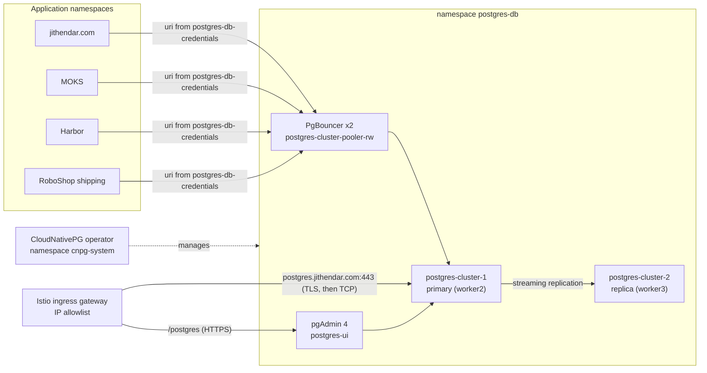
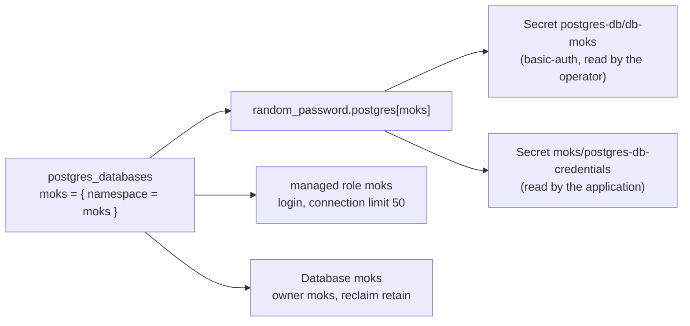

<Todo>Updated on 2026-11-14 for k3s on Hetzner Cloud from the kubernetes repository and read-only kubectl: two instances instead of three, pgAdmin instead of Adminer, live output from k3s. Check: (1) why the database stays on local-path although k3s's default class is hcloud-volumes (the repositories do not say; add your reason in "Why local-path"); (2) which applications use the cluster today (the site and the SEO agent read postgres-db-credentials, Harbor's README says its database is here; MOKS and RoboShop shipping are not confirmed); (3) the comments in the kubernetes repository still describe minikube ("minikube nodes have no zone label", "mk4's 8 nodes").</Todo>

Until November 2026, every application on `mk4` (the cluster that runs this website, the MOKS SRE portal, Harbor and RoboShop AI) brought its own PostgreSQL: one single-replica pod each, four in total, four sets of credentials, four volumes and no failover. This article explains how we replaced that with **one shared, highly available PostgreSQL 18 cluster**, managed by the CloudNativePG operator and installed as Helm releases from Terraform. It covers why we made each choice, the exact files, how it was deployed, and a troubleshooting FAQ built from the errors we actually hit.

It is written for DevOps and SRE engineers who know Kubernetes basics (Pods, Services, PersistentVolumeClaims) and have used Terraform, but have not yet run a PostgreSQL operator.

We built it on 9 November 2026, when `mk4` was still an 8-node Minikube cluster on one server. A day later mk4 moved to **k3s on Hetzner Cloud** (one control-plane node and three `cax21` Arm workers in Falkenstein), and Terraform installed the same releases there. Everything below describes the k3s cluster, read from the repositories and from `kubectl` on 14 November 2026; the Minikube story is kept where it explains a decision. Versions are what `mk4` runs, not recommendations: CloudNativePG 1.30.1 (chart `cloudnative-pg` 0.29.1), chart `cluster` 0.9.0, PostgreSQL 18, local-path-provisioner v0.0.37, k3s v1.37.2+k3s1, Istio 1.30.7.

## 1. Why one shared cluster

### What we had

| Application | Pod | PostgreSQL | Data on 9 Nov 2026 |
|---|---|---|---|
| jithendar.com | `jithendar/jithendar-postgres-0` | 18 | about 70 MB |
| MOKS portal | `moks/moks-postgres-0` | 17 | about 200 MB |
| Harbor | `harbor/harbor-postgres-0` | 18 | about 70 MB |
| RoboShop shipping | `roboshop-ai/shipping-db` | 18 | about 70 MB |

Under half a gigabyte in total, spread over four pods that each had to be upgraded, monitored and backed up separately. None of them could survive losing its node.

### The incident that forced the issue (on Minikube)

The bigger problem was storage. Minikube's default StorageClass, `standard`, uses the `k8s.io/minikube-hostpath` provisioner. Its volumes are plain folders under `/tmp/hostpath-provisioner/` **with no node affinity**. On a single-node Minikube that does not matter. On 8 nodes it means that when a database pod is rescheduled to a different node, Kubernetes happily mounts *that* node's empty folder.

That is exactly what happened on 8 November 2026: after a rollout restart, RoboShop's `shipping-db` came up on another node with no tables, although its import job had succeeded 30 minutes earlier. The data was not gone, just stranded on the old node. Every other database on the cluster had the same exposure.

### What we wanted

- **Survive a node failure** without anyone touching it: a primary plus replicas on different nodes, with automatic failover.
- **Volumes that follow their data**: a pod must come back to the node that holds its files, or not start at all.
- **One place for PostgreSQL**: one version, one upgrade, one dashboard, one backup configuration.
- **Isolation between applications**: each application gets its own database and a role that cannot read anyone else's.
- **Everything as code**: the cluster, the databases, the roles and the credentials all come from Terraform, like every other add-on on `mk4`.
- **Reachable from outside for the owner only**: a web client at `https://jithendar.com/postgres/` and `psql` from a laptop, both behind an IP allowlist.

## 2. Architecture



| Piece | What it is | Where it is defined |
|---|---|---|
| local-path-provisioner | StorageClass `local-path`: node-pinned volumes | `minikube-infrastructure/local-path.tf`, `deploy/minikube/storage/` |
| CloudNativePG operator | CRDs, webhooks and the controller that runs PostgreSQL | `minikube-infrastructure/postgres.tf`, `deploy/minikube/postgres/operator.yaml` |
| `postgres-cluster` | 2 PostgreSQL instances, a PgBouncer Pooler, one `Database` object per application | `postgres.tf`, `deploy/minikube/postgres/cluster.yaml` |
| Tenancy | Roles, passwords and credential Secrets per application | `postgres.tf`, variable `postgres_databases` |
| `postgres-access` | pgAdmin 4, the TCP route, gateway allowlists, NetworkPolicies, metrics Service | local chart `deploy/minikube/postgres/access` |
| Edge | Route `/postgres` and the TLS server for `postgres.jithendar.com` | `deploy/minikube/istio/edge/values.yaml` |

All of it lives in my `kubernetes` repository (it was called `miniKube`, and the folder names still say so), in the Terraform root `minikube-infrastructure/`, next to the other add-ons (cert-manager, Istio, Prometheus, Grafana, Loki). Each add-on is one `.tf` file and one or more `helm_release` resources.

## 3. The choices, and why

### Why an operator at all

You can run PostgreSQL as a plain StatefulSet, which is what all four applications did. What a StatefulSet cannot do is the database-specific work: decide which instance is primary, promote a replica when the primary dies, rebuild a lost replica from the primary, rotate TLS certificates, switch over before a rolling upgrade. An operator does those things continuously.

### Why CloudNativePG

[CloudNativePG](https://cloudnative-pg.io/docs/current) (a CNCF project) talks to the Kubernetes API directly instead of using an external consensus store like etcd or Consul, and it manages Pods and PVCs itself rather than through a StatefulSet. For us three things mattered most:

1. **Declarative roles and databases.** `Cluster.spec.managed.roles` and the `Database` custom resource let Terraform own every application's role and database. Nothing is created by hand in `psql`.
2. **A built-in PgBouncer.** The `Pooler` resource runs PgBouncer and keeps its authentication in sync with the cluster.
3. **Official Helm charts.** The operator chart and a `cluster` chart, so the setup fits the "every add-on is a `helm_release`" rule of this repository.

### Why `local-path`

![mk4 on Hetzner Cloud in Falkenstein, 14 November 2026. Visitors look up jithendar.com in Cloudflare DNS and connect on ports 80 and 443 to the load balancer mk4-edge (LB11), which forwards to the Istio gateway's NodePorts with the PROXY protocol. GitHub Actions reaches the API on port 6443 through the cloud firewall that hetzner-k3s creates, open to 0.0.0.0/0. Inside the private network 10.0.0.0/16 with flannel run k3s v1.37.2 on Ubuntu 24.04 arm64: the control-plane node jithendar-master1 (cax11, 2 vCPU, 4 GB), tainted CriticalAddonsOnly so it runs no workloads and with no API load balancer, and three workers (cax21, 4 vCPU, 8 GB, 80 GB disk each). Worker1 holds valkey-0, a PgBouncer pod, pgAdmin and Grafana; worker2 holds the PostgreSQL primary postgres-cluster-1, valkey-1, a PgBouncer pod, the Harbor registry and Loki; worker3 holds the replica postgres-cluster-2. Two StorageClasses: local-path, a folder on the node's own disk pinned to that node with Retain, used by Postgres, Valkey, Harbor, Loki, Prometheus and Grafana; and the default hcloud-volumes, Hetzner Cloud block volumes, used by RoboShop's stateful services. Terraform in minikube-infrastructure installs the add-ons as Helm releases; hetzner-k3s.yaml defines servers, network, firewall and the k3s version.](/images/mk4-k3s/mk4-k3s-cluster.svg)

On Minikube the alternative was the default class, `standard`, with the problem above. On k3s the default class is `hcloud-volumes`: Hetzner Cloud block volumes through Hetzner's CSI driver. The database still uses `local-path`, the node's own disk.

Rancher's [local-path-provisioner](https://github.com/rancher/local-path-provisioner) also uses folders on the node, but every PersistentVolume it creates carries **node affinity** to the node that holds the folder. With `volumeBindingMode: WaitForFirstConsumer`, the node is chosen when the first pod is scheduled. From then on the scheduler will only ever place that pod on that node. If the node is gone, the pod stays `Pending` instead of starting on an empty folder. That is the behaviour a database needs.

Here is the live result on k3s, two volumes on two workers:

```text
$ kubectl get pv -o 'custom-columns=CLAIM:.spec.claimRef.name,NODE:.spec.nodeAffinity.required.nodeSelectorTerms[0].matchExpressions[0].values[0],POLICY:.spec.persistentVolumeReclaimPolicy'
CLAIM                NODE                             POLICY
postgres-cluster-1   jithendar-pool-workers-worker2   Retain
postgres-cluster-2   jithendar-pool-workers-worker3   Retain
```

The upstream project ships its Helm chart only inside its Git repository, not in a Helm repository, so we vendored it (copied it unchanged from tag `v0.0.37`) into `deploy/minikube/storage/local-path-provisioner`.

### Why session-mode PgBouncer

PgBouncer has three pool modes. **Transaction** mode gives the biggest connection savings, but it breaks anything that relies on session state: named prepared statements, `SET`, advisory locks, `LISTEN`/`NOTIFY`. We are moving four applications we did not all write with poolers in mind, so we chose **session** mode. It still caps and reuses server connections, and it gives applications one stable address that survives a failover.

### Why no Istio sidecars in `postgres-db`

Every application namespace on `mk4` is in the Istio mesh. The database namespace is deliberately not. CloudNativePG brings its own TLS between instances and its own short-lived `initdb` and `join` jobs, and a proxy in front of replication adds nothing but another thing to debug. Meshed clients still connect without any extra configuration, because Istio's automatic mTLS notices the destination has no sidecar and sends plain TCP.

## 4. Implementation

### 4.1 StorageClass `local-path`

`minikube-infrastructure/local-path.tf`:

```hcl
resource "helm_release" "local_path_provisioner" {
  name             = "local-path-provisioner"
  namespace        = "local-path-storage"
  create_namespace = true
  chart            = "${local.minikube}/storage/local-path-provisioner"
  values           = [file("${local.minikube}/storage/local-path.yaml")]

  wait    = true
  timeout = var.helm_timeout
}
```

The values that matter (`deploy/minikube/storage/local-path.yaml`):

```yaml
storageClass:
  create: true
  name: local-path
  defaultClass: false          # "standard" stays the default; databases opt in
  reclaimPolicy: Retain        # deleting a PVC keeps the folder
  volumeBindingMode: WaitForFirstConsumer

nodePathMap:
  - node: DEFAULT_PATH_FOR_NON_LISTED_NODES
    paths:
      - /var/local-path-provisioner
```

Two details are easy to get wrong:

- **The path.** The chart's default is `/opt/local-path-provisioner`. We chose `/var/...` on Minikube, where each node was a Docker container and only `/var` survived the container being recreated. On k3s the nodes are virtual machines and both paths are on the node's own disk; the setting stayed.
- **`Retain`.** CloudNativePG PVCs are owned by the `Cluster` object. Delete the `Cluster` and Kubernetes deletes the PVCs with it. `Retain` keeps the PersistentVolume and its folder, so a mistake is recoverable.

### 4.2 The operator

```hcl
resource "helm_release" "cnpg_operator" {
  name             = "cnpg"
  namespace        = "cnpg-system"
  create_namespace = true
  repository       = "https://cloudnative-pg.github.io/charts"
  chart            = "cloudnative-pg"
  version          = "0.29.1"
  values           = [file("${local.minikube}/postgres/operator.yaml")]

  wait    = true
  timeout = var.helm_timeout
}
```

```yaml
# deploy/minikube/postgres/operator.yaml
crds:
  create: true
config:
  clusterWide: true            # other namespaces may create Clusters later
monitoring:
  podMonitorEnabled: false     # mk4's Prometheus has no Prometheus Operator CRDs
```

`wait = true` matters: the operator registers validating and mutating webhooks, and a `Cluster` created before the webhook answers is rejected.

### 4.3 The cluster

The heart of `deploy/minikube/postgres/cluster.yaml`:

```yaml
type: postgresql
version:
  postgresql: "18"            # image ghcr.io/cloudnative-pg/postgresql:18 (multi-arch; mk4 is arm64)
mode: standalone

cluster:
  instances: 2                # primary + one replica, each on its own worker
  storage:
    size: 10Gi
    storageClass: local-path
  affinity:
    topologyKey: kubernetes.io/hostname   # all mk4 nodes are in one zone (fsn1-dc14)
    enablePodAntiAffinity: true
    podAntiAffinityType: required         # never two instances on one node
  resources:
    requests: { cpu: 100m, memory: 512Mi }
    limits:   { memory: 2Gi }
  primaryUpdateStrategy: unsupervised
  primaryUpdateMethod: switchover
  enableSuperuserAccess: true
  initdb:
    database: app
    owner: app
  postgresql:
    parameters:
      max_connections: "300"
      shared_buffers: 512MB
      effective_cache_size: 1536MB
      idle_in_transaction_session_timeout: "600000"
      pg_stat_statements.track: top
      log_connections: "on"
      log_disconnections: "on"

poolers:
  - name: rw
    type: rw
    poolMode: session
    instances: 2
    parameters:
      max_client_conn: "1000"
      default_pool_size: "20"

backups:
  enabled: false
```

Things worth explaining:

- **`topologyKey: kubernetes.io/hostname`.** The chart's default is `topology.kubernetes.io/zone`. Every mk4 node is in the same Hetzner zone (`fsn1-dc14`; on Minikube there was no zone label at all), so with the default every node counts as the same "zone" and anti-affinity spreads nothing.
- **`podAntiAffinityType: required`.** With `preferred`, the scheduler may still put two instances on one node when it is busy. Then one node failure takes out both copies.
- **`idle_in_transaction_session_timeout` (10 minutes).** On a shared server, one application holding a transaction open (and its locks) must not block the others.
- **`pg_stat_statements.track`.** Setting any `pg_stat_statements.*` parameter makes CloudNativePG preload the library. Running `CREATE EXTENSION pg_stat_statements` in a database then shows which application's queries cost the most.
- **The `app` database.** CloudNativePG always bootstraps one database. We keep it as a scratch database that no application uses.

The release itself:

```hcl
resource "helm_release" "postgres_cluster" {
  name       = "postgres-cluster"
  namespace  = kubernetes_namespace_v1.postgres_db.metadata[0].name
  repository = "https://cloudnative-pg.github.io/charts"
  chart      = "cluster"
  version    = "0.9.0"
  values = [
    file("${local.minikube}/postgres/cluster.yaml"),
    yamlencode(local.postgres_tenants),   # roles and databases, below
  ]

  depends_on = [helm_release.cnpg_operator, helm_release.local_path_provisioner,
                kubernetes_secret_v1.postgres_role]
}
```

Because the release name contains the chart name (`cluster`), the chart names the `Cluster` object `postgres-cluster` and the operator creates the Services `postgres-cluster-rw` (primary), `-ro` (replicas only), `-r` (any instance) and `postgres-cluster-pooler-rw` (PgBouncer).

### 4.4 One database and one role per application

Applications are a Terraform map in `vars/mk4.tfvars`:

```hcl
postgres_databases = {
  jithendar = { namespace = "jithendar" }
  moks      = { namespace = "moks" }
  registry  = { namespace = "harbor" }       # Harbor's database is called "registry"
  shipping  = { namespace = "roboshop-ai" }
}
```

For each entry, `postgres.tf` produces five things:



The role and database lists are merged into the chart values:

```hcl
locals {
  postgres_tenants = {
    cluster = {
      roles = [for name, db in var.postgres_databases : {
        name            = name
        ensure          = "present"
        login           = true
        inherit         = true
        connectionLimit = db.connection_limit        # default 50
        passwordSecret  = { name = "db-${name}" }
      }]
    }
    databases = [for name, db in var.postgres_databases : {
      name                  = name
      owner                 = name
      ensure                = "present"
      databaseReclaimPolicy = "retain"
    }]
  }
}
```

The operator reads each role's password from a `kubernetes.io/basic-auth` Secret in the cluster's namespace. The label `cnpg.io/reload` tells it to re-apply the password when the Secret changes:

```hcl
resource "kubernetes_secret_v1" "postgres_role" {
  for_each = var.postgres_databases
  metadata {
    name      = "db-${each.key}"
    namespace = kubernetes_namespace_v1.postgres_db.metadata[0].name
    labels    = { "cnpg.io/reload" = "true" }
  }
  type = "kubernetes.io/basic-auth"
  data = {
    username = each.key
    password = random_password.postgres[each.key].result
  }
}
```

Applications cannot read Secrets in another namespace, so Terraform writes a second Secret, `postgres-db-credentials`, **into the application's own namespace**. It contains `host`, `port`, `dbname`, `username`, `password` and a ready-made `uri` (all through PgBouncer), plus `direct-host` and `direct-uri` pointing at the primary for tools that need a real session. The password exists only in the encrypted Terraform state (S3) and in those two Secrets.

Two validations keep the map safe:

```hcl
validation {
  condition     = alltrue([for name in keys(var.postgres_databases) : can(regex("^[a-z][a-z0-9_]{0,47}$", name))])
  error_message = "Database names: lower case letters, digits and _, starting with a letter, at most 48 characters."
}
validation {
  condition     = length(setintersection(keys(var.postgres_databases),
                    ["app", "postgres", "streaming_replica", "cnpg_pooler_pgbouncer", "template0", "template1"])) == 0
  error_message = "app, postgres, streaming_replica, cnpg_pooler_pgbouncer, template0 and template1 are reserved."
}
```

Those names belong to CloudNativePG itself (the bootstrap owner, the superuser, the replication user, PgBouncer's login). Reusing one would hand an application the operator's own credentials.

Each database is owned by its own role, and PostgreSQL's default `CONNECT` privilege on a new database goes to `PUBLIC`. To fully stop one application's role from even connecting to another application's database, run `REVOKE CONNECT ON DATABASE <name> FROM PUBLIC` once per database. That is on our list for the migration (section 6).

### 4.5 The namespace

```hcl
resource "kubernetes_namespace_v1" "postgres_db" {
  metadata {
    name = "postgres-db"
    labels = {
      "pod-security.kubernetes.io/enforce" = "baseline"
      "pod-security.kubernetes.io/warn"    = "restricted"
    }
  }
}
```

It carries no `istio-injection=enabled` label, so no sidecars. Terraform creates it as its own resource rather than through Helm's `create_namespace`, because the role Secrets must exist in it **before** the cluster release (and this turned out to matter for another reason, see the FAQ).

### 4.6 Reaching it from outside

PostgreSQL does not speak HTTP, so a URL path like `/postgres` cannot carry `psql` traffic. There are two ways in, both through the Istio ingress gateway that already serves `jithendar.com`:

| Way in | How it works |
|---|---|
| `https://jithendar.com/postgres/` | Adminer, a small PHP database client, behind a delegate VirtualService. Sign in with an application's role. |
| `postgres.jithendar.com:443` | A TLS server on the gateway for that hostname. The gateway terminates TLS with the wildcard certificate, then forwards raw TCP to `postgres-cluster-rw:5432`. |

The second one relies on a PostgreSQL 17 feature: **direct TLS**. Classic PostgreSQL clients start in plain text and ask the server to upgrade (`SSLRequest`), which no TLS proxy understands. With libpq 17+ and `sslnegotiation=direct`, the client starts TLS immediately and sets ALPN to `postgresql`. To a proxy that looks like any other TLS connection with an SNI. The edge chart sets that ALPN on the filter chain for this host:

```yaml
# deploy/minikube/istio/edge/values.yaml
gateway:
  tls:
    - host: jithendar/db.jithendar.com     # the site's own database, same pattern
      alpn: [postgresql]
    - host: postgres-db/postgres.jithendar.com
      alpn: [postgresql]
root:
  delegates:
    - {name: postgres, prefix: /postgres, to: postgres-db/postgres-ui}
```

From a laptop (once the route and the DNS record are live, see the status note in section 6):

```bash
psql "host=postgres.jithendar.com port=443 dbname=moks user=moks \
      sslmode=verify-full sslrootcert=system sslnegotiation=direct"
```

**The allowlist.** Both ways in are `DENY` AuthorizationPolicies on the gateway for every client address not in `postgres_allowed_ips`. The gateway knows the real client address because the host's HAProxy sends it in a PROXY protocol header:

```yaml
apiVersion: security.istio.io/v1
kind: AuthorizationPolicy
metadata:
  name: postgres-tcp-allowlist
  namespace: istio-ingress
spec:
  selector:
    matchLabels: { istio: ingressgateway }
  action: DENY
  rules:
    - from:
        - source:
            notRemoteIpBlocks: ["<allowed address>/32"]
      when:
        - key: connection.sni
          values: ["postgres.jithendar.com"]
```

The access chart refuses to render with an empty list, and the Terraform release has a `precondition` with the same check. An empty `notRemoteIpBlocks` would make the rule match everyone (locking everyone out); a missing policy would let everyone in. Neither should happen silently.

The HTTP policy for `/postgres` carries an extra condition, `connection.sni notValues ["postgres.jithendar.com"]`. On TCP filter chains Istio drops the HTTP-only fields (`paths`) of a `DENY` rule, so without that condition the rule would apply to every connection on the TCP host as well.

**NetworkPolicies** in `postgres-db`: the instances accept 5432 from any namespace (applications and the gateway), 8000 (the instance manager's status port) only from the operator and each other, and 9187 (metrics) only from `monitoring`. Adminer accepts traffic only from the gateway and may only talk to DNS and the cluster, so its "server" field cannot be used to probe the rest of the cluster.

### 4.7 Monitoring

Every instance runs a metrics exporter on port 9187. `mk4`'s Prometheus is a plain Deployment without the Prometheus Operator, so instead of a `PodMonitor` the access chart adds a headless Service, and Prometheus finds the pods through DNS:

```yaml
- job_name: postgres
  dns_sd_configs:
    - names: ["postgres-cluster-metrics.postgres-db.svc.cluster.local"]
      type: A
      port: 9187
```

The two metrics to watch first are `cnpg_collector_up` and `cnpg_pg_replication_lag`.

## 5. Deployment

### 5.1 Checks before anything touches the cluster

Every pull request runs, with no access to `mk4`:

- `terraform fmt -check`, `terraform validate` and `terraform test` with mock providers. Tests assert pinned chart versions and namespaces, that each tenant gets `db-<name>` and `postgres-db-credentials`, that an empty allowlist fails, and that reserved role names are refused.
- `helm lint` and `helm template` of every local chart, including the access chart with a placeholder allowlist.
- `pytest`, which renders the access chart and checks the allowlists, the routes and the edge configuration.

### 5.2 The first install has to be staged

The first plan with all of this failed:

```text
Error: Error performing dry run install
  with helm_release.postgres_cluster,
unable to build kubernetes objects from release manifest: resource mapping not found for name:
"postgres-cluster-jithendar" namespace: "postgres-db" from "": no matches for kind "Database"
in version "postgresql.cnpg.io/v1"
ensure CRDs are installed first
```

The Helm provider does a dry-run install during `plan`. The `Cluster`, `Pooler` and `Database` kinds do not exist until the operator chart has installed its CRDs, so the dry run cannot even map them. The fix is to install the foundation first, then everything else:

```bash
cd kubernetes
terraform -chdir=minikube-infrastructure apply -var-file=vars/mk4.tfvars \
  -target=helm_release.local_path_provisioner \
  -target=helm_release.cnpg_operator \
  -target=kubernetes_namespace_v1.postgres_db
terraform -chdir=minikube-infrastructure apply -var-file=vars/mk4.tfvars
```

In CI (`create-mk-infrastructure.yml`), a step before `terraform plan` does this automatically, and only when needed:

```bash
if kubectl get crd clusters.postgresql.cnpg.io -o name >/dev/null 2>&1 \
   && kubectl get namespace postgres-db -o name >/dev/null 2>&1; then
  echo "CloudNativePG CRDs and namespace postgres-db present"; exit 0
fi
terraform -chdir=minikube-infrastructure apply -input=false -auto-approve -var-file=vars/mk4.tfvars \
  -target=helm_release.local_path_provisioner -target=helm_release.cnpg_operator \
  -target=kubernetes_namespace_v1.postgres_db
kubectl wait --for=condition=Established --timeout=120s \
  crd/clusters.postgresql.cnpg.io crd/databases.postgresql.cnpg.io crd/poolers.postgresql.cnpg.io
```

The first two CI runs failed at the plan; the third failed in this step with a provider error (FAQ). With the namespace added to the bootstrap targets, the fourth run installed the cluster.

### 5.3 What a healthy first start looks like

The operator runs `initdb` on the first instance, then the replica clones the primary with `pg_basebackup` in a `join` job. On the first install (on Minikube, 9 November 2026) it took about six and a half minutes, most of it the replicas' base backups. On k3s, once both instances are up:

```text
$ kubectl -n postgres-db get pods -o wide
NAME                                    READY  STATUS   NODE
postgres-cluster-1                      1/1    Running  jithendar-pool-workers-worker2
postgres-cluster-2                      1/1    Running  jithendar-pool-workers-worker3
postgres-cluster-pooler-rw-...-5t6wb    1/1    Running  jithendar-pool-workers-worker2
postgres-cluster-pooler-rw-...-ljxxh    1/1    Running  jithendar-pool-workers-worker1
postgres-ui-...-rlktp                   1/1    Running  jithendar-pool-workers-worker1
```

```text
$ kubectl -n postgres-db get cluster,pooler,database
NAME                                          INSTANCES  READY  STATUS                    PRIMARY
cluster.postgresql.cnpg.io/postgres-cluster   2          2      Cluster in healthy state  postgres-cluster-1

NAME                                                   CLUSTER           TYPE  PHASE
pooler.postgresql.cnpg.io/postgres-cluster-pooler-rw   postgres-cluster  rw    active

NAME                                                     PG NAME    APPLIED
database.postgresql.cnpg.io/postgres-cluster-jithendar   jithendar  true
database.postgresql.cnpg.io/postgres-cluster-moks        moks       true
database.postgresql.cnpg.io/postgres-cluster-registry    registry   true
database.postgresql.cnpg.io/postgres-cluster-shipping    shipping   true
```

Then check from inside the primary (the output below is from the first install on Minikube, with three instances):

```bash
kubectl -n postgres-db exec postgres-cluster-1 -c postgres -- psql -Atc "
  select version();
  select rolname, rolconnlimit from pg_roles where rolname in ('jithendar','moks','registry','shipping');
  select datname, pg_get_userbyid(datdba) from pg_database where datname in ('jithendar','moks','registry','shipping');
  select client_addr, state, sync_state from pg_stat_replication;"
```

```text
PostgreSQL 18.6 (Debian 18.6-1.pgdg11+2) on aarch64-unknown-linux-gnu, ...
jithendar|50
moks|50
registry|50
shipping|50
jithendar|jithendar
moks|moks
registry|registry
shipping|shipping
10.244.2.171|streaming|async
```

Every role exists with its connection limit, every database is owned by its role, and the replicas stream from the primary (on k3s there is one replica). The credential Secrets are in place in each application namespace:

```text
$ kubectl -n moks get secret postgres-db-credentials -o jsonpath='{.data.host}' | base64 -d
postgres-cluster-pooler-rw.postgres-db.svc.cluster.local
```

## 6. Moving an application onto the cluster

**Status on 9 November 2026 (Minikube):** the operator, storage and cluster were live and healthy, and every application already had its database, role and credentials Secret. No application used the cluster yet.

**Since the move to k3s (14 November 2026):** jithendar.com and its SEO agent read `DATABASE_URL` from `postgres-db-credentials`, and pgAdmin runs at `/postgres`. The rest of this section is the procedure for each remaining application. The public side (the `/postgres` route, the gateway's TLS server, the access chart and the DNS record for `postgres.jithendar.com`) was not deployed yet: the CI run that installed the cluster stopped afterwards on two unrelated releases (the Istio `base` chart and the OpenTelemetry Collector), before it reached the edge. This article shows those parts from the configuration, not from live output.

Each move follows the same steps, one application at a time:

**Step 1: Backups first.** Base backups and the WAL archive to a private Cloudflare R2 bucket, through the Barman Cloud plugin, are in the configuration but switched off on mk4: Terraform turns them on only when `postgres_backups` is set and the credentials Secret exists. Replicas protect against a lost node, not against a bad migration or a dropped table. With every application in one place, an object-store backup (base backups plus WAL archive) is the first thing to add.

**Step 2: Allow the traffic.** If the application's namespace restricts egress with a NetworkPolicy (MOKS and jithendar.com do), add a rule for namespace `postgres-db` on port 5432.

**Step 3: Stop writes and copy.** Scale the application to zero, then dump and restore:

```bash
# inside the old pod, as its own database user
kubectl -n moks exec moks-postgres-0 -- sh -c 'pg_dump -U "$POSTGRES_USER" -Fc moks' > moks.dump
pg_restore --no-owner --role=moks \
  -d "host=postgres.jithendar.com port=443 dbname=moks user=moks sslmode=verify-full sslrootcert=system sslnegotiation=direct" \
  moks.dump
```

MOKS is on PostgreSQL 17. A dump made with the 17 client restores into 18 with the same commands. `--no-owner --role=moks` makes every restored object belong to the application's new role.

**Step 4: Lock the door.** `REVOKE CONNECT ON DATABASE moks FROM PUBLIC;` so only `moks` (and the superuser) can connect.

**Step 5: Switch.** Point the application at `postgres-db-credentials` (environment variables from the Secret, or the `uri` key), start it, check it, and only then remove its own PostgreSQL. Keep the old PVC until the first backup of the new cluster has run.

Adding a **new** application is just one line in `postgres_databases` and an apply. Its namespace must exist first, because Terraform writes the credentials Secret into it.

## 7. FAQ and troubleshooting

### Plan fails with `no matches for kind "Cluster"` or `"Database"`

The operator's CRDs are not installed yet, and the Helm provider's dry run cannot map those kinds. Apply the operator first with `-target` (section 5.2). This happens only once per cluster, and again only if someone uninstalls the operator.

### `Provider produced inconsistent result after apply` on the operator release

We saw this in CI on the targeted bootstrap apply:

```text
Error: Provider produced inconsistent result after apply
When applying changes to helm_release.cnpg_operator, provider "provider[\"registry.terraform.io/hashicorp/helm\"]"
produced an unexpected new value:
.resources["customresourcedefinition.apiextensions.k8s.io/v1//clusters.postgresql.cnpg.io"]: was ...
```

The cause is the Helm provider's `experiments = { manifest = true }` setting, which we turned on so that `plan` diffs the rendered manifests rather than just chart versions (otherwise a template change in a local chart can plan as "No changes"). For resources whose namespace does not yet exist at plan time, the provider's planned manifest and the one it reads back after apply differ, and Terraform rejects the result.

What to do:

1. Check whether Helm actually succeeded: `helm list -A | grep cnpg`. In our case both releases were `deployed` and the operator pod was `Running`.
2. Terraform marks those resources as *tainted*, so the next apply would reinstall them. If the release is healthy, clear that: `terraform untaint helm_release.cnpg_operator` (and `helm_release.local_path_provisioner`). The next plan was clean.
3. Prevent it: create namespaces as their own Terraform resource (`kubernetes_namespace_v1`) and include them in the bootstrap `-target`, instead of relying on `create_namespace = true` in the same apply as the release. Any **new** release that creates its namespace can hit this.

It is not specific to CloudNativePG. The next run hit the same error on an unrelated, long-installed release (`helm_release.istio_base`: `.metadata.revision: was 1, but now 2`), which points at the provider's manifest experiment rather than at any one chart.

### The pull request check fails in `helm template` of the edge chart

```text
Error: execution error at (istio-edge/templates/basic-auth.yaml:16:14): basicAuthUsers.prometheus-remote-write is missing
```

The edge chart refuses to render without the gateway's basic-auth users (a safety check: a missing login must lock a path, not open it). The real values come from a Secret on the cluster, which a pull request job cannot read. The check now passes placeholder `{SHA}` users with `--set-json basicAuthUsers=...`. The same pattern applies to the access chart, which needs `--set allowedIps[0]=192.0.2.1/32` to render in CI.

### A replica is stuck at `waiting for checkpoint to complete`

```text
"logger":"pg_basebackup","msg":"pg_basebackup: initiating base backup, waiting for checkpoint to complete"
```

This is normal on a quiet server. `pg_basebackup` asks for a *spread* checkpoint, which PostgreSQL paces over `checkpoint_completion_target × checkpoint_timeout` (0.9 × 5 minutes by default), so a new replica can sit there for up to about four and a half minutes before copying anything. Give it time before you debug. If the `join` job fails instead, read its logs (`kubectl logs <cluster>-N-join-xxxxx`); the usual cause is the replica not reaching the primary on 5432 (a NetworkPolicy) or not enough disk.

### A pod is `Pending` after a node went away

That is `local-path` working as designed: the volume is pinned to the old node and the scheduler will not start the instance anywhere else. Two options:

- **The node will come back:** wait, and the instance resumes with its data.
- **The node is gone:** delete that instance's PVC (`kubectl -n postgres-db delete pvc postgres-cluster-2`) and its pod. The operator creates a new instance on another node and clones it from the primary. With `Retain`, the old PersistentVolume stays behind. Delete it with `kubectl delete pv <name>` once you are sure.

If the lost node held the **primary**, the operator has already promoted a replica. Check with `kubectl -n postgres-db get cluster` (column `PRIMARY`).

### `psql` says `invalid connection option "sslnegotiation"` or hangs at the gateway

`sslnegotiation=direct` needs libpq 17 or newer; older clients reject the option outright. `psql --version` shows your client. Older clients start with a plain-text `SSLRequest`, which the gateway's TLS listener cannot parse, so the connection closes or hangs. Upgrade the client (for example `brew install libpq` on macOS) or connect from a pod inside the cluster.

### `psql` fails with `server certificate does not match host name`

Use the hostname, not an IP, and keep `sslrootcert=system`. The certificate is the gateway's Let's Encrypt wildcard for `*.jithendar.com`, not CloudNativePG's internal CA. Inside the cluster the opposite applies: connections go straight to PostgreSQL, whose certificate is signed by the cluster's own CA in Secret `postgres-cluster-ca`.

### `/postgres` answers `RBAC: access denied`, or `psql` is cut off immediately

Your address is not in `postgres_allowed_ips`. Home connections change their public IP. Check yours (`curl -s https://ifconfig.me`), update `vars/mk4.tfvars` and apply. For the TCP host there is no error page, the gateway simply closes the connection after the TLS handshake.

### An application cannot connect from inside the cluster

Work through it in this order:

1. **DNS and port:** from the application's pod, `nc -vz postgres-cluster-pooler-rw.postgres-db.svc.cluster.local 5432`.
2. **Its own NetworkPolicy:** a namespace that restricts egress needs a rule to `postgres-db` on 5432. This is the most common one.
3. **Credentials:** the application must read `postgres-db-credentials` in **its own** namespace. Compare its `username` with the role: `kubectl -n postgres-db get secret db-<name> -o jsonpath='{.data.username}' | base64 -d`.
4. **Istio:** nothing to configure. Meshed clients send plain TCP to a destination without a sidecar. If you added a `DestinationRule` with `ISTIO_MUTUAL` for `*.svc.cluster.local`, exclude `postgres-db`.

### `FATAL: too many connections for role`

Each role has a connection limit (50 by default). Raise it per application with `connection_limit` in `postgres_databases`, or better, check for a connection leak first: `select usename, state, count(*) from pg_stat_activity group by 1, 2;`. The server-wide limit is 300, and PgBouncer keeps server connections well below that.

### An application breaks behind PgBouncer

In session mode almost everything works. If an application holds very long sessions (so pooling saves nothing) or needs something PgBouncer does not pass through, use the `direct-uri` key from the same Secret. It points at `postgres-cluster-rw`, which always follows the current primary.

### How do I rotate an application's password?

Replace the random password and apply:

```bash
terraform -chdir=minikube-infrastructure apply -var-file=vars/mk4.tfvars -replace='random_password.postgres["moks"]'
```

Terraform updates both Secrets. The `cnpg.io/reload` label makes the operator set the new password in PostgreSQL. Then restart the application so it reads the new Secret.

An upgrade note: in CloudNativePG 1.30 (what `mk4` runs), `passwordSecret` plus the `cnpg.io/reload` label is the documented way to supply a role's password. The project's development documentation already describes `passwordSecret` as deprecated in favour of a new `password` stanza. Read the release notes before upgrading the operator past 1.30, and expect to change the role definitions in `postgres.tf`.

### I removed an application from `postgres_databases`. Where is its data?

Still there. Removing the entry drops the role's Secrets and login, but the `Database` objects use `databaseReclaimPolicy: retain`, so the PostgreSQL database stays until someone drops it by hand. That is deliberate. A typo in a map key should never delete data.

### The volume says 10Gi. Is that a quota?

It is not a quota: `local-path` volumes are plain folders and the size is not enforced. Each copy shares its worker's 80 GB disk with every other `local-path` volume and image on that node. (On Minikube all nodes sat on one host disk, which filled up completely on 8 November 2026.) Watch `df` on the node, not the PVC size.

### Why do I see a `postgres-cluster-ping-test` Job in `helm template` output?

It is a Helm **test hook** (`helm.sh/hook: test`) from the `cluster` chart. It is not installed by `terraform apply`; it only runs with `helm test`.

## 8. Best practices we followed, and what is next

- **Pin every chart version** (`0.29.1`, `0.9.0`) and upgrade them on purpose, in a pull request. Dependabot does not see chart versions inside `helm_release` blocks, so this is a manual check. The images use the floating major tag `18` with `imagePullPolicy: Always`, which follows PostgreSQL minor releases.
- **Node-pinned storage for anything stateful.** Never a provisioner without node affinity (Minikube's `standard`) on a multi-node cluster.
- **Required anti-affinity by hostname**, so one node failure costs at most one copy.
- **`Retain` everywhere data lives**: on the volumes and on the databases.
- **Secrets generated, never typed.** Passwords come from `random_password`, are stored in encrypted state, and reach applications as a Secret in their own namespace.
- **Fail closed.** An empty allowlist fails the plan; a missing gateway login renders a line nobody can match.
- **Stage first installs of operators** (CRDs before custom resources), and create namespaces as their own resources.

Open items, in order:

1. **Backups.** Switch on the R2 object store (base backups plus continuous WAL archiving) that is already in the configuration, and test a restore.
2. **`REVOKE CONNECT ... FROM PUBLIC`** on each application database.
3. **Move the remaining applications** one at a time (section 6), then delete their PostgreSQL pods and volumes.
4. **Alerts** on `cnpg_collector_up == 0` and on replication lag.

### Conclusion

One CloudNativePG cluster replaced four unmanaged PostgreSQL pods with a primary and a replica on separate nodes, automatic failover, a connection pooler and one place to monitor. Terraform owns every database, role and credential. The two lessons that cost the most time had nothing to do with PostgreSQL. The first was storage: on a multi-node cluster, use a provisioner that pins volumes to nodes (it bit us on Minikube). The second was Terraform: an operator's CRDs must exist before anything can plan against them.
