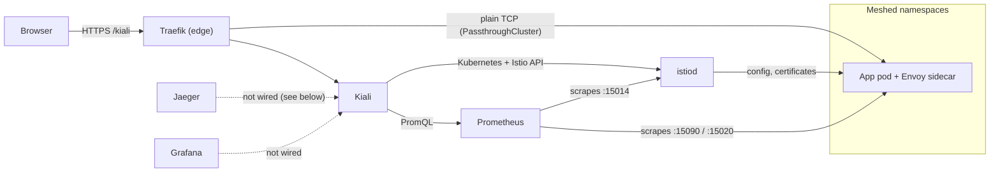

## Why we added a mesh, and why Kiali

Our Minikube cluster, mk4, runs this site, MOKS (our Python and React SRE agent), RoboShop AI, Argo CD, Harbor and the monitoring stack. We had metrics per application and logs in Loki, but no single picture of **who calls whom**. When a page was slow, we could see that the web pod was slow, but not whether the time went to Postgres, Redis or another service.

A service mesh fixes that. Every pod gets an Envoy sidecar that reports every request it sees, and Kiali turns those reports into a live graph. We also wanted mutual TLS (mTLS) between pods without changing application code.

This post covers what we built, what Kiali showed on day one (less than we hoped), the outage the rollout caused, and the checks we now run. All facts below were checked against our Git repositories and the running cluster on 8 November 2026.

## What Kiali is

Kiali is the observability console for Istio. It stores nothing of its own. It reads from four places:

- **Prometheus**, for the request and TCP metrics the sidecars emit (`istio_requests_total`, `istio_tcp_sent_bytes_total` and friends). The graph is built from these.
- **The Kubernetes API**, for namespaces, workloads, pods, labels and logs.
- **Istio configuration** (through istiod and the Istio CRDs), for validation and mTLS status.
- **A tracing backend** (Jaeger or Tempo), optionally, for traces on detail pages.



If Prometheus has no data, Kiali has no graph. That one sentence explains most of our troubleshooting.

## Our environment

| Item | Value |
| --- | --- |
| Cluster | Minikube profile `mk4`, Docker driver, containerd, 8 nodes, Kubernetes 1.37. Minikube version: [TODO: confirm] |
| Node size | Each node reports 16 CPUs and ~30 GiB, but all 8 share one host, so these numbers overlap |
| Edge | Traefik v3.7.14 (chart 42.0.0). A Kong Gateway migration is prepared on a branch but **not deployed** |
| Istio | 1.30.7, Helm charts `base`, `cni`, `istiod`, sidecar mode, no ingress gateway |
| Kiali | `kiali-server` Helm chart 2.34.0 in `istio-system`, token auth, view-only |
| Metrics | Our own Prometheus chart, `scrape_interval: 30s` |
| Tracing | Jaeger 2.x (in-memory), **not connected to Kiali** |
| Install | Terraform `helm_release` resources in our `miniKube` repository |

Two corrections to how we first described this setup. First, Kong does not front Kiali today; Traefik does. Second, these add-ons are **not** Argo CD Applications. They were, until 8 November, when we moved all thirteen cluster add-ons into Terraform so one plan shows the whole platform. Argo CD still deploys the applications, and Argo CD's own pods are in the mesh.

Meshed namespaces (label `istio-injection=enabled`): `jithendar`, `moks`, `roboshop-ai`, `argocd`, `harbor`, `monitoring`, `observability`, `cert-manager` and `traefik`. Every pod in those namespaces has a sidecar except one cert-manager webhook pod, which we exclude on purpose.

## How we implemented it

### 1. Istio: CRDs, CNI agent and istiod

Three Helm releases at the same version. The order matters: `base` (CRDs), then `cni`, then `istiod`.

```hcl
resource "helm_release" "istiod" {
  name       = "istiod"
  namespace  = "istio-system"
  repository = "https://istio-release.storage.googleapis.com/charts"
  chart      = "istiod"
  version    = "1.30.7"
  values     = [file("${local.minikube}/istio/istiod.yaml")]
  depends_on = [helm_release.istio_base, helm_release.istio_cni]
}
```

The istiod values carry most of the Minikube tuning:

```yaml
pilot:
  autoscaleEnabled: false
  replicaCount: 1
  resources:
    requests: {cpu: 100m, memory: 256Mi}
    limits: {memory: 1Gi}
  cni:
    enabled: true            # no istio-init container (see troubleshooting)
  env:
    ENABLE_NATIVE_SIDECARS: "true"
sidecarInjectorWebhook:
  neverInjectSelector:       # gVisor practice sandboxes must never get a sidecar
    - matchExpressions:
        - {key: app.kubernetes.io/name, operator: In, values: [practice-sandbox]}
global:
  proxy:
    resources:
      requests: {cpu: 20m, memory: 64Mi}
      limits: {memory: 256Mi}
meshConfig:
  defaultHttpRetryPolicy:
    attempts: 0              # mesh retries could replay a checkout; apps own idempotency
  defaultConfig:
    holdApplicationUntilProxyStarts: true
```

A single istiod replica is a trade-off. The injection webhook fails closed, so while istiod restarts, new pods in meshed namespaces wait.

### 2. Enabling injection

Injection is per namespace:

```bash
kubectl --context mk4 label namespace moks istio-injection=enabled
kubectl --context mk4 -n moks rollout restart deployment
```

Existing pods only get a sidecar when they restart. Check before you trust the graph:

```bash
kubectl --context mk4 get ns -L istio-injection
```

### 3. Prometheus, so Kiali has data

We do not run kube-prometheus-stack. Our Prometheus chart gained two scrape jobs, copied from Istio's sample add-on configuration:

```yaml
- job_name: istiod
  static_configs:
    - targets: ["istiod.istio-system.svc.cluster.local:15014"]
- job_name: envoy-stats
  metrics_path: /stats/prometheus
  kubernetes_sd_configs:
    - role: pod
  relabel_configs:
    - source_labels: [__meta_kubernetes_pod_container_port_name]
      action: keep
      regex: '.*-envoy-prom'
    - source_labels: [__meta_kubernetes_namespace]
      target_label: namespace
    - source_labels: [__meta_kubernetes_pod_name]
      target_label: pod
```

`envoy-stats` uses pod discovery, so the Prometheus ClusterRole needed `get`, `list` and `watch` on pods. Prometheus is meshed but its scrapes skip its own sidecar (`traffic.sidecar.istio.io/includeOutboundIPRanges: ""`), because it scrapes pod IPs directly.

### 4. Kiali values

```yaml
auth:
  strategy: token
deployment:
  view_only_mode: true
  resources:
    requests: {cpu: 10m, memory: 64Mi}
    limits: {memory: 512Mi}
external_services:
  prometheus:
    url: http://prometheus.monitoring.svc.cluster.local:9090/prometheus
  grafana:
    enabled: false
  tracing:
    enabled: false
login_token:
  signing_key: secret:kiali-signing-key:key
server:
  web_root: /kiali
  web_fqdn: jithendar.com
  web_schema: https
  web_port: "443"
```

Notes on each choice:

- **Prometheus URL** includes `/prometheus` because our Prometheus serves under that path prefix.
- **Grafana and tracing are off.** Our Grafana needs a login, and when we set this up we concluded Kiali's Jaeger client did not fit our Jaeger 2.x deployment. [TODO: confirm against the Kiali 2.34 tracing docs; Kiali documents Jaeger and Tempo support, so this may only need the right URL.]
- **The signing key** lives in a Secret that Terraform generates once and keeps in state. Left empty, the chart generated a new key on every upgrade and signed everyone out.

### 5. Auth and exposure

Kiali is public at `https://jithendar.com/kiali/` through a Traefik Ingress, set in the same values file with `deployment.ingress.override_yaml`. Because the path is public, we chose `token` auth and `view_only_mode`. Sign-in uses a short-lived ServiceAccount token:

```bash
kubectl --context mk4 -n istio-system create token kiali --duration=8h
```

View-only mode means nobody can change the mesh from the UI, even with a valid token. It also hides the traffic wizards (more below).

### 6. GitOps

The Kiali, Istio and Prometheus releases are Terraform resources in Git, checked by a pull-request workflow and applied by a workflow on push to `master`. That workflow exists but has not run on GitHub yet; so far we apply from a workstation. [TODO: confirm once the first CI apply succeeds.] We do not have an Argo CD Application for Kiali to show, because we deleted it in the move.

## Key features and what we use them for

### Traffic graph

Kiali draws four graph types: **app**, **versioned app**, **service** and **workload**. Display options add edge labels (request rate, response time, throughput, traffic distribution), a security badge (padlock) for mTLS edges, and traffic animation. We mostly use the workload graph, because our pods do not carry `version` labels, so the versioned-app graph adds nothing yet.

### Health

Each node gets a health colour based on request error rates and pod status. Kiali's thresholds are configurable (`health_config` in the Kiali configuration); we run the defaults. [TODO: confirm the default tolerances for Kiali 2.34 in the health docs before quoting numbers.]

### Applications, Workloads and Services pages

Each detail page shows inbound and outbound metrics, pod logs (including the `istio-proxy` container), Envoy details and Istio config that applies to it. The logs tab is the fastest way we know to see an Envoy `503 UF` next to the application's own error.

### Istio Config validation

Kiali validates VirtualService, DestinationRule, Gateway, PeerAuthentication, AuthorizationPolicy and Sidecar objects, and flags errors and warnings (for example, a DestinationRule whose host matches nothing). We currently have only PeerAuthentications in the `moks` namespace, so this page is quiet.

### mTLS status

The masthead shows mesh-wide mTLS status, namespaces show their own, and graph edges show a padlock when traffic used mTLS. Our MOKS namespace is STRICT with two ports left PERMISSIVE:

```yaml
apiVersion: security.istio.io/v1
kind: PeerAuthentication
metadata:
  name: moks-metrics
  namespace: moks
spec:
  selector:
    matchLabels:
      app: moks
  mtls:
    mode: STRICT
  portLevelMtls:
    "8080":
      mode: PERMISSIVE   # Traefik reaches the API in plaintext
    "9464":
      mode: PERMISSIVE   # Prometheus scrapes from outside its sidecar
```

### Tracing, wizards, and ambient mode

- **Tracing** on detail pages needs `external_services.tracing`; we have it off.
- **Wizards** (request routing, fault injection, traffic shifting, request timeouts) write VirtualServices and DestinationRules for you. They are hidden in view-only mode, which is what we want on a public URL. If you use them, review the generated YAML and commit it to Git, or your GitOps tool will revert or fight it.
- **Ambient mode** changes what Kiali shows (ztunnel and waypoint proxies instead of sidecars). We run sidecars only, so nothing in this post is tested on ambient.

## What Kiali actually showed us

On day one the graph was mostly Prometheus. In a 30-minute window on 8 November, almost every HTTP edge Prometheus held was Prometheus scraping a pod, with `connection_security_policy="unknown"` (its scrapes skip its sidecar). The one real mTLS edge was `moks-worker → prometheus`.

Traffic from Traefik shows as an `unknown` source or as PassthroughCluster. Traefik sends requests to pod IPs with the public `Host: jithendar.com`, so its sidecar cannot match a mesh service and passes the bytes through as plain TCP. We have not yet explained why the site's inbound requests from Traefik do not appear in `istio_requests_total` for the `jithendar` namespace. [TODO: confirm.]

That is the honest result: a mesh with an edge that is not really part of it.

## What to check in Kiali: an operational checklist

| Check | Where in Kiali | What "good" looks like | Red flag | Action |
| --- | --- | --- | --- | --- |
| Sidecars present | Workloads list, "Missing sidecar" badge | No badge in meshed namespaces | Badge on a workload in a labelled namespace | Restart the workload; check the injection label and `neverInjectSelector` |
| Unknown / PassthroughCluster | Graph, workload view | Few, explained nodes | New unknown sources, or app traffic to PassthroughCluster | Find the caller; check it is meshed and calls a Service name, not a pod IP |
| Error rate per edge | Graph edge labels, response-code split | 5xx near zero | Rising 5xx on one edge | Open the destination workload, check `istio-proxy` logs for flags like `UF`, `UH`, `NR` |
| Latency per edge | Graph edge labels (response time), workload metrics | Stable p95/p99 | p99 jump on one edge | Compare inbound vs outbound latency to find which hop added time |
| mTLS | Masthead, namespace overview, padlocks | STRICT where intended, padlocks on mesh edges | Plaintext edge between two meshed pods | Check PeerAuthentication and port-level overrides |
| Config validation | Istio Config list | No errors | Red or yellow validation icon | Read the message, fix in Git |
| Orphaned DR / VS | Istio Config, Services page | Every DR/VS has a live host | Host that matches no Service | Delete it in Git |
| app / version labels | Workloads, "Missing labels" | `app` (and `version` for canaries) set | Missing labels; workloads collapse oddly in the app graph | Add `app` and `version` labels to the pod template |
| Traffic split | Versioned app graph, traffic distribution labels | Percentages match the VirtualService weights | Split differs from intent | Check the VirtualService and that both versions are healthy |
| Throughput anomalies | Workload inbound/outbound metrics | Steady baseline | Sudden drop to zero or spike | Zero often means a broken scrape, not a quiet service; check Prometheus |
| Kiali's own health | Masthead warnings, About dialog | No warnings | Prometheus unreachable, istiod unreachable, version warning | Check the URL in `external_services`, istiod pods, compatibility table |

### Daily 5-minute check

1. Open the namespace overview: every meshed namespace healthy, mTLS as expected.
2. Workloads list: no "Missing sidecar" badges.
3. Workload graph, last hour: no new unknown or PassthroughCluster nodes.
4. Istio Config: no validation errors.
5. Masthead: no Prometheus or istiod warnings.

### During an incident

1. Start at the graph for the affected namespace, last 5 or 10 minutes, edge labels on response time and request rate.
2. Find the first red edge from the caller's side, then open the destination workload.
3. Read `istio-proxy` logs next to the application logs; the Envoy response flag tells you whether it was the app, a connection failure or no route.
4. If edges vanished rather than turned red, check Prometheus before the app. No data is not the same as no traffic.

## Troubleshooting: what we hit

**"Missing sidecar" everywhere.** Symptom: Kiali flagged every workload. Cause: no namespace had the injection label. Fix: label namespaces and restart deployments.

**Injected pods rejected in `moks`.** Symptom: pods never created after labelling. Cause: the `istio-init` container needs `NET_ADMIN` and `NET_RAW`, which Pod Security "baseline" forbids. A server-side dry run proved it. Fix: install the Istio CNI agent and set `pilot.cni.enabled: true`.

**Site outage (503).** Symptom: jithendar.com returned 503 shortly after the mesh rollout. Cause: a NetworkPolicy for sidecars allowed egress to istiod on 15012 but no DNS, and the Postgres and Redis pods had no DNS rule of their own. Their native sidecars could not resolve `istiod.istio-system.svc`, never became ready, so Postgres never started and the web pods failed their startup lock. Fix: add kube-dns egress on port 53 to the sidecar policy:

```yaml
egress:
  - to:
      - namespaceSelector:
          matchLabels:
            kubernetes.io/metadata.name: kube-system
        podSelector:
          matchLabels:
            k8s-app: kube-dns
    ports:
      - {port: 53, protocol: UDP}
      - {port: 53, protocol: TCP}
```

Lesson: with `holdApplicationUntilProxyStarts`, a sidecar that cannot reach istiod blocks the application completely.

**Traefik broke when meshed.** Symptom: edge connections failed after Traefik got a sidecar. Cause: our host HAProxy sends the PROXY protocol header, which Envoy does not expect. Fix: `traffic.sidecar.istio.io/includeInboundPorts: ""` on Traefik pods so inbound traffic bypasses Envoy.

**STRICT mTLS would block the site.** Cause: Traefik's outbound traffic is plaintext PassthroughCluster. Fix for now: PERMISSIVE on the ports Traefik and Prometheus use; STRICT PeerAuthentications for `jithendar` and `roboshop-ai` are written but not applied.

**Signed out after every Kiali upgrade.** Cause: an empty `login_token.signing_key` makes the chart generate a new one. Fix: a Terraform-generated Secret.

**Version skew.** Istio 1.30.7 does not list Kubernetes 1.37 as supported. It works for us today, but it is unsupported. We also have not confirmed Kiali 2.34 against Istio 1.30 in Kiali's compatibility table. [TODO: confirm.]

## Limitations and lessons learned

- **Kiali shows what Prometheus has.** Scrape interval (30s for us), dropped targets and sidecar bypasses all shape the graph.
- **A mesh with a non-mesh edge is half a mesh.** Until the edge proxy sends traffic to mesh Services (Istio calls this native load balancing in Traefik's case) or is replaced by a mesh-aware gateway, the edge hop is plaintext and anonymous.
- **Sidecars cost memory on a shared host.** Every pod now requests an extra 64Mi with a 256Mi limit. Across roughly 60 meshed pods, that adds up on eight nodes sharing one machine. [TODO: confirm measured usage with `kubectl top`.]
- **The mesh interacts with NetworkPolicy.** Our Minikube CNI (kindnet) enforces NetworkPolicy, so every new port (15012, 15020, 15090, DNS) has to be allowed explicitly.
- **Before EKS**, we would run istiod with two replicas, decide on ambient vs sidecar mode first, and put the edge inside the mesh from day one.

## What's next

1. Make the edge part of the mesh: either Traefik routing to Services with native load balancing, or the Kong migration with Kong meshed, then apply STRICT in `jithendar` and `roboshop-ai`.
2. Wire tracing: point `external_services.tracing` at Jaeger and confirm traces appear on workload pages.
3. Add `version` labels so the versioned-app graph and traffic-split checks become useful.
4. Run the Terraform apply workflow from CI instead of a workstation.
5. Move to an Istio release that supports Kubernetes 1.37, and check Kiali's compatibility table at the same time.
6. Measure sidecar CPU and memory and right-size the proxy requests.

## Summary

We installed Istio 1.30.7 and Kiali 2.34.0 with Helm through Terraform, fed Kiali from our own Prometheus, and exposed it read-only with token sign-in. Kiali immediately showed us which pods were not in the mesh and that our edge traffic was not really meshed. The rollout also caused a real outage, from a missing DNS rule. The checklist above is what we now look at daily and during incidents.

## References

- [Kiali documentation](https://kiali.io/docs/)
- [Kiali installation with Helm](https://kiali.io/docs/installation/installation-guide/)
- [Kiali authentication strategies](https://kiali.io/docs/configuration/authentication/)
- [Kiali Prometheus, Grafana and tracing configuration](https://kiali.io/docs/configuration/p8s-jaeger-grafana/)
- [Kiali health configuration](https://kiali.io/docs/configuration/health/)
- [Kiali features](https://kiali.io/docs/features/)
- [Kiali version compatibility](https://kiali.io/docs/installation/installation-guide/prerequisites/)
- [Istio installation with Helm](https://istio.io/latest/docs/setup/install/helm/)
- [Istio CNI node agent](https://istio.io/latest/docs/setup/additional-setup/cni/)
- [Istio sidecar injection](https://istio.io/latest/docs/setup/additional-setup/sidecar-injection/)
- [Istio PeerAuthentication](https://istio.io/latest/docs/reference/config/security/peer_authentication/)
- [Istio and Prometheus](https://istio.io/latest/docs/ops/integrations/prometheus/)
- [Istio supported releases](https://istio.io/latest/docs/releases/supported-releases/)
