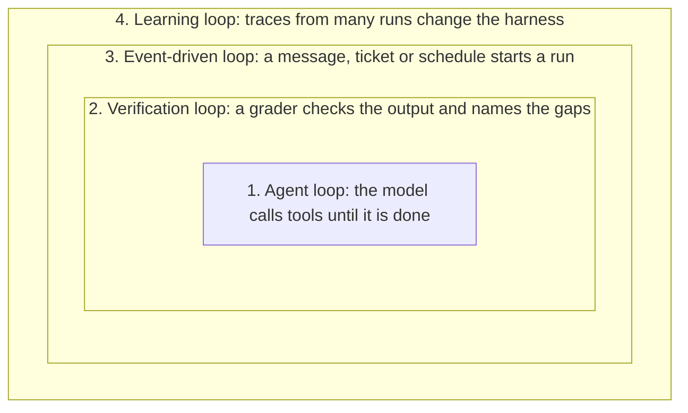

<Todo>Drafted 2026-11-21. Before publishing: (1) add your final lab and quiz scores, and what you changed between the 0/100 submission and the next one (the lab section stops at the first attempt); (2) name the exact setting the course uses for the cap on model turns (the article only says "a maximum number of model turns"); (3) the quiz scenarios are paraphrased on purpose, so check that each one still matches what you saw; (4) add a cover image (prompt and alt text in docs/knowledge-sharing/loop-engineering-deep-agents/README.md); (5) the "What I want to try next" list is a suggestion, so replace it with your real plans; (6) add your own commentary, confirm the AI-assistance line against the AI use policy, then set status and publishedAt.</Todo>

An agent can work in a demo and still disappoint in real use. It says "done" when the tests still fail, it retries a dead API until the budget runs out, or nobody opens the separate app it lives in. None of these are model problems. They are problems in what surrounds the model.

DeepLearning.AI's short course [**Loop Engineering with LangChain Deep Agents**](https://www.deeplearning.ai/short-courses/loop-engineering-with-langchain-deep-agents/) gives that surrounding part a name and a structure: four loops, each wrapped around the one before. This article covers the four loops, the ideas behind the seven quiz questions, and the graded coding lab, where my first submission scored 0 out of 100.

> This is an independent learning article. It is not official course material and is not endorsed by DeepLearning.AI or LangChain. Course facts come from the public course page; the quiz and lab are described in my own words.

## What the course covers

According to the [course page](https://www.deeplearning.ai/short-courses/loop-engineering-with-langchain-deep-agents/), the course:

- is built with **LangChain** and taught by **Sydney Runkle**, Product Manager at LangChain and a maintainer of Deep Agents, and **Esmaeil Gargari** of DeepLearning.AI;
- is an **intermediate** course of about **1 hour 16 minutes**: eight video lessons and four code examples, plus a graded coding lab and a graded quiz;
- recommends familiarity with Python;
- builds one example throughout: a **requirements-review agent** that reads a software specification and reports facts, ambiguities, assumptions and clarification questions.

The lessons are: Introduction, Overview of Loop Engineering, Deep Agent Primer, Agent Loop, Verification Loop, Event-Driven Loop, Learning Loop, the coding lab, the quiz and a conclusion.

## Where loop engineering fits

Agent work already has a few named areas. Prompt engineering is about the instructions sent to the model. Context engineering is about getting the right information to the model at the right time. Harness engineering is about what is built around the model, such as file systems and sandboxes.

Loop engineering is about **agents that improve over time because of the loops around them**. The first quiz idea is exactly this distinction: if an answer talks about instructions, information or sandboxes, it describes one of the other three.

## The four loops



| Loop | What it adds | What it costs |
| --- | --- | --- |
| Agent | The model calls tools, reads the results and decides what to do next | Can run forever without a cap on turns |
| Verification | A grader checks the output against a rubric and sends failures back | More latency and more tokens per run |
| Event-driven | Runs start from where work already happens: a chat message, a ticket, a schedule | A public endpoint to run and secure |
| Learning (hill-climbing) | An analyst reads traces from many runs and proposes changes to prompts, tools or graders | A review step before a change goes live |

The course page calls the fourth loop both "hill-climbing" and "learning loop". [LangChain's article on loop engineering](https://www.langchain.com/blog/the-art-of-loop-engineering) uses the first name and makes the nesting explicit: each loop wraps the ones inside it, and the outer loop is the only one that changes the inner loops.

## The four loops in plain Python

To check that I understood the structure and not just the library, I wrote all four loops in one file with no LLM and no dependencies. The "model" is a deterministic stand-in: it writes a requirements review that contains only the sections its instructions, or the grader's feedback, ask for. The full script is about 140 lines; the parts that matter are below. I ran it with Python 3.13.

### Loop 1: a cap on model turns

```python
def agent_loop(requirement, instructions, feedback=(), max_turns=6):
    wanted = [key for key in SECTIONS if any(key in text.lower() for text in [*instructions, *feedback])]
    use_glossary = any("glossary" in text.lower() for text in instructions)
    for turn in range(1, max_turns + 1):
        if use_glossary:  # a model that keeps choosing the same failing tool call
            try:
                flaky_api(requirement)
            except TimeoutError:
                continue
        draft = [f"Facts: {requirement}"] + [f"{SECTIONS[key]} ..." for key in wanted]
        return {"status": "done", "turns": turn, "output": "\n".join(draft)}
    return {"status": "max_turns_reached", "turns": max_turns, "output": ""}
```

When the tool always times out, the run ends with `max_turns_reached` after six turns instead of never ending. A better prompt or a stricter rubric would not have stopped it, because neither is consulted while the model is still retrying. MOKS has the same kind of guard: [its LangGraph agent](/blog/langchain-vs-langgraph-sre-agent-moks) runs under a recursion limit and a token budget.

### Loop 2: a grader that names each gap

```python
def vague_grader(output):
    ok = all(heading in output for heading in SECTIONS.values())
    return {"passed": ok, "gaps": [] if ok else ["needs improvement"]}


def rubric_grader(output):
    criteria = {key: heading in output for key, heading in SECTIONS.items()}
    gaps = [f"Missing section: {key}" for key, passed in criteria.items() if not passed]
    return {"passed": not gaps, "criteria": criteria, "gaps": gaps}
```

Both graders apply the same standard. Only the feedback differs, and so does the result:

```text
vague grader: max_iterations_reached after 3 iteration(s); first feedback: ['needs improvement']
rubric grader: satisfied after 2 iteration(s); first feedback: ['Missing section: assumptions', 'Missing section: questions']
```

With "needs improvement", the agent used all three attempts and never passed. With pass or fail per criterion and the gap named, it passed on the second attempt. Raising the retry limit on the vague grader would only have bought more identical failures.

In Deep Agents this loop is a middleware. The snippet below is adapted from the [RubricMiddleware documentation](https://docs.langchain.com/oss/python/deepagents/rubric), with the rubric changed to the requirements review. It needs `deepagents>=0.6.5`, and the docs mark the middleware as beta. Unlike the plain-Python script, I did not run this one for the article.

```python
from deepagents import RubricMiddleware, create_deep_agent
from langchain.messages import HumanMessage

agent = create_deep_agent(
    model="anthropic:claude-sonnet-5",
    middleware=[RubricMiddleware(model="anthropic:claude-haiku-4-5", max_iterations=3)],
)

result = agent.invoke({
    "messages": [HumanMessage("Review this requirement: Passwords must be secure.")],
    "rubric": (
        "- Every ambiguous term is listed\n"
        "- Every assumption is stated\n"
        "- There is at least one clarification question"
    ),
})
print(result.get("_rubric_status"))
```

Each grader pass gives a verdict for the rubric as a whole, and a pass or a named gap for each criterion; `needs_revision` sends the gaps back to the agent. The run ends as `satisfied`, `failed`, `grader_error` or `max_iterations_reached`, so check `_rubric_status` before trusting the output. The grader can also be given tools, which is how a coding agent's claim of "done" gets checked: the grader runs the test suite instead of reading the agent's summary.

### Loop 3: an event starts the loop you already have

```python
def on_ticket_changed(event, instructions):
    return {"ticket": event["ticket"], **verification_loop(event["text"], instructions)}
```

This is the whole event-driven loop in my script: a handler that turns an event into a run of the existing verification loop. Nothing inside is rebuilt and the grader stays.

Two practical points from the quiz belong here. First, an agent on a laptop has no address a project tracker can call, so a webhook needs a **tunnel** (ngrok and Cloudflare Tunnel are two examples) or a deployed endpoint. Second, this loop is what fixes adoption. A good agent that needs its own app, a paste in and a copy back gets used rarely. The same agent answering a mention in the team's chat tool gets used.

### Loop 4: an analyst over saved reviews

```python
def analyst(saved_reviews, min_runs=3):
    recurring = Counter(gap for review in saved_reviews for gap in review["gaps"])
    return [f"Always include a section for {gap.split(': ')[1]}." for gap, n in recurring.items() if n >= min_runs]
```

The analyst reads the graders' saved reviews, keeps the gaps that recur in at least three of five runs, and proposes one instruction per gap. The learning loop then writes first drafts for the same five requirements with the original and the proposed instructions, compares them criterion by criterion, and saves the decision:

```text
decision: update instructions
reason: 2 gap(s) recurred in at least 3 of 5 saved reviews
proposed_instructions: ['Always include a section for assumptions.', 'Always include a section for questions.']
outcome: First-draft checks went from 5/15 to 15/15
before: {'ambiguities': 5, 'assumptions': 0, 'questions': 0}
after:  {'ambiguities': 5, 'assumptions': 5, 'questions': 5}
```

The measure is **first-draft quality**, not final quality. The verification loop already gets every run to a pass in the end. What the learning loop changes is how often the first attempt passes, which is where the latency and tokens of loop 2 are saved. A toy model that obeys every instruction makes 5/15 to 15/15 look easy; with a real model the comparison is the part that matters, because a new instruction can make another criterion worse.

## The seven quiz ideas

The quiz has seven scenario questions. I have paraphrased them, because the idea behind each one is more useful than the answer.

| Scenario | Idea |
| --- | --- |
| What loop engineering is for | Agents that improve over time through the loops around them |
| A coding agent says "done" and nothing checks the tests | A verification loop: a grader scores the output and sends the gaps back |
| A grader says "needs improvement" and revisions barely change | Define pass or fail criteria and name each gap; more retries do not help |
| An agent retries a failing API call with no progress | A maximum number of model turns is the safety net |
| A tracker calls an agent on a laptop and the calls never arrive | A tunnel that gives the local agent a public address |
| A team wants its verified agent to run on a chat mention | Wrap the existing loop in an event trigger and keep the grader |
| A good review agent that nobody uses because it lives in another app | Connect it to the chat tool where the work already happens |

Most of the wrong options are a real technique applied to the wrong loop. A stricter rubric does not stop a runaway tool call. A stronger model does not give a laptop a public address. A grader does not make people open a separate app. Each question is really asking which loop the problem belongs to.

## The coding lab, and my 0 out of 100

The lab asks you to build an analyst over saved reviews, then save four things: your instruction decision, the reason, the comparison and an explanation of the outcome. It is scored out of 100: 30 for the analyst, 20 for the decision and explanation, and 50 for first-draft quality.

The comparison is on first drafts for the same five requirements, before and after your decision. A pass needs 70 points, all the required evidence, and a qualifying result: at least 12 of 15 checks, or three more checks than before, with no criterion getting worse. Keeping the original instructions is allowed, but only if the baseline is already at 12 of 15 and holds. Missing evidence caps the score at 69, so a good analyst alone cannot pass.

My first submission scored **0/100** in all three parts. I had asked the lab's built-in coding agent to build the analyst, and it did: the code compiled and passed a smoke test. It also reported that it could not run the full test suite because Flask and pytest were missing in the environment. I submitted anyway. The grader's message was the same in every section: no saved activity was found.

The agent wrote code and reported success. Nothing had run the analyst on the saved reviews, made the decision or saved the comparison, and I had not checked. That is the second quiz scenario, with me as the missing verification loop. The lab's grader then did what a rubric grader should do: it failed me on explicit criteria and named the gap, which was enough to know what to do next.

What I took from it:

1. **"Built" is not "ran".** Ask the agent to run the activity and show where each result was saved, not only to write it.
2. **Take the baseline first.** Without first-draft scores for the original instructions there is nothing to compare against.
3. **Make the decision a saved record**, with the reason and the per-criterion comparison next to it. An instruction change that lives only in a chat transcript cannot be reviewed.
4. **Check for a criterion that declined.** A higher total can hide one.

## What I want to try next

These are plans, not things I have done:

1. Add a rubric grader to one [MOKS](/projects/moks) investigation type and measure first-draft pass rate before changing any prompt.
2. Trigger a MOKS investigation from an alert webhook instead of a typed question.
3. Save grader reviews for every run, so an analyst has something to read.
4. Compare this with how [CrewAI handles guardrails and memory](/blog/multi-ai-agent-systems-with-crewai-course-notes), which solve part of the same problem inside one crew.

## Conclusion

The four loops are a way to place a problem. An agent that never stops needs a limit in loop 1. An agent that stops too early needs a grader in loop 2. An agent nobody uses needs a trigger in loop 3. An agent that makes the same mistake every week needs an analyst in loop 4. Changing the prompt is only one of the possible fixes, and it belongs to the last loop, after the traces say what to change.

## Frequently asked questions

### What is loop engineering?

Building agents that improve over time through the loops around the model: the agent loop, a verification loop, an event-driven loop and a learning (hill-climbing) loop. Each loop wraps the ones inside it.

### What is a verification loop?

A grader checks the agent's output against explicit criteria. If a criterion fails, the gap goes back to the agent as feedback and the agent tries again, up to a maximum number of iterations.

### Why does a vague grader not help?

Feedback such as "needs improvement" gives the agent nothing to change, so each revision is a guess. Pass or fail per criterion, with each gap named, tells the agent what to fix.

### What stops an agent that keeps retrying a failing tool?

A cap on the number of model turns. It ends the run when no progress is being made, whatever the prompt or the rubric says.

### What is RubricMiddleware in Deep Agents?

A middleware that adds an LLM-as-a-judge grader to a deep agent. You pass a rubric with the request, and the grader drives revisions until every criterion passes or `max_iterations` is reached. The documentation marks it as beta.

### Do I need LangChain to use these ideas?

No. The four loops are a structure, and the script in this article implements all of them in plain Python. Deep Agents gives you the grader, the file system and the skills ready-made.

*This article was drafted with AI assistance from the public course page, official documentation and my own quiz and lab attempts, and reviewed by the author before publication.*
