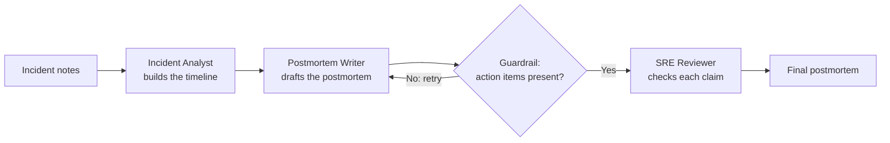

<Todo>Drafted by Claude on 2026-11-16 for your review. Before publishing: (1) the Python was written against the CrewAI 1.15 docs and only syntax-checked, not run: run docs/knowledge-sharing/crewai-multi-agent-course/examples/postmortem_crew.py once with your own model key; (2) the reason for taking the course in the intro, and the opinions under "Is the course worth your time?", are a starting point: make them yours; (3) CrewAI ships often, so open the docs pages in sources and confirm the defaults quoted here; (4) add a cover image (prompt and alt text in docs/knowledge-sharing/crewai-multi-agent-course/README.md); (5) set status and publishedAt.</Todo>

On 16 November 2026 I finished [Multi AI Agent Systems with crewAI](https://www.deeplearning.ai/short-courses/multi-ai-agent-systems-with-crewai/), a short course from DeepLearning.AI. The instructor is João Moura, the founder and CEO of CrewAI. It is a beginner course: about three hours, with 18 video lessons, 7 code examples and a graded quiz at the end. I passed the quiz, and [my accomplishment page is here](https://www.deeplearning.ai/accomplishments/510d886e-af8d-4c52-807e-16c51e73cf65?accomplishmentId=510d886e-af8d-4c52-807e-16c51e73cf65).

I already run CrewAI in two places. The AI workflows behind this site are [CrewAI Flows in a service called `seo-agent`](/blog/how-i-built-jithendar-com), and [MOKS](/projects/moks) has an [opt-in flow of three CrewAI agents](/blog/four-ai-systems-one-cluster). So I didn't take the course to learn the syntax. I wanted to check my own mental model against how the person who built the framework explains it.

These are my notes. The quiz has seven questions, and two of them ask the same thing, so it really covers six ideas. I'm not going to copy the questions or give the answers. They belong to the course, and the quiz is more useful if you take it cold. Instead I explain each idea in my own words, show how it looks in CrewAI code, and note what to check in the current CrewAI docs.

> This is an independent learning article. It is not official course material and is not endorsed by DeepLearning.AI or CrewAI. What I say about the course comes from its public course page and the quiz I took.

## What the course covers

The lessons build six crews, each for an everyday business job:

- researching, writing and editing a technical article
- answering customer support questions
- running a customer outreach campaign
- planning an event
- doing financial analysis
- tailoring a resume and preparing for an interview

Everything hangs off six things that make agents work well: role-playing, focus, tools, cooperation, guardrails and memory. That list comes back in idea 2.

## Idea 1: A multi-agent system is a team with one goal

A multi-agent system is a group of AI agents where each one has a defined role, and they work together on one complex job. They share information and hand work to each other.

It helps to say what it is not:

- It is not one agent with a long list of tools. That is still a single agent, and it has to be good at everything.
- It is not many copies of the same agent doing the same job in parallel. That gives you throughput, not teamwork.
- It is not several agents working alone on separate goals. With no communication between them, there is no system.

The two words that matter are **roles** and **together**.

In CrewAI the building blocks are an `Agent` (who does the work), a `Task` (what the work is) and a `Crew` (the team, and how it runs). I'll use one small example for the rest of this post: a crew that turns raw incident notes into a blameless postmortem.



Here are its three agents.

```python
from typing import Any, Tuple

from crewai import Agent, Crew, Process, Task, TaskOutput

analyst = Agent(
    role="Incident Analyst",
    goal="Turn raw incident notes into an accurate timeline and a probable root cause",
    backstory="You are an SRE who only states what the notes support.",
)
writer = Agent(
    role="Postmortem Writer",
    goal="Write a blameless postmortem that an engineer can read in five minutes",
    backstory="You write for busy on-call engineers, in short sentences.",
)
reviewer = Agent(
    role="SRE Reviewer",
    goal="Catch claims in the postmortem that the timeline does not support",
    backstory="You are the sceptical senior engineer in every incident review.",
    allow_delegation=True,
)
```

## Idea 2: Six things make an agent effective

This is the list the whole course is built on. Here is each one, with the CrewAI setting that goes with it.

| Component | What it means | In CrewAI |
| --- | --- | --- |
| Role-playing | Each agent gets a specific role, goal and backstory | `role`, `goal` and `backstory`, all required on every `Agent` |
| Focus | Each agent has one job, one goal and only the tools that job needs | Narrow goals, short tool lists, more agents instead of bigger ones |
| Tools | Agents get ways to act: web search, file readers, your own functions | `tools` on an agent, or on a task to limit the agent to those tools for that task |
| Cooperation | Agents work in series, in parallel or under a manager | The crew's `process`, plus `context` and `async_execution` on tasks |
| Guardrails | Errors, hallucinations and endless loops are caught before a user sees them | Task guardrails, and an iteration limit on agents (`max_iter`, 20 by default) |
| Memory | Agents remember, inside one run and across runs | `memory=True` on the crew |

The list also works as a debugging checklist. When a crew misbehaves, ask which of the six is weak before you touch the prompt.

## Idea 3: Collaboration and delegation improve quality and speed

Three things happen when specialised agents work as a team:

1. **Work is shared.** Each part goes to the agent best suited to it.
2. **Work runs in parallel.** Tasks that don't depend on each other don't wait for each other.
3. **Work is reviewed.** One agent checks another's output before it goes out.

Sharing and review are in the example further down: every task has its own agent, and the last task belongs to the reviewer.

Parallel work needs two settings. Put `async_execution=True` on the tasks that can run at the same time. Then list those tasks in the `context` of the task that needs their results, and it waits for all of them.

Delegation is a separate switch. With `allow_delegation=True`, an agent can hand work to the other agents in the crew, or ask them questions. I gave it only to the reviewer, so it can send a weak section back instead of quietly rewriting it.

If you want a manager on top, use `Process.hierarchical`. A manager agent then plans, delegates and validates the work, and you must give the crew either a `manager_llm` or a `manager_agent`.

## Idea 4: Role-playing keeps each agent in its lane

Role-playing does two jobs.

First, it sets scope. An agent that knows it is the reviewer doesn't start building a new timeline. A clear role tells the agent what its job is and, just as usefully, what its job is not. This is how role-playing supports focus.

Second, it sets quality. A goal and a backstory give the model a point of view, so its answers fit the situation better. "You write for busy on-call engineers" changes the output more than "write well" does.

A rule that follows from this: if you can't describe an agent's role in one line, it is probably two agents.

## Idea 5: Memory is how a crew improves over time

Memory helps in two ways:

- **Continuity.** An agent keeps the context from earlier steps instead of starting from zero each time.
- **Learning.** The crew remembers what happened in past runs and uses it in the next one. This is what makes results better and more reliable over time, not just consistent inside one run.

The course page describes memory as short-term, long-term and shared. The current CrewAI docs describe one `Memory` class that replaces the separate short-term, long-term, entity and external memory types. Turning it on is still one argument: `memory=True` on the `Crew`.

According to the docs, that argument does two things. After each task, the crew pulls discrete facts out of the output and stores them. Before each task, the agent recalls the relevant ones, and they are added to its prompt. Recall is ranked by a mix of semantic similarity, recency and importance (the default weights are 0.5, 0.3 and 0.2).

Two things to know before you turn it on in a real system:

- **It calls an embedding API.** The default embedder is OpenAI's `text-embedding-3-large`, which needs an `OPENAI_API_KEY`. If your incident notes are sensitive, configure a different embedder first.
- **It writes to disk.** The default store is LanceDB under `./.crewai/memory`, and you can move it with `CREWAI_STORAGE_DIR`. In a container, that path needs a volume, or the crew forgets everything when the pod restarts.

The first point is why memory is off in MOKS. Its CrewAI flow runs with memory, knowledge and planning disabled, [because each one would call its own provider](/blog/four-ai-systems-one-cluster).

## Idea 6: A task says what to do and what done looks like

A task is a description of the objective plus the expected output. Both fields are required in CrewAI.

It is tempting to give tasks more jobs than that, such as deciding the order of work or how agents talk to each other. Those belong elsewhere. The order comes from the crew's process: sequential runs the tasks in the order you list them, and hierarchical lets a manager hand them out.

The expected output deserves the most care. Compare "a postmortem" with "Markdown with: Summary, Impact, Timeline, Root cause, Action items". The second one can be checked, by a person or by a guardrail.

```python
def has_action_items(result: TaskOutput) -> Tuple[bool, Any]:
    """Reject a postmortem that has no action items section."""
    if "action items" not in result.raw.lower():
        return (False, "Add an 'Action items' section with at least one item.")
    return (True, result.raw)


build_timeline = Task(
    description="Build a timeline from these incident notes:\n\n{incident_notes}",
    expected_output="Events in time order with evidence, then one probable root cause.",
    agent=analyst,
)
write_postmortem = Task(
    description="Write a blameless postmortem from the timeline.",
    expected_output="Markdown with: Summary, Impact, Timeline, Root cause, Action items.",
    agent=writer,
    context=[build_timeline],
    guardrail=has_action_items,
)
review_postmortem = Task(
    description="Compare the postmortem with the timeline. Fix any unsupported claim.",
    expected_output="The corrected postmortem, then a short list of what you changed.",
    agent=reviewer,
    context=[build_timeline, write_postmortem],
)
```

The guardrail is a plain function. It receives the task output and returns either `(True, result)` or `(False, message)`. On a failure, the message goes back to the agent, which tries again, up to `guardrail_max_retries` times (3 by default). You can also pass a plain-English sentence instead of a function, and CrewAI checks the output with the agent's LLM.

## The crew, assembled

```python
crew = Crew(
    agents=[analyst, writer, reviewer],
    tasks=[build_timeline, write_postmortem, review_postmortem],
    process=Process.sequential,
    verbose=True,
)

with open("incident-notes.txt") as f:
    result = crew.kickoff(inputs={"incident_notes": f.read()})

print(result.raw)
```

The value you pass in `inputs` fills the `{incident_notes}` placeholder in the first task. From there the analyst builds the timeline, the writer drafts from it, the guardrail checks the draft, and the reviewer compares the draft with the timeline.

## What to check in the current docs

CrewAI moves fast. If you learn from a course, or from any tutorial more than a few months old, check the current docs before you copy code. I used the 1.15 docs for this post. Besides the memory change above, four things stand out:

1. **Delegation is off by default.** The current docs list `allow_delegation` as `False`. Older docs listed `True`. Set it explicitly so your crew behaves the same on any version.
2. **New projects are config-first.** `crewai create crew` now generates a `crew.jsonc` file and one file per agent under `agents/`. The YAML layout with `@CrewBase` is still supported through the `--classic` flag, and plain Python like the code in this post still works.
3. **Flows exist.** They are for when you want explicit steps, state and resumable runs around your crews. The AI workflows on this site are built that way: [Flows orchestrate, crews do the reasoning, and plain Python does the data work](/blog/how-i-built-jithendar-com).
4. **Telemetry is on by default.** CrewAI sends anonymous usage data. The docs say it carries no prompts, task descriptions or outputs, but it does include agent role names and tool names. Set `CREWAI_DISABLE_TELEMETRY=true` to turn it off, which is what MOKS does.

## Is the course worth your time?

If you are new to agents, yes. In about three hours you get a working vocabulary and code examples you can run.

If you already run agents, the value is the six-part list more than the code. It gives a team a shared way to talk about why a crew is failing.

The lesson list has nothing on deployment or observability. For that, DeepLearning.AI has a longer course from the same instructor, [Design, Develop, and Deploy Multi-Agent Systems with CrewAI](https://www.deeplearning.ai/courses/design-develop-and-deploy-multi-agent-systems-with-crewai), which covers Flows, guardrails, tracing and observability.

## Check yourself

These six questions are mine, not the course's. Cover the answers and try them.

1. **One agent has twelve tools. Is that a multi-agent system?** No. It is a single agent, however many tools it has. A multi-agent system needs several agents, each with a role, working toward one goal.
2. **Your writer agent keeps doing its own research. Which of the six do you look at first?** Role-playing and focus. Tighten its role and goal, and remove tools it doesn't need.
3. **Two tasks don't depend on each other. How do you run them at the same time?** Set `async_execution=True` on both, and list both in the `context` of the task that needs their results.
4. **Where does the order of work come from?** From the crew's process, not from the tasks.
5. **Which two fields must every task have?** `description` and `expected_output`.
6. **With default settings, what does `memory=True` need from outside your machine?** An OpenAI API key for embeddings, unless you configure another embedder.
