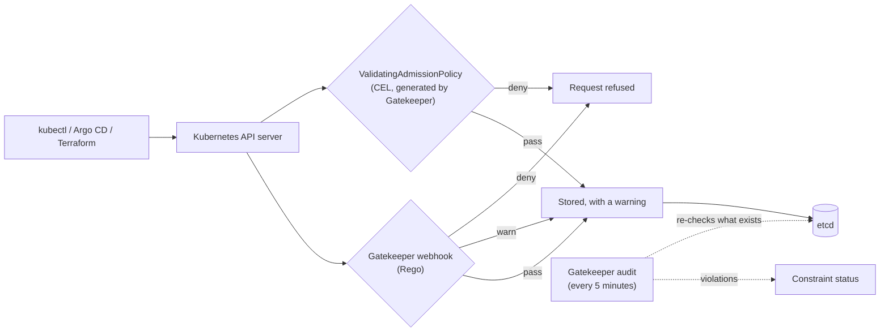

jithendar.com doesn't run alone. Its pods share a four-node k3s cluster on Hetzner Cloud (one control-plane node and three workers), which I call **mk4**, with MOKS (my SRE agent), RoboShop AI, Argo CD, Harbor, a shared PostgreSQL cluster, Valkey and the monitoring stack. Manifests reach that cluster from Terraform, Argo CD and my own `kubectl`. Until this week, Kubernetes accepted any of them as long as the YAML was valid and the identity had permission.

That's a weak guarantee. One manifest with `privileged: true` or a `hostPath: /` mount, from any of those apps, would give a container root on a node. That node might be the one serving this site or holding its database. So I installed **OPA Gatekeeper** and turned on a first set of policies.

This post explains what Gatekeeper is, the six policies now active, how I chose between blocking and warning, what the first audit found, and what I want to tighten next. Everything below was checked against my repositories and the running cluster on 14 November 2026.

## What OPA Gatekeeper is

**Open Policy Agent (OPA)** is a general-purpose policy engine: you describe rules as code, and OPA answers "allowed or not?" for any JSON input. **Gatekeeper** is the Kubernetes integration of OPA. It plugs into the API server as an *admission controller*. Every create or update request is checked against your policies before the object is stored.

Gatekeeper does two jobs:

1. **Admission.** It checks requests as they arrive. A violating request is refused (`deny`), or it is admitted with a warning (`warn`).
2. **Audit.** It re-checks everything that already exists, on a timer. Each policy's status then lists what violates it today, including objects created before the policy existed.

Policies come in two parts, and the split is the key idea:

- A **ConstraintTemplate** holds the logic, written in Rego (OPA's language) and, in newer templates, also in CEL. Example: "a container must not be privileged".
- A **Constraint** is one use of that template: which resources it matches, which namespaces it skips, its parameters, and its `enforcementAction` (`deny`, `warn` or `dryrun`).

You write or borrow the logic once, then decide per constraint how strict to be and where. Most of the logic you need already exists in the official [gatekeeper-library](https://github.com/open-policy-agent/gatekeeper-library), with tests.



### Why Gatekeeper, and not just Pod Security Admission?

Kubernetes has a built-in **Pod Security Admission** controller. It enforces the three Pod Security Standards (privileged, baseline, restricted) with a label on each namespace. It's a good baseline, but it's fixed: you can't add rules like "no `:latest` images" or "every container needs a memory limit". You also can't exempt one namespace from one rule while keeping the others.

Gatekeeper covers the pod-security rules and anything else you can express. Exceptions are per rule, and the audit report shows what already breaks each one. On a cluster that runs many unrelated apps, that per-rule control is the point.

## How it's installed: three Helm releases in Terraform

All add-ons on mk4 are Terraform `helm_release` resources, one file per add-on, in my `kubernetes` repository (formerly `miniKube`, so the folder names still say minikube). Gatekeeper follows the same pattern in `minikube-infrastructure/gatekeeper.tf`:

| Release | Chart | What it holds |
|---|---|---|
| `gatekeeper` | open-policy-agent `gatekeeper` 3.23.1 | The webhook (2 replicas) and the audit controller |
| `gatekeeper-library` | local chart | Six ConstraintTemplates, copied unchanged from gatekeeper-library and pinned to one commit |
| `gatekeeper-constraints` | local chart | The constraints: what is enforced, and where |

```hcl
resource "helm_release" "gatekeeper" {
  name             = "gatekeeper"
  namespace        = "gatekeeper-system"
  create_namespace = true
  repository       = "https://open-policy-agent.github.io/gatekeeper/charts"
  chart            = "gatekeeper"
  version          = "3.23.1"
  values           = [file("${local.minikube}/gatekeeper/values.yaml")]
  wait             = true
  timeout          = var.helm_timeout
}
```

A few choices in the values file were deliberate:

- **2 replicas, not the default 3, with 256 MiB memory requests.** The workers' memory is about 80% requested, and the defaults would have reserved roughly 2 GiB.
- **Mutation disabled.** I only validate, so the mutating webhook isn't installed at all.
- **The webhook fails open** (`failurePolicy: Ignore`, 3-second timeout). If Gatekeeper's pods are down, I'd rather admit a deployment and catch it in the next audit than block every rollout on the cluster.

### The one trap: constraints before their kinds exist

When you apply a ConstraintTemplate, Gatekeeper creates a new CRD for it, such as `K8sPSPPrivilegedContainer`. It does this a few seconds *later*, asynchronously. If the constraints are installed right after the templates, Helm fails with `no matches for kind`. Helm's `wait` can't help, because it doesn't know about that CRD.

So templates and constraints are separate releases, with a deliberate pause between them:

```hcl
resource "time_sleep" "gatekeeper_constraint_kinds" {
  create_duration = "30s"
  triggers = {
    library = helm_release.gatekeeper_library.metadata.revision
  }
}
```

The trigger makes Terraform pause again whenever the library changes, because a new template means a new kind.

The templates contain Rego with curly braces, which Helm would try to evaluate as template syntax. So the library chart loads each file verbatim with `{{ .Files.Get "library/<file>.yaml" }}` and never templates the Rego.

## The six policies running on mk4

Every constraint matches **Pods** in every namespace except `kube-system` (the cluster's own components) and `gatekeeper-system`.

| Constraint | What it stops | Action |
|---|---|---|
| `disallow-privileged-containers` | `securityContext.privileged: true` | **deny** |
| `disallow-host-namespaces` | `hostPID` and `hostIPC` | **deny** |
| `disallow-host-network-and-ports` | `hostNetwork` and any `hostPort` | **deny** |
| `disallow-hostpath-volumes` | `hostPath` volumes (also skips `istio-system`, `system-upgrade`, `local-path-storage`) | **deny** |
| `disallow-latest-image-tag` | images tagged `:latest` or with no tag | warn |
| `require-memory-limits` | containers without a memory limit | warn |

The first four are the classic **container escape routes**. A privileged container, the host's process or IPC namespace, the host's network or the host's filesystem each turn "I compromised one pod" into "I own the node". None of my applications needs them, so they're refused outright.

The `hostPath` rule has three extra exceptions, each for a real reason:

- **istio-cni** installs its network plugin on every node.
- The **k3s system-upgrade** jobs replace the k3s binary on the host.
- **local-path-provisioner** creates volume directories on the node through short-lived helper pods.

The last two policies are about **operability** more than security, and they only warn for now. The next sections explain why.

### How I chose deny or warn

Turning on `deny` for a rule that running workloads already break is how you cause your own outage. The next rollout of an affected Deployment simply stops creating pods. So before writing any constraint, I scanned every running pod on the cluster for each rule:

- **The four escape-route rules:** the only violations were in `kube-system`. That's hcloud-csi running privileged, plus k3s's service load balancer and CoreDNS on the host network. With `kube-system` excluded there was nothing left, so those four went straight to `deny`.
- **`:latest` tags:** every application image in `jithendar`, `moks` and `roboshop-ai`.
- **Missing memory limits:** several system add-ons.

Denying those last two would have broken real deployments, so they warn. `warn` admits the pod, `kubectl` and Argo CD show the warning, and the audit keeps a list. Once the list is empty, the rule can move to `deny` with no surprises.

### Two enforcement paths, one surprise

When I tested the policies with server-side dry runs, the refusals didn't come from Gatekeeper's webhook:

```text
$ kubectl apply --dry-run=server -f privileged-pod.yaml
The pods "gk-test" is invalid: : ValidatingAdmissionPolicy 'gatekeeper-k8spspprivilegedcontainer'
with binding 'gatekeeper-k8spspprivilegedcontainer-disallow-privileged-containers' denied request:
Privileged container is not allowed: c, securityContext.privileged: true

$ kubectl apply --dry-run=server -f latest-pod.yaml
Warning: [require-memory-limits] container <c> does not have <{"memory"}> limits defined
Warning: [disallow-latest-image-tag] container <c> uses a disallowed tag <busybox:latest>; disallowed tags are ["latest"]
pod/gk-test created (server dry run)
```

The four pod-security templates contain **CEL** code next to the Rego. For those, Gatekeeper 3.23 generates a native Kubernetes **ValidatingAdmissionPolicy** and binding. The API server then evaluates them itself, without calling Gatekeeper. Two practical consequences:

- **The deny rules keep working even if Gatekeeper's pods are down.** The webhook's fail-open setting only covers the two Rego-only rules (tags and memory limits).
- **Namespace exclusions still apply.** The binding carries the constraint's `excludedNamespaces`. I confirmed that a privileged pod in `kube-system` and a `hostPath` pod in `istio-system` are still admitted.

I've written both paths into the repository's README, because "the webhook fails open" alone would have been a misleading summary.

## What the first audit found

About five minutes after the install, the audit had run across the whole cluster:

```text
$ kubectl get constraints -o custom-columns=NAME:.metadata.name,ACTION:.spec.enforcementAction,VIOLATIONS:.status.totalViolations
NAME                              ACTION   VIOLATIONS
disallow-latest-image-tag         warn     34
disallow-hostpath-volumes         deny     0
disallow-host-namespaces          deny     0
disallow-host-network-and-ports   deny     0
disallow-privileged-containers    deny     0
require-memory-limits             warn     11
```

**Zero** for the four escape routes: the exclusions are tight and nothing slipped through. The other two numbers are my to-do list:

- **34 containers on `:latest`.** 10 of them are in the `jithendar` namespace: this site, the SEO agent and its scheduled jobs. The rest belong to MOKS and RoboShop AI. All come from my own registry, `registry.jithendar.com`.
- **11 containers without a memory limit.** They're spread over Argo CD's ApplicationSet controller, the Barman Cloud backup plugin, istio-cni on each node, Grafana, the PgBouncer pods in front of PostgreSQL, Kafka and the k3s upgrade controller. Some are init or sidecar containers that a quick look at the main containers would miss. Audit catches those.

`kubectl describe` on a constraint lists each violating pod and the exact message. That makes it a precise work queue rather than a vague "we should add limits sometime".

## Why this matters for jithendar.com

Gatekeeper protects the whole cluster, but several benefits land directly on this site.

### A shared node is a shared risk

The site's pods, its PostgreSQL database and its Valkey cache run on the same four nodes as everything else. If any app on the cluster gained node access, it would have access to this site too. A careless chart value from someone else's Helm repository, a compromised CI token or a buggy agent would all do it. The four `deny` rules close the most common way to turn a container into node access, whichever app the manifest comes from.

### Untrusted code is part of the plan

jithendar.com has a [Python practice](/python-practice) feature. Its executor is designed to run each visitor's submission as its own short-lived pod, under gVisor, in the `jithendar` namespace. Today the sandbox isn't live on mk4. The dispatcher's service account can't create pods yet, and the `gvisor-nonet` RuntimeClass doesn't exist on the cluster.

When I switch it on, that dispatcher will hold permission to create pods in the same namespace as the site. RBAC can say *who* may create pods. It can't say *what kind* of pods. Gatekeeper can: even a dispatcher compromised through a malicious submission couldn't launch a privileged or host-mounted pod. Of everything here, that's the guardrail I care about most.

### Rollbacks I can trust

`:latest` makes a deployment non-reproducible. The same manifest can mean a different image tomorrow, and Argo CD can't tell anything changed. Rolling back means "whatever `latest` was", which may not be what was running. The warning is a nudge toward immutable tags (the Git commit SHA), so every version of jithendar.com that ever ran can be redeployed exactly.

### Memory limits protect the site's neighbours, and the site

The cluster's memory is about 80% requested. A container without a limit can grow until the node runs out, and then the kernel's OOM killer picks victims, possibly the site's web pods. I've seen this pattern before: self-hosted CI runners on the old Minikube host froze it twice by competing with the cluster for memory. A limit on every container makes failures local to the misbehaving pod.

### Policy is code, reviewed like code

The policies live in Git, are installed by Terraform, are linted and rendered in CI, and have a `terraform test` that pins the versions. Changing a rule means a pull request with a diff, not a `kubectl edit` someone forgets. The audit doubles as a continuous inventory: at any moment, `kubectl get constraints` says how far the cluster is from its own rules.

## How I plan to improve it

This is a first layer, not the finished design. Here's the roadmap, roughly in order.

### 1. Turn the two warnings into denials

- **`:latest`:** have the jithendar.com, MOKS and RoboShop pipelines push an image tagged with the Git SHA, and deploy that tag. Then set `disallow-latest-image-tag` to `deny`.
- **Memory limits:** add limits to the eleven containers in their Helm values, then set `require-memory-limits` to `deny`.

### 2. Catch violations in the pull request, not at deploy time

The constraints match Pods, so a bad Deployment is accepted and its ReplicaSet then fails quietly to create pods. Two fixes:

- **Shift left with `gator`.** Gatekeeper's CLI runs the same templates and constraints against rendered manifests. A `gator verify` step in each repository's CI would fail the PR before Argo CD ever syncs it.
- **Expansion templates.** Gatekeeper can evaluate a Deployment, StatefulSet or CronJob *as the pods it will create*. That rejects the workload at `kubectl apply` time with a clear error.

### 3. Move toward the "restricted" pod standard

Today's rules cover the Pod Security *baseline*. The *restricted* standard adds:

- `allowPrivilegeEscalation: false`
- dropping all Linux capabilities
- `runAsNonRoot`
- a `RuntimeDefault` seccomp profile

The library has a template for each. They'd start in `warn` per namespace, with jithendar.com first. Its pods don't set `runAsNonRoot` yet.

### 4. Trust only my registries

An `allowed-repos` policy would reject images from anywhere except `registry.jithendar.com`, plus an explicit list of upstream registries for the add-ons. That turns a typo-squatted image name into a refused request instead of a running container.

### 5. A dedicated policy for the practice sandbox

Before the executor goes live, add a constraint just for sandbox pods. They'd be selected by label, and they must:

- use the `gvisor-nonet` RuntimeClass
- not mount a service account token
- run as non-root with a read-only root filesystem

The executor's code already builds pods like that. A policy makes it a rule the cluster enforces, not a habit of the code.

### 6. See violations in Grafana

Gatekeeper exports Prometheus metrics: violations per constraint, admission latency and denied requests. Scraping them into the existing Prometheus and adding a Grafana panel would show the to-do list shrinking. An alert on a new `deny` would mean someone tried something they shouldn't.

## How to check it yourself

If you run Gatekeeper, these are the commands I use most:

```bash
kubectl get constraints                       # action and violation count per constraint
kubectl get constrainttemplates               # each template and whether its kind was created
kubectl describe k8sdisallowedtags disallow-latest-image-tag   # the violating pods, with messages
kubectl get validatingadmissionpolicy         # the CEL policies Gatekeeper generated
kubectl -n gatekeeper-system logs deploy/gatekeeper-controller-manager | grep denied
```

To test a policy without creating anything, use `kubectl apply --dry-run=server -f pod.yaml`. The request goes through admission exactly as a real one would.

## Takeaways

- **Gatekeeper splits policy logic from policy use.** Borrow the logic from gatekeeper-library and spend your effort deciding where and how strictly to apply it.
- **Scan before you deny.** Measure what already breaks each rule. Deny where the answer is zero, warn where it isn't, and let the audit tell you when to tighten.
- **Know your enforcement path.** On recent versions, CEL-based templates are enforced by the API server through ValidatingAdmissionPolicy. They behave differently from the webhook when Gatekeeper is down.
- **On a shared cluster, policy protects every tenant from every other tenant.** For jithendar.com, that means its pods, its database and the code-execution sandbox to come.

The first audit gave me a list of 45 things to fix and zero escape routes. That's a good place to start from.
