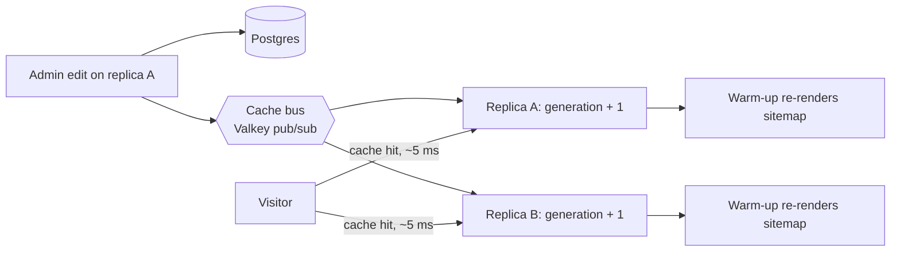
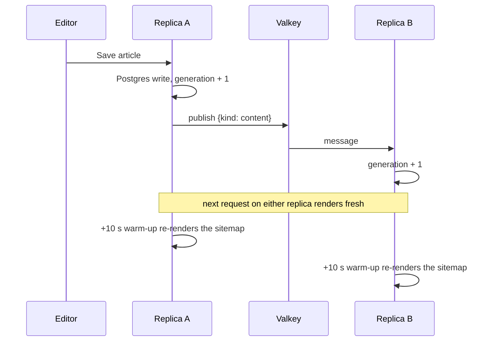

<Todo>Written on 2026-11-11 for the change in the pull request "SSG + ISR for public pages" (docs/PROGRESS.md, "SSG + ISR for public pages"). The "after" numbers were measured on a production build running locally against PostgreSQL 18, not on the live site. Before publishing: (1) deploy the change and re-measure TTFB on jithendar.com (the table below has a row for it), replacing or confirming the local numbers; (2) choose the category (devops-sre is a placeholder; no web-development category exists); (3) check the two diagrams in light and dark mode; (4) add your own commentary, confirm the AI-assistance line against the AI use policy, then set status and publishedAt.</Todo>

Every page on this site used to be built from scratch for every visitor. A request for an article went to Postgres, compiled the MDX, rendered React to HTML and sent it back. That took about half a second for an article and a full second for the homepage. Nothing on those pages changes between visitors.

This article explains the two Next.js techniques that fix that, **SSG** and **ISR**, how I moved jithendar.com onto them, and the one problem that made the default setup unusable here: the site runs on more than one server.

## SSG, ISR and dynamic rendering in one table

**SSG (Static Site Generation)** builds a page into HTML once, when you run `next build`. After that the server hands out the finished file: no database, no rendering, nothing per visitor. The catch is that the content is frozen at build time.

**ISR (Incremental Static Regeneration)** keeps the speed of SSG but removes the freeze. A page is served from a cache, and Next.js rebuilds it in the background after a set time, or immediately when you tell it the data changed. Each page refreshes on its own, without rebuilding the site.

**Dynamic rendering** is the opposite: the page is built on every request.

| Mode | When the HTML is made | Speed | New content appears |
|---|---|---|---|
| SSG | Once, at build time | Fastest | After the next build |
| ISR | Once, then again in the background or on change | As fast as SSG for visitors | Within minutes, or at once on change |
| Dynamic | On every request | Database + render each time | Immediately |

A blog is the textbook case for ISR: pages change rarely, are read often, and must update quickly when they do.

## How the site ended up fully dynamic

The original plan for jithendar.com said "static-first rendering (SSG + ISR)". The docs still say article pages "revalidate every 5 minutes". The code disagreed: 36 routes carried this line.

```ts
export const dynamic = "force-dynamic";
```

That happened when articles moved from MDX files into Postgres so they could be edited in the admin. Per-request rendering is the easy way to make an edit visible at once. But there was a second, quieter cause. The root layout read a cookie on every request, to check whether an admin was previewing a new theme:

```ts
const token = (await cookies()).get(PREVIEW_COOKIE)?.value;
```

In the Next.js App Router, reading `cookies()` or `headers()` during render makes the page dynamic. Because it was in the **root layout**, it made **every** page dynamic. Removing `force-dynamic` alone would have changed nothing.

The cost was visible in the response headers, `Cache-Control: private, no-store` on every page, and in the server time:
rendering an article from Postgres took about 0.49 s on a production build, for every request. (Times measured from a
distant client add the network on top; the comparison that matters is the server's own work.)

## The obstacle: two replicas and Next's default cache

ISR in Next.js is mostly a one-line change: `export const revalidate = 300` on a route. When content changes, you call `revalidatePath()` and the cached page is dropped.

That works on one server. jithendar.com runs two replicas behind Istio, and **Next's default cache is per process**. An edit saved on replica A would clear A's cache, while replica B kept serving the old page until its timer ran out. The Next.js self-hosting docs say the same: with several instances, on-demand revalidation only reaches the instance that received the call.

The site already had half the answer. A **cache bus** sends `{kind, origin}` messages between replicas over Valkey pub/sub when content changes, so each replica can clear its in-process caches. The missing half: when a bus message arrives, there is no request in progress, and Next refuses to revalidate outside one:

```text
Error: Invariant: static generation store missing in revalidatePath("/")
```

So the cache had to be one I could clear from anywhere.

## The design



Four pieces:

1. **A custom ISR cache handler** that keeps pages in memory and can be cleared with one counter.
2. **Routes switched to ISR**, with the cookie read removed from the root layout.
3. **The cache bus** clears the cache on every replica.
4. **A warm-up** that renders every page right after start-up and after each change. That is the "SSG" part.

### 1. A cache handler with a generation counter

Next.js lets you replace its ISR store through `cacheHandler` in `next.config.ts`. Setting `cacheMaxMemorySize: 0` turns off Next's own memory layer, so this handler is the only one:

```ts
// next.config.ts
cacheHandler: path.join(siteRoot, "cache-handler.mjs"),
cacheMaxMemorySize: 0,
```

The idea is a **generation number**. Every cached page remembers the generation it was rendered in. Clearing the whole cache means adding one to the counter: older entries simply stop matching. Next creates a new handler object for every request, so the store lives on `globalThis`, where the cache-bus listener can reach it too.

```js
// cache-handler.mjs (abridged)
export default class PageCacheHandler {
  async get(key) {
    const s = pageCacheState();
    const e = s.entries.get(key);
    if (!e || e.generation !== s.generation) {
      if (e) drop(s, key);
      s.pending.set(key, s.generation); // the render that follows this miss starts now
      return null;
    }
    s.entries.delete(key);
    s.entries.set(key, e); // least recently used goes first
    return { lastModified: e.lastModified, value: e.value, cacheControl: e.cacheControl };
  }

  async set(key, data, ctx) {
    const s = pageCacheState();
    const started = s.pending.get(key) ?? s.generation;
    s.pending.delete(key);
    drop(s, key);
    if (data === null || started !== s.generation) return; // cleared mid-render: don't keep stale HTML
    s.entries.set(key, { value: data, lastModified: Date.now(), generation: s.generation, cacheControl: ctx?.cacheControl, bytes: sizeOf(data) });
    // ...evict the oldest entries above PAGE_CACHE_MAX_MB (64 MB by default)
  }

  async revalidateTag() {
    pageCacheState().generation++; // a small site: any tag clears every page
  }
}
```

One detail matters. If an edit lands **while a page is rendering**, that render read the old data. The handler records the generation when the render started (at the cache miss) and refuses to store a result that finished after a clear. Without that check, a publish could be hidden for five minutes by a render that happened to be in flight.

Clearing everything rather than individual pages is deliberate. The site has a few hundred pages, an edit to one article also changes listings, tag pages, the sitemap and feeds, and the warm-up re-renders everything within seconds. Fine-grained tags would add bookkeeping for no visible gain.

### 2. Making the pages static again

Each public route swaps `force-dynamic` for a revalidation time. Routes with a parameter also return an empty `generateStaticParams`:

```ts
// src/app/blog/[slug]/page.tsx
export const revalidate = 300;

// No paths at build time (the build has no database): each one is rendered
// on its first request, then cached.
export async function generateStaticParams() {
  return [];
}
```

Returning an empty list is what turns on ISR for a dynamic route without listing pages at build time. That matters here: CI builds the site **without a database**, so it cannot know the article slugs.

Then the root layout. The theme preview now uses Next's **draft mode**, which is designed for this case. The preview endpoint turns it on for the admin's browser only, and the layout only reads the cookie when it is on:

```ts
const { cookies, draftMode } = await import("next/headers");
// Checking draft mode first keeps every other request static.
if (!(await draftMode()).isEnabled) return undefined;
return (await cookies()).get(PREVIEW_COOKIE)?.value;
```

Draft-mode requests bypass the cache and are never stored in it. I tested that explicitly: a page requested in draft mode and then anonymously was a cache miss the second time, so an admin's unpublished theme can never be served to visitors.

The last per-visitor read was the contact form, which asked the server whether the visitor was signed in. That check moved into the browser. The server action behind the form still checks the session itself.

### 3. Clearing every replica

The cache bus already broadcast `content`, `categories`, `settings` and `integrations` messages. A few lines connect those to the page cache:

```ts
// src/lib/page-cache.ts
export const PAGE_KINDS = ["content", "categories", "settings", "integrations"];

for (const kind of PAGE_KINDS) onInvalidate(kind, clearPageCache);
```

`onInvalidate` handlers run on the replica that made the change and on every replica that receives the bus message. Python practice messages are left out: those pages are per user and never cached. If Valkey is down, the other replicas fall back to the 5-minute timer, which is the same guarantee the site's other caches already had.

### 4. Warm-up: SSG without a build-time database

Classic SSG renders pages during `next build`. Here, each pod does it right after starting instead. It reads its own `sitemap.xml` and requests every URL from `127.0.0.1`, two at a time:

```ts
export async function warmPages(fetcher = localFetcher()) {
  const sitemap = await fetcher("/sitemap.xml");
  const paths = sitemapPaths(sitemap.body, new URL(siteUrl()).origin);
  let next = 0;
  async function worker() {
    while (next < paths.length) await fetcher(paths[next++]);
  }
  await Promise.all([worker(), worker()]);
}
```

It runs again 10 seconds after the cache is cleared, debounced, so a burst of edits causes one pass. The first visitor after a deploy or a publish gets a cached page instead of paying for the render.



## Results

Measured on a production build (`APP_ENV=production`) running locally against PostgreSQL 18:

| Check | Result |
|---|---|
| First render of an article (cache miss) | 0.49 s |
| Every request after that (cache hit) | 5–9 ms |
| First visitor after start-up | Cache hit (the warm-up already rendered it) |
| Edit through the API | New version on the next request |
| Unpublish | 404 on the next request, gone from `/blog` |
| Two replicas over Redis, edit on B | A serves the new version on its next request |
| Admin in draft mode | Fresh render each time, never stored |
| Article Open Graph image | 194 ms → 6 ms once cached |
| Live site after deploy | `x-nextjs-cache: HIT` and `s-maxage=300` on every public page; TTFB *to be measured from a real client* |

The build output now shows the public routes as `○` (static) or `●` (SSG) with a 5-minute revalidation, while admin, account, search, sign-in and Python practice stay `ƒ` (dynamic).

## Benefits

- **Speed for readers.** A cached page answers in milliseconds instead of half a second to a second. That feeds directly into Core Web Vitals (Largest Contentful Paint starts with the first byte) and into how quickly crawlers can fetch the site.
- **Far less database load.** Postgres serves one render per page per replica per change, not one per visit. Traffic spikes hit memory, not the database.
- **Better behaviour under stress.** If Postgres is slow or briefly down, cached pages keep being served.
- **Instant updates stay instant.** Publishing, editing and unpublishing show up on the next request on every replica, which was the reason for going dynamic in the first place.
- **Shared caches allowed.** Pages now send `Cache-Control: s-maxage=300, stale-while-revalidate`, so a CDN or proxy in front of the site can cache them too.

## Trade-offs

- **Changes made outside the app are not detected.** An edit straight in SQL skips the bus; it appears within 5 minutes or after a restart.
- **Scheduled posts wait up to 5 minutes.** A post whose publish time passes is picked up by the next background refresh, not to the second.
- **Memory per pod.** The cache is capped at 64 MB per pod (`PAGE_CACHE_MAX_MB`); the oldest pages are evicted first and simply render again on demand.
- **A cold pod renders the site once.** The warm-up costs a few seconds of CPU after each start and each change. For a few hundred pages that is negligible; a much larger site would want smarter, per-page invalidation.

## What I'd tell someone doing the same

1. Check the build output before you trust your config. A single `cookies()` call in a layout can make every page dynamic, whatever the page says.
2. If you run more than one Next.js instance, plan for cache invalidation across them from the start. The default cache won't do it.
3. Make "clear everything" cheap. A generation counter is a few lines of code and removes a whole class of "why is this page stale?" bugs.
4. Test the parts that leak: draft mode, a publish during a render, and an edit on one replica seen from the other.

*This article was drafted with AI assistance from the implementation and its test results.*
