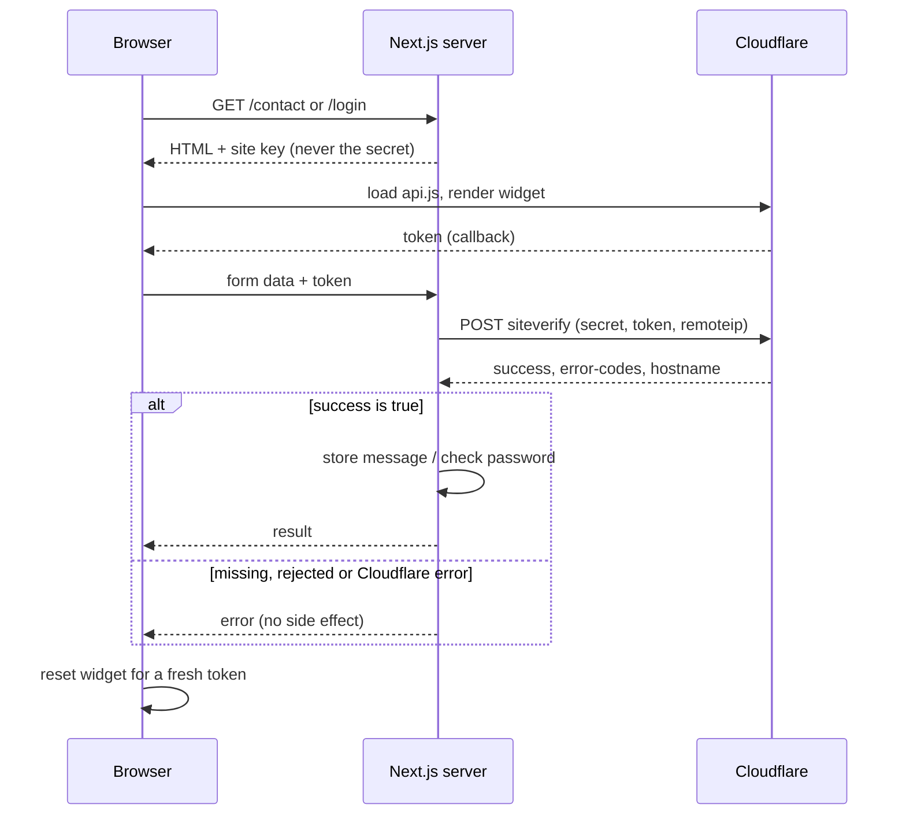

Anyone can send an HTTP request to a form endpoint; a browser is one way, a ten-line script is another. This tutorial shows how jithendar.com protects its email sign-in, sign-up and contact form with Cloudflare Turnstile, using the site's real Next.js code: the widget in React, verification on the server, failure handling, local testing, and the gaps I found.

It is written for developers integrating bot protection for the first time. You need a Cloudflare account to create a widget, and a Next.js App Router project; the code is from the `www/` folder of [github.com/mrjithendar/jithendar.com](https://github.com/mrjithendar/jithendar.com) at commit `dc249e8` (Next.js 16.4, React 19.3, TypeScript 6.0, Better Auth 1.7.14). The Turnstile code was unchanged on 6 November 2026.

Code samples are labelled **Actual project code** (unchanged except for elisions marked `// …`), **Simplified from project code** (what was removed is listed), or **Standalone teaching example** (not in the repository).

## 1. Why a website needs bot protection

Nothing in HTTP says a person must be on the other end of a public form. Scripts use them for **spam** through contact forms, **credential stuffing** with leaked password pairs, **fake accounts** in bulk, and plain **cost and noise**, since each submission can mean a database write, an email or an audit entry.

Bot protection answers one question: *is this request likely to come from a real browser session?* It is not authentication (who are you), authorization (may you do this) or rate limiting (have you done this too often). jithendar.com uses all four, and a request can pass Turnstile and still be refused by the others. No bot protection stops every bot; a determined attacker can pay people to solve challenges or drive a real browser. The goal is to make automated abuse more expensive.

## 2. What Cloudflare Turnstile is

Cloudflare calls Turnstile its ["smart CAPTCHA alternative"](https://developers.cloudflare.com/turnstile/). A small widget runs checks in the visitor's browser and, when they pass, hands your page a **token**: a short-lived string proving the check happened. Your server sends that token to Cloudflare and asks whether it is real.

The [widget documentation](https://developers.cloudflare.com/turnstile/concepts/widget/) lists three modes, chosen in the Cloudflare dashboard, not in code:

| Mode | What the visitor sees |
|---|---|
| Managed (Cloudflare's recommendation) | Usually nothing to click. Cloudflare decides, based on risk, whether to show a checkbox. |
| Non-interactive | A visible widget with a loading spinner. The visitor never has to interact. |
| Invisible | Nothing at all. Cloudflare notes that this mode requires referencing its Turnstile Privacy Addendum in your privacy policy. |

The repository cannot show which mode jithendar.com uses; it renders a visible container, which fits Managed or Non-interactive.

Turnstile is not the WAF or a challenge page. Those sit in front of a site proxied through Cloudflare, while Turnstile is an API your own application calls and ["can be embedded into any website without sending traffic through Cloudflare"](https://developers.cloudflare.com/turnstile/), though both share the same Challenge Platform. That matters here because jithendar.com's DNS is not proxied; the site's own Node.js server does the verification ([project page](/projects/nextjs-site-on-kubernetes)).

**The common mistake** is treating the widget as the protection. It only produces a token. If your server never checks it, an attacker skips the widget and posts directly to your endpoint; Cloudflare's [server-side validation guide](https://developers.cloudflare.com/turnstile/get-started/server-side-validation/) is explicit that the widget alone protects nothing.

## 3. Where jithendar.com uses Turnstile

These are the integration points found by searching the repository for Turnstile, Siteverify and the `x-captcha-response` header:

| Protected action | Page | Frontend | Server-side check |
|---|---|---|---|
| Email sign-in | `/login` | `src/app/login/LoginForm.tsx` | Better Auth `captcha` plugin, configured in `src/lib/auth.ts` |
| Email sign-up | `/login` (Create account tab) | `src/app/login/LoginForm.tsx` | Better Auth `captcha` plugin |
| Password reset request | No page in the UI calls it | none | Better Auth `captcha` plugin (on by default for `/request-password-reset`) |
| Contact form (signed-out visitors only) | [`/contact`](/contact) | `src/components/ContactForm.tsx` | `verifyTurnstile()` in `src/lib/turnstile.ts`, called from `submitContact()` in `src/lib/contact.ts` |

Supporting code: `src/components/Turnstile.tsx` (the shared widget component), `src/lib/turnstile.ts` (keys and contact verification), `src/lib/runtime-settings.ts` (keys stored encrypted from **Admin → Advanced settings**), `src/lib/health.ts` and `src/lib/dashboard.ts` (key and script status), and `src/lib/auth-audit.ts` (audits rejections).

**Not protected by Turnstile:** comments, which require a signed-in session instead (`tests/discussions.test.ts` asserts they never call Siteverify); Google and GitHub sign-in, handled by the identity provider; and article pages, where the script never loads.

## 4. The complete request flow

1. The server renders the page and passes the **site key** to the client component as a prop.
2. The browser loads `api.js` from `challenges.cloudflare.com` and renders the widget.
3. When the check passes, the widget calls back with a **token**, which React stores in state.
4. On submit, the browser sends the token with the form data: as an argument to a Next.js **server action** for the contact form, or as an `x-captcha-response` header to `/api/auth/*` for sign-in.
5. The server POSTs the token and the **secret key** to Cloudflare's Siteverify endpoint.
6. Only if Cloudflare answers `success: true` does the server store the message or check the password.



The contact form validates its fields with Zod *before* calling Siteverify, which is safe because validation has no side effect.

## 5. Site keys and secret keys

A Turnstile widget comes with two keys. The **site key** is public: it goes into the page so the widget loads the right configuration, and anyone can read it. The **secret key** is private: only your server sends it, and only to Siteverify. If it leaked, someone could validate tokens as you.

*Standalone teaching example: dummy values only.*

```ini
# .env.local (never commit real values)
TURNSTILE_SITE_KEY=1x00000000000000000000AA
TURNSTILE_SECRET_KEY=1x0000000000000000000000000000000AA
```

Both values are Cloudflare's public [test keys](https://developers.cloudflare.com/turnstile/troubleshooting/testing/), which always pass. Neither variable starts with `NEXT_PUBLIC_`: in Next.js that prefix copies a variable into the JavaScript sent to every browser, so the secret must never have it.

*Actual project code from [`src/lib/turnstile.ts`](https://github.com/mrjithendar/jithendar.com/blob/dc249e807f83ef5a0e2aaa34638c42399e91e905/www/src/lib/turnstile.ts).*

```ts
import { isProductionEnv } from "@/config/site";

// Cloudflare's documented test keys: always pass. Used only outside production when keys are unset.
const TEST_SITE_KEY = "1x00000000000000000000AA";
const TEST_SECRET = "1x0000000000000000000000000000000AA";

type Env = Record<string, string | undefined>;

export function turnstileSiteKey(env: Env = process.env): string | undefined {
  return env.TURNSTILE_SITE_KEY || (isProductionEnv() ? undefined : TEST_SITE_KEY);
}

export function turnstileSecret(env: Env = process.env): string | undefined {
  return env.TURNSTILE_SECRET_KEY || (isProductionEnv() ? undefined : TEST_SECRET);
}

/** Keys from Admin → Advanced settings, falling back to the deployment (and to Cloudflare's test keys outside production). */
export async function turnstileKeys(): Promise<{ siteKey: string | undefined; secret: string | undefined; production: boolean }> {
  const { effectiveEnv } = await import("./runtime-settings");
  const env = await effectiveEnv();
  return { siteKey: turnstileSiteKey(env), secret: turnstileSecret(env), production: Boolean(env.TURNSTILE_SITE_KEY) };
}
```

- `effectiveEnv()` merges two sources: keys saved in **Admin → Advanced settings** win, otherwise the process environment applies. In production that comes from the Kubernetes Secret `jithendar-com-env`, created by `scripts/create-secrets.sh` with a hidden prompt for the secret.
- Admin-saved secrets are stored sealed and unsealed with `SETTINGS_ENCRYPTION_KEY`; the admin form only learns *whether* a secret is stored.
- **Test-key fallback:** with no key configured *and* `isProductionEnv()` false, the always-pass test keys apply; in production the functions return `undefined`. `APP_ENV=production` is set by the `Dockerfile` default and `minikube/30-jithendar-com.yaml`.
- `production` is only a display flag for the admin dashboard.

The site key reaches the browser as a prop from a **server component** (a React component that runs only on the server):

*Actual project code from [`src/app/[page]/page.tsx`](https://github.com/mrjithendar/jithendar.com/blob/dc249e807f83ef5a0e2aaa34638c42399e91e905/www/src/app/%5Bpage%5D/page.tsx).*

```tsx
export default async function StaticPage({ params }: Props) {
  const page = await load((await params).page);
  const contactForm =
    page.slug === "contact" && (await getSettings()).features.contactForm ? (
      <ContactForm siteKey={(await turnstileKeys()).siteKey} signedIn={!!(await getSessionUser())} />
    ) : undefined;
  return <PageView page={page} after={contactForm} />;
}
```

Only `siteKey` is passed down. Because it is read at request time, an admin can change it without rebuilding the image, which a `NEXT_PUBLIC_` variable would not allow. Never commit the secret to `.env` files in Git or prefix it "so the client can verify": the client never verifies.

## 6. Frontend implementation

Cloudflare ships Turnstile as a plain script, while React renders and removes elements on its own schedule. The integration must load the script once, render into a React-owned element, pass the token into React state, and clean up. Cloudflare's [client-side rendering guide](https://developers.cloudflare.com/turnstile/get-started/client-side-rendering/) offers **implicit** rendering (the script scans the page for `cf-turnstile` elements, suited to static pages) and **explicit** rendering (`turnstile.render()` with `?render=explicit`, suited to single-page apps). jithendar.com uses explicit.

### Types for a global script

*Actual project code from [`src/components/Turnstile.tsx`](https://github.com/mrjithendar/jithendar.com/blob/dc249e807f83ef5a0e2aaa34638c42399e91e905/www/src/components/Turnstile.tsx).*

```tsx
"use client";

import { useEffect, useLayoutEffect, useRef } from "react";

declare global {
  interface Window {
    turnstile?: {
      render: (el: HTMLElement, opts: Record<string, unknown>) => string;
      reset: (id?: string) => void;
      remove: (id: string) => void;
    };
  }
}
```

`"use client"` makes this a browser component, since server components cannot use effects or `window`. `declare global` tells TypeScript that `window` may have a `turnstile` property, added by Cloudflare's script at runtime (`?` because it is undefined until then). `render` returns the **widget ID** that `remove` and `reset` need. `Record<string, unknown>` keeps the declaration short at the cost of not catching misspelled options; no Turnstile type package is installed.

### Loading the script once

*Actual project code from `src/components/Turnstile.tsx`.*

```tsx
const SCRIPT = "https://challenges.cloudflare.com/turnstile/v0/api.js?render=explicit";

function loadScript(): Promise<void> {
  if (window.turnstile) return Promise.resolve();
  const existing = document.querySelector<HTMLScriptElement>(`script[src="${SCRIPT}"]`);
  return new Promise((resolve, reject) => {
    const script = existing ?? Object.assign(document.createElement("script"), { src: SCRIPT, async: true, defer: true });
    script.addEventListener("load", () => resolve());
    script.addEventListener("error", () => reject(new Error("Turnstile failed to load")));
    if (!existing) document.head.appendChild(script);
  });
}
```

If `window.turnstile` exists, the script has loaded. If a matching `<script>` tag is already in the page, another widget is loading it, so the code waits for its `load` event instead of adding a duplicate when you move between `/login` and `/contact`. The script comes straight from `challenges.cloudflare.com`, because Cloudflare warns that ["proxying or caching this file will cause Turnstile to fail when future updates are released"](https://developers.cloudflare.com/turnstile/get-started/client-side-rendering/).

### Rendering the widget and receiving the token

*Actual project code from `src/components/Turnstile.tsx`.*

```tsx
export function Turnstile({ siteKey, onToken, resetKey = 0 }: { siteKey: string; onToken: (token: string | null) => void; resetKey?: number }) {
  const ref = useRef<HTMLDivElement>(null);
  const widget = useRef<string | null>(null);
  const callback = useRef(onToken);
  useLayoutEffect(() => {
    callback.current = onToken;
  }, [onToken]);

  useEffect(() => {
    let cancelled = false;
    loadScript()
      .then(() => {
        if (cancelled || !ref.current || !window.turnstile) return;
        widget.current = window.turnstile.render(ref.current, {
          sitekey: siteKey,
          theme: "auto",
          // The standard widget is 300px wide; on the narrowest phones use the 150px compact one.
          size: ref.current.clientWidth < 300 ? "compact" : "normal",
          callback: (t: string) => callback.current(t),
          "expired-callback": () => callback.current(null),
          "error-callback": () => callback.current(null),
        });
      })
      .catch(() => callback.current(null));
    return () => {
      cancelled = true;
      if (widget.current && window.turnstile) window.turnstile.remove(widget.current);
      widget.current = null;
    };
  }, [siteKey, resetKey]);

  return <div ref={ref} className="min-h-[65px] max-w-full" />;
}
```

- **`ref`** points at the `<div>` the widget draws into; `min-h-[65px]` reserves the normal widget's height (300 × 65 px) so the form does not jump.
- **Callbacks:** `callback` delivers a token; `expired-callback` and `error-callback` report `null`, meaning "no usable token".
- **`callback.current`** is the "latest callback" pattern: the effect depends only on `siteKey` and `resetKey`, so a new `onToken` function from a re-render does not recreate the widget.
- **`size`:** Cloudflare's [widget configurations](https://developers.cloudflare.com/turnstile/get-started/client-side-rendering/widget-configurations/) offer `normal` (300 × 65), `flexible` and `compact` (150 × 140); narrow containers get `compact`. `theme: "auto"` follows light or dark mode.
- **Cleanup:** on unmount or a key change, `turnstile.remove()` deletes the widget without firing callbacks, and the `cancelled` flag stops a slow script load from rendering into a component that has gone. Together they also handle React's development-mode double effect, which would otherwise draw two widgets.
- **`resetKey`** lets a parent ask for a fresh widget by changing a number.

The component does not set `action`, `cData`, `refresh-expired`, `retry` or `timeout-callback`. Cloudflare documents `refresh-expired` and `retry` as defaulting to `auto`, so after expiry the widget should fetch a new token itself; I did not test that in a browser.

### Using the component in a form

*Simplified from project code: [`src/components/ContactForm.tsx`](https://github.com/mrjithendar/jithendar.com/blob/dc249e807f83ef5a0e2aaa34638c42399e91e905/www/src/components/ContactForm.tsx). Removed: the success/error alert markup and Tailwind classes.*

```tsx
export function ContactForm({ siteKey, signedIn = false }: { siteKey: string | undefined; signedIn?: boolean }) {
  const [token, setToken] = useState<string | null>(null);
  const [resetKey, setResetKey] = useState(0);
  const [pending, start] = useTransition();
  if (!siteKey && !signedIn) return null;

  function submit(e: React.FormEvent<HTMLFormElement>) {
    e.preventDefault();
    const form = e.currentTarget;
    const data = Object.fromEntries(new FormData(form)) as { name: string; email: string; subject: string; message: string };
    if (!signedIn && !token) {
      setResult({ ok: false, text: "Please complete the human verification." });
      return;
    }
    start(async () => {
      const r = await submitContactAction(data, token);
      setResult(r.ok ? { ok: true, text: r.message } : { ok: false, text: r.error, issues: r.issues });
      setToken(null);
      setResetKey((k) => k + 1);
      if (r.ok) form.reset();
    });
  }
  // … <form onSubmit={submit}> … {!signedIn && siteKey && <Turnstile siteKey={siteKey} onToken={setToken} resetKey={resetKey} />}
}
```

The token lives in `useState<string | null>`, filled by `onToken={setToken}`. With no token the form stops before calling the server. After *every* attempt, success or failure, it clears the token and bumps `resetKey`, because tokens are single-use (section 7). With no site key, signed-out visitors see no form at all instead of one that can never pass. `src/app/login/LoginForm.tsx` follows the same pattern with a different transport, shown next.

## 7. Backend verification

A token is an ordinary string: only Cloudflare can say whether it issued it, whether it expired, or whether it was already used. Cloudflare's [server-side validation guide](https://developers.cloudflare.com/turnstile/get-started/server-side-validation/) documents `POST https://challenges.cloudflare.com/turnstile/v0/siteverify`, form-encoded or JSON, with required `secret` and `response` fields and optional `remoteip` and `idempotency_key`. Tokens are at most 2048 characters, **valid for 300 seconds**, and **can be validated only once**. The response carries `success`, `error-codes`, `hostname`, `action`, `cdata` and `challenge_ts`.

| Situation | What Siteverify returns |
|---|---|
| No token sent | `missing-input-response` (if you call Siteverify at all; better to reject first) |
| Forged, malformed or expired token | `invalid-input-response` |
| Token already validated once | `timeout-or-duplicate` |
| Wrong or missing secret | `invalid-input-secret` or `missing-input-secret` |
| Problem on Cloudflare's side | `internal-error` |

### Path 1: the contact form

*Actual project code from [`src/lib/turnstile.ts`](https://github.com/mrjithendar/jithendar.com/blob/dc249e807f83ef5a0e2aaa34638c42399e91e905/www/src/lib/turnstile.ts).*

```ts
/** Server-side Turnstile check for our own forms (contact). Fails closed. */
export async function verifyTurnstile(token: string | null | undefined, ip?: string | null): Promise<boolean> {
  const { secret } = await turnstileKeys();
  if (!secret || !token) return false;
  try {
    const body = new URLSearchParams({ secret, response: token, ...(ip ? { remoteip: ip } : {}) });
    const res = await fetch("https://challenges.cloudflare.com/turnstile/v0/siteverify", {
      method: "POST",
      body,
      signal: AbortSignal.timeout(10_000),
    });
    const data = (await res.json()) as { success?: boolean };
    return data.success === true;
  } catch {
    return false;
  }
}
```

- **No secret or no token returns `false`** without calling Cloudflare, so a missing configuration rejects instead of waving requests through. That is what "fails closed" means.
- **`URLSearchParams`** gives a form-encoded body, and `remoteip` is added only when known.
- **`AbortSignal.timeout(10_000)`** stops waiting after 10 seconds, as Cloudflare advises.
- **`data.success === true`** is strict: a missing field, the string `"true"` or a non-JSON error page all fail, and so does any exception.

It does not check `hostname`, `action` or `error-codes` (the widget sets no `action`); section 10 covers the hostname gap. The form calls a server action that adds the visitor's IP and session state:

*Actual project code from [`src/app/_actions/public.ts`](https://github.com/mrjithendar/jithendar.com/blob/dc249e807f83ef5a0e2aaa34638c42399e91e905/www/src/app/_actions/public.ts).*

```ts
async function clientIp() {
  return (await headers()).get("x-forwarded-for")?.split(",")[0]?.trim() ?? null;
}

export async function submitContactAction(data: { name: string; email: string; subject: string; message: string }, token: string | null): Promise<PublicResult> {
  return guard(async () => {
    await submitContact(data, token, await clientIp(), { signedIn: !!(await getSessionUser()) });
    return "Thanks for getting in touch. Your message has been received.";
  });
}
```

`signedIn` comes from the server's own session lookup, so a browser cannot claim to be signed in to skip the check.

*Actual project code from [`src/lib/contact.ts`](https://github.com/mrjithendar/jithendar.com/blob/dc249e807f83ef5a0e2aaa34638c42399e91e905/www/src/lib/contact.ts), lines 23–33.*

```ts
export async function submitContact(raw: unknown, turnstileToken: string | null, ip?: string | null, { signedIn = false } = {}) {
  if (!(await getSettings()).features.contactForm) throw new PostError("The contact form is closed.", 403);
  const parsed = contactInput.safeParse(raw);
  if (!parsed.success) throw new PostError("Please check the form.", 400, parsed.error.issues.map((i) => i.message));
  if (!signedIn && !(await verifyTurnstile(turnstileToken, ip))) throw new PostError("Please complete the human verification again.", 400);
  const db = await getDb();
  const hourAgo = new Date(Date.now() - 60 * 60 * 1000);
  const [{ mine } = { mine: 0 }] = await db.select({ mine: count() }).from(schema.contactMessage).where(and(gt(schema.contactMessage.createdAt, hourAgo), eq(schema.contactMessage.email, parsed.data.email)));
  const [{ all } = { all: 0 }] = await db.select({ all: count() }).from(schema.contactMessage).where(gt(schema.contactMessage.createdAt, hourAgo));
  if (mine >= 3 || all >= 100) throw new PostError("Too many messages right now. Please try again later.", 400);
  await db.insert(schema.contactMessage).values(parsed.data);
  // … logs the subject length and emails every admin
}
```

The order is the point: the admin feature switch, then Zod validation with no side effects, then **Turnstile** (unless the server session says the visitor is signed in), then a rate limit of 3 messages per hour per submitted email and 100 per hour site-wide, and only then the Postgres insert and the admin emails.

### Path 2: sign-in and sign-up through Better Auth

Better Auth's `captcha` plugin makes the Siteverify call, so the site only configures it:

*Actual project code from [`src/lib/auth.ts`](https://github.com/mrjithendar/jithendar.com/blob/dc249e807f83ef5a0e2aaa34638c42399e91e905/www/src/lib/auth.ts), line 186 (inside `betterAuth({ plugins: [ … ] })`).*

```ts
captcha({ provider: "cloudflare-turnstile", secretKey: (await turnstileKeys()).secret ?? "missing-turnstile-secret" }),
```

The fallback `"missing-turnstile-secret"` is deliberately not a secret. Without it a missing key would make the plugin throw on every request; with it, Cloudflare rejects every token as `invalid-input-secret`, so sign-in fails closed (and the sign-in page hides the email form when no site key exists). Saving the keys in Admin → Advanced settings broadcasts `"integrations"`, and `src/lib/auth.ts` rebuilds its cached auth instance, so a key change needs no restart. On the client, the token travels in a header:

*Actual project code from [`src/app/login/LoginForm.tsx`](https://github.com/mrjithendar/jithendar.com/blob/dc249e807f83ef5a0e2aaa34638c42399e91e905/www/src/app/login/LoginForm.tsx), lines 45–57.*

```tsx
    const fetchOptions = { headers: { "x-captcha-response": token } };
    setBusy(true);
    const result =
      mode === "signin"
        ? await authClient.signIn.email({ email, password, fetchOptions })
        : await authClient.signUp.email({ email, password, name: String(form.get("name") ?? ""), fetchOptions });
    setBusy(false);
    if (result.error) {
      setError(result.error.message ?? "Something went wrong. Please try again.");
      setToken(null);
      setResetKey((k) => k + 1); // tokens are single-use
      return;
    }
```

What the installed plugin does (read from `node_modules/better-auth/dist/plugins/captcha/`, version 1.7.14):

| Step | Better Auth 1.7.14 behaviour |
|---|---|
| Which endpoints | Defaults: `/sign-up/email`, `/sign-in/email`, `/request-password-reset`. The site does not override them. |
| When it runs | In the plugin's `onRequest` hook, before the endpoint handler checks the password or creates the user. |
| No header | HTTP 400, code `MISSING_RESPONSE`, without calling Cloudflare. |
| Siteverify call | JSON body with `secret`, `response`, and `remoteip` when known; 10-second timeout. |
| `success` is false | HTTP 403, code `VERIFICATION_FAILED`. The error codes, hostname and action are logged as a warning (the token is not). |
| Cloudflare unreachable or timed out | HTTP 500, "Something went wrong". Fails closed. |
| `hostname` / `action` | Checked only if `allowedHostnames` / `expectedAction` are configured. The site configures neither. |

When sign-in or sign-up fails with `VERIFICATION_FAILED` or `MISSING_RESPONSE`, the auth route has `src/lib/auth-audit.ts` write an `auth.captcha_failed` entry, which Admin → Audit log counts as "blocked by Turnstile". A common mistake here is `if (data.success)` on untyped JSON, or treating a network error as "probably fine"; both turn an outage into a pass.

## 8. Handling failures gracefully

Bot protection fails real people too: a privacy extension blocks the script, a laptop wakes with a stale token, Cloudflare has a bad minute. The form should explain, keep what the visitor typed, and make a retry easy.

| Situation | Contact form | Sign-in / sign-up |
|---|---|---|
| Script blocked or fails to load | Token stays `null`; on submit: "Please complete the human verification." | Same message |
| Challenge error | `error-callback` sets token to `null`; same message on submit | Same |
| Token expires before submit | `expired-callback` sets token to `null`; Cloudflare's default `refresh-expired: auto` should issue a new one | Same |
| Siteverify rejects the token | "Please complete the human verification again." | "Captcha verification failed" (HTTP 403) |
| Cloudflare unreachable | Same message as a rejection | "Something went wrong" (500) |
| Any failed attempt | Token cleared, widget reset, typed input kept | Token cleared, widget reset, typed input kept |
| Double click on submit | Button disabled while the server action is pending | Button disabled while `busy` (`loading` sets `disabled`) |

A fresh token is needed after **every** server round trip: even a request that failed for another reason (wrong password, rate limit) has spent its token, and both forms reset unconditionally. Input survives failure: the contact form calls `form.reset()` only on success, and the sign-in inputs are never cleared on error.

Suggested, not implemented: say when the widget could not load at all ("check that challenges.cloudflare.com is not blocked"), hint or disable submit while no token exists, and tell "Cloudflare unreachable" apart from "verification failed", which `verifyTurnstile()` reports as the same `false`.

## 9. Local development and testing

Cloudflare publishes [dummy keys](https://developers.cloudflare.com/turnstile/troubleshooting/testing/) that behave predictably:

| Key | Type | Behaviour |
|---|---|---|
| `1x00000000000000000000AA` | Site key | Visible widget, always passes |
| `2x00000000000000000000AB` | Site key | Visible widget, always fails |
| `3x00000000000000000000FF` | Site key | Forces an interactive challenge |
| `1x0000000000000000000000000000000AA` | Secret | Always passes validation |
| `2x0000000000000000000000000000000AA` | Secret | Always fails validation |
| `3x0000000000000000000000000000000AA` | Secret | Returns `timeout-or-duplicate` (token already spent) |

Test site keys produce the dummy token `XXXX.DUMMY.TOKEN.XXXX`, which test secrets accept and **production secrets reject**. With `APP_ENV` unset and no keys saved, jithendar.com falls back to the always-pass pair, so you usually need no configuration. To exercise failures, set the variables before `npm run dev` (keys saved in Admin → Advanced settings override them, so clear those first):

*Standalone teaching example.*

```bash
# Widget fails in the browser: the form never gets a token.
TURNSTILE_SITE_KEY=2x00000000000000000000AB npm run dev

# Widget passes, Siteverify rejects: tests the server-side failure path.
TURNSTILE_SITE_KEY=1x00000000000000000000AA \
TURNSTILE_SECRET_KEY=2x0000000000000000000000000000000AA npm run dev

# Siteverify reports a reused token.
TURNSTILE_SITE_KEY=1x00000000000000000000AA \
TURNSTILE_SECRET_KEY=3x0000000000000000000000000000000AA npm run dev
```

To check that a missing token is refused, use a made-up address against your **local** server only:

*Standalone teaching example.*

```bash
curl -i http://localhost:3000/api/auth/sign-in/email \
  -H 'content-type: application/json' \
  -H 'origin: http://localhost:3000' \
  -d '{"email":"nobody@example.com","password":"not-a-real-password"}'
# Expect HTTP 400 with code MISSING_RESPONSE: no x-captcha-response header was sent.
```

The existing suite relies on this design: `tests/social-auth.test.ts` stubs `fetch` so Siteverify returns `{ success: true }`, `tests/security-admin.test.ts` checks that a `VERIFICATION_FAILED` sign-in is audited and that admin keys override deployment keys, and `tests/discussions.test.ts` keeps comments away from Siteverify. There is no test for `verifyTurnstile()` itself; this is what one could look like:

*Standalone teaching example: not in the repository. It runs as `tests/turnstile.test.ts` and uses the repository's own `freshDb()` helper.*

```ts
import { afterEach, beforeEach, describe, expect, it, vi } from "vitest";
import { verifyTurnstile } from "@/lib/turnstile";
import { freshDb } from "./db-helpers";

// Admin-saved keys live in the database, and that code imports "server-only" (which throws outside Next.js).
vi.mock("server-only", () => ({}));

beforeEach(async () => {
  await freshDb(); // in-memory database: no saved keys, so Cloudflare's test secret applies
});
afterEach(() => vi.unstubAllGlobals());

describe("verifyTurnstile", () => {
  it("rejects a missing token without calling Cloudflare", async () => {
    const fetchSpy = vi.fn();
    vi.stubGlobal("fetch", fetchSpy);
    expect(await verifyTurnstile(null)).toBe(false);
    expect(fetchSpy).not.toHaveBeenCalled();
  });

  it("rejects a spent token", async () => {
    vi.stubGlobal("fetch", vi.fn(async () => Response.json({ success: false, "error-codes": ["timeout-or-duplicate"] })));
    expect(await verifyTurnstile("XXXX.DUMMY.TOKEN.XXXX")).toBe(false);
  });

  it("fails closed when Siteverify is unreachable", async () => {
    vi.stubGlobal("fetch", vi.fn(async () => { throw new TypeError("fetch failed"); }));
    expect(await verifyTurnstile("XXXX.DUMMY.TOKEN.XXXX")).toBe(false);
  });
});
```

Stubbing `fetch` keeps the test offline. Never point automated tests at the production secret, and never add a "skip verification" switch; the test keys exist so you do not need one.

## 10. Security boundaries and gaps

Everything in the browser is under the visitor's control: they can delete the widget, call the server action directly or use `curl`. The only check that counts is the server's, before the side effect, and both paths do that. Turnstile replaces none of the other controls: Zod and Better Auth validate input, roles enforce authorization, Better Auth limits `/sign-in/email` to 5 requests a minute and `/sign-up/email` to 5 an hour, Better Auth's origin check stays on (`disableOriginCheck: false`), and Next.js compares `Origin` with `Host` for server actions.

The secret never leaves the server and is sealed when saved through the admin UI. Neither path logs the token, but `verifyTurnstile()` logs nothing at all on failure, so an operator cannot tell a Cloudflare outage from a wave of bad tokens. Both paths **fail closed**, so if Cloudflare is unreachable nobody can use email sign-in or the signed-out contact form; Google and GitHub sign-in keep working, and the health page reports whether Cloudflare's script is reachable.

Gaps found during inspection, none of them changed:

1. **No hostname check.** Neither path compares Siteverify's `hostname` with `jithendar.com`, although Cloudflare advises validating it. Better Auth supports `allowedHostnames`; the contact path needs a few lines.
2. **Signed-in contact skips Turnstile, including for Google and GitHub accounts**, which never see the widget. With registration open, a scripted account could send contact messages unchecked, and the per-email limit counts the *submitted* email, so the binding limit is the site-wide 100 per hour.
3. **The site-wide contact cap can be exhausted**, refusing legitimate visitors, and its count-then-insert is not atomic.
4. **`/api/auth/send-verification-email` is not covered.** In Better Auth 1.7.14 it accepts an email without a session, is not in the captcha plugin's defaults, and has only the global 100-per-minute limit.
5. **`remoteip` comes from the first `X-Forwarded-For` value**, which a client can set unless the proxy overwrites it; the impact is limited to the signal Cloudflare receives.
6. **The test-key fallback depends on `APP_ENV`**, so a non-production deployment reachable from the internet with no keys accepts everyone.
7. **Stale descriptions:** `content/pages/privacy-policy.mdx`, `content/pages/cookies.mdx`, `src/lib/runtime-settings.ts` and `src/lib/health.ts` still say comments use Turnstile.

A proposed hostname check:

*Standalone teaching example: proposed, not in the repository.*

```ts
// src/lib/auth.ts (proposed)
captcha({
  provider: "cloudflare-turnstile",
  secretKey: (await turnstileKeys()).secret ?? "missing-turnstile-secret",
  allowedHostnames: [new URL(siteUrl()).hostname],
}),

// src/lib/turnstile.ts (proposed), replacing the last check in verifyTurnstile()
const data = (await res.json()) as { success?: boolean; hostname?: string };
return data.success === true && data.hostname === new URL(siteUrl()).hostname;
```

This would need care in development, where the dummy keys may not report your local hostname, and a test before it ships.

## 11. Lessons and checklist

What worked: one `<Turnstile>` component serves both a server action and a Better Auth endpoint, differing only in transport; the server-rendered site key lets an admin change keys without a rebuild; every path fails closed; tokens are reset after every attempt; cheap validation runs before Siteverify, and Siteverify before any side effect; rejections are audited; and article pages never load the script.

Recommended, not yet implemented: add the hostname check, log `error-codes` (never the token) from `verifyTurnstile()`, decide whether social accounts should face Turnstile on the contact form or be limited by session user, cover `/send-verification-email`, add a `verifyTurnstile()` test, and allow `challenges.cloudflare.com` if a Content Security Policy with `script-src` or `frame-src` is ever added.

- [ ] Create a widget in the Cloudflare dashboard and note the site key and secret key.
- [ ] Keep the secret server-only: no `NEXT_PUBLIC_` prefix, not in Git.
- [ ] Load `api.js?render=explicit` from `challenges.cloudflare.com`; do not proxy or bundle it.
- [ ] Render with `turnstile.render()`, keep the widget ID, and call `turnstile.remove()` on cleanup.
- [ ] Store the token from `callback`; clear it in `expired-callback` and `error-callback`.
- [ ] Send the token with the request and verify it with Siteverify on the server, with a timeout.
- [ ] Accept only `success === true`; check `hostname` (and `action`, if you set one).
- [ ] Run the check before any database write, email or password check.
- [ ] Reset the widget after every server response; tokens are single-use.
- [ ] Keep the visitor's input on failure and disable the submit button while a request is in flight.
- [ ] Keep rate limiting, validation, authorization and CSRF controls; Turnstile replaces none of them.
- [ ] Test with Cloudflare's dummy keys, never by disabling verification.
