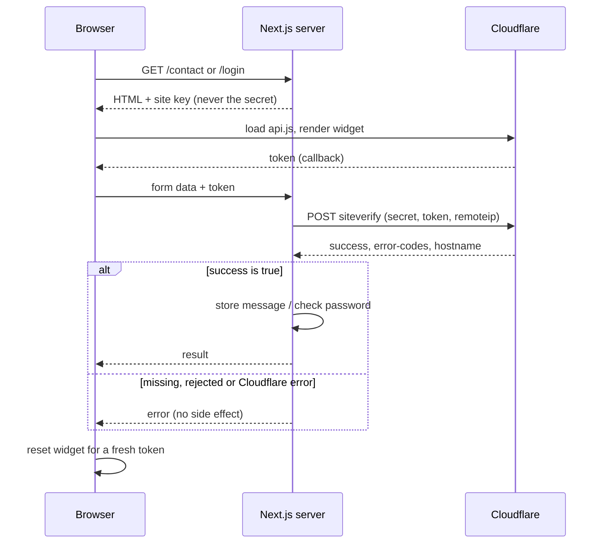

Anyone can send an HTTP request to a form endpoint. A browser is one way to do it; a ten-line script is another. This Cloudflare Turnstile tutorial walks through how jithendar.com adds bot protection to its email sign-in, sign-up and contact form, using real code from the site's Next.js repository.

It is written for developers who have never integrated bot protection before. Each section explains the problem first, then the Turnstile concept, then the code that actually runs on this site. Where the implementation has gaps, I say so.

**How the code samples are labelled**

- **Actual project code**: copied from the file named, unchanged except for elided lines marked `// …`.
- **Simplified from project code**: shortened from the file named; what was removed is listed underneath.
- **Standalone teaching example**: written for this article. It is not in the repository.

All repository paths are relative to the `www/` folder of [github.com/mrjithendar/jithendar.com](https://github.com/mrjithendar/jithendar.com), at commit `dc249e8`. The stack is Next.js 16.4 (App Router), React 19.3, TypeScript 6.0 and Better Auth 1.7.14.

## 1. Why a website needs bot protection

### The problem

A public form is an open door. A contact form accepts a name, an email and a message, then stores it and emails the site owner. A sign-in form accepts an email and a password, then checks them against a database. Nothing about the HTTP protocol says a person must be on the other end.

Scripts abuse these doors in predictable ways:

- **Spam**: posting thousands of advertising messages through a contact form.
- **Credential stuffing**: trying leaked email and password pairs from other breaches against a sign-in form.
- **Fake accounts**: creating accounts in bulk through a sign-up form.
- **Cost and noise**: every submission can trigger a database write, an outgoing email, or an audit log entry.

### Bot protection is not the same as other controls

These four ideas are easy to mix up:

| Control | Question it answers |
|---|---|
| Authentication | Who are you? (password, Google, GitHub) |
| Authorization | Are you allowed to do this? (roles such as admin, author, user) |
| Rate limiting | Have you done this too often recently? |
| Bot protection | Is this request likely to come from a real browser session and not an automated script? |

They stack. A request can pass bot protection and still be refused because the password is wrong, the account lacks a role, or the caller hit a rate limit. jithendar.com uses all four, and Turnstile only covers the last row.

No bot protection stops every bot. A determined attacker can pay people to solve challenges or drive a real browser. The realistic goal is to make automated abuse more expensive and to give the other controls less to deal with.

## 2. What Cloudflare Turnstile is

### The concept

Cloudflare describes Turnstile as its ["smart CAPTCHA alternative"](https://developers.cloudflare.com/turnstile/). You embed a small widget in your page. The widget runs checks in the visitor's browser and, when they pass, hands your page a **token**: a short-lived string that proves the check happened. Your server then sends that token to Cloudflare and asks, "Is this real?"

Cloudflare's [widget documentation](https://developers.cloudflare.com/turnstile/concepts/widget/) lists three widget modes. You pick the mode when you create the widget in the Cloudflare dashboard, not in code:

| Mode | What the visitor sees |
|---|---|
| Managed (Cloudflare's recommendation) | Usually nothing to click. Cloudflare decides, based on risk, whether to show a checkbox. |
| Non-interactive | A visible widget with a loading spinner. The visitor never has to interact. |
| Invisible | Nothing at all. Cloudflare notes that this mode requires referencing its Turnstile Privacy Addendum in your privacy policy. |

The widget mode for jithendar.com is set in the Cloudflare dashboard, so the repository cannot tell us which one is in use. The code renders a visible container, which fits the Managed or Non-interactive modes.

### Turnstile is not the WAF or a challenge page

Cloudflare has several products that sound similar:

- **Cloudflare WAF and challenge pages** sit in front of a site whose traffic is proxied through Cloudflare. They can block or challenge a request before it reaches your server.
- **Turnstile** is an API your own application calls. Cloudflare's overview says it ["can be embedded into any website without sending traffic through Cloudflare"](https://developers.cloudflare.com/turnstile/). Cloudflare also states that challenge pages and Turnstile share the same underlying Challenge Platform.

That distinction matters here. The site's [project page](/projects/nextjs-site-on-kubernetes) notes that Turnstile "is an API the site calls, and it works whether or not traffic is proxied." The site's own Node.js server does the verification.

### A common mistake

Treating the widget as the protection. The widget only produces a token. If your server never checks that token with Cloudflare, an attacker skips the widget and posts directly to your endpoint. Cloudflare's [server-side validation guide](https://developers.cloudflare.com/turnstile/get-started/server-side-validation/) is explicit: the client-side widget alone does not protect your forms.

## 3. Where jithendar.com uses Turnstile

I searched the repository for every reference to Turnstile, Siteverify and the `x-captcha-response` header. These are the verified integration points.

### Implemented

| Protected action | Page | Frontend | Server-side check |
|---|---|---|---|
| Email sign-in | `/login` | `src/app/login/LoginForm.tsx` | Better Auth `captcha` plugin, configured in `src/lib/auth.ts` |
| Email sign-up | `/login` (Create account tab) | `src/app/login/LoginForm.tsx` | Better Auth `captcha` plugin |
| Password reset request | No page in the UI calls it | none | Better Auth `captcha` plugin (on by default for `/request-password-reset`) |
| Contact form (signed-out visitors only) | [`/contact`](/contact) | `src/components/ContactForm.tsx` | `verifyTurnstile()` in `src/lib/turnstile.ts`, called from `submitContact()` in `src/lib/contact.ts` |

Supporting code:

- `src/components/Turnstile.tsx`: the shared React component that loads Cloudflare's script and renders the widget.
- `src/lib/turnstile.ts`: key lookup and the contact form's verification function.
- `src/lib/runtime-settings.ts`: lets an admin store the keys in **Admin → Advanced settings**, encrypted at rest.
- `src/lib/health.ts` and `src/lib/dashboard.ts`: report whether keys are configured and whether Cloudflare's script URL is reachable.
- `src/lib/auth-audit.ts`: records Turnstile rejections on sign-in and sign-up in the audit log.

### Not protected by Turnstile

- **Comments.** They require a signed-in session instead. `docs/COMMENTS.md` records the decision, and `tests/discussions.test.ts` asserts that posting a comment makes no outbound request to Siteverify.
- **Google and GitHub sign-in.** The identity provider handles that sign-in; the Turnstile widget is only part of the email form.
- **Article pages.** The component's own comment says it loads "only on pages with forms (login, contact), never on article reading pages."

Proposed improvements are kept separate, in section 10 and the checklist at the end.

## 4. The complete request flow

### The problem

Bot protection involves three parties: the visitor's browser, your server, and Cloudflare. It helps to see who talks to whom, and in what order, before reading the code.

### The flow on jithendar.com

1. The server renders the page and passes the **site key** to the client component as a prop.
2. The browser loads `api.js` from `challenges.cloudflare.com` and renders the widget.
3. When the check passes, the widget calls back with a **token**, which React stores in state.
4. On submit, the browser sends the token with the form data. The contact form passes it as an argument to a Next.js **server action** (a server function the client can call like a normal function). The sign-in form sends it as an `x-captcha-response` HTTP header to `/api/auth/*`.
5. The server POSTs the token and the **secret key** to Cloudflare's Siteverify endpoint.
6. Only if Cloudflare answers `success: true` does the server store the message or check the password.



The contact form validates the form fields with Zod *before* calling Siteverify. That is safe because validation has no side effect.

## 5. Site keys and secret keys

### The problem

The browser needs something to tell Cloudflare which widget it is rendering. The server needs something to prove to Cloudflare that it owns that widget. Those must be different values, because anything sent to a browser is public.

### The concept

When you create a Turnstile widget in the Cloudflare dashboard you get two keys:

- **Site key**: public. It goes into the page so the widget knows which configuration to load. Anyone can read it with View Source, and that is fine.
- **Secret key**: private. Only your server sends it, and only to Siteverify. If it leaked, someone could validate tokens as if they were you. Cloudflare's guide warns that exposing the secret in front-end code would let attackers bypass the check.

### Example configuration

*Standalone teaching example: dummy values only.*

```ini
# .env.local (never commit real values)
TURNSTILE_SITE_KEY=1x00000000000000000000AA
TURNSTILE_SECRET_KEY=1x0000000000000000000000000000000AA
```

Both values above are Cloudflare's public [test keys](https://developers.cloudflare.com/turnstile/troubleshooting/testing/). They always pass and are safe to publish.

Notice that neither variable starts with `NEXT_PUBLIC_`. In Next.js, that prefix copies a variable into the JavaScript bundle sent to every browser. The secret must never have it, and the site's `AGENTS.md` makes that a rule for all server-only variables.

### How the repository resolves keys

*Actual project code from [`src/lib/turnstile.ts`](https://github.com/mrjithendar/jithendar.com/blob/dc249e807f83ef5a0e2aaa34638c42399e91e905/www/src/lib/turnstile.ts).*

```ts
import { isProductionEnv } from "@/config/site";

// Cloudflare's documented test keys: always pass. Used only outside production when keys are unset.
const TEST_SITE_KEY = "1x00000000000000000000AA";
const TEST_SECRET = "1x0000000000000000000000000000000AA";

type Env = Record<string, string | undefined>;

export function turnstileSiteKey(env: Env = process.env): string | undefined {
  return env.TURNSTILE_SITE_KEY || (isProductionEnv() ? undefined : TEST_SITE_KEY);
}

export function turnstileSecret(env: Env = process.env): string | undefined {
  return env.TURNSTILE_SECRET_KEY || (isProductionEnv() ? undefined : TEST_SECRET);
}

/** Keys from Admin → Advanced settings, falling back to the deployment (and to Cloudflare's test keys outside production). */
export async function turnstileKeys(): Promise<{ siteKey: string | undefined; secret: string | undefined; production: boolean }> {
  const { effectiveEnv } = await import("./runtime-settings");
  const env = await effectiveEnv();
  return { siteKey: turnstileSiteKey(env), secret: turnstileSecret(env), production: Boolean(env.TURNSTILE_SITE_KEY) };
}
```

The important lines:

- `effectiveEnv()` merges two sources. Keys saved in **Admin → Advanced settings** win; otherwise the process environment applies. In production that environment comes from the Kubernetes Secret `jithendar-com-env`, created by `scripts/create-secrets.sh` (which reads the secret key with a hidden prompt).
- Admin-saved secrets are stored sealed. `effectiveEnv()` calls `unseal()` with `SETTINGS_ENCRYPTION_KEY`, and the admin form only ever learns *whether* a secret is stored, never its value.
- **Test-key fallback.** If no key is configured *and* `isProductionEnv()` is false, Cloudflare's always-pass test keys apply. In production the functions return `undefined` instead. `isProductionEnv()` is true when `APP_ENV=production`, which both the `Dockerfile` (as the default build argument) and `k8s/30-jithendar-com.yaml` set.
- `production` is a display flag for the admin dashboard ("Production keys" vs "Test keys"). It is not a security decision.

### Getting the site key to the browser

The site key reaches the browser as a prop from a **server component** (a React component that runs only on the server):

*Actual project code from [`src/app/[page]/page.tsx`](https://github.com/mrjithendar/jithendar.com/blob/dc249e807f83ef5a0e2aaa34638c42399e91e905/www/src/app/%5Bpage%5D/page.tsx).*

```tsx
export default async function StaticPage({ params }: Props) {
  const page = await load((await params).page);
  const contactForm =
    page.slug === "contact" && (await getSettings()).features.contactForm ? (
      <ContactForm siteKey={(await turnstileKeys()).siteKey} signedIn={!!(await getSessionUser())} />
    ) : undefined;
  return <PageView page={page} after={contactForm} />;
}
```

Only `siteKey` is passed down. The secret stays inside `turnstileKeys()` on the server. Because the key is read at request time, an admin can change it without rebuilding the Docker image, which a `NEXT_PUBLIC_` variable would not allow.

### A common mistake

Checking the secret into `.env` files in Git, or giving it a `NEXT_PUBLIC_` prefix "so the client can verify". The client never verifies. Only the server should hold the secret.

## 6. Frontend implementation

### The problem

Cloudflare ships Turnstile as a plain JavaScript file. React, however, renders and removes elements on its own schedule. The integration has to load the script once, render a widget into a React-owned element, pass the token back into React state, and clean up when the component goes away.

### The concept: explicit rendering

Cloudflare's [client-side rendering guide](https://developers.cloudflare.com/turnstile/get-started/client-side-rendering/) offers two modes:

- **Implicit**: the script scans the page on load for elements with the `cf-turnstile` class. Cloudflare suggests this for static pages.
- **Explicit**: you call `turnstile.render()` yourself. Cloudflare suggests this for dynamic content and single-page apps. You opt in with `?render=explicit` on the script URL.

A React app swaps content without full page loads, so jithendar.com uses explicit rendering.

### TypeScript types for a global script

*Actual project code from [`src/components/Turnstile.tsx`](https://github.com/mrjithendar/jithendar.com/blob/dc249e807f83ef5a0e2aaa34638c42399e91e905/www/src/components/Turnstile.tsx).*

```tsx
"use client";

import { useEffect, useLayoutEffect, useRef } from "react";

declare global {
  interface Window {
    turnstile?: {
      render: (el: HTMLElement, opts: Record<string, unknown>) => string;
      reset: (id?: string) => void;
      remove: (id: string) => void;
    };
  }
}
```

In plain language:

- `"use client"` tells Next.js this component runs in the browser. Server components cannot use effects or touch `window`.
- `declare global { interface Window { … } }` teaches TypeScript that `window` may have a `turnstile` property. Cloudflare's script adds it at runtime; without this declaration, `window.turnstile` would be a type error.
- The `?` in `turnstile?` means "might be undefined". Before the script loads, it is.
- `render` returns a `string`: the **widget ID**. You pass that ID to `remove` or `reset` later.
- `opts: Record<string, unknown>` is a loose type: "an object with string keys and values of any type". It keeps the declaration short, at the cost of not catching a misspelled option name. No Turnstile type package is installed.

### Loading the script once

*Actual project code from `src/components/Turnstile.tsx`.*

```tsx
const SCRIPT = "https://challenges.cloudflare.com/turnstile/v0/api.js?render=explicit";

function loadScript(): Promise<void> {
  if (window.turnstile) return Promise.resolve();
  const existing = document.querySelector<HTMLScriptElement>(`script[src="${SCRIPT}"]`);
  return new Promise((resolve, reject) => {
    const script = existing ?? Object.assign(document.createElement("script"), { src: SCRIPT, async: true, defer: true });
    script.addEventListener("load", () => resolve());
    script.addEventListener("error", () => reject(new Error("Turnstile failed to load")));
    if (!existing) document.head.appendChild(script);
  });
}
```

- If `window.turnstile` already exists, the script has loaded; nothing to do.
- If a `<script>` tag with the same URL is already in the page (another widget is still loading it), reuse it and wait for its `load` event. This prevents duplicate script tags when you navigate between `/login` and `/contact`.
- Otherwise, create the tag and append it.
- The script is loaded directly from `challenges.cloudflare.com`. Cloudflare warns that ["proxying or caching this file will cause Turnstile to fail when future updates are released"](https://developers.cloudflare.com/turnstile/get-started/client-side-rendering/), so do not copy it into your bundle.

### Rendering the widget and receiving the token

*Actual project code from `src/components/Turnstile.tsx`.*

```tsx
export function Turnstile({ siteKey, onToken, resetKey = 0 }: { siteKey: string; onToken: (token: string | null) => void; resetKey?: number }) {
  const ref = useRef<HTMLDivElement>(null);
  const widget = useRef<string | null>(null);
  const callback = useRef(onToken);
  useLayoutEffect(() => {
    callback.current = onToken;
  }, [onToken]);

  useEffect(() => {
    let cancelled = false;
    loadScript()
      .then(() => {
        if (cancelled || !ref.current || !window.turnstile) return;
        widget.current = window.turnstile.render(ref.current, {
          sitekey: siteKey,
          theme: "auto",
          // The standard widget is 300px wide; on the narrowest phones use the 150px compact one.
          size: ref.current.clientWidth < 300 ? "compact" : "normal",
          callback: (t: string) => callback.current(t),
          "expired-callback": () => callback.current(null),
          "error-callback": () => callback.current(null),
        });
      })
      .catch(() => callback.current(null));
    return () => {
      cancelled = true;
      if (widget.current && window.turnstile) window.turnstile.remove(widget.current);
      widget.current = null;
    };
  }, [siteKey, resetKey]);

  return <div ref={ref} className="min-h-[65px] max-w-full" />;
}
```

The props type `{ siteKey: string; onToken: (token: string | null) => void; resetKey?: number }` reads as: a required site key, a function that receives either a token string or `null`, and an optional number.

What each part does:

- **`ref`** points at the empty `<div>` the widget draws into. `min-h-[65px]` reserves the height of a normal widget (Cloudflare documents 300 × 65 px) so the form does not jump when it appears.
- **Callbacks.** `callback` fires with a token on success. `expired-callback` and `error-callback` both report `null`, which tells the form "you no longer have a usable token".
- **`callback.current`** is the "latest callback" pattern. The effect depends only on `siteKey` and `resetKey`, so a parent re-rendering with a new `onToken` function does not destroy and recreate the widget.
- **`size`**: Cloudflare's [widget configurations](https://developers.cloudflare.com/turnstile/get-started/client-side-rendering/widget-configurations/) list `normal` (300 × 65 px), `flexible` (100% wide, 300 px minimum) and `compact` (150 × 140 px). The code measures the container once and picks `compact` on narrow screens.
- **`theme: "auto"`** follows the visitor's light or dark preference.
- **Cleanup.** When the component unmounts, or `siteKey` or `resetKey` changes, React runs the returned function. It calls `turnstile.remove()`, which Cloudflare documents as removing the widget's DOM elements without calling any callback. The `cancelled` flag stops a slow script load from rendering into a component that has already gone. Together they also cover React's development-mode double effect, which would otherwise draw two widgets.
- **`resetKey`** is how a parent asks for a fresh widget. Changing the number re-runs the effect: remove the old widget, render a new one.

What the component does *not* set: `action`, `cData`, `refresh-expired`, `retry` or `timeout-callback`. Cloudflare documents `refresh-expired` and `retry` as defaulting to `auto`, so after expiry the widget should obtain a new token on its own and call `callback` again. I did not test that in a browser for this article.

### Using the component in a form

*Simplified from project code: [`src/components/ContactForm.tsx`](https://github.com/mrjithendar/jithendar.com/blob/dc249e807f83ef5a0e2aaa34638c42399e91e905/www/src/components/ContactForm.tsx). Removed: the success/error alert markup and Tailwind classes.*

```tsx
export function ContactForm({ siteKey, signedIn = false }: { siteKey: string | undefined; signedIn?: boolean }) {
  const [token, setToken] = useState<string | null>(null);
  const [resetKey, setResetKey] = useState(0);
  const [pending, start] = useTransition();
  if (!siteKey && !signedIn) return null;

  function submit(e: React.FormEvent<HTMLFormElement>) {
    e.preventDefault();
    const form = e.currentTarget;
    const data = Object.fromEntries(new FormData(form)) as { name: string; email: string; subject: string; message: string };
    if (!signedIn && !token) {
      setResult({ ok: false, text: "Please complete the human verification." });
      return;
    }
    start(async () => {
      const r = await submitContactAction(data, token);
      setResult(r.ok ? { ok: true, text: r.message } : { ok: false, text: r.error, issues: r.issues });
      setToken(null);
      setResetKey((k) => k + 1);
      if (r.ok) form.reset();
    });
  }
  // … <form onSubmit={submit}> … {!signedIn && siteKey && <Turnstile siteKey={siteKey} onToken={setToken} resetKey={resetKey} />}
}
```

- `useState<string | null>(null)` stores the token. The type says it is either a string or `null` (no token yet, expired, or failed).
- `onToken={setToken}` connects the widget's callbacks to that state.
- If there is no token, the form stops before calling the server.
- After *every* attempt, success or failure, it clears the token and bumps `resetKey`. That matters because Cloudflare tokens are single-use (section 7).
- `if (!siteKey && !signedIn) return null` hides the form entirely from signed-out visitors when no key is configured, rather than showing a form that can never pass.

`src/app/login/LoginForm.tsx` follows the same pattern, with one difference in transport, covered next.

### A common mistake

Rendering the widget in an effect without cleanup. In React development mode, effects run twice, and on client-side navigation the old element can disappear while the widget is still registered. You end up with two widgets, or a callback writing into a form that no longer exists. Always keep the widget ID and call `turnstile.remove()` in the cleanup function.

## 7. Backend verification

### The problem

The token arrives at your server as an ordinary string. Your server cannot tell by looking at it whether Cloudflare issued it, whether it expired, or whether someone already used it. Only Cloudflare can answer that.

### The concept: Siteverify

Cloudflare's [server-side validation guide](https://developers.cloudflare.com/turnstile/get-started/server-side-validation/) documents the endpoint:

- `POST https://challenges.cloudflare.com/turnstile/v0/siteverify`, form-encoded or JSON.
- Required fields: `secret` and `response` (the token). Optional: `remoteip` (the visitor's IP) and `idempotency_key`.
- Tokens are at most 2048 characters, are **valid for 300 seconds**, and **can be validated only once**.

The response is JSON. The fields that matter here:

| Field | Meaning |
|---|---|
| `success` | `true` only if the token is valid |
| `error-codes` | Why it failed, when it failed |
| `hostname` | The hostname where the widget was served |
| `action`, `cdata` | Values the page set on the widget, if any |
| `challenge_ts` | When the challenge was solved |

Receiving a token is not the same as verifying it. A token can be missing, made up, expired, or replayed. Cloudflare's error codes map directly to those cases:

| Situation | What Siteverify returns |
|---|---|
| No token sent | `missing-input-response` (if you call Siteverify at all; better to reject first) |
| Forged, malformed or expired token | `invalid-input-response` |
| Token already validated once | `timeout-or-duplicate` |
| Wrong or missing secret | `invalid-input-secret` or `missing-input-secret` |
| Problem on Cloudflare's side | `internal-error` |

### Path 1: the contact form

*Actual project code from [`src/lib/turnstile.ts`](https://github.com/mrjithendar/jithendar.com/blob/dc249e807f83ef5a0e2aaa34638c42399e91e905/www/src/lib/turnstile.ts).*

```ts
/** Server-side Turnstile check for our own forms (contact). Fails closed. */
export async function verifyTurnstile(token: string | null | undefined, ip?: string | null): Promise<boolean> {
  const { secret } = await turnstileKeys();
  if (!secret || !token) return false;
  try {
    const body = new URLSearchParams({ secret, response: token, ...(ip ? { remoteip: ip } : {}) });
    const res = await fetch("https://challenges.cloudflare.com/turnstile/v0/siteverify", {
      method: "POST",
      body,
      signal: AbortSignal.timeout(10_000),
    });
    const data = (await res.json()) as { success?: boolean };
    return data.success === true;
  } catch {
    return false;
  }
}
```

Line by line:

- **No secret or no token → `false`**, without calling Cloudflare. A missing configuration rejects the request instead of waving it through. That is what "fails closed" means.
- **`URLSearchParams`** produces a form-encoded body. `fetch` sets the matching `Content-Type` automatically.
- **`remoteip`** is only added when the caller knows the IP.
- **`AbortSignal.timeout(10_000)`** cancels the request after 10 seconds. Cloudflare's guide says not to wait indefinitely for Siteverify.
- **`data.success === true`** is a strict check. A missing field, `"true"` as a string, or a non-JSON error page all count as failure.
- **`catch { return false }`**: a timeout, DNS failure or invalid JSON also rejects the submission.

What it does not check: `hostname`, `action` and `error-codes`. There is no `action` to compare because the widget does not set one. The missing hostname check is discussed in section 10.

### The protected contact handler

The form calls a server action, which adds the visitor's IP and session state:

*Actual project code from [`src/app/_actions/public.ts`](https://github.com/mrjithendar/jithendar.com/blob/dc249e807f83ef5a0e2aaa34638c42399e91e905/www/src/app/_actions/public.ts).*

```ts
async function clientIp() {
  return (await headers()).get("x-forwarded-for")?.split(",")[0]?.trim() ?? null;
}

export async function submitContactAction(data: { name: string; email: string; subject: string; message: string }, token: string | null): Promise<PublicResult> {
  return guard(async () => {
    await submitContact(data, token, await clientIp(), { signedIn: !!(await getSessionUser()) });
    return "Thanks for getting in touch. Your message has been received.";
  });
}
```

`signedIn` comes from the server's own session lookup, not from anything the browser sent. A browser cannot claim to be signed in to skip the check.

*Actual project code from [`src/lib/contact.ts`](https://github.com/mrjithendar/jithendar.com/blob/dc249e807f83ef5a0e2aaa34638c42399e91e905/www/src/lib/contact.ts), lines 23–33.*

```ts
export async function submitContact(raw: unknown, turnstileToken: string | null, ip?: string | null, { signedIn = false } = {}) {
  if (!(await getSettings()).features.contactForm) throw new PostError("The contact form is closed.", 403);
  const parsed = contactInput.safeParse(raw);
  if (!parsed.success) throw new PostError("Please check the form.", 400, parsed.error.issues.map((i) => i.message));
  if (!signedIn && !(await verifyTurnstile(turnstileToken, ip))) throw new PostError("Please complete the human verification again.", 400);
  const db = await getDb();
  const hourAgo = new Date(Date.now() - 60 * 60 * 1000);
  const [{ mine } = { mine: 0 }] = await db.select({ mine: count() }).from(schema.contactMessage).where(and(gt(schema.contactMessage.createdAt, hourAgo), eq(schema.contactMessage.email, parsed.data.email)));
  const [{ all } = { all: 0 }] = await db.select({ all: count() }).from(schema.contactMessage).where(gt(schema.contactMessage.createdAt, hourAgo));
  if (mine >= 3 || all >= 100) throw new PostError("Too many messages right now. Please try again later.", 400);
  await db.insert(schema.contactMessage).values(parsed.data);
  // … logs the subject length and emails every admin
}
```

The order is the important part:

1. Feature switch (admin can close the form).
2. Input validation with Zod. No side effects yet.
3. **Turnstile verification**, unless the server session says the visitor is signed in.
4. Rate limit: 3 messages per hour per submitted email address, 100 per hour across the site.
5. Only now: insert into Postgres and email the admins.

Verification happens before the database write and before any email is sent.

### Path 2: sign-in and sign-up through Better Auth

Better Auth is the authentication library the site uses. Its `captcha` plugin performs the Siteverify call, so the site only configures it:

*Actual project code from [`src/lib/auth.ts`](https://github.com/mrjithendar/jithendar.com/blob/dc249e807f83ef5a0e2aaa34638c42399e91e905/www/src/lib/auth.ts), line 186 (inside `betterAuth({ plugins: [ … ] })`).*

```ts
captcha({ provider: "cloudflare-turnstile", secretKey: (await turnstileKeys()).secret ?? "missing-turnstile-secret" }),
```

The fallback string `"missing-turnstile-secret"` is a deliberate non-secret. Without it, a missing key would make the plugin throw on every request. With it, Cloudflare rejects every token as `invalid-input-secret`, so sign-in fails closed. The sign-in page also hides the email form when no site key exists.

The auth instance is cached after it is built. Saving the Turnstile group in Admin → Advanced settings calls `broadcastInvalidate("integrations")`, and `src/lib/auth.ts` listens for that event to rebuild the instance, so a key change takes effect without a restart.

On the client, the token travels in a header:

*Actual project code from [`src/app/login/LoginForm.tsx`](https://github.com/mrjithendar/jithendar.com/blob/dc249e807f83ef5a0e2aaa34638c42399e91e905/www/src/app/login/LoginForm.tsx), lines 45–57.*

```tsx
    const fetchOptions = { headers: { "x-captcha-response": token } };
    setBusy(true);
    const result =
      mode === "signin"
        ? await authClient.signIn.email({ email, password, fetchOptions })
        : await authClient.signUp.email({ email, password, name: String(form.get("name") ?? ""), fetchOptions });
    setBusy(false);
    if (result.error) {
      setError(result.error.message ?? "Something went wrong. Please try again.");
      setToken(null);
      setResetKey((k) => k + 1); // tokens are single-use
      return;
    }
```

I read the installed plugin source (`node_modules/better-auth/dist/plugins/captcha/`, version 1.7.14) to confirm what happens on the server, because the site's behaviour depends on it:

| Step | Better Auth 1.7.14 behaviour |
|---|---|
| Which endpoints | Defaults: `/sign-up/email`, `/sign-in/email`, `/request-password-reset`. The site does not override them. |
| When it runs | In the plugin's `onRequest` hook, before the endpoint handler checks the password or creates the user. |
| No header | HTTP 400, code `MISSING_RESPONSE`, without calling Cloudflare. |
| Siteverify call | JSON body with `secret`, `response`, and `remoteip` when known; 10-second timeout. |
| `success` is false | HTTP 403, code `VERIFICATION_FAILED`. The error codes, hostname and action are logged as a warning (the token is not). |
| Cloudflare unreachable or timed out | HTTP 500, "Something went wrong". Fails closed. |
| `hostname` / `action` | Checked only if `allowedHostnames` / `expectedAction` are configured. The site configures neither. |

The site's auth route, `src/app/api/auth/[...all]/route.ts`, reads the response afterwards. When sign-in or sign-up fails with `VERIFICATION_FAILED` or `MISSING_RESPONSE`, `src/lib/auth-audit.ts` writes an `auth.captcha_failed` entry, which Admin → Audit log counts as "blocked by Turnstile".

### A common mistake

Writing `if (data.success)` on an untyped `res.json()` result, or treating a network error as "probably fine". Both turn an outage or a malformed response into a pass. Compare against `true` exactly, and make every unexpected branch return failure.

## 8. Handling failures gracefully

### The problem

Bot protection fails real people too: a privacy extension blocks the script, a laptop wakes from sleep with a stale token, Cloudflare has a bad minute. The form should explain what happened, keep what the visitor typed, and make a retry easy.

### What the site does today

| Situation | Contact form | Sign-in / sign-up |
|---|---|---|
| Script blocked or fails to load | Token stays `null`; on submit: "Please complete the human verification." | Same message |
| Challenge error | `error-callback` sets token to `null`; same message on submit | Same |
| Token expires before submit | `expired-callback` sets token to `null`; Cloudflare's default `refresh-expired: auto` should issue a new one | Same |
| Siteverify rejects the token | "Please complete the human verification again." | "Captcha verification failed" (HTTP 403) |
| Cloudflare unreachable | Same message as a rejection | "Something went wrong" (500) |
| Any failed attempt | Token cleared, widget reset, typed input kept | Token cleared, widget reset, typed input kept |
| Double click on submit | Button disabled while the server action is pending | Button disabled while `busy` (`loading` sets `disabled`) |

When is a fresh token needed? After **every** server round trip, successful or not. Cloudflare validates each token once, so even a request that failed for an unrelated reason (wrong password, rate limit) has spent its token. Both forms reset the widget unconditionally after a server response, which handles this.

Form input is preserved on failure. The contact form only calls `form.reset()` when the server reports success. The sign-in form's inputs are uncontrolled and are never cleared on error.

### Recommended UX improvements (not implemented)

These are suggestions, not current behaviour:

- Tell the visitor when the widget could not load at all ("Verification could not load. Check that challenges.cloudflare.com is not blocked.") instead of the generic message on submit.
- Disable the submit button, or show a hint, while no token is present.
- In the contact form, distinguish "Cloudflare could not be reached, please try again" from "verification failed". Today `verifyTurnstile()` returns the same `false` for both.

### A common mistake

Clearing the form on any error. If the visitor wrote a long message and verification failed because a token expired, wiping the textarea punishes a human for a check that exists to stop bots.

## 9. Local development and testing

### Cloudflare's test keys

Cloudflare publishes [dummy keys](https://developers.cloudflare.com/turnstile/troubleshooting/testing/) that behave predictably:

| Key | Type | Behaviour |
|---|---|---|
| `1x00000000000000000000AA` | Site key | Visible widget, always passes |
| `2x00000000000000000000AB` | Site key | Visible widget, always fails |
| `3x00000000000000000000FF` | Site key | Forces an interactive challenge |
| `1x0000000000000000000000000000000AA` | Secret | Always passes validation |
| `2x0000000000000000000000000000000AA` | Secret | Always fails validation |
| `3x0000000000000000000000000000000AA` | Secret | Returns `timeout-or-duplicate` (token already spent) |

Test site keys produce the dummy token `XXXX.DUMMY.TOKEN.XXXX`. Test secrets only accept that dummy token, and **production secrets reject it**. So you cannot accidentally test against production with dummy tokens.

On jithendar.com you usually need no configuration at all: with `APP_ENV` unset and no keys saved, `turnstileKeys()` falls back to the always-pass pair. To exercise failures locally, set the environment variables before `npm run dev`:

*Standalone teaching example.*

```bash
# Widget fails in the browser: the form never gets a token.
TURNSTILE_SITE_KEY=2x00000000000000000000AB npm run dev

# Widget passes, Siteverify rejects: tests the server-side failure path.
TURNSTILE_SITE_KEY=1x00000000000000000000AA \
TURNSTILE_SECRET_KEY=2x0000000000000000000000000000000AA npm run dev

# Siteverify reports a reused token.
TURNSTILE_SITE_KEY=1x00000000000000000000AA \
TURNSTILE_SECRET_KEY=3x0000000000000000000000000000000AA npm run dev
```

One trap: keys saved in Admin → Advanced settings override environment variables. If your local database has saved keys, clear them first.

### Testing a missing token

Use a made-up address against your **local** server only:

*Standalone teaching example.*

```bash
curl -i http://localhost:3000/api/auth/sign-in/email \
  -H 'content-type: application/json' \
  -H 'origin: http://localhost:3000' \
  -d '{"email":"nobody@example.com","password":"not-a-real-password"}'
# Expect HTTP 400 with code MISSING_RESPONSE: no x-captcha-response header was sent.
```

### Unit tests

The existing suite already relies on this design. `tests/social-auth.test.ts` stubs `fetch` so any request to `challenges.cloudflare.com` returns `{ success: true }`, and sends `x-captcha-response` on sign-up and sign-in. `tests/security-admin.test.ts` checks that a `VERIFICATION_FAILED` sign-in is audited as `auth.captcha_failed`, and that admin-saved keys override deployment keys. `tests/discussions.test.ts` makes sure comments never call Siteverify.

There is no test for `verifyTurnstile()` itself. This is what one could look like with Vitest:

*Standalone teaching example: not in the repository. It runs as `tests/turnstile.test.ts` and uses the repository's own `freshDb()` helper.*

```ts
import { afterEach, beforeEach, describe, expect, it, vi } from "vitest";
import { verifyTurnstile } from "@/lib/turnstile";
import { freshDb } from "./db-helpers";

// Admin-saved keys live in the database, and that code imports "server-only" (which throws outside Next.js).
vi.mock("server-only", () => ({}));

beforeEach(async () => {
  await freshDb(); // in-memory database: no saved keys, so Cloudflare's test secret applies
});
afterEach(() => vi.unstubAllGlobals());

describe("verifyTurnstile", () => {
  it("rejects a missing token without calling Cloudflare", async () => {
    const fetchSpy = vi.fn();
    vi.stubGlobal("fetch", fetchSpy);
    expect(await verifyTurnstile(null)).toBe(false);
    expect(fetchSpy).not.toHaveBeenCalled();
  });

  it("rejects a spent token", async () => {
    vi.stubGlobal("fetch", vi.fn(async () => Response.json({ success: false, "error-codes": ["timeout-or-duplicate"] })));
    expect(await verifyTurnstile("XXXX.DUMMY.TOKEN.XXXX")).toBe(false);
  });

  it("fails closed when Siteverify is unreachable", async () => {
    vi.stubGlobal("fetch", vi.fn(async () => { throw new TypeError("fetch failed"); }));
    expect(await verifyTurnstile("XXXX.DUMMY.TOKEN.XXXX")).toBe(false);
  });
});
```

Stubbing `fetch` keeps the test offline and independent of real accounts or submissions. Never point automated tests at the production secret, and never add a "skip verification" switch for convenience. The test keys exist so you do not need one.

## 10. Security boundaries and limitations

### Why browser checks are not enough

Everything in the browser is under the visitor's control. They can delete the widget, call the server action directly, or send a request with `curl`. The only check that counts is the one on the server, before the side effect. Both paths on this site do that.

### What Turnstile does not replace here

- **Input validation**: the contact form validates with Zod; Better Auth validates its own inputs and the site adds a password policy hook.
- **Authorization**: roles are enforced separately (`admin`, `author`, `user`).
- **Rate limiting**: Better Auth limits `/sign-in/email` to 5 requests per minute and `/sign-up/email` to 5 per hour; the contact form has its own per-hour caps.
- **CSRF and origin checks**: Better Auth's origin check is explicitly kept on (`disableOriginCheck: false`). For server actions such as the contact form, Next.js compares the request's `Origin` header with its `Host` and rejects mismatches. Turnstile is not a CSRF control.

### Token and secret handling

- The secret never leaves the server, is not `NEXT_PUBLIC_`, and is sealed when saved through the admin UI.
- Neither path logs the token. The contact form logs only the subject length. Better Auth's warning logs Cloudflare's error codes, hostname and action.
- `verifyTurnstile()` logs nothing at all when it fails, so an operator cannot tell a Cloudflare outage from a wave of bad tokens on the contact form.

### The failure policy

Both paths **fail closed**: missing keys, missing tokens, rejected tokens, timeouts and Cloudflare outages all block the action. The trade-off is availability. If Cloudflare is unreachable, nobody can use email sign-in or (signed-out) the contact form. Google and GitHub sign-in keep working, and the health page reports whether Cloudflare's script URL is reachable.

### Gaps found during inspection

These are observations about the current code, not fixes. Nothing below has been changed.

1. **No hostname check.** Neither `verifyTurnstile()` nor the Better Auth plugin configuration compares Siteverify's `hostname` with `jithendar.com`. Cloudflare's guide advises validating hostname and action when specified. Better Auth supports `allowedHostnames`; the contact path would need a few lines.
2. **Signed-in contact skips Turnstile, including for Google and GitHub accounts.** The code comment says sign-in "already passed one", but social sign-in never shows the widget. With registration open, a scripted account could send contact messages with no Turnstile check. The per-email limit counts the *submitted* email field, which the sender chooses, so the binding limit is the site-wide 100 per hour.
3. **Site-wide contact cap can be exhausted.** Once 100 messages arrive within an hour, legitimate visitors are refused too. The count-then-insert is also not atomic.
4. **`/api/auth/send-verification-email` is not covered.** In Better Auth 1.7.14 this endpoint accepts an email without a session and sends a verification email to an existing unverified account. It is not in the captcha plugin's default list and has no custom rate limit (the global rule of 100 per minute applies).
5. **`remoteip` comes from the first `X-Forwarded-For` value** in the contact action. Unless the proxy chain overwrites that header, a client can set it. The field is optional for Cloudflare, so the impact is limited to the signal Cloudflare receives.
6. **Test-key fallback depends on `APP_ENV`.** Any non-production deployment reachable from the internet, with no keys configured, accepts every request as human.
7. **Stale descriptions.** `content/pages/privacy-policy.mdx`, `content/pages/cookies.mdx`, the admin settings description in `src/lib/runtime-settings.ts`, and the health check message in `src/lib/health.ts` still say comments are protected by Turnstile. Comments no longer use it.

### Proposed fix for the hostname check

*Standalone teaching example: proposed, not in the repository.*

```ts
// src/lib/auth.ts (proposed)
captcha({
  provider: "cloudflare-turnstile",
  secretKey: (await turnstileKeys()).secret ?? "missing-turnstile-secret",
  allowedHostnames: [new URL(siteUrl()).hostname],
}),

// src/lib/turnstile.ts (proposed), replacing the last check in verifyTurnstile()
const data = (await res.json()) as { success?: boolean; hostname?: string };
return data.success === true && data.hostname === new URL(siteUrl()).hostname;
```

This would need care in development, where the dummy keys may not report your local hostname, and a test before it ships.

## 11. Lessons from this implementation

### Patterns the code supports

- **One component, two protocols.** The same `<Turnstile>` component serves a server action and a Better Auth HTTP endpoint. Only the transport differs: an argument in one case, a header in the other.
- **Server-rendered site key.** Passing the site key as a prop from a server component means keys can change at runtime from the admin UI, without a rebuild.
- **Fail closed everywhere.** Missing keys hide the form or force a rejection; there is no code path that lets an unverified token through.
- **Reset after every attempt.** Treating tokens as single-use on the client matches Cloudflare's server-side rule and avoids confusing `timeout-or-duplicate` errors.
- **Verify before side effects, validate before verify.** Cheap, local checks run first; Siteverify runs before the database write, the email and the password check.
- **Make rejections visible.** Turnstile rejections on sign-in and sign-up are audited and counted on the admin dashboard.
- **Load only where needed.** Article pages never download Cloudflare's script.

### Recommendations (not yet implemented)

- Add the hostname check from section 10.
- Log `error-codes` from `verifyTurnstile()` (never the token) so failures are diagnosable.
- Decide whether signed-in social accounts should face Turnstile on the contact form, or base the per-sender limit on the session user instead of the submitted email.
- Add `/send-verification-email` to the captcha plugin's endpoint list, or give it a stricter rate limit.
- Add a unit test for `verifyTurnstile()`.
- If a Content Security Policy with `script-src` or `frame-src` is ever added (today the site only sets `frame-ancestors`), allow `challenges.cloudflare.com`, as Cloudflare's documentation requires.

## 12. Beginner recap

| Concept | Purpose | Location in jithendar.com |
|---|---|---|
| Site key | Public ID that tells the widget which configuration to load | `turnstileSiteKey()` in `src/lib/turnstile.ts`; passed as a prop from `src/app/[page]/page.tsx` and `src/app/login/page.tsx` |
| Secret key | Private key the server sends to Siteverify | `turnstileSecret()` in `src/lib/turnstile.ts`; stored in the `jithendar-com-env` Secret or sealed in Admin → Advanced settings |
| Widget | Runs the browser check and produces a token | `src/components/Turnstile.tsx` |
| Token | Single-use, 300-second proof that the check passed | React state in `ContactForm.tsx` and `LoginForm.tsx` |
| Siteverify | Cloudflare API that validates the token | `verifyTurnstile()` (contact); Better Auth `captcha` plugin (sign-in, sign-up) |
| Protected action | The side effect that only runs after verification | `submitContact()` in `src/lib/contact.ts`; Better Auth `/sign-in/email`, `/sign-up/email` |
| Fail closed | Every error blocks the action | `return false` branches in `verifyTurnstile()`; `"missing-turnstile-secret"` fallback in `src/lib/auth.ts` |
| Test keys | Predictable pass/fail behaviour without real keys | Fallback constants in `src/lib/turnstile.ts` (non-production only) |
| Audit | Records blocked sign-ins | `src/lib/auth-audit.ts`, Admin → Audit log |

### Implementation checklist

- [ ] Create a widget in the Cloudflare dashboard and note the site key and secret key.
- [ ] Keep the secret server-only: no `NEXT_PUBLIC_` prefix, not in Git.
- [ ] Load `api.js?render=explicit` from `challenges.cloudflare.com`; do not proxy or bundle it.
- [ ] Render with `turnstile.render()`, keep the widget ID, and call `turnstile.remove()` on cleanup.
- [ ] Store the token from `callback`; clear it in `expired-callback` and `error-callback`.
- [ ] Send the token with the request and verify it with Siteverify on the server, with a timeout.
- [ ] Accept only `success === true`; check `hostname` (and `action`, if you set one).
- [ ] Run the check before any database write, email or password check.
- [ ] Reset the widget after every server response; tokens are single-use.
- [ ] Keep the visitor's input on failure and disable the submit button while a request is in flight.
- [ ] Keep rate limiting, validation, authorization and CSRF controls; Turnstile replaces none of them.
- [ ] Test with Cloudflare's dummy keys, never by disabling verification.
