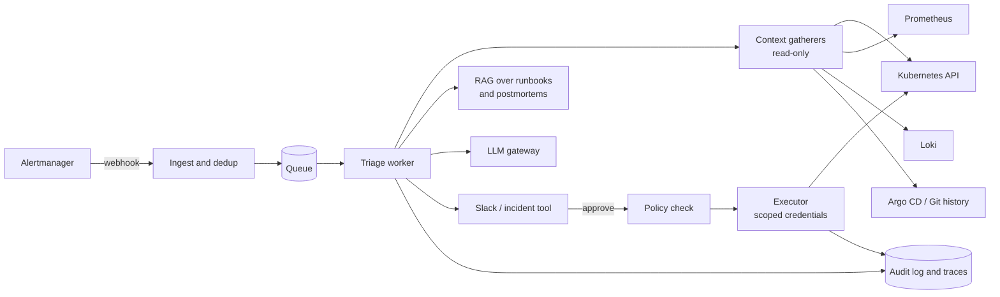
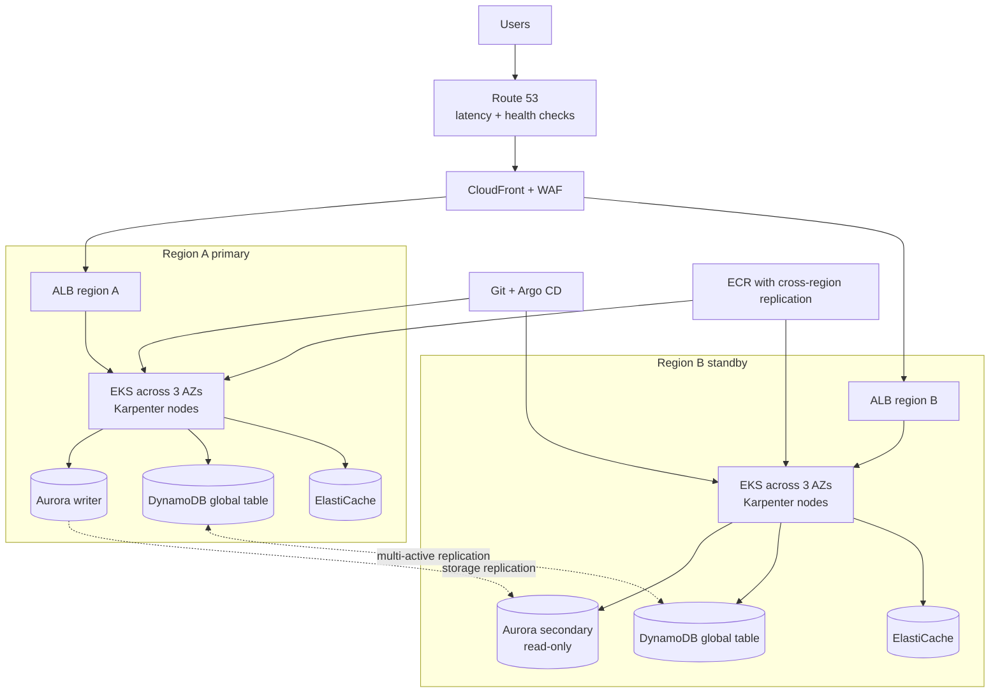

<Todo>Draft for review, written 2026-11-07. Every Python example lives in docs/knowledge-sharing/devops-interview-prep/examples and was run there (pytest 9.2, MCP Python SDK 2.3.0); verify_examples.py checks the article's Python blocks match those files. SEO package, keywords, cover image alt text and open checks are in docs/knowledge-sharing/devops-interview-prep/README.md. Before publishing: (1) fill the AUTHOR NOTE blocks; (2) add a cover image; (3) recheck the MCP SDK import if the SDK has moved past 2.x.</Todo>

Five years ago a DevOps loop was Linux, a cloud, some scripting and a whiteboard. Today the same loop asks you to debug a CrashLoopBackOff, defend an IAM policy, write a retry decorator, and then design an AI agent that triages alerts without deleting production. Teams ship LLM features and wire agents into their platforms through the Model Context Protocol, and they want the people who run that platform to understand both. This guide is my DevOps interview preparation plan for that bar: what interviewers actually probe, the answers I'd give out loud, and labs you can run on a laptop.

::toc

## How to use this DevOps interview preparation guide

Every topic section has the same shape: what interviewers are really testing, a concepts checklist, the most-asked questions with short model answers, one troubleshooting scenario, and a lab. Read the answers out loud. If you can't say one in under a minute without notes, you don't own it yet.

Don't memorise them: the follow-up is where seniority shows, so hang your own production stories on each one.

<Todo>📝 AUTHOR NOTE: Add one or two sentences on your own most recent interview loop: which company type, how many rounds, and which round surprised you.</Todo>

### A 7-week roadmap

About 8–10 hours a week, assuming you already do this job. Compress it to four weeks if the interview is next month.

| Week | Focus | Outcome |
| --- | --- | --- |
| 1 | Linux internals and debugging | You debug a slow server in a fixed order and can explain load average, OOM and inodes |
| 2 | Kubernetes core and debugging | You can trace `kubectl apply` to a running pod and fix the four common failure states |
| 3 | Kubernetes operations, AWS foundations | You can talk through upgrades, backups and RBAC, and draw a three-AZ VPC from memory |
| 4 | AWS compute, data and cost | You can choose between EC2, ECS, EKS and Lambda and defend it on cost and operations |
| 5 | Python for automation | You can write the three coding problems below in 20 minutes each, with tests |
| 6 | MCP and AI system design | You can draw a RAG pipeline, say how you'd evaluate it, and build a small MCP server |
| 7 | Mocks: system design and behavioural | Two timed design mocks, five written STAR stories, one full mock loop |

## Linux

**What interviewers are really testing:** whether you have a method when a box misbehaves. They want to hear you rule things out in order rather than reboot, and to know you understand what the numbers mean.

### Linux concepts checklist

- Boot: firmware (UEFI or BIOS), GRUB 2, kernel and initramfs, PID 1 (systemd), targets
- Processes: fork/exec, states (R, S, D, Z, T), signals, zombies and orphans
- systemd: units, targets, restart policy, journald, cgroups
- Permissions: mode bits, setuid/setgid/sticky, umask, ACLs, capabilities
- Filesystems: inodes, hard and soft links, deleted-but-open files
- Memory and CPU: page cache, swap, OOM killer, load average, iowait, steal, Pressure Stall Information (PSI)
- Networking: `ip`, `ss`, `tcpdump`, the DNS resolution path, TCP states

### Top Linux questions and model answers

**1. Walk me through the Linux boot process.**
Firmware initialises the hardware and hands off to a bootloader, usually GRUB 2, which loads the kernel and an initramfs. The kernel uses the initramfs to find and mount the real root filesystem, then starts PID 1, normally systemd, which brings up the default target by starting units in dependency order.

**2. SIGTERM vs. SIGKILL, and why does it matter in containers?**
SIGTERM can be caught, so the app can drain connections and exit cleanly; SIGKILL can't, and the kernel ends the process immediately. Kubernetes sends SIGTERM, waits `terminationGracePeriodSeconds` (30 by default), then SIGKILL. A shell script as PID 1 that doesn't forward signals is a classic cause of dropped requests on every deploy.

**3. What is a zombie process?**
A process that has exited but whose parent hasn't called `wait()` to collect its exit status. You can't kill it because it's already dead; you fix or restart the parent, and once the parent goes, PID 1 adopts and reaps the zombie. In containers that spawn children, that's why you run a small init such as `tini`.

**4. What does load average measure?**
On Linux it's the damped average number of tasks that are runnable or in uninterruptible sleep (D state), over 1, 5 and 15 minutes. So high load with idle CPUs usually means tasks are blocked on I/O, often disk or NFS. I compare it with `nproc`, then use `vmstat` and PSI to see which resource is actually contended.

**5. How does the OOM killer choose a victim?**
It scores processes mainly by memory use, adjusted by `oom_score_adj`, and kills the highest. In a cgroup with a memory limit, which is every Kubernetes container with a limit, the kill happens inside that cgroup even if the node has free memory. I confirm it in `journalctl -k`, and in Kubernetes the container's last state shows `OOMKilled` with exit code 137.

**6. `df` says the disk is full but `du` can't find the files. Why?**
Either a process still holds a deleted file open, so its blocks aren't freed, or the filesystem has run out of inodes rather than blocks. `lsof +L1` finds open files with no links left and `df -i` shows inode use. An inode holds a file's metadata; a hard link is another name for the same inode, while a symlink is a separate file holding a path.

**7. How do you write a systemd service that restarts on failure?**
`Restart=on-failure` with a `RestartSec`, plus `StartLimitIntervalSec` and `StartLimitBurst` so a crash loop eventually stops instead of hammering a dependency. Run it as a dedicated user with hardening such as `NoNewPrivileges=true` and `ProtectSystem=strict`, and read it with `journalctl -u`. Don't forget `systemctl daemon-reload`.

**8. A service can't resolve a hostname. How do you trace it?**
Check `/etc/resolv.conf` and, on systemd-resolved hosts, `resolvectl status`, then query the configured server directly with `dig` and compare with a public resolver. If it's intermittent, `tcpdump -i any -nn port 53` shows whether queries leave and answers return.

### Scenario: "The server is slow"

The trap is jumping to a fix. Say your order out loud first.

1. **Define slow.** Which requests, since when, for whom? What changed: deploy, traffic, a cron job?
2. **One-line picture.** Load versus CPU count, and PSI, which tells you directly how much time tasks stalled on CPU, memory or I/O:

```bash
uptime                 # load averages vs. CPU count (nproc)
cat /proc/pressure/cpu /proc/pressure/memory /proc/pressure/io
```

3. **CPU, memory and run queue over a few seconds.**

```bash
vmstat 1 5             # r = run queue, si/so = swapping, wa = iowait, st = steal
free -h
```

4. **Disk.**

```bash
iostat -xz 1 3         # %util and await per device (sysstat package)
df -h && df -i
```

5. **Which process?**

```bash
pidstat -u -d 1 5                                     # per-process CPU and disk
ps -eo pid,stat,wchan:20,cmd | awk '$2 ~ /^D/'        # tasks stuck in D state
journalctl -k --since "1 hour ago" | grep -i -E 'oom|killed process'
```

6. **Network.**

```bash
ss -s
ss -tanp state close-wait | head
ip -br addr && ip route get 1.1.1.1
```

7. **Go deeper on the suspect** with `strace -f -tt -p <pid>` to see which syscall it's blocked on, or `perf top` to see where CPU goes.

Finish with the fix and the alert you'd add so you hear about it first next time.

<Todo>📝 AUTHOR NOTE: Add a real "server is slow" story with a screenshot of vmstat or PSI output from one of your hosts.</Todo>

### Lab: break a box on purpose

Use a throwaway VM (Multipass, UTM or a free-tier EC2 instance) with `stress-ng` and `sysstat` installed:

```bash
# CPU pressure: watch load average and /proc/pressure/cpu climb
stress-ng --cpu "$(nproc)" --timeout 60s

# OOM inside a cgroup: systemd kills it when it passes 200 MB
sudo systemd-run --scope -p MemoryMax=200M stress-ng --vm 1 --vm-bytes 400M --timeout 30s
journalctl -k --since "5 min ago" | grep -i oom

# Deleted-but-open file
python3 -c "import time; f=open('/tmp/big','w'); f.write('x'*200_000_000); f.flush(); time.sleep(600)" &
sleep 5 && rm /tmp/big && df -h /tmp && sudo lsof +L1 | grep /tmp/big
```

Each time, run the slow-server checklist and note which command found the problem first.

## Kubernetes

**What interviewers are really testing:** whether you understand the control loop well enough to predict what Kubernetes will do, and whether you debug from events and status rather than guessing.

### Kubernetes concepts checklist

- Control plane (API server, etcd, scheduler, controller manager) and node (kubelet, runtime, kube-proxy or an eBPF replacement)
- Pod lifecycle: phases, container states, init and sidecar containers, termination
- Scheduling: requests vs. limits, QoS classes, taints and tolerations, affinity, topology spread
- Probes: startup, readiness, liveness
- Networking: Services, EndpointSlices, DNS, Ingress, Gateway API, NetworkPolicy
- Security: RBAC, ServiceAccounts, Pod Security Admission
- Scaling and state: HPA, Cluster Autoscaler or Karpenter, StatefulSets, PVCs
- Operations: etcd snapshots, Velero, upgrades and version skew

### Top Kubernetes questions and model answers

**1. What happens when you run `kubectl apply`?**
The API server authenticates the request, authorises it with RBAC, runs mutating then validating admission, and stores the object in etcd. The Deployment controller creates a ReplicaSet, which creates Pods; the scheduler binds each Pod to a node. The kubelet there pulls images, sets up networking through CNI and storage through CSI, and starts the containers, so every step is a controller watching the API server.

**2. Explain the three probe types.**
A startup probe protects slow starters: the other probes wait until it passes. Readiness controls traffic: failing it removes the pod from Service endpoints without a restart. Liveness restarts the container, so it must only check that the process is wedged, never a downstream database, or one DB blip restarts the whole fleet.

**3. Requests vs. limits, and QoS classes?**
The scheduler places pods by requests; limits are enforced at runtime, with CPU throttled and memory over the limit OOM-killed. Requests equal to limits for every resource gives Guaranteed QoS, some requests gives Burstable, none gives BestEffort, which is evicted first. I often skip CPU limits on latency-sensitive services, because throttling hurts tail latency.

**4. How do you debug Pending, CrashLoopBackOff and ImagePullBackOff?**
Pending means the scheduler can't place the pod: `kubectl describe pod` names the reason, whether insufficient resources, an untolerated taint, an unsatisfiable affinity rule or an unbound PVC. CrashLoopBackOff means it starts and exits, with restarts backing off up to five minutes; `kubectl logs --previous` and the exit code tell you why, and 137 usually means OOMKilled. ImagePullBackOff means the image never arrived: wrong tag, missing pull secret, expired registry credentials, or no route to the registry.

**5. Ingress or Gateway API?**
The Ingress API is stable but frozen; new features land in Gateway API, which is GA and splits roles into GatewayClass for the provider, Gateway for the platform team and HTTPRoute for app teams. That role split plus built-in traffic splitting is why I'd pick it for a new platform. The community ingress-nginx controller has also been retired, with maintenance ending in March 2026, so many teams are migrating anyway.

**6. How does RBAC work and how do you check it?**
Roles and ClusterRoles list verbs on resources; RoleBindings and ClusterRoleBindings grant them to users, groups or ServiceAccounts. It's additive only, with no deny rules. I verify with `kubectl auth can-i --as=system:serviceaccount:<ns>:<name>` and watch for the dangerous grants: reading secrets, `pods/exec`, creating pods in privileged namespaces, and wildcards.

**7. How does the HPA decide replica counts?**
It computes `desired = ceil(current × currentMetric / targetMetric)` and applies a stabilisation window, five minutes for scale-down by default, to avoid flapping. Utilisation is measured against requests, so pods without requests can't scale on CPU. Queue workers scale better on queue depth via KEDA.

**8. StatefulSets, backups and upgrades?**
A StatefulSet gives each pod a stable name, stable DNS through a headless Service, and its own PVC that follows it, which databases and Kafka need, though a managed database is often the better answer. For backups I use etcd snapshots on self-managed control planes and Velero for API objects and volumes, and I test restores on a schedule. For upgrades, the control plane moves one minor version at a time and kubelets may lag it by up to three; I check for removed APIs first, then upgrade control plane, add-ons and nodes, with PodDisruptionBudgets protecting quorum.

### Scenario: a rollout is stuck and pods are crash-looping

1. **Scope it.** One deployment or the whole namespace? Did a rollout just happen?

```bash
kubectl rollout status deployment/web -n shop
kubectl get pods -n shop -l app=web -o wide
kubectl get events -n shop --sort-by=.lastTimestamp | tail -20
```

2. **Read why the last container died.**

```bash
kubectl describe pod <pod> -n shop        # Last State, Reason, Exit Code, probe failures
kubectl logs <pod> -n shop --previous
```

3. **Branch on the evidence.** `OOMKilled`: raise the limit or fix the leak. Liveness failures in events: the probe is too aggressive for startup, so add a startup probe. An app error: diff config and secrets against the previous ReplicaSet.

```bash
kubectl rollout history deployment/web -n shop
kubectl diff -f deploy/web.yaml
```

4. **Restore service first, debug second.**

```bash
kubectl rollout undo deployment/web -n shop
```

With GitOps, revert the commit instead, or Argo CD or Flux will put the broken version straight back.

5. **If logs aren't enough,** attach a debug container to the pod:

```bash
kubectl debug -it <pod> -n shop --image=busybox:1.36 --target=web
```

A probe and resource setup that prevents most of these incidents:

```yaml
apiVersion: apps/v1
kind: Deployment
metadata:
  name: web
  namespace: shop
spec:
  replicas: 3
  selector:
    matchLabels:
      app: web
  template:
    metadata:
      labels:
        app: web
    spec:
      terminationGracePeriodSeconds: 30
      containers:
        - name: web
          image: nginx:1.27
          ports:
            - containerPort: 80
          resources:
            requests:
              cpu: 100m
              memory: 128Mi
            limits:
              memory: 128Mi
          startupProbe:
            httpGet:
              path: /
              port: 80
            failureThreshold: 30
            periodSeconds: 2
          readinessProbe:
            httpGet:
              path: /
              port: 80
            periodSeconds: 5
          livenessProbe:
            httpGet:
              path: /
              port: 80
            periodSeconds: 10
            failureThreshold: 3
```

<Todo>📝 AUTHOR NOTE: Add a screenshot of a real CrashLoopBackOff from your mk4 cluster, with `kubectl describe` showing Last State.</Todo>

### Lab: a failure zoo on Minikube

```bash
minikube start --nodes 3 --cpus 2 --memory 4g
minikube addons enable metrics-server
kubectl create namespace zoo

# CrashLoopBackOff
kubectl -n zoo create deployment crash --image=busybox:1.36 -- sh -c 'echo starting; exit 1'
# ImagePullBackOff
kubectl -n zoo run badimage --image=nginx:does-not-exist
# Pending: asks for more CPU than any node has
kubectl -n zoo create deployment hungry --image=nginx:1.27
kubectl -n zoo set resources deployment hungry --requests=cpu=64

kubectl -n zoo get pods -w
```

Diagnose each using only `describe`, `logs` and `events`. Then create the `shop` namespace, apply the Deployment above, and add an HPA:

```yaml
apiVersion: autoscaling/v2
kind: HorizontalPodAutoscaler
metadata:
  name: web
  namespace: shop
spec:
  scaleTargetRef:
    apiVersion: apps/v1
    kind: Deployment
    name: web
  minReplicas: 3
  maxReplicas: 10
  metrics:
    - type: Resource
      resource:
        name: cpu
        target:
          type: Utilization
          averageUtilization: 60
```

Stretch goal: install Velero against a local MinIO bucket, run `velero backup create shop-test --include-namespaces shop`, delete the namespace, and bring it back with `velero restore create --from-backup shop-test`.

## AWS

**What interviewers are really testing:** whether you design for failure and cost at the same time, and understand IAM well enough to explain why a request was denied.

### AWS concepts checklist

- VPC: CIDR planning, subnets per AZ, route tables, NAT gateways, VPC endpoints, security groups vs. NACLs
- IAM: identity vs. resource policies, roles and STS, permission boundaries, SCPs, evaluation order, Access Analyzer
- Compute: EC2 and Auto Scaling, ECS (EC2 and Fargate), EKS, Lambda
- Data: S3 classes and lifecycle, EBS vs. EFS, RDS and Aurora, DynamoDB
- Load balancing: ALB vs. NLB, target groups, health checks
- Observability: CloudWatch metrics, logs, alarms, Logs Insights, CloudTrail
- Resilience and cost: multi-AZ vs. multi-region, RTO/RPO, Savings Plans, Spot, Graviton, data transfer

### Top AWS questions and model answers

**1. Design a VPC for a production three-tier app.**
A /16 across three AZs, each with a public subnet for load balancers and NAT, a private subnet for compute, and an isolated subnet for databases with no internet route. One NAT gateway per AZ avoids a cross-AZ single point of failure, at a cost I'd call out. I'd add free gateway endpoints for S3 and DynamoDB and leave CIDR room for EKS pod IPs and future peering.

**2. How does IAM decide whether a request is allowed?**
An explicit Deny anywhere wins. Otherwise something must allow it, and every guardrail in play must permit it too: SCPs and resource control policies from Organizations, permission boundaries and session policies. Within an account, an allow in either the identity or resource policy is enough; across accounts, both sides must allow.

**3. How do you apply least privilege in practice?**
Grant only the actions the workload calls, scope them to resource ARNs, and add conditions such as `aws:SourceVpce` or tags. IAM Access Analyzer can generate policies from CloudTrail activity and flag unused access. Workloads get roles, never long-lived keys: instance profiles, ECS task roles, and EKS Pod Identity or IRSA.

**4. EC2 vs. ECS vs. EKS vs. Lambda?**
Lambda for event-driven or spiky work under 15 minutes per invocation; it gets expensive at sustained high throughput. ECS on Fargate is the simplest way to run long-lived containers. EKS when I need the Kubernetes ecosystem or a shared multi-team platform and accept its operating cost, and EC2 when I need the instance itself: special hardware, licensing, or software that won't containerise.

**5. ALB or NLB?**
ALB is layer 7: host and path routing, header rules, OIDC authentication and WAF. NLB is layer 4: very high connection rates, static IPs per AZ, TLS passthrough and non-HTTP protocols.

**6. RDS Multi-AZ, read replicas, or DynamoDB?**
Multi-AZ is for availability, a synchronous standby that RDS fails over to automatically; read replicas are asynchronous and exist for read scaling, so they can lag. DynamoDB fits known access patterns that need predictable low latency at any scale, if you design keys around those queries and avoid hot partitions.

**7. The AWS bill jumped. What do you look at first?**
Cost Explorer by service and then usage type, to find the line that moved. The usual culprits are NAT gateway data processing, cross-AZ or internet transfer, forgotten EBS volumes and idle load balancers, and log ingestion. Fixes: VPC endpoints instead of NAT for AWS APIs, Savings Plans for steady compute, Spot for interruptible work, Graviton where software supports arm64, and S3 lifecycle rules.

**8. DR strategies, and what you'd alarm on?**
AWS describes four, in rising cost and falling RTO/RPO: backup and restore, pilot light, warm standby, and multi-site active/active, and the business picks based on how long it can be down and how much data it can lose. For alarms I start with user symptoms, ALB 5xx rate, p99 response time and healthy hosts, then saturation such as database connections and replica lag, always over a window rather than single data points.

### Scenario: an app in a private subnet can't reach S3

1. **Is it `AccessDenied` or a timeout?** They have completely different causes.

```bash
aws sts get-caller-identity
aws s3 ls s3://my-app-bucket/ --debug 2>&1 | tail -20
```

2. **A timeout is the network.** Does the subnet's route table have a NAT route or an S3 gateway endpoint? If there's an endpoint, does its policy allow this bucket? Do the security group and NACL allow outbound HTTPS?
3. **AccessDenied is policy.** Simulate the role's identity policy:

```bash
aws iam simulate-principal-policy \
  --policy-source-arn arn:aws:iam::123456789012:role/app-role \
  --action-names s3:GetObject \
  --resource-arns arn:aws:s3:::my-app-bucket/config.json
```

4. **Then the other side:** the bucket policy (an explicit deny, or an `aws:SourceVpce` condition that doesn't match), an SCP, and, for objects encrypted with a customer-managed KMS key, whether the role can call `kms:Decrypt`. The KMS one catches people constantly.
5. **Confirm in CloudTrail,** which records the denied call, the principal, and often which policy type denied it.

The least-privilege policy for this workload:

```json
{
  "Version": "2012-10-17",
  "Statement": [
    {
      "Sid": "ReadAppConfig",
      "Effect": "Allow",
      "Action": ["s3:GetObject"],
      "Resource": "arn:aws:s3:::my-app-bucket/config/*"
    },
    {
      "Sid": "ListConfigPrefix",
      "Effect": "Allow",
      "Action": ["s3:ListBucket"],
      "Resource": "arn:aws:s3:::my-app-bucket",
      "Condition": { "StringLike": { "s3:prefix": ["config/*"] } }
    }
  ]
}
```

### Lab: a small, cheap, real environment

Set an AWS Budget alarm first. Then use Terraform to build a VPC with public and private subnets in two AZs and an EC2 instance in the private subnet with no public IP, and reach it through SSM Session Manager instead of SSH. Add an S3 gateway endpoint, remove the NAT route, and prove the instance can reach S3 but not the internet. Run `terraform destroy` the same day. My [Terraform tutorial](/blog/learning-terraform-real-project-tools-repository) walks through a real repository.

## Python

**What interviewers are really testing:** whether you write automation someone else can run at 3 a.m.: timeouts, real error handling, exit codes and tests. Algorithms matter less than in a software engineering loop.

### Python concepts checklist

- Data structures: list, dict, set, `collections` (Counter, defaultdict, deque) and their complexity
- Generators, comprehensions, `itertools`
- Decorators, closures, `functools.wraps`
- Context managers and `contextlib`
- Concurrency: threads, processes, asyncio, the GIL
- Errors: specific `except`, re-raising, `finally`, exit codes
- Automation: `argparse`, `subprocess`, `logging`, HTTP clients with timeouts
- Testing: pytest fixtures, parametrize, `monkeypatch`, `tmp_path`

### Top Python questions and model answers

**1. What's a generator, and why use one in ops scripts?**
A function that `yield`s values one at a time and keeps its state between calls, so it produces items lazily. For a multi-gigabyte log or a paginated API, memory stays flat and processing starts immediately.

**2. How does a decorator work?**
It's a function that takes a function and returns a new one, usually a wrapper that runs code around the original; `@retry` is just `func = retry(func)`. I always use `functools.wraps` so the wrapper keeps the original name and docstring for logs and tracebacks.

**3. What do context managers solve?**
Guaranteed cleanup: `__exit__` runs whether the block succeeds or raises, so files close and locks release. For my own resources I use `contextlib.contextmanager` with `try`/`finally` around the `yield`.

**4. Explain the GIL.**
In the default CPython build, only one thread runs Python bytecode at a time, so threads don't speed up CPU-bound work, but they do help I/O-bound work because the lock is released while waiting on sockets and disks. CPU-bound work goes to processes. CPython also ships a free-threaded build, officially supported since 3.14 but not the default.

**5. asyncio or threads?**
asyncio when there are thousands of concurrent I/O operations, because coroutines are far cheaper than threads, but everything in the path must be async, since one blocking call stalls the loop. For twenty health checks a thread pool is simpler; for ten thousand I'd use asyncio with a semaphore capping concurrency.

**6. How do you run shell commands safely?**
`subprocess.run` with an argument list, not a string with `shell=True`, so input can't inject commands. I set `check=True`, `capture_output=True`, `text=True`, and always a `timeout`.

**7. What does good exception handling look like in automation?**
Catch the specific exceptions you can handle and let the rest propagate; never use a bare `except:`, which hides bugs and swallows Ctrl-C. Retry only transient errors such as timeouts and 503s, and exit non-zero on failure so cron, CI or a Kubernetes Job notices.

**8. How do you test code that calls an external API?**
Keep logic separate from I/O so most of it is plain functions. Inject the client or the `sleep` function, or use `monkeypatch`, so tests never touch the network, and parametrize over failure cases: timeout, 500, malformed JSON.

### Coding problem 1: parse an access log

> Given an Nginx access log with request time as the last field, report the status code mix, the top paths returning 5xx, and p95 latency per path.

```python
"""Summarise an Nginx access log: status mix, top 5xx paths, p95 latency per path."""
import math
import re
import sys
from collections import Counter, defaultdict

# Combined log format with $request_time appended as the last field.
LINE = re.compile(
    r'(?P<ip>\S+) \S+ \S+ \[(?P<ts>[^\]]+)\] '
    r'"(?P<method>[A-Z]+) (?P<path>[^ ?"]+)[^"]*" '
    r'(?P<status>\d{3}) (?P<size>\d+|-) "[^"]*" "[^"]*" (?P<rt>\d+(?:\.\d+)?)$'
)


def parse(lines):
    """Yield one dict per valid line. A generator, so a 20 GB log never sits in memory."""
    for line in lines:
        match = LINE.match(line.rstrip("\n"))
        if match:
            yield match.groupdict()


def p95(values):
    ordered = sorted(values)
    return ordered[math.ceil(0.95 * len(ordered)) - 1]  # nearest-rank


def summarise(lines):
    statuses, errors, latency = Counter(), Counter(), defaultdict(list)
    for rec in parse(lines):
        statuses[rec["status"]] += 1
        if rec["status"].startswith("5"):
            errors[rec["path"]] += 1
        latency[rec["path"]].append(float(rec["rt"]))
    return {
        "statuses": dict(statuses),
        "top_5xx": errors.most_common(5),
        "p95": {path: p95(v) for path, v in latency.items()},
    }


if __name__ == "__main__":
    with open(sys.argv[1], encoding="utf-8", errors="replace") as fh:
        report = summarise(fh)
    print("status codes:", report["statuses"])
    print("top 5xx paths:", report["top_5xx"])
    for path, value in sorted(report["p95"].items(), key=lambda kv: -kv[1])[:5]:
        print(f"p95 {value:.3f}s  {path}")
```

Talk through the choices: the generator keeps memory flat, query strings are stripped so paths group together, and malformed lines and bad bytes don't crash the run.

### Coding problem 2: retry with exponential backoff

```python
"""Retry a flaky call with capped exponential backoff and full jitter."""
import functools
import random
import time


def retry(attempts=5, base=0.2, cap=5.0, retry_on=(ConnectionError, TimeoutError), sleep=time.sleep):
    def decorator(func):
        @functools.wraps(func)
        def wrapper(*args, **kwargs):
            for attempt in range(1, attempts + 1):
                try:
                    return func(*args, **kwargs)
                except retry_on:
                    if attempt == attempts:
                        raise  # out of budget: surface the real error
                    # Full jitter: random wait in [0, min(cap, base * 2^n)].
                    sleep(random.uniform(0, min(cap, base * 2 ** (attempt - 1))))
        return wrapper
    return decorator
```

And the tests:

```python
import pytest

from retry import retry


def test_succeeds_after_transient_failures():
    calls = []

    @retry(attempts=3, sleep=lambda _: None)
    def flaky():
        calls.append(1)
        if len(calls) < 3:
            raise ConnectionError("reset by peer")
        return "ok"

    assert flaky() == "ok"
    assert len(calls) == 3


def test_gives_up_and_reraises():
    @retry(attempts=2, sleep=lambda _: None)
    def always_down():
        raise TimeoutError("upstream timeout")

    with pytest.raises(TimeoutError):
        always_down()


def test_does_not_retry_bugs():
    calls = []

    @retry(attempts=5, sleep=lambda _: None)
    def buggy():
        calls.append(1)
        raise ValueError("bad input")

    with pytest.raises(ValueError):
        buggy()
    assert len(calls) == 1
```

What interviewers listen for: jitter, so a thousand clients don't retry in lockstep after an outage; caps on delay and attempts; retrying only transient errors; and an injectable `sleep` so tests run instantly. Retries also need idempotent operations.

### Coding problem 3: parallel health checks

```python
"""Check many HTTP endpoints in parallel with a per-request timeout."""
import sys
import time
import urllib.error
import urllib.request
from concurrent.futures import ThreadPoolExecutor, as_completed


def check(url, timeout=3.0):
    start = time.monotonic()
    try:
        with urllib.request.urlopen(url, timeout=timeout) as resp:
            status = resp.status
    except urllib.error.HTTPError as exc:  # 4xx/5xx still answered
        status = exc.code
    except (urllib.error.URLError, TimeoutError, OSError) as exc:
        return url, None, f"{type(exc).__name__}: {exc}"
    return url, status, f"{(time.monotonic() - start) * 1000:.0f} ms"


def check_all(urls, workers=20):
    # Threads are fine here: the GIL is released while waiting on sockets.
    with ThreadPoolExecutor(max_workers=workers) as pool:
        futures = [pool.submit(check, u) for u in urls]
        for future in as_completed(futures):
            yield future.result()


if __name__ == "__main__":
    failed = 0
    for url, status, detail in check_all(sys.argv[1:]):
        healthy = status is not None and 200 <= status < 400
        failed += not healthy
        print(f"{'OK  ' if healthy else 'FAIL'} {status or '---'} {url} ({detail})")
    sys.exit(1 if failed else 0)
```

Run it as `python3 health_check.py https://example.com http://localhost:8080/healthz`. It's standard library only, every request has a timeout, and the exit code makes it usable in CI. At 10,000 endpoints, move to asyncio with a semaphore.

### Lab: write a real ops CLI

Build an `argparse` tool that lists pods in a namespace with the Kubernetes Python client, flags any with restarts above a threshold, and exits non-zero if it finds one. Test it with a fake client. My [Python tutorial](/blog/python-tutorial-beginners-real-projects) uses real project code if you need a starting point.

## MCP (Model Context Protocol)

**What interviewers are really testing:** whether you see MCP as an integration protocol with a real security surface, and whether you'd give an AI agent access to production tools responsibly.

### MCP concepts checklist

- Architecture: host, client (one per server connection), server
- JSON-RPC 2.0, capability negotiation at initialisation, a date-versioned spec
- Server primitives: tools (model-controlled), resources (application-controlled), prompts (user-controlled)
- Client features: sampling, roots, elicitation
- Transports: stdio locally, Streamable HTTP remotely
- Authorisation: OAuth 2.1 for HTTP, audience-bound tokens, no token passthrough
- Risks: prompt injection via tool output, tool poisoning, over-broad permissions, confused deputy

### Top MCP questions and model answers

**1. What is MCP?**
An open protocol for connecting AI applications to tools and data. A system exposes an MCP server once, and any MCP-capable host, an IDE, a desktop assistant or your own agent, can discover and call its tools, resources and prompts.

**2. Host, client and server: who's who?**
The host is the application the user runs; it owns the model and the user's consent. Inside it, one client per server holds a stateful connection, and the server exposes capabilities, either as a local subprocess or a remote HTTP service.

**3. Tools vs. resources vs. prompts?**
Tools are functions the model decides to call, with a JSON Schema for inputs, so they're the risky part. Resources are read-only context addressed by URI, such as a runbook, that the application chooses to include. Prompts are reusable templates the user picks, like a "triage this alert" workflow.

**4. stdio vs. Streamable HTTP?**
With stdio the host launches the server as a subprocess and they talk over stdin and stdout; it's local and runs with the user's own permissions. Streamable HTTP, which replaced the older HTTP plus SSE transport, runs the server as a remote service for many clients. Remote means real authentication, TLS and rate limits.

**5. How does authorisation work for remote servers?**
The spec builds on OAuth 2.1: the MCP server is a resource server, and it must check that each token was issued for it. It must not accept tokens meant for other services or pass the client's token through to downstream APIs, which is the confused deputy problem.

**6. What are the main security risks?**
Prompt injection first: tool results, tickets and logs are untrusted text, and a model can follow instructions hidden in them. Then over-broad tools such as `run_shell` or a cluster-admin ServiceAccount, malicious tool descriptions that steer the model, and local servers that can touch everything the user can. Mitigations: narrow read-only tools, human approval for state changes, and audit logs.

**7. Are tool annotations like `readOnlyHint` a security control?**
No. They're hints that help the host decide when to ask the user, and a client should treat them as untrusted unless it trusts the server. The real control is what the server's credentials can do, so a read-only tool needs a read-only role behind it.

**8. How would you build an MCP server for an internal ops tool?**
Start from the questions on-call engineers actually ask and expose narrow, typed, read-only tools for them: health by service name, recent deploys, the runbook for an alert. The server holds its own scoped credentials, validates every input against an allowlist, and never accepts raw URLs, shell commands or free-form queries from the model. Anything that changes state goes through approval outside the model, and every call is logged with the caller's identity.

A minimal version with the official Python SDK. In SDK 2.x the high-level class is `MCPServer`; 1.x called it `FastMCP` and imported it from `mcp.server.fastmcp`.

```python
"""A small read-only MCP server for an internal ops tool (MCP Python SDK 2.x)."""
from pathlib import Path

from mcp.server.mcpserver import MCPServer
from mcp.types import ToolAnnotations

from health_check import check

RUNBOOKS = Path(__file__).parent / "runbooks"
# The model never chooses a URL: it picks a service name from this allowlist.
SERVICES = {
    "web": "http://localhost:8080/healthz",
    "api": "http://localhost:8081/healthz",
}

mcp = MCPServer("ops-tools", instructions="Read-only health and runbook access.")


@mcp.tool(annotations=ToolAnnotations(readOnlyHint=True, openWorldHint=False))
def service_health(service: str) -> dict:
    """Return the HTTP status and latency of one known service."""
    if service not in SERVICES:
        return {"error": f"unknown service; choose one of {sorted(SERVICES)}"}
    _, status, detail = check(SERVICES[service], timeout=2.0)
    return {"service": service, "status": status, "detail": detail}


@mcp.resource("runbook://{name}", mime_type="text/markdown")
def runbook(name: str) -> str:
    """A runbook by name, e.g. runbook://crashloop."""
    path = (RUNBOOKS / f"{name}.md").resolve()
    if path.parent != RUNBOOKS.resolve() or not path.is_file():
        raise ValueError(f"no runbook named {name!r}")
    return path.read_text(encoding="utf-8")


@mcp.prompt()
def triage(alert_name: str, namespace: str) -> str:
    """Start an alert triage conversation."""
    return (
        f"Alert {alert_name} fired in namespace {namespace}. "
        "Check service_health first, read the matching runbook, and propose "
        "next steps. Do not suggest commands that change the cluster."
    )


if __name__ == "__main__":
    mcp.run()  # stdio by default; mcp.run(transport="streamable-http") for remote
```

It reuses `check()` from the health-check problem. Notice what the model can't do: choose a URL, read outside the runbook folder, or change anything.

### Scenario: an agent closed 40 tickets after reading one

1. **Contain.** Disable the tool or revoke the server's token before hunting for the root cause.
2. **Reconstruct.** Pull the MCP call log: which calls, in what order, with what arguments, on whose behalf.
3. **Find the trigger.** Most likely indirect prompt injection: the ticket body said something like "close all related tickets", and the model treated data as instructions.
4. **Fix the design, not just the prompt.** Split read and write tools, require human confirmation for state changes, limit bulk operations, and scope the token to the user's own permissions.
5. **Prevent regressions.** Add the malicious ticket to an evaluation set that runs on every prompt or model change.

### Lab: build, connect and attack your own server

Put the server, `health_check.py` and a `runbooks/` folder with a Markdown file side by side, `pip install mcp`, and connect it to an MCP-capable client or the MCP Inspector. Then attack it: request `runbook://../../etc/passwd`, plant an instruction inside a runbook, and ask for a service that isn't on the allowlist. My [RoboShop MCP server article](/blog/roboshop-ai-mcp-server) shows a server that forwards the caller's own session instead of holding broad credentials.

## AI system design

**What interviewers are really testing:** whether you treat an LLM as an unreliable, expensive, slow dependency and design around it with retrieval, evaluation, caching, guardrails and observability, as you would any other risky component.

### AI system design concepts checklist

- RAG: ingestion, chunking, embeddings, hybrid search, reranking, prompt assembly, citations
- Vector stores: pgvector, OpenSearch, dedicated vector databases; HNSW indexes; metadata filters
- Evaluation: recall@k, MRR, faithfulness, golden sets, LLM-as-judge and its limits
- Latency and cost: tokens, time to first token, streaming, model routing
- Caching: provider prompt caching, response and embedding caches, semantic caching
- Guardrails: input and output validation, PII, structured output
- Observability: per-request traces, token and cost metrics, feedback
- Agents: tool use, step limits, human-in-the-loop, audit

### Top AI system design questions and model answers

**1. Walk me through a RAG architecture.**
Offline: ingest documents, chunk them, embed each chunk, and store vectors with metadata such as source and access level. Online: embed the query, run hybrid keyword-plus-vector search filtered by the user's permissions, rerank the candidates, and put the best few in the prompt with instructions to answer only from them and cite sources. Freshness and permissions break more often than the model.

**2. How do you choose a chunking strategy?**
Follow the document's structure, headings, sections and code blocks, rather than fixed character counts, with chunks specific enough to match and complete enough to stand alone. I prefix each chunk with its title and section path so it keeps context. Then I tune chunk size against an evaluation set.

**3. How do you evaluate a RAG system?**
Retrieval and generation separately. Retrieval gets a golden set of questions with known relevant documents, measured by recall@k and MRR; answers get checked for faithfulness to the context, relevance and correct citations, using human review plus an LLM judge I've validated against human labels. It runs in CI whenever the prompt, model, chunking or index changes.

**4. Why add a reranker?**
Embedding search is fast but approximate, because query and chunk vectors are computed independently. A cross-encoder reads the query and each candidate together and scores relevance far better, but it's too slow for the whole corpus. So I retrieve around 50 candidates cheaply and rerank to the top 5, which often helps more than a bigger model.

**5. How do you control latency, cost and caching?**
Measure tokens, time to first token and latency per step first. Then retrieve fewer, better chunks, route easy requests to a smaller model, stream output, and put stable content such as the system prompt and tool definitions first so provider prompt caching applies. Exact-match response and embedding caches are safe; semantic caching is risky because similar questions can need different answers and a shared cache can leak across users, so scope it per tenant with a strict threshold.

**6. What guardrails would you add?**
On input: authentication, rate and size limits, and treating all retrieved and user content as untrusted. On output: schema validation, PII and secret checks, and grounding checks against the retrieved sources. For actions, the model proposes and deterministic policy decides.

**7. How do you observe an LLM app in production?**
A trace per request with spans for retrieval, reranking and each model and tool call, recording model, tokens, latency, cost and retrieved document IDs, following OpenTelemetry's generative AI semantic conventions so it fits the existing stack. Alerts catch error rates and token spikes, and user feedback links back to traces.

**8. How would you use AI agents in SRE safely?**
Start where mistakes are cheap: summarising alerts, correlating them with recent deploys, finding the runbook, drafting the timeline. Let the agent read broadly but act narrowly, through specific tools with scoped credentials, and make a human approve anything that changes state. Then measure time to diagnosis and how often its suggestions were right.

### Scenario: the RAG assistant started giving wrong answers last week

1. **Define wrong:** wrong facts, outdated answers, or "I don't know" when the answer exists?
2. **Check what changed:** model, prompt, embedding model, chunking or a re-index. Changing the embedding model without re-embedding everything silently breaks retrieval.
3. **Split retrieval from generation.** In each bad trace, were the right chunks retrieved? If not, fix retrieval; if they were, look at the prompt or model.
4. **Check freshness.** A stalled ingestion job is the most common cause of "it used to know this".
5. **Reproduce in the evaluation set,** fix it, and keep the cases so the regression can't return silently.

### Lab: a local RAG with an evaluation harness

Run Postgres with pgvector in Docker, embed your own notes or runbooks with a local embedding model, and build a small retrieval API. Write 30 questions with known answers and measure recall@5 before and after changing chunk size. I wrote up [adding PyTorch reranking to my SRE assistant's RAG pipeline](/blog/pytorch-rag-reranking-moks-sre-agent).

## System design walkthrough 1: an AI SRE agent that triages Kubernetes alerts

Spend the first five of 45 minutes on requirements; most candidates skip them.

### Requirements: SRE agent

- **Functional:** receive Alertmanager alerts; gather context (pod status, events, logs, metrics, recent deploys); find runbooks and past incidents; post a summary with likely cause and suggested fix to on-call; execute an action only after a human approves it.
- **Non-functional:** first summary within 60 seconds; no change without approval; every action audited; 20 clusters; if the AI path fails, the alert still reaches on-call unchanged; cost per triage tracked.
- **Out of scope for v1:** autonomous remediation and alert rule tuning.

### High-level design: SRE agent



### Deep dive: SRE agent

**Ingestion.** Alertmanager already groups alerts; I deduplicate by fingerprint and queue the work, so a storm of 500 alerts becomes a handful of triage jobs and the webhook never blocks.

**Context gathering is code, not the model.** For `KubePodCrashLooping`, the worker always fetches the pod description, previous container logs, recent events, rollout history and the matching Argo CD sync. The model gets curated context, not a shell.

**Retrieval.** Runbooks and postmortems are indexed with alert name, service and cluster as metadata. Filtering on the alert name before semantic search puts the right runbook first almost every time.

**Reasoning.** The model returns structured output: probable cause, evidence with links, confidence, and actions picked from a fixed catalogue such as roll back, scale up or restart. It can't invent commands.

**Human-in-the-loop.** Suggestions arrive in Slack with approve and reject buttons. On approval, a policy engine checks the action (no deletes, no production changes during a freeze, a blast-radius limit), and an executor with a narrowly scoped ServiceAccount per cluster runs it. In MOKS, the SRE portal I run on my own cluster, read-only diagnostics run without approval but restores wait for a human, and that split is the most important decision in the design.

### Trade-offs: SRE agent

- **Fixed workflows vs. an agent loop.** Per-alert workflows are predictable and cheap; an agent handles the long tail. Start with workflows for the top ten alerts and a constrained agent for the rest.
- **Self-hosted vs. API models.** Logs can hold secrets and customer data, so data handling may decide this before quality does. Redact secrets before anything leaves the cluster either way.

### Scaling and failure modes: SRE agent

- **LLM slow or down:** time out at 30 seconds and post the alert with the gathered context, which is useful on its own.
- **Alert storm:** dedup, queue and a per-cluster concurrency limit; triage the first alert in a correlated group.
- **Prompt injection through logs:** logs are untrusted, and the action catalogue plus policy engine mean even a manipulated model can only suggest something a human must approve.
- **Wrong suggestions erode trust:** show evidence and confidence, track acceptance per alert type, and switch suggestions off where it's low.
- **Executor credentials:** per cluster and per action, short-lived, every use logged.

<Todo>📝 AUTHOR NOTE: Add a screenshot of a MOKS triage summary or approval screen, and one sentence on what surprised you when you built it.</Todo>

For more depth, my [MOKS RAG and skills design](/blog/moks-rag-and-skills-design) covers retrieval and governance, and [LangChain vs. LangGraph for an SRE agent](/blog/langchain-vs-langgraph-sre-agent-moks) covers orchestration.

## System design walkthrough 2: a highly available multi-region web platform on AWS and EKS

### Requirements: multi-region platform

- **Functional:** a customer-facing web app and API with accounts, orders and a product catalogue.
- **Non-functional:** 99.95% availability; survive an AZ loss with no manual action and a region loss within 15 minutes (RTO) with under a minute of data loss (RPO); p99 API latency under 300 ms on two continents; zero-downtime deploys several times a day.
- **Clarify:** read/write ratio, data residency, and whether writes must be accepted in both regions. That last answer drives most of the design.

### High-level design: multi-region platform



### Deep dive: multi-region platform

**Edge.** CloudFront serves static assets and terminates TLS near users, with WAF in front; Route 53 latency-based routing with health checks sends API traffic to the nearest healthy region.

**Per region.** A three-AZ VPC, an ALB, and EKS with Karpenter provisioning nodes across AZs. Topology spread constraints put replicas in every AZ, and PodDisruptionBudgets stop node rotations from breaking quorum.

**Data is the hard part,** so I split it by consistency needs:

- **Orders and accounts** in Aurora PostgreSQL with Aurora Global Database: region A writes, region B holds a read-only secondary with lag typically under a second, and we promote B if A fails.
- **Sessions and carts** in DynamoDB global tables, which accept writes in both regions with last-writer-wins conflict resolution: fine for a cart, not for an order.
- **ElastiCache** per region as a pure cache, so losing it costs latency, not data.
- **S3** for media with cross-region replication.

**Deploys.** ECR replicates images across regions, and Argo CD syncs the standby region first as a canary, with automated rollback on error rate.

### Trade-offs: multi-region platform

- **Active/passive vs. active/active writes.** Active/active orders need conflict-free data models or a globally consistent database and much harder testing. With a 15-minute RTO, active/passive writes and active/active reads is the honest answer.
- **Cost.** A warm standby roughly doubles the baseline. Region B can run smaller and scale on failover, but then that scale-up, including EC2 capacity in that region, has to be tested.
- **EKS vs. ECS.** EKS is justified if the company already runs Kubernetes; otherwise ECS on Fargate removes a lot of operational work. Say that out loud.

### Scaling and failure modes: multi-region platform

| Failure | What happens | Mitigation |
| --- | --- | --- |
| One AZ lost | ALB stops routing there; Karpenter replaces capacity; Aurora moves the writer if needed | Three AZs, topology spread, PDBs, ~30% headroom |
| EKS control plane issue in a region | Running pods keep serving; no deploys or scaling | Freeze deploys there; shift traffic via Route 53 if needed |
| Bad deploy | Error rate rises in the canary region | Automated rollback, one region at a time |
| Region A lost | Health checks shift traffic to B; writes fail until promotion | Practised Aurora promotion runbook or automation |
| Payments provider outage | Checkout fails | Timeouts, circuit breakers, queue orders for later |

The closing line I'd give: none of this is real until it's tested. Run game days that fail an AZ and then a region, and measure actual RTO and RPO against the targets.

<Todo>📝 AUTHOR NOTE: If you've run a real failover or game day, add the measured RTO/RPO and what broke.</Todo>

## The behavioural round

Senior engineers fail loops here more often than they admit. Interviewers want evidence of judgement and ownership.

### Five questions to prepare

1. Tell me about the worst production incident you were part of.
2. Tell me about a time you disagreed with a technical decision.
3. Describe something you automated that saved your team real time.
4. Tell me about a change you made that caused an outage.
5. How have you improved on-call for your team?

### STAR tips for incident stories

- **Situation:** one or two sentences with scale and stakes: "checkout was failing for 30% of users at peak."
- **Task:** your specific role: incident commander, debugger, communicator.
- **Action:** most of your time goes here: what you checked in what order, what you ruled out, and the trade-offs, such as rolling back before knowing the root cause.
- **Result:** numbers: time to mitigate, customer impact, and follow-ups that shipped, not just ones that were filed.
- **Reflection:** what you'd do differently, in blameless language. "The pipeline allowed it" lands better than naming a colleague.

Have one story where you were the cause, and what you changed so nobody else can repeat it.

<Todo>📝 AUTHOR NOTE: Add a short STAR example of your own, ideally an incident you caused and what you changed afterwards.</Todo>

## Common mistakes candidates make

- Jumping to a fix before asking what changed and what "slow" means.
- Listing tools instead of a method: "I'd use Prometheus" isn't an answer.
- Designing without requirements, or ignoring cost.
- Treating AI as magic: no evaluation plan, no guardrails, no fallback when the model is slow or wrong.
- Giving an agent broad credentials "for now".
- Saying "it depends" and stopping. Say what it depends on, then choose.
- Python with no timeouts, a bare `except:` and no exit codes.
- Bluffing. "I haven't run that at scale, but here's how I'd test it" is a strong sentence.

## The day before the interview

- [ ] Map each line of the job description to one story or answer.
- [ ] Say the slow-server and CrashLoopBackOff walkthroughs out loud once.
- [ ] Redraw both system designs from memory in under 10 minutes each.
- [ ] Write the retry decorator from scratch.
- [ ] Review your five STAR stories, with numbers.
- [ ] Prepare three questions for them: on-call load, how incidents are reviewed, how they use AI in operations.
- [ ] Test camera, microphone and screen sharing, and have a plain editor ready.
- [ ] Sleep. A rested brain debugs better than a crammed one.

## Conclusion

You still need deep Linux, Kubernetes and AWS fundamentals, but now you're also expected to automate cleanly in Python and reason about AI systems and the protocols that connect them to production. The same habits cover all of it: ask what changed, gather evidence before acting, design for failure, keep permissions narrow, and measure everything.

Treat this DevOps interview preparation guide as a plan, not a script. Run the labs, break things on purpose, and turn what you learn into your own stories.

If it helped, subscribe to jithendar.com for more hands-on posts. Good next reads are my [MOKS RAG and skills design](/blog/moks-rag-and-skills-design) and the [RoboShop MCP server](/blog/roboshop-ai-mcp-server) walkthrough.

## Frequently asked questions

### How long does DevOps interview preparation take?

For someone already working in DevOps or SRE, six to eight weeks at 8–10 hours a week covers Linux, Kubernetes, AWS, Python and AI system design properly. With less time, prioritise the troubleshooting walkthroughs and one system design.

### Do DevOps interviews now include AI and MCP questions?

Increasingly, especially at product companies and startups that ship LLM features. Expect RAG architecture, evaluating and observing LLM apps, and how you'd give an AI agent safe access to tools, which is where MCP comes in.

### Which Kubernetes topics come up most in SRE interviews?

Pod lifecycle and probes, debugging CrashLoopBackOff, ImagePullBackOff and Pending, requests and limits, RBAC, autoscaling, and upgrades and backups.

### How much Python do I need for a DevOps interview?

Enough to write clean automation under time pressure: parse logs, call APIs with timeouts and retries, run work in parallel, handle errors and write pytest tests. Heavy algorithm questions are rarer than in software engineering loops.

### How do I practise system design for DevOps roles?

Take a prompt, set 45 minutes, and talk through requirements, high-level design, deep dive, trade-offs and failure modes, ideally with a peer.
