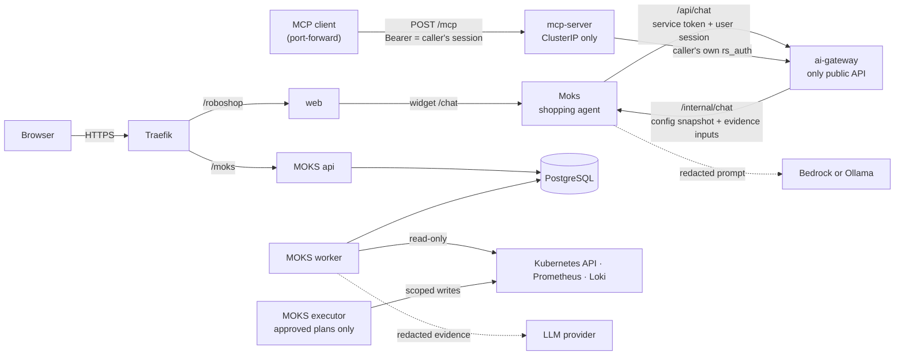
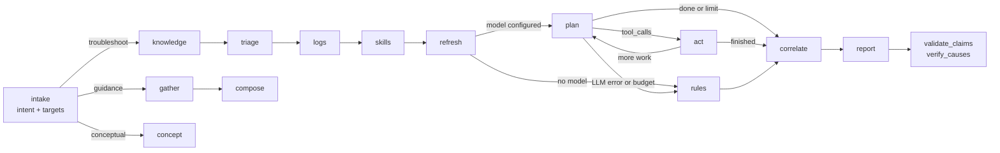

<Todo>Review every section against the repositories, add your own commentary, then set status to published with a publishedAt time.</Todo>

I run four AI systems on one Minikube cluster. They do different jobs: one investigates production incidents, one fronts a shop, one exposes that shop to MCP clients, and one recommends products. They share one rule.

**The model proposes, code decides.** The language model receives evidence that has been redacted and wrapped in tags marking it as untrusted. It returns *requests* (tool calls, a plan, a list of SKUs) or *text*. It never holds credentials. Code decides what is in scope, who may do what, how much may be spent, and whether anything changes in the world.

:::callout{type="info" title="Two systems called Moks"}
**MOKS** (capitals) is my SRE investigation portal at [jithendar.com/moks](https://jithendar.com/moks). **Moks** is the RoboShop shopping widget at `/roboshop/moks`. They share a name and nothing else: different repositories, different code, no calls between them.
:::

::toc

## The platform

Everything runs on **mk4**, a Minikube cluster on a single arm64 server. [Argo CD](https://argo-cd.readthedocs.io/) delivers both projects. MOKS has a root Application plus one per component (`moks-api`, `moks-worker`, `moks-executor`, `moks-crewai` and so on, see `moks/docs/ARGOCD_APP_SPLIT.md`). RoboShop has one `roboshop-<app>` Application per service, with manual sync and no pruning (`roboshop-ai/argocd-minikube/README.md`).

Images come from my own Harbor registry, `registry.jithendar.com/jithendar/<image>:latest`. CI builds and pushes them on every push to `master`. For telemetry, services send OpenTelemetry traces to a collector and on to Jaeger, Prometheus scrapes metrics, and Alloy ships JSON logs to Loki. MOKS also *reads* that same Prometheus and Loki as evidence. That matters during an incident: if Loki is down, MOKS loses its own logs and a source of evidence at once.

The RoboShop services themselves (catalogue, cart, payment, shipping, the event pipeline) are covered in [Inside RoboShop AI: microservices on Kubernetes](/blog/roboshop-ai-microservices-architecture). Here I only cover the AI parts.



All four systems and who calls whom. Dotted arrows are the only places a model is involved; every solid arrow is checked by code.

## MOKS: the SRE investigation agent

You ask MOKS "Why is checkout returning 502 errors?". It collects live evidence through typed, read-only tools and returns a report that keeps observed facts, suspected causes, missing evidence, next steps and proposed remediation apart.

### Components

| Component | Role |
|---|---|
| `moks-api` (×2) | FastAPI: the React portal, REST API, server-sent events, sign-in |
| `moks-worker` | Claims queued investigations (`FOR UPDATE SKIP LOCKED`) and runs them |
| `moks-executor` | The **only** process with write credentials, with its own ServiceAccount bound per namespace |
| PostgreSQL | The only system of record: users, RBAC, investigations, evidence, audit |
| OpenSearch | Optional knowledge index; derived data that can be rebuilt from PostgreSQL |

The API and worker cannot even construct the writer: a `MOKS_PROCESS_ROLE` guard stops them (`docs/SECURITY.md`). The in-cluster `moks-reader` ClusterRole has no write verbs and no Secrets, ConfigMaps, `pods/exec`, `pods/attach` or `pods/portforward`.

### The investigation loop

An investigation is a LangGraph state machine (`backend/moks/orchestrator/graph.py`). The graph only decides what runs next; every node calls an `Investigator` method, and every live read goes through one `ToolExecutor`.



The MOKS investigation graph. The model is only consulted in `plan` and `report`; with no model, or after a model failure, the `rules` path still produces a report.

In `plan`, the model sees the question, the scope, the tool schemas and the evidence so far, all inside randomly tagged `<untrusted_data>` blocks. It answers in MOKS's own JSON protocol: `{"tool_calls": [...], "done": bool}`. Each call is checked against the tool allowlist, the argument schema, RBAC, scope and size bounds before any connector runs. A rejected call is audited and fed back so the model does not repeat it.

Limits are enforced in code (`backend/moks/config.py`, `docs/ARCHITECTURE.md`):

| Limit | Value |
|---|---|
| Tool calls per investigation | 16 by default; `values.yaml` sets 24 on mk4 |
| LLM planning rounds | 4 |
| Duration | 180 s, via `asyncio.timeout` |
| Stored result size | 48,000 bytes, truncated structurally |
| Tokens per investigation | 60,000 |
| Cost | Daily USD budget per LLM configuration, plus per-user and per-investigation budgets |

Every model call reserves its worst-case cost before it runs (`moks/llm/budget.py`). If the model fails or the budget runs out, MOKS falls back to rule-based follow-ups (logs of crashed pods, memory against limits, recent rollouts) and says so in the report. An unavailable connector becomes a "missing evidence" item, not a failure.

### The evidence ledger and claim validation

Every tool result is stored as a numbered evidence row, `E1` to `En`, with the tool, arguments, scope, the exact query, timing and the redacted data. The report has to cite those rows. This is the contract (`backend/moks/orchestrator/report.py`, trimmed):

```python
class Cause(BaseModel):
    cause: str
    confidence: Literal["low", "medium", "high"] = "low"
    evidence: list[str]       # E-refs, checked against the ledger
    verified: bool = False    # set only by verify_causes; never by the model

class Report(BaseModel):
    summary: str
    observed_facts: list[Fact]                 # each {statement, evidence[]}
    suspected_causes: list[Cause]
    missing_evidence: list[str]
    next_steps: list[str]
    proposed_remediation: list[Remediation]    # executable=False, always
    generated_by: Literal["llm", "rules"] = "rules"
```

After the model writes the report, code validates it. Facts with no real evidence reference are dropped. Causes without evidence fall to `low`. "Confirmed" or "resolved" wording gets an explicit "unverified" note. A model's cause is **never** marked verified, whatever its confidence. Verified causes come only from five detectors that observe the fault directly: `service_selector_mismatch`, `oomkilled`, `image_pull`, `unschedulable` and `config_ref_missing`.

### Two layers of authorization

Access is the intersection of two independent controls (`docs/SECURITY.md`):

1. **Application RBAC.** Bindings of the form `role : environment-pattern : namespace-pattern`, for roles from viewer up to admin.
2. **Infrastructure scope.** Each environment has allowed and denied namespace lists that apply to everyone, administrators included, and the connector's own Kubernetes RBAC narrows it further.

The effective scope is *RBAC ∩ allow-list − deny-list*. It is checked in the API, again when the worker picks up the job, and again in the executor on every tool call, including calls the model planned. Free-form LogQL must pin `namespace="<permitted>"` in every selector. Revocation reaches running work within 5 seconds: the investigation compares version counters before every tool call, before every LLM request, and every 5 seconds.

### Action plans, approvals and at-most-once execution

MOKS reports never execute anything. Changes go through **action plans**: an allowlist of `restart_deployment`, `scale_deployment`, `rollback_deployment`, `patch_resources`, `apply_config_patch` and `open_pull_request`. A plan is bound by SHA-256 to the environment, namespace, action, target, parameters, requester, expiry and the target's `resourceVersion`. Approvers submit the hash they reviewed, and the requester cannot approve their own plan.

The executor re-checks everything right before acting. It requires the live `resourceVersion` to equal the reviewed one, writes an `intent` checkpoint, mutates once, reads the result back and records `applied`. If the outcome is uncertain, the plan goes to `reconciliation_required` for a person to decide. Nothing is ever replayed.

One exception is stated plainly in the docs: a global administrator can approve their own plans, which removes separation of duties for that role. Each waiver is audited as `action.approval_waived`.

### The hash-chained audit log

`audit_events` records sign-ins, denials, every tool call (allowed and denied) and every configuration change. Database triggers reject UPDATE, DELETE and TRUNCATE. A BEFORE INSERT trigger sets `hash = sha256(prev_hash | seq | row content)`, and `moks verify-audit` recomputes the chain. The docs call this **tamper-evident, not tamper-proof**: a database superuser could disable the triggers and rewrite the whole chain consistently. Shipping checkpoints off-cluster is the documented fix.

### The opt-in CrewAI flow

For one question, "why is this workload unhealthy?", MOKS can run three [CrewAI](https://github.com/crewAIInc/crewAI) agents in sequence instead of the LangGraph loop (`docs/crewai-investigation.md`):

1. A **workload investigator** with nine read-only tools (pods, events, logs, metrics, alerts).
2. A **change investigator** with rollout history, config audit, Git commits and runbook search.
3. An **incident reviewer** with only `evidence_list`, which returns the JSON findings.

The 14 investigation tools are read-only and go through the same `ToolExecutor`, so each call becomes an evidence row. The reviewer's `evidence_list` only reads what has been recorded. The model supplies only narrow arguments. The environment, namespace, workload and time window are bound from the investigation, and a pod outside `<workload>-…` is refused. After the crew finishes, code rejects citations that are not in the registry and removes findings left with none. It also caps confidence: `low` with no live evidence, at most `medium` with one source, and `high` only with two. The usual `validate_claims` and `verify_causes` then run as they do for every report.

CrewAI sends anonymous telemetry by default. MOKS turns it off before importing crewai, and a test fails if a run resolves any non-local host. Memory, knowledge and planning are off, because each would call a provider of its own. CrewAI runs in its own worker Deployment, `moks-crewai`, so its 76 extra packages stay out of every other pod.

## The AI gateway

`ai-gateway` is RoboShop's only public API. Browsers never talk to a backend service directly. It has [its own article](/blog/roboshop-ai-gateway), so this is the short version (`services/ai-gateway/README.md`).

- **Authentication is delegated.** `user-service` owns users and hashed sessions, and the gateway forwards to it. Session checks **fail closed** if that service is down.
- **Mutations are origin-checked.** State-changing requests fail with 403 "Origin not allowed" from a foreign origin. Cookies are `HttpOnly`, `SameSite=Strict` and `Secure` on HTTPS.
- **Orders follow a state machine.** `creating → payment_pending → paid`, with `payment_review` when a provider's answer is unknown. A retry reconciles by receipt and never creates a second provider order. The payment details are in [the microservices article](/blog/roboshop-ai-microservices-architecture).

**The super admin owns the LLM.** A fresh install has no model: chat answers "Please connect an LLM to get results." with `code: LLM_NOT_CONFIGURED`, and the gateway returns that before calling Moks at all. Only a super admin can save a provider, and saves are revision-checked and audited. Bedrock uses the workload's IAM credential chain, never keys typed into a UI. Ollama endpoints must be allowlisted by the deployment. Automatic Ollama-to-Bedrock failover is opt-in, and it only commits if **both** providers pass a connection test.

**Readiness never depends on AI.** `/health/ready` probes MongoDB, the catalogue, the user service, the ledger writer and Redis carts, within a 1.5-second budget. It never calls a model, recommendations, payment or telemetry. If AI is broken, chat returns 503 `feature-unavailable` while browsing, cart and checkout keep working.

The gateway also admits chat through a fixed pool of slots. When they're full it returns 429 `assistant-busy` with `Retry-After: 5`, which is a different outcome from a failed provider.

## The MCP server

`mcp-server` lets MCP clients (Claude, an IDE, a script) search, compare and shop the catalogue *as a signed-in user*. It uses FastMCP 4.1.3 on MCP Python SDK 2.3.0. The [deep-dive](/blog/roboshop-ai-mcp-server) has the walkthrough; these are the boundaries (`services/mcp-server/README.md`).

**Transport and identity.** It speaks Streamable HTTP (`POST /mcp`, stateless) in the cluster and stdio for local clients. The Service is ClusterIP only, and a NetworkPolicy admits only pods labelled `roboshop.ai/mcp-client: "true"`. No workload carries that label today, so access is by port-forward. Every HTTP request carries `Authorization: Bearer <session>`, an ordinary opaque RoboShop session that is checked against `/api/auth/me` on **every** request, with no cache. Toward the gateway, the server sends only `accept`, the caller's own `rs_auth` cookie and trace headers. The gateway then authorizes the call again.

**Why it must stay private.** This is not OAuth. A remote client over the internet needs MCP authorization with OAuth 2.1 against an external identity provider, plus TLS. That isn't built, and the README says not to expose `/mcp` publicly without it.

**Tools.** Every tool has a strict input schema (no unknown fields, no type coercion, bounded sizes) and a declared output schema that the result must pass before it is returned.

| Kind | Tools | Notes |
|---|---|---|
| Read (10) | `search_products`, `compare_products`, `shipping_countries`, `shipping_cities`, `service_health`, `personalized_recommendations`, `view_cart`, `admin_list_products`, `admin_list_users`, `admin_get_settings` | Read-only and idempotent; retried once, only on connection failure, timeout or 502/503/504 |
| Write (1) | `update_cart` | Sets one line in the caller's own cart; never retried |
| Admin write (4) | `admin_create_product`, `admin_update_product`, `admin_set_user_access`, `admin_update_settings` | **Not registered** unless `MCP_ENABLE_ADMIN_WRITES=true` |

There are no tools for orders, payments, refunds, deletion or infrastructure, and no tool takes a URL, SQL or a shell command.

**Confirmation for admin writes.** A `confirm: true` argument chosen by the model never counts. The first call returns an MCP elicitation request. Its state names the caller, the tool, a hash of the exact arguments, a two-minute expiry and a one-time nonce, all HMAC-signed. The retry proceeds only if that state verifies, is unexpired and unused, matches the same identity and arguments, and carries `accept` with `confirm: true`. This proves the confirmation came through the authenticated client; it can't prove a human clicked. That's why admin writes are off by default.

**Errors and limits.** Tool failures come back as `isError: true` results with one structured shape:

```json
{"error": {
  "code": "conflict",
  "message": "<public message>",
  "retryable": false,
  "correlationId": "<trace id>"
}}
```

Codes include `invalid_argument`, `unauthenticated`, `forbidden`, `not_found`, `conflict`, `rate_limited`, `dependency_unavailable`, `invalid_response`, `timeout` and three `confirmation_*` codes. `retryable` is never true for a write. Admission is 60 calls per minute per user and 32 in flight. Each tool call has a 10-second deadline, retries included, and bodies over 256 KiB get 413. One W3C trace runs from the client's `traceparent` through `POST /mcp`, the session check, `mcp.call_tool`, the gateway call and the gateway itself. Span attributes come from an allowlist, so arguments and session IDs are never exported.

**Why Moks doesn't use MCP.** The gateway calls Moks for `/api/chat`. If Moks reached the catalogue through MCP, the path would be gateway → Moks → MCP → gateway: a loop that adds a hop and no authorization.

## Moks: the shopping agent

Moks is the widget in the corner of every RoboShop page. It is a fixed pipeline, not a tool-using agent: no loop, no cart, no checkout. The [shopping-agent article](/blog/roboshop-ai-shopping-agent) traces a conversation through it (`services/moks/README.md`).

The graph is three nodes in a line (`services/moks/agent.py`):

```text
START → search_catalogue → ground_evidence → generate_answer → END
```

**Retrieval is deterministic.** Hard filters run before ranking: archived and sold-out listings, an explicit currency (with no conversion), the budget, and "in stock" wording that excludes reference and showcase listings. Budgets parse formats like `under INR 5,000`, `below ₹5000` and Indian grouping (`1,00,000`). Two currencies or two amounts get a clarifying question instead of a guess. At most **four** products become evidence, and the model sees only those.

**Cards are validated.** The model must end with `Products: <SKUs>` or `Products: none`. Moks keeps only SKUs that were in the evidence, strips the line, and returns at most **three** cards in the model's order. Unknown SKUs are dropped and counted as validation failures. The gateway then re-applies live stock before the widget shows today's price.

**Follow-ups cost no model call.** "Which of those is cheaper?", "compare the first two" and "only under INR 5,000" are resolved deterministically against the last saved product references and *today's* catalogue. Ambiguous references get one deterministic question. History is capped at 4,000 characters and the prompt at 14,000, and the current question is never truncated.

**Deadlines and failure.** Each request has a 16-second retrieval and inference budget (`server.py`, `routing.py`). Each provider attempt is capped at 6 seconds when failover is on (12 seconds otherwise), with at most one fallback after an eligible transport failure. A per-replica circuit breaker opens after 3 failures for 30 seconds, then allows one half-open call. OpenTelemetry and optional Langfuse record metadata only (retrieval mode, candidate count, cards, token usage), never prompts or replies.

**Why no embeddings yet.** On this catalogue, the measured retrieval failures were word forms, generic words and references, not missing meaning. So the work went into word matching (whole words, plurals, suffixes, ignoring generic words) rather than a vector store. The README says to revisit if evaluations show paraphrase misses that synonyms can't cover.

## Shared patterns

| Pattern | MOKS | AI gateway | MCP server | Moks |
|---|---|---|---|---|
| Untrusted data | Random-tagged `<untrusted_data>` blocks | Passes history as a separate field | No tool takes URLs, SQL or shell | History and catalogue text are data |
| Citations | E-refs; uncited facts dropped | n/a | Output schema per tool | `Products:` SKUs must be in evidence |
| Budgets | Tool calls, rounds, 180 s, tokens, USD | Chat slots, 23 s downstream budget | 10 s deadline, 60/min, 32 in flight | 16 s, per-attempt cap, breaker |
| Fail-closed auth | RBAC ∩ scope, re-checked per call | Session check fails closed | Session check per request, no cache | Signed-in user and allowed Origin |
| Optional AI | `rules` path without a model | No LLM by default; readiness ignores AI | Never calls a model | Widget hides; shopping unaffected |
| Observability without prompts | Spans record names and codes | Category-only logs | Allowlisted span attributes | Metadata-only spans |

## What's not proven yet

These come straight from `moks/docs/LIMITATIONS.md`, `docs/crewai-investigation.md` and the READMEs.

**MOKS**
- Phase 1 (sign-in, RBAC, the portal, Kubernetes, Prometheus and Loki tools, cited investigations, audit) is verified live, except streaming through the ingress.
- Phase 3 actions are **tested with fakes only**. No action plan has run against a real API server.
- Phase 4 (alert-triggered investigations) is tested with fakes and hasn't run on mk4 since the rewrite.
- The docs record that no chat model has answered a live MOKS request. Gemini embeddings have run live; Bedrock has no AWS keys on mk4.
- Claim support is identifier overlap, not meaning: a well-formed false sentence about the right resource can pass.
- The Kubernetes connector shares one ServiceAccount across users, so isolation between users rests on MOKS's own checks.
- All mk4 nodes share one disk, and there is no point-in-time recovery.

**CrewAI flow**
- No real model has run the crew. Small models may not follow CrewAI's Action/Observation text format.
- The `moks-crewai` worker is deployed on mk4, but the demo smoke test hasn't run.
- A CrewAI run writes no checkpoints, so a dead worker means a failed run rather than a resumed one.

**Gateway**
- The JSON order ledger is **one process, one replica**, with `strategy: Recreate`, so upgrades briefly interrupt it. A PostgreSQL ledger exists behind `COMMERCE_BACKEND=postgres` but isn't the default.
- There is no automatic cancellation, reservation expiry or refund flow.
- The LLM status checks are model-list and TLS checks, not proof that generation will work.

**MCP server**
- There's no OAuth, so it's private only.
- Every HTTP user shares the gateway's per-address limit of 300 requests a minute.
- Confirmation nonces live in memory: they are single-use within one replica only and are lost on restart.

**Moks**
- The quality of real model prose is unverified until it has been scored with the human rubric.
- Prefix matching can over-match ("card" and "cardboard").
- References look only at the most recent turn that showed products.

## What I'd do next

1. **Run the MOKS executor against a real API server.** It's the one write path in the system, and today it has only met an in-memory writer.
2. **Run CrewAI on mk4 with a real model.** That means `scripts/crewai-demo.sh` and its two broken workloads, then checking that the injected log line changes nothing.
3. **Cut the gateway over to the PostgreSQL commerce ledger.** The README is explicit that a transactional database and outbox are needed before the gateway can scale past one replica.
4. **Add OAuth 2.1 before any remote MCP access.** That needs an external identity provider and TLS, and it's the precondition for letting a client outside the cluster connect.
5. **Score Moks with the human rubric.** Then decide on embeddings using measured paraphrase misses, not by default.

## Code and live apps

- MOKS: [github.com/mrjithendar/moks](https://github.com/mrjithendar/moks), live at [jithendar.com/moks](https://jithendar.com/moks) (sign-in required)
- RoboShop AI: [github.com/mrjithendar/roboshop-ai](https://github.com/mrjithendar/roboshop-ai) (`services/ai-gateway`, `services/mcp-server`, `services/moks`), live at [jithendar.com/roboshop](https://jithendar.com/roboshop)
- Deeper reading: [the gateway](/blog/roboshop-ai-gateway), [the MCP server](/blog/roboshop-ai-mcp-server), [the shopping agent](/blog/roboshop-ai-shopping-agent), [LangGraph in MOKS](/blog/langchain-vs-langgraph-sre-agent-moks) and [MOKS observability](/blog/moks-observability-logging-tracing-ai-agent-monitoring)
