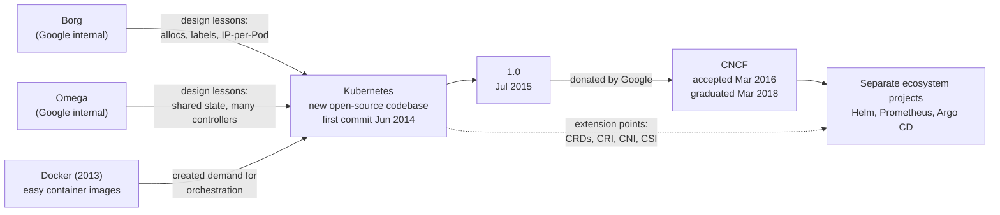

<Todo>Written on 2026-11-05. Research notes, the claim-by-claim source table and open items are in docs/knowledge-sharing/kubernetes-history/README.md. Before publishing: (1) the ACM Queue paper page returned 403 to the research tool, so the Omega paragraph paraphrases the paper from the Google Research listing and the authors' known text; check the wording against the paper; (2) the GKE and AKS launch dates rest on Google's blog title and press coverage rather than a readable primary post; (3) "v1.37 is the newest minor release" is true on 2026-11-05; v1.38 is expected in December 2026, so recheck the date-sensitive lines in the last two sections if publication slips; (4) add your own commentary, confirm the AI-assistance line against the AI use policy, then set status and publishedAt.</Todo>

Most engineers meet Kubernetes as a finished thing: a YAML file, a `kubectl apply`, a cluster someone else built. It is easy to miss why it looks the way it does. Why is the smallest unit a Pod and not a container? Why does everything "reconcile"? Why did Docker support disappear from the kubelet, and why did nothing break for most people?

Each of those answers is a piece of history. This article follows Kubernetes from the problems that came before it, through its origin at Google and its move to a community foundation, to the features and milestones that shaped what you run today. Where the record is clear, I give the date and the source. Where it is interpretation, I say so.

## The problem before Kubernetes: containers without a conductor

For a long time, one application meant one physical server. Capacity planning was guesswork, most machines sat idle, and a hardware failure was an outage. Virtual machines improved utilisation by slicing a server into several isolated guests, but each VM still carried a full operating system, booted slowly, and was managed much like a small server.

Linux containers changed the packaging. Kernel features for isolating and accounting for resources had been developing since the mid-2000s; Google engineer Rohit Seth described the idea of tracking a workload's resources in a "container" on a kernel mailing list in 2006. In March 2013, Solomon Hykes showed Docker in a five-minute PyCon talk, and Docker made containers easy enough for ordinary developers to build and share ([10 Years of Kubernetes](https://kubernetes.io/blog/2024/06/06/10-years-of-kubernetes/)). An image now held the application and its dependencies, and it ran the same way on a laptop and a server.

But an image only answers "what runs". Once you have dozens of services across many machines, harder questions appear:

- **Scheduling:** which machine has enough CPU and memory for this container?
- **Failure:** when a machine dies at 3 a.m., who restarts its containers elsewhere?
- **Service discovery:** if a container moves and gets a new address, how do clients find it?
- **Networking:** how do containers on different hosts talk without port clashes?
- **Scaling and deployments:** how do you go from 3 copies to 30, or replace version 1 with version 2 without downtime?

Docker on a single host did not answer these. That gap, between packaging and operating, is what container orchestration fills.

## Where Kubernetes was born

### Google had already lived this problem

Google ran almost everything in containers long before Docker existed. A 2015 Kubernetes blog post says Google had been running containerised workloads in production "for more than a decade", from web front ends to Bigtable and MapReduce, all managed by an internal cluster manager called Borg ([Borg: The Predecessor to Kubernetes](https://kubernetes.io/blog/2015/04/borg-predecessor-to-kubernetes/)). Google described it in detail in a [2015 EuroSys paper](https://research.google/pubs/large-scale-cluster-management-at-google-with-borg/).

Borg was followed by Omega, a second system that explored a different design: cluster state held in a shared store, with several schedulers and controllers working on it in parallel rather than one monolithic master. Brendan Burns, Brian Grant, David Oppenheimer, Eric Brewer and John Wilkes later wrote up the lessons of all three systems in [Borg, Omega, and Kubernetes](https://research.google/pubs/borg-omega-and-kubernetes/) (ACM Queue, 2016), subtitled "lessons learned from three container management systems over a decade."

### Lessons, not a code dump

It is tempting to say "Kubernetes is open-source Borg". The primary sources do not support that: Kubernetes was a new Go codebase, and what carried over were ideas and people. The 2015 blog post says many of the Kubernetes developers had worked on Borg and lists four ideas that came from it, two of them deliberate corrections:

- **Pods** came from Borg's *alloc*, a resource envelope in which helper processes run beside a main task.
- **Services** reflected the naming and load balancing that Borg applications depended on.
- **Labels** replaced Borg's rigid Job/Task grouping with arbitrary key/value tags, so one Pod can belong to several logical groups.
- **IP-per-Pod** fixed a Borg pain point: Borg tasks shared their host's IP and had to have ports scheduled as a resource.

From Omega, Kubernetes took the idea of many independent components cooperating through shared state. The ACM Queue paper describes the key difference: in Kubernetes, components never touch the store directly but go through the API server, which adds validation, versioning and policy. That is my summary of the paper, not a quotation.

### The founders and the codename

The [10 Years of Kubernetes](https://kubernetes.io/blog/2024/06/06/10-years-of-kubernetes/) post names the founding team as Joe Beda, Brendan Burns, Craig McLuckie, Ville Aikas, Tim Hockin, Dawn Chen, Brian Grant and Daniel Smith. Burns' own [history of the project](https://kubernetes.io/blog/2018/07/20/the-history-of-kubernetes-the-community-behind-it/) adds detail: he credits Joe Beda with suggesting, in summer 2013, that they look at Docker; he says it became "increasingly obvious to Joe, Craig and I" that an orchestrator was necessary and that it would inevitably be open source; and he credits Craig McLuckie with writing "numerous whitepapers" and Eric Brewer with early executive support. Development of a prototype began in late fall 2013.

Inside Google, the project had a Star Trek name. Craig McLuckie wrote that, "in keeping with the Borg theme", it was called Project Seven of Nine, after the Voyager character who was once a Borg drone, and that this is why the logo "has seven sides" ([Google Cloud, 2016](https://cloud.google.com/blog/products/containers-kubernetes/from-google-to-the-world-the-kubernetes-origin-story)). Later release posts shorten it to "Project Seven". The wheel inside the logo also has seven spokes, though McLuckie's wording refers to its sides.

The public name is Greek for "helmsman or pilot", and K8s is a numeronym: K, the eight letters in between, then s ([Kubernetes overview](https://kubernetes.io/docs/concepts/overview/)).

### Commit, announcement, release

Three dates are often blurred together. Joe Beda pushed the [first commit](https://github.com/kubernetes/kubernetes/commit/2c4b3a562ce34cddc3f8218a2c4d11c7310e6d56) on **6 June 2014**. Eric Brewer announced the project in a DockerCon keynote on **10 June 2014** ([10 Years of Kubernetes](https://kubernetes.io/blog/2024/06/06/10-years-of-kubernetes/)). Version 1.0 came more than a year later. Kubernetes was public code before it was announced, and announced long before it was stable.

## From a Google project to a community platform

Open source was not just a licence choice. McLuckie wrote that feedback loops became "essentially instantaneous" and that the project could work with outside engineers who understood what businesses needed ([Google Cloud, 2016](https://cloud.google.com/blog/products/containers-kubernetes/from-google-to-the-world-the-kubernetes-origin-story)). Burns notes the OpenShift team at Red Hat joined early and brought "real world enterprise expertise". In the first year, contributors came largely from Google and Red Hat.

Kubernetes 1.0 was released on **21 July 2015**. On the same day, the Linux Foundation announced the Cloud Native Computing Foundation, and Google said it would contribute Kubernetes "as a seed technology" ([CNCF announcement](https://www.cncf.io/announcements/2015/06/21/new-cloud-native-computing-foundation-to-drive-alignment-among-container-technologies/), dateline 21 July 2015, despite the June date in its URL). The order matters: Google built Kubernetes and then gave it to a new, neutral home. CNCF did not create Kubernetes.

The handover became formal on **10 March 2016**, when CNCF's newly elected Technical Oversight Committee accepted Kubernetes as its first hosted project, at the incubating level ([CNCF project page](https://www.cncf.io/projects/kubernetes/)).

Governance grew in parallel. Work was split across Special Interest Groups (SIGs), each owning an area such as networking, storage, auth or apps, so maintainers from many companies could own parts of the system. In October 2017, a Bootstrap Governance Committee drawn from five companies handed over to the first elected Steering Committee ([Kubernetes blog](https://kubernetes.io/blog/2017/10/kubernetes-community-steering-committee-election-results/)).

On **6 March 2018**, Kubernetes became the first CNCF project to graduate ([CNCF](https://www.cncf.io/announcements/2018/03/06/kubernetes-first-cncf-project-graduate/)). Graduation is CNCF's highest maturity level. It signals that a project meets the foundation's criteria for adoption, governance and security practices (Kubernetes had held a Core Infrastructure Initiative best-practices badge since 2016). It is a statement about project health, not a product certification.

## How Kubernetes evolved technically

The useful way to read Kubernetes' technical history is as a series of problems and the API objects invented to solve them. One rule makes the dates make sense: a feature usually appears as **alpha**, becomes **beta**, and only later reaches **stable (GA)**. "Introduced" and "stable" are often years apart.

### Desired state and reconciliation

The core idea was there from the start. You do not tell Kubernetes "start three containers"; you record that three should exist, and controllers keep working until reality matches.

```yaml
apiVersion: apps/v1
kind: Deployment
metadata:
  name: web
spec:
  replicas: 3
  selector:
    matchLabels: { app: web }
  template:
    metadata:
      labels: { app: web }
    spec:
      containers:
        - name: web
          image: nginx:1.27
```

Delete one of the three Pods and the ReplicaSet controller sees two where three are wanted, so it creates a third. A node failure, a manual mistake and a scale-up are handled the same way: compare desired with observed, then act. Dozens of controllers run this loop; it is the heart of the system.

### From ReplicationController to Deployment

Kubernetes 1.0 already had Pods, Services, Namespaces, Secrets, PersistentVolumes and the ReplicationController, which kept N copies of a Pod running ([v1.0.0 API types](https://github.com/kubernetes/kubernetes/blob/v1.0.0/pkg/api/v1/types.go)). Rolling out a new version, though, was driven from the client side. Kubernetes 1.2 (March 2016) added the beta Deployment API, which moved rollouts and rollbacks onto the server, and ReplicaSets with richer label selectors ([1.2 release post](https://kubernetes.io/blog/2016/03/kubernetes-1-2-even-more-performance-upgrades-plus-easier-application-deployment-and-management/)). Deployments, ReplicaSets, DaemonSets and StatefulSets reached GA together in the `apps/v1` API in 1.9, December 2017 ([1.9 release post](https://kubernetes.io/blog/2017/12/kubernetes-19-workloads-expanded-ecosystem/)).

### Services, DNS and networking

A Service gives a changing set of Pods, selected by label, one stable name and virtual IP. Cluster DNS turned those names into something any application can resolve; CoreDNS became the default DNS server in 1.13 ([1.13 release post](https://kubernetes.io/blog/2018/12/03/kubernetes-1-13-release-announcement/)). The IP-per-Pod model meant every Pod needed a routable address, which is why networking plugins became a whole ecosystem. NetworkPolicy, which lets you restrict which Pods may talk to each other, was promoted to stable in 1.7 ([1.7 release post](https://kubernetes.io/blog/2017/06/kubernetes-1-7-security-hardening-stateful-application-extensibility-updates/)). For HTTP routing, Ingress arrived in beta in 1.2, and the more expressive [Gateway API](https://kubernetes.io/blog/2023/10/31/gateway-api-ga/) reached v1.0 in October 2023 as a SIG Network project installed as CRDs rather than built into the core.

### Stateful workloads, per-node agents and batch

Early Kubernetes suited stateless services. Databases need stable names and their own disks. PetSet appeared as alpha in 1.3, was renamed StatefulSet and moved to beta in 1.5 ([1.5 release post](https://kubernetes.io/blog/2016/12/kubernetes-1-5-supporting-production-workloads/)), and reached GA in 1.9. DaemonSet, for "one Pod per node" agents such as log shippers, was beta in 1.2 and GA in 1.9. For finite work, the Job API was already in `batch/v1` by 1.2 ([v1.2.0 source tree](https://github.com/kubernetes/kubernetes/tree/v1.2.0/pkg/apis/batch/v1)), while CronJob did not reach GA until 1.21 in April 2021, after a rewritten controller ([CronJob GA](https://kubernetes.io/blog/2021/04/09/kubernetes-release-1.21-cronjob-ga/)).

### Multi-tenancy and access control

Namespaces divided a cluster from the start, but they are a naming boundary, not a security one. Role-based access control (RBAC) went beta in 1.6 and GA in 1.8, both in 2017 ([RBAC GA](https://kubernetes.io/blog/2017/10/using-rbac-generally-available-18/)), letting teams share a cluster without sharing every permission. Pod security took a longer path, covered below.

### Extending the API: CRDs and operators

The most consequential design choice may be that users can add their own resource types. ThirdPartyResources came first; CustomResourceDefinitions replaced them in 1.7 and reached GA in 1.16, September 2019 ([1.16 release post](https://kubernetes.io/blog/2019/09/18/kubernetes-1-16-release-announcement/)). In November 2016, CoreOS described the **operator** pattern: a custom resource plus a controller that encodes how to run a specific system, such as etcd. An operator is not a Kubernetes feature; it is a way of using CRDs and the reconciliation loop for your own software.

### CRI, CNI and CSI: three different plug points

These names look alike but cover different jobs:

| Interface | Plugs in | Kubernetes history |
| --- | --- | --- |
| **CRI** (Container Runtime Interface) | The runtime that starts containers, such as containerd or CRI-O | Introduced in 1.5, December 2016 ([CRI post](https://kubernetes.io/blog/2016/12/container-runtime-interface-cri-in-kubernetes/)) |
| **CNI** (Container Network Interface) | The plugin that gives a Pod its network interface and IP | A separate CNCF specification that Kubernetes networking relies on, not a Kubernetes API |
| **CSI** (Container Storage Interface) | Storage drivers that provision and attach volumes | Alpha in 1.9, beta in 1.10, GA in 1.13 |

Each moved vendor-specific code out of Kubernetes, so runtimes, networks and storage could evolve on their own schedules.

### Scaling and scheduling

The Horizontal Pod Autoscaler arrived as beta in 1.1 (November 2015), scaling Pods on CPU usage ([1.1 release post](https://kubernetes.io/blog/2015/11/kubernetes-1-1-performance-upgrades-improved-tooling-and-a-growing-community/)). Later work changed how resources themselves are handled: in-place Pod resource resize, which lets you change CPU and memory without recreating the Pod, went beta in 1.33 and stable in 1.35 ([1.35 release post](https://kubernetes.io/blog/2025/12/17/kubernetes-v1-35-release/)). Dynamic Resource Allocation (DRA), a way to request GPUs and other devices with structured parameters, had its core reach GA in 1.34 in August 2025 ([1.34 release post](https://kubernetes.io/blog/2025/08/27/kubernetes-v1-34-release/)).

## Major Kubernetes milestones

The table picks events for their lasting effect, not every release. Dates are release or announcement dates from the linked sources.

| Date | Milestone | Why it mattered |
| --- | --- | --- |
| 6 Jun 2014 | [First commit](https://github.com/kubernetes/kubernetes/commit/2c4b3a562ce34cddc3f8218a2c4d11c7310e6d56) on GitHub | A new open-source codebase, not a released internal system |
| 10 Jun 2014 | Public announcement at DockerCon 2014 | Positioned Kubernetes as the orchestration layer for the Docker-era container boom |
| 21 Jul 2015 | Kubernetes 1.0; CNCF announced the same day | First stable API, and a commitment to vendor-neutral governance |
| 26 Aug 2015 | [Google Container Engine (now GKE) generally available](https://cloudplatform.googleblog.com/2015/08/Google-Container-Engine-is-Generally-Available.html) | Google's hosted Kubernetes service leaves beta, backed by an SLA |
| 10 Mar 2016 | [Accepted into CNCF](https://www.cncf.io/projects/kubernetes/) as its first hosted project | IP and stewardship moved to a neutral foundation |
| Dec 2016 | CRI introduced in 1.5 | Started decoupling the kubelet from any single runtime |
| Oct 2017 | RBAC GA in 1.8; first elected Steering Committee | A real permission model, and governance beyond the founding companies |
| Dec 2017 | `apps/v1` workloads GA in 1.9 | Deployments, StatefulSets, DaemonSets and ReplicaSets became long-term stable APIs |
| 6 Mar 2018 | [First CNCF project to graduate](https://www.cncf.io/announcements/2018/03/06/kubernetes-first-cncf-project-graduate/) | Independent signal of maturity and governance |
| Jun 2018 | [Amazon EKS GA](https://aws.amazon.com/about-aws/whats-new/2018/06/amazon-elastic-container-service-for-kubernetes-eks-now-ga) (5 June) and Azure AKS GA (13 June, per [Microsoft's announcement record](https://azure.microsoft.com/en-us/blog/wp-json/wp/v2/posts/2629)) | Managed Kubernetes on all three of the largest public clouds |
| Dec 2018 | CSI GA in 1.13 | Storage drivers moved out of the Kubernetes tree |
| Sep 2019 | CRDs GA in 1.16 | Extending the API became a stable contract, underpinning operators and much of the ecosystem |
| Dec 2020 → May 2022 | Dockershim deprecated in 1.20, removed in 1.24 | Kubelet talks only CRI; see below |
| Apr 2021 → Aug 2022 | PodSecurityPolicy deprecated in 1.21, removed in 1.25; Pod Security Admission stable in 1.25 | A simpler, built-in model for Pod security |
| Aug 2025 | DRA core GA in 1.34 | A standard way to request accelerators and other devices |

**Dockershim, the most misunderstood change.** Early Kubernetes talked to Docker Engine directly. After CRI arrived, the kubelet kept a built-in adapter, dockershim, to translate CRI calls into Docker's API. Kubernetes announced its deprecation with 1.20 in December 2020 ([Don't Panic](https://kubernetes.io/blog/2020/12/02/dont-panic-kubernetes-and-docker/)) and removed it in 1.24 on 3 May 2022 ([1.24 release post](https://kubernetes.io/blog/2022/05/03/kubernetes-1-24-release-announcement/)). What went away was Docker Engine *as the node runtime*. Images built with `docker build` are standard OCI images, and they keep running on containerd, CRI-O or any CRI runtime. Developers could keep using Docker on their laptops; cluster operators had to switch the node runtime, or use the externally maintained cri-dockerd adapter.

**PodSecurityPolicy to Pod Security Admission.** PSP tried to control what Pods could do (run as root, use host networking and so on), but it was hard to apply correctly and never reached stable. Kubernetes deprecated it in 1.21 ([PSP deprecation](https://kubernetes.io/blog/2021/04/06/podsecuritypolicy-deprecation-past-present-and-future/)) and removed it in 1.25 in August 2022. Its replacement, Pod Security Admission, applies three predefined levels (privileged, baseline, restricted) per namespace ([PSP: the historical context](https://kubernetes.io/blog/2022/08/23/podsecuritypolicy-the-historical-context/)).

Two process changes also matter. In 2021 the project moved from four releases a year to three ([release cadence](https://kubernetes.io/blog/2021/07/20/new-kubernetes-release-cadence/)), and from 1.24 it signed release artifacts with Sigstore's cosign, extending signing to binaries in 1.26.

## Why Kubernetes became widely adopted

I can point to what the project offered, but not to precise adoption numbers, so I will stick to reasons.

**A common API.** A Deployment means the same thing on a laptop cluster, in a data centre and on a managed cloud service. Teams learn one set of objects and one tool, `kubectl`.

**Declarative configuration.** Because desired state is just data, it can be stored in Git, reviewed, diffed and applied by machines. That made automation natural.

**Extensibility.** CRDs and the plug-in interfaces let vendors and teams add features without forking Kubernetes. Much of the ecosystem exists because of this.

**Managed services.** GKE, EKS, AKS and others took on running the control plane, which lowered the cost of trying Kubernetes.

The ecosystem is where the line between core and add-on gets blurry, so it is worth drawing:

- **In Kubernetes core:** the API server, scheduler, controllers, kubelet, and built-in objects such as Pods, Deployments, Services and RBAC.
- **Separate projects:** [Helm](https://www.cncf.io/projects/helm/) for packaging (CNCF graduated May 2020), [Prometheus](https://www.cncf.io/projects/prometheus/) for metrics (graduated August 2018), and [Argo](https://www.cncf.io/projects/argo/), including Argo CD for GitOps (graduated December 2022). GitOps itself is a practice: Git holds desired state and a controller in the cluster applies it, the same reconciliation idea one level up.

Portability has limits. Your Deployment YAML moves easily; your storage classes, load balancers, cloud IAM identities, DNS and network policies often do not. "Runs on any Kubernetes" usually means "runs on any Kubernetes with the same environmental pieces wired in."

Kubernetes also has real costs. A new minor release arrives roughly every four months, add-ons need patching, and security is shared: the platform gives you RBAC and admission control, but you still configure them. The learning curve is steep, and idle clusters cost money. For a single web app, a small team or a low-traffic service, a managed platform service or a few VMs may be simpler and cheaper. Kubernetes pays off when you have many services, many teams, or a need for consistent automation across them.

## Kubernetes today and what comes next

As of November 2026, the newest minor release is **v1.37** (26 August 2026), with patch v1.37.2 published on 28 October ([Kubernetes releases](https://kubernetes.io/releases/)). Recent releases show where the project is putting its effort.

**Already available:**

- **AI/ML and accelerators.** DRA's core is GA (1.34), with more DRA features reaching stable in 1.36 and 1.37 ([1.37 release post](https://kubernetes.io/blog/2026/08/26/kubernetes-v1-37-release/)). In November 2025, CNCF launched a [Certified Kubernetes AI Conformance](https://www.cncf.io/announcements/2025/11/11/cncf-launches-certified-kubernetes-ai-conformance-program-to-standardize-ai-workloads-on-kubernetes/) programme for platforms running AI frameworks.
- **Batch.** [Kueue](https://kubernetes.io/blog/2022/10/04/introducing-kueue/) (introduced 2022) and [JobSet](https://kubernetes.io/blog/2025/03/23/introducing-jobset/) (introduced 2025) are kubernetes-sigs projects for job queuing and for running groups of jobs as one unit. They are add-ons, not core.
- **Security and supply chain.** Signed release artifacts, Pod Security Admission, and Pod certificates for workload identity, which became stable in 1.37.
- **Efficiency.** In-place Pod resize is stable (1.35).

**Still in progress (beta or alpha in 1.37):** gang scheduling, which places a group of Pods all at once or not at all; HPA scale to zero (beta); and Pod-level checkpoint and restore (alpha). Beta and alpha features can change, so treat them as direction, not promise.

**Ecosystem housekeeping:** the community Ingress NGINX controller was retired on 24 March 2026, and SIG Network recommends migrating to Gateway API or another Ingress controller ([retirement notice](https://kubernetes.io/blog/2025/11/11/ingress-nginx-retirement/), [1.36 release post](https://kubernetes.io/blog/2026/04/22/kubernetes-v1-36-release/)).

Platform engineering is the broader trend, and here I am interpreting rather than quoting: many organisations now treat Kubernetes as a base on which internal platforms are built, not as something every developer touches directly.

The thread through all of it is the same one Google's engineers pulled in 2013. Containers packaged software; something still had to place it, heal it, connect it and scale it. Kubernetes answered that with a declarative API and reconciliation loops, then opened those loops to everyone. Today the same mechanism schedules GPUs and batch jobs, but the idea is unchanged: say what you want, and let controllers make it so.

## Diagram: from Google's systems to an open ecosystem



Borg and Omega stayed internal to Google. The arrows into Kubernetes are lessons and people, not source code.

## References

- Kubernetes Blog, [10 Years of Kubernetes](https://kubernetes.io/blog/2024/06/06/10-years-of-kubernetes/) (2024)
- Kubernetes Blog, [Borg: The Predecessor to Kubernetes](https://kubernetes.io/blog/2015/04/borg-predecessor-to-kubernetes/) (2015)
- Brendan Burns, [The History of Kubernetes & the Community Behind It](https://kubernetes.io/blog/2018/07/20/the-history-of-kubernetes-the-community-behind-it/) (2018)
- Burns, Grant, Oppenheimer, Brewer, Wilkes, [Borg, Omega, and Kubernetes](https://research.google/pubs/borg-omega-and-kubernetes/), ACM Queue 14 (2016)
- Verma et al., [Large-scale cluster management at Google with Borg](https://research.google/pubs/large-scale-cluster-management-at-google-with-borg/), EuroSys 2015
- Craig McLuckie, [From Google to the world: the Kubernetes origin story](https://cloud.google.com/blog/products/containers-kubernetes/from-google-to-the-world-the-kubernetes-origin-story) (2016)
- GitHub, [kubernetes/kubernetes first commit](https://github.com/kubernetes/kubernetes/commit/2c4b3a562ce34cddc3f8218a2c4d11c7310e6d56)
- CNCF, [Foundation announcement](https://www.cncf.io/announcements/2015/06/21/new-cloud-native-computing-foundation-to-drive-alignment-among-container-technologies/) (21 July 2015), [Kubernetes project page](https://www.cncf.io/projects/kubernetes/), [graduation announcement](https://www.cncf.io/announcements/2018/03/06/kubernetes-first-cncf-project-graduate/)
- Kubernetes release posts: [1.2](https://kubernetes.io/blog/2016/03/kubernetes-1-2-even-more-performance-upgrades-plus-easier-application-deployment-and-management/), [1.5](https://kubernetes.io/blog/2016/12/kubernetes-1-5-supporting-production-workloads/), [1.7](https://kubernetes.io/blog/2017/06/kubernetes-1-7-security-hardening-stateful-application-extensibility-updates/), [1.9](https://kubernetes.io/blog/2017/12/kubernetes-19-workloads-expanded-ecosystem/), [1.13](https://kubernetes.io/blog/2018/12/03/kubernetes-1-13-release-announcement/), [1.16](https://kubernetes.io/blog/2019/09/18/kubernetes-1-16-release-announcement/), [1.24](https://kubernetes.io/blog/2022/05/03/kubernetes-1-24-release-announcement/), [1.25](https://kubernetes.io/blog/2022/08/23/kubernetes-v1-25-release/), [1.34](https://kubernetes.io/blog/2025/08/27/kubernetes-v1-34-release/), [1.35](https://kubernetes.io/blog/2025/12/17/kubernetes-v1-35-release/), [1.36](https://kubernetes.io/blog/2026/04/22/kubernetes-v1-36-release/), [1.37](https://kubernetes.io/blog/2026/08/26/kubernetes-v1-37-release/)
- Kubernetes Blog, [Don't Panic: Kubernetes and Docker](https://kubernetes.io/blog/2020/12/02/dont-panic-kubernetes-and-docker/) (2020) and [PodSecurityPolicy: The Historical Context](https://kubernetes.io/blog/2022/08/23/podsecuritypolicy-the-historical-context/) (2022)
- Kubernetes, [Releases](https://kubernetes.io/releases/) and [Overview](https://kubernetes.io/docs/concepts/overview/)
