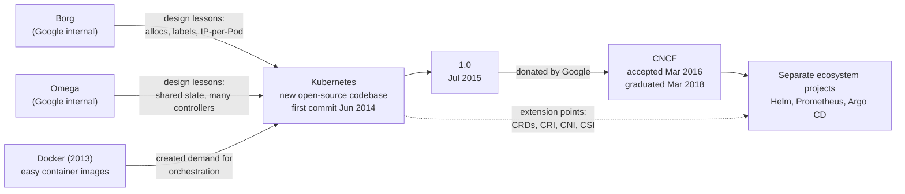

<Todo>Open items in docs/knowledge-sharing/kubernetes-history/README.md: the Omega paragraph paraphrases the ACM Queue paper (403); the GKE and AKS dates lack a readable primary post. "v1.37 newest" rechecked 2026-11-06; recheck after v1.38 (December 2026).</Todo>

Most engineers meet Kubernetes as a finished thing: a YAML file, a `kubectl apply`, a cluster someone else built. Why is the smallest unit a Pod and not a container? Why does everything "reconcile"? Why did Docker support disappear from the kubelet without breaking most people's images?

Each answer is a piece of history. This article follows Kubernetes from the problem it solved, through its origin at Google and its move to a neutral foundation, to the milestones that shaped what you run today, with a source for every date.

## The problem before Kubernetes: containers without a conductor

Virtual machines had already improved on one-app-per-server, but each still carried a full operating system and was managed like a small server. Linux containers changed the packaging. Kernel features for isolating and accounting for resources had been developing since the mid-2000s; Google engineer Rohit Seth described tracking a workload's resources in a "container" on a kernel mailing list in 2006. In March 2013 Solomon Hykes showed Docker in a five-minute PyCon talk, and Docker made images easy to build and share ([10 Years of Kubernetes](https://kubernetes.io/blog/2024/06/06/10-years-of-kubernetes/)).

An image only answers "what runs". With dozens of services across many machines, harder questions appear:

- **Scheduling:** which machine has enough CPU and memory for this container?
- **Failure:** when a machine dies at 3 a.m., who restarts its containers elsewhere?
- **Service discovery:** if a container moves and gets a new address, how do clients find it?
- **Networking:** how do containers on different hosts talk without port clashes?
- **Scaling and deployments:** how do you go from 3 copies to 30, or replace version 1 with version 2 without downtime?

Docker on a single host did not answer these. That gap between packaging and operating is what orchestration fills.

## Where Kubernetes was born

### Google had already lived this problem

A 2015 Kubernetes blog post says Google had run containerised workloads in production "for more than a decade", from web front ends to Bigtable and MapReduce, all managed by an internal cluster manager called Borg ([Borg: The Predecessor to Kubernetes](https://kubernetes.io/blog/2015/04/borg-predecessor-to-kubernetes/); see also the [2015 EuroSys paper](https://research.google/pubs/large-scale-cluster-management-at-google-with-borg/)).

Borg was followed by Omega, which kept cluster state in a shared store with several schedulers and controllers working on it in parallel instead of one monolithic master. Brendan Burns, Brian Grant, David Oppenheimer, Eric Brewer and John Wilkes later wrote up the lessons of all three systems in [Borg, Omega, and Kubernetes](https://research.google/pubs/borg-omega-and-kubernetes/) (ACM Queue, 2016).

### Lessons, not a code dump

"Kubernetes is open-source Borg" is not what the sources say. Kubernetes was a new Go codebase; what carried over were ideas and people. The 2015 post lists four ideas from Borg, two of them deliberate corrections:

- **Pods** came from Borg's *alloc*, a resource envelope in which helper processes run beside a main task.
- **Services** reflected the naming and load balancing Borg applications depended on.
- **Labels** replaced Borg's rigid Job/Task grouping with arbitrary key/value tags, so one Pod can belong to several groups.
- **IP-per-Pod** fixed a Borg pain point: Borg tasks shared their host's IP and had ports scheduled as a resource.

From Omega came many independent components cooperating through shared state. In my summary of the ACM Queue paper, the key difference is that Kubernetes components never touch the store directly but go through the API server, which adds validation, versioning and policy.

### The founders and the codename

The [10 Years of Kubernetes](https://kubernetes.io/blog/2024/06/06/10-years-of-kubernetes/) post names the founding team as Joe Beda, Brendan Burns, Craig McLuckie, Ville Aikas, Tim Hockin, Dawn Chen, Brian Grant and Daniel Smith. In his [history of the project](https://kubernetes.io/blog/2018/07/20/the-history-of-kubernetes-the-community-behind-it/), Burns credits Beda with suggesting in summer 2013 that they look at Docker, says it became "increasingly obvious to Joe, Craig and I" that an orchestrator was needed and would be open source, and dates the first prototype to late fall 2013.

Inside Google the project was named, "in keeping with the Borg theme", Project Seven of Nine, after the Voyager character who was once a Borg drone; McLuckie says that is why the logo "has seven sides" ([Google Cloud, 2016](https://cloud.google.com/blog/products/containers-kubernetes/from-google-to-the-world-the-kubernetes-origin-story)). The public name is Greek for "helmsman or pilot", and K8s is a numeronym: K, eight letters, s ([Kubernetes overview](https://kubernetes.io/docs/concepts/overview/)).

### Commit, announcement, release

Three dates are often blurred. Joe Beda pushed the [first commit](https://github.com/kubernetes/kubernetes/commit/2c4b3a562ce34cddc3f8218a2c4d11c7310e6d56) on **6 June 2014**. Eric Brewer announced the project in a DockerCon keynote on **10 June 2014**. Version 1.0 came more than a year later: Kubernetes was public code before it was announced, and announced long before it was stable.

## From a Google project to a community platform

McLuckie wrote that open source made feedback loops "essentially instantaneous". Burns notes that Red Hat's OpenShift team joined early with "real world enterprise expertise"; first-year contributors came largely from Google and Red Hat.

Kubernetes 1.0 was released on **21 July 2015**. The same day, the Linux Foundation announced the Cloud Native Computing Foundation, and Google said it would contribute Kubernetes "as a seed technology" ([CNCF announcement](https://www.cncf.io/announcements/2015/06/21/new-cloud-native-computing-foundation-to-drive-alignment-among-container-technologies/), dateline 21 July 2015 despite the June date in its URL). Google built Kubernetes and then gave it a neutral home; CNCF did not create it.

The handover became formal on **10 March 2016**, when CNCF's Technical Oversight Committee accepted Kubernetes as its first hosted project, at the incubating level ([CNCF project page](https://www.cncf.io/projects/kubernetes/)). Work was split across Special Interest Groups (SIGs) such as networking, storage and auth, and in October 2017 a bootstrap committee from five companies handed over to the first elected Steering Committee ([Kubernetes blog](https://kubernetes.io/blog/2017/10/kubernetes-community-steering-committee-election-results/)).

On **6 March 2018**, Kubernetes became the first CNCF project to graduate ([CNCF](https://www.cncf.io/announcements/2018/03/06/kubernetes-first-cncf-project-graduate/)), CNCF's highest maturity level for adoption, governance and security practice. It is a statement about project health, not a product certification.

## How Kubernetes evolved technically

Kubernetes' technical history reads best as problems and the API objects invented to solve them. Features usually appear as **alpha**, become **beta**, and only later reach **stable (GA)**, so "introduced" and "stable" are often years apart.

### Desired state and reconciliation

The core idea was there from the start. You do not tell Kubernetes "start three containers"; you record that three should exist, and controllers work until reality matches.

```yaml
apiVersion: apps/v1
kind: Deployment
metadata:
  name: web
spec:
  replicas: 3
  selector:
    matchLabels: { app: web }
  template:
    metadata:
      labels: { app: web }
    spec:
      containers:
        - name: web
          image: nginx:1.27
```

Delete one Pod and the ReplicaSet controller sees two where three are wanted, so it creates a third. Node failures, mistakes and scale-ups are all handled by comparing desired with observed state, then acting.

### From ReplicationController to Deployment

Kubernetes 1.0 already had Pods, Services, Namespaces, Secrets, PersistentVolumes and the ReplicationController ([v1.0.0 API types](https://github.com/kubernetes/kubernetes/blob/v1.0.0/pkg/api/v1/types.go)), but rollouts were driven from the client. Kubernetes 1.2 (March 2016) added the beta Deployment API, which moved rollouts and rollbacks onto the server, and ReplicaSets with richer selectors ([1.2 release post](https://kubernetes.io/blog/2016/03/kubernetes-1-2-even-more-performance-upgrades-plus-easier-application-deployment-and-management/)). Deployments, ReplicaSets, DaemonSets and StatefulSets reached GA together in `apps/v1` in 1.9, December 2017 ([1.9 release post](https://kubernetes.io/blog/2017/12/kubernetes-19-workloads-expanded-ecosystem/)).

### Services, DNS and networking

A Service gives a changing, label-selected set of Pods one stable name and virtual IP; CoreDNS became the default cluster DNS in 1.13 ([1.13 release post](https://kubernetes.io/blog/2018/12/03/kubernetes-1-13-release-announcement/)). IP-per-Pod meant every Pod needed a routable address, which is why networking plugins became an ecosystem. NetworkPolicy became stable in 1.7 ([1.7 release post](https://kubernetes.io/blog/2017/06/kubernetes-1-7-security-hardening-stateful-application-extensibility-updates/)). Ingress arrived in beta in 1.2, and the more expressive [Gateway API](https://kubernetes.io/blog/2023/10/31/gateway-api-ga/) reached v1.0 in October 2023 as CRDs maintained by SIG Network, not part of the core.

### Stateful workloads, per-node agents and batch

PetSet appeared as alpha in 1.3, was renamed StatefulSet and moved to beta in 1.5 ([1.5 release post](https://kubernetes.io/blog/2016/12/kubernetes-1-5-supporting-production-workloads/)), and reached GA in 1.9, giving databases stable names and their own disks. DaemonSet ("one Pod per node", for agents such as log shippers) was beta in 1.2 and GA in 1.9. The Job API was in `batch/v1` by 1.2 ([v1.2.0 source tree](https://github.com/kubernetes/kubernetes/tree/v1.2.0/pkg/apis/batch/v1)), while CronJob reached GA only in 1.21, April 2021, after a controller rewrite ([CronJob GA](https://kubernetes.io/blog/2021/04/09/kubernetes-release-1.21-cronjob-ga/)).

### Access control and extensibility

Namespaces are a naming boundary, not a security one. Role-based access control (RBAC) went beta in 1.6 and GA in 1.8, both in 2017 ([RBAC GA](https://kubernetes.io/blog/2017/10/using-rbac-generally-available-18/)), so teams could share a cluster without sharing every permission.

The most consequential choice may be that users can add their own resource types. CustomResourceDefinitions replaced ThirdPartyResources in 1.7 and reached GA in 1.16, September 2019 ([1.16 release post](https://kubernetes.io/blog/2019/09/18/kubernetes-1-16-release-announcement/)). In November 2016 CoreOS described the **operator** pattern: a custom resource plus a controller that encodes how to run a specific system, such as etcd. It is a way of using CRDs and reconciliation, not a Kubernetes feature.

### CRI, CNI and CSI: three different plug points

| Interface | Plugs in | Kubernetes history |
| --- | --- | --- |
| **CRI** (Container Runtime Interface) | The runtime that starts containers, such as containerd or CRI-O | Introduced in 1.5, December 2016 ([CRI post](https://kubernetes.io/blog/2016/12/container-runtime-interface-cri-in-kubernetes/)) |
| **CNI** (Container Network Interface) | The plugin that gives a Pod its network interface and IP | A separate CNCF specification that Kubernetes networking relies on, not a Kubernetes API |
| **CSI** (Container Storage Interface) | Storage drivers that provision and attach volumes | Alpha in 1.9, beta in 1.10, GA in 1.13 |

Each moved vendor-specific code out of Kubernetes, so runtimes, networks and storage could evolve on their own schedules.

### Scaling and scheduling

The Horizontal Pod Autoscaler arrived as beta in 1.1, November 2015 ([1.1 release post](https://kubernetes.io/blog/2015/11/kubernetes-1-1-performance-upgrades-improved-tooling-and-a-growing-community/)). In-place Pod resource resize, which changes CPU and memory without recreating the Pod, went beta in 1.33 and stable in 1.35 ([1.35 release post](https://kubernetes.io/blog/2025/12/17/kubernetes-v1-35-release/)). Dynamic Resource Allocation (DRA), for requesting GPUs and other devices with structured parameters, had its core reach GA in 1.34, August 2025 ([1.34 release post](https://kubernetes.io/blog/2025/08/27/kubernetes-v1-34-release/)).

## Major Kubernetes milestones

Chosen for lasting effect; dates from the linked sources.

| Date | Milestone | Why it mattered |
| --- | --- | --- |
| 6 Jun 2014 | [First commit](https://github.com/kubernetes/kubernetes/commit/2c4b3a562ce34cddc3f8218a2c4d11c7310e6d56) on GitHub | A new open-source codebase, not a released internal system |
| 10 Jun 2014 | Public announcement at DockerCon 2014 | Positioned Kubernetes as the orchestration layer for the Docker-era container boom |
| 21 Jul 2015 | Kubernetes 1.0; CNCF announced the same day | First stable API, and a commitment to vendor-neutral governance |
| 26 Aug 2015 | [Google Container Engine (now GKE) generally available](https://cloudplatform.googleblog.com/2015/08/Google-Container-Engine-is-Generally-Available.html) | Google's hosted Kubernetes service leaves beta, backed by an SLA |
| 10 Mar 2016 | [Accepted into CNCF](https://www.cncf.io/projects/kubernetes/) as its first hosted project | IP and stewardship moved to a neutral foundation |
| Dec 2016 | CRI introduced in 1.5 | Started decoupling the kubelet from any single runtime |
| Oct 2017 | RBAC GA in 1.8; first elected Steering Committee | A real permission model, and governance beyond the founding companies |
| Dec 2017 | `apps/v1` workloads GA in 1.9 | Deployments, StatefulSets, DaemonSets and ReplicaSets became long-term stable APIs |
| 6 Mar 2018 | [First CNCF project to graduate](https://www.cncf.io/announcements/2018/03/06/kubernetes-first-cncf-project-graduate/) | Independent signal of maturity and governance |
| Jun 2018 | [Amazon EKS GA](https://aws.amazon.com/about-aws/whats-new/2018/06/amazon-elastic-container-service-for-kubernetes-eks-now-ga) (5 June) and Azure AKS GA (13 June, per [Microsoft's announcement record](https://azure.microsoft.com/en-us/blog/wp-json/wp/v2/posts/2629)) | Managed Kubernetes on all three of the largest public clouds |
| Dec 2018 | CSI GA in 1.13 | Storage drivers moved out of the Kubernetes tree |
| Sep 2019 | CRDs GA in 1.16 | Extending the API became a stable contract, underpinning operators and much of the ecosystem |
| Dec 2020 → May 2022 | Dockershim deprecated in 1.20, removed in 1.24 | Kubelet talks only CRI; see below |
| Apr 2021 → Aug 2022 | PodSecurityPolicy deprecated in 1.21, removed in 1.25; Pod Security Admission stable in 1.25 | A simpler, built-in model for Pod security |
| Aug 2025 | DRA core GA in 1.34 | A standard way to request accelerators and other devices |

**Dockershim, the most misunderstood change.** After CRI arrived, the kubelet kept a built-in adapter, dockershim, to translate CRI calls into Docker Engine's API. Kubernetes announced its deprecation with 1.20 in December 2020 ([Don't Panic](https://kubernetes.io/blog/2020/12/02/dont-panic-kubernetes-and-docker/)) and removed it in 1.24 on 3 May 2022 ([1.24 release post](https://kubernetes.io/blog/2022/05/03/kubernetes-1-24-release-announcement/)). What went away was Docker Engine *as the node runtime*. Images built with `docker build` are standard OCI images and keep running on containerd, CRI-O or any CRI runtime; cluster operators had to switch the node runtime or use the external cri-dockerd adapter.

**PodSecurityPolicy to Pod Security Admission.** PSP controlled what Pods could do (run as root, use host networking and so on), but it was hard to apply correctly and never reached stable. It was deprecated in 1.21 ([PSP deprecation](https://kubernetes.io/blog/2021/04/06/podsecuritypolicy-deprecation-past-present-and-future/)) and removed in 1.25, August 2022. Pod Security Admission replaced it with three predefined levels (privileged, baseline, restricted) per namespace ([PSP: the historical context](https://kubernetes.io/blog/2022/08/23/podsecuritypolicy-the-historical-context/)).

Two process changes also matter: in 2021 the project moved from four releases a year to three ([release cadence](https://kubernetes.io/blog/2021/07/20/new-kubernetes-release-cadence/)), and from 1.24 it signed release artifacts with Sigstore's cosign, extending signing to binaries in 1.26.

## Why Kubernetes became widely adopted

I cannot point to precise adoption numbers, so these are reasons, not measurements:

- **A common API.** A Deployment means the same thing on a laptop cluster, in a data centre and on a managed cloud service, and one tool, `kubectl`, drives them all.
- **Declarative configuration.** Desired state is data, so it can live in Git, be reviewed and diffed, and be applied by machines.
- **Extensibility.** CRDs and the plug-in interfaces let vendors add features without forking Kubernetes.
- **Managed services.** GKE, EKS, AKS and others run the control plane, which lowered the cost of trying it.

The core is the API server, scheduler, controllers, kubelet, and built-in objects such as Pods, Deployments, Services and RBAC. Much of what people call "Kubernetes" is separate projects: [Helm](https://www.cncf.io/projects/helm/) for packaging (CNCF graduated May 2020), [Prometheus](https://www.cncf.io/projects/prometheus/) for metrics (graduated August 2018), and [Argo](https://www.cncf.io/projects/argo/), including Argo CD for GitOps (graduated December 2022). GitOps is a practice, the same reconciliation idea one level up: Git holds desired state and a controller applies it.

Portability has limits: Deployment YAML moves easily, but storage classes, load balancers, cloud IAM and DNS often do not. Kubernetes also costs something: a minor release roughly every four months, add-ons to patch, security to configure, and a steep learning curve. For a single web app, a managed platform or a few VMs may be simpler; Kubernetes pays off with many services, many teams, or a need for consistent automation.

## Kubernetes today and what comes next

As of November 2026 the newest minor release is **v1.37** (26 August 2026); patch v1.37.2 was published on 28 October ([Kubernetes releases](https://kubernetes.io/releases/)).

**Already available:**

- **AI/ML and accelerators.** DRA's core is GA (1.34), with more DRA features reaching stable in 1.36 and 1.37 ([1.37 release post](https://kubernetes.io/blog/2026/08/26/kubernetes-v1-37-release/)). In November 2025 CNCF launched a [Certified Kubernetes AI Conformance](https://www.cncf.io/announcements/2025/11/11/cncf-launches-certified-kubernetes-ai-conformance-program-to-standardize-ai-workloads-on-kubernetes/) programme.
- **Batch.** [Kueue](https://kubernetes.io/blog/2022/10/04/introducing-kueue/) (2022) and [JobSet](https://kubernetes.io/blog/2025/03/23/introducing-jobset/) (2025) are kubernetes-sigs add-ons for job queuing and for running groups of jobs as one unit.
- **Security and supply chain.** Signed release artifacts, Pod Security Admission, and Pod certificates for workload identity, stable in 1.37.
- **Efficiency.** In-place Pod resize is stable (1.35).

**Still in progress (beta or alpha in 1.37):** gang scheduling, which places a group of Pods all at once or not at all; HPA scale to zero (beta); and Pod-level checkpoint and restore (alpha). Treat these as direction, not promise.

**Ecosystem housekeeping:** the community Ingress NGINX controller was retired on 24 March 2026, and SIG Network recommends migrating to Gateway API or another Ingress controller ([retirement notice](https://kubernetes.io/blog/2025/11/11/ingress-nginx-retirement/), [1.36 release post](https://kubernetes.io/blog/2026/04/22/kubernetes-v1-36-release/)).

My own reading of the broader trend is platform engineering: many organisations now treat Kubernetes as a base for internal platforms, not something every developer touches directly. The mechanism underneath is unchanged since 2014: say what you want, and let controllers make it so.

## Diagram: from Google's systems to an open ecosystem



Borg and Omega stayed internal; the arrows into Kubernetes are lessons and people, not code.
