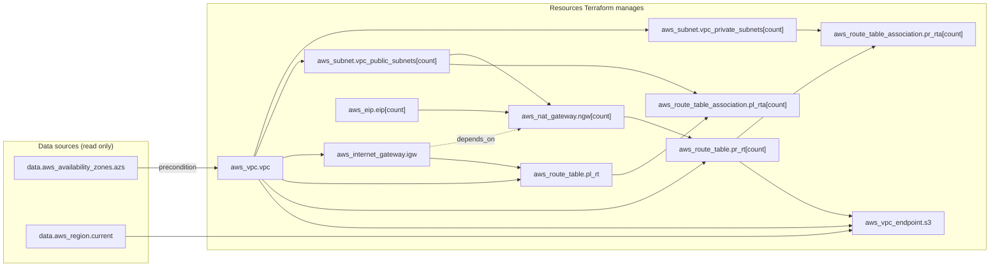
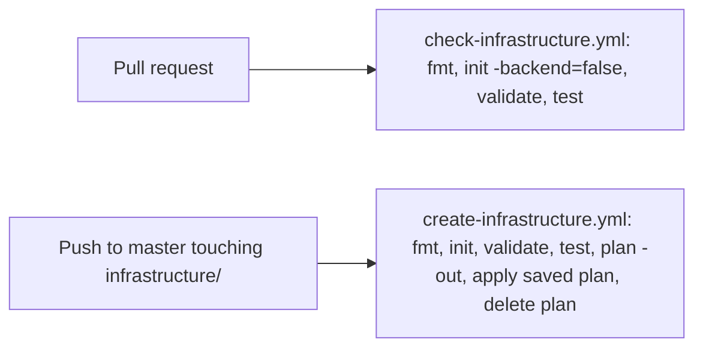

This tutorial teaches Terraform from the beginning using the one configuration in my `tools` repository, `infrastructure/`, which builds an AWS network (VPC, public and private subnets, NAT gateways, route tables), private ECR registries, SES email for jithendar.com, and optional IAM roles and EKS cluster. You need basic cloud ideas (network, subnet, IAM role) but no Terraform; a local practice project at the end needs no AWS account.

I checked everything against the `infrastructure/` folder of the [tools repository](https://github.com/mrjithendar/tools/tree/387bd306d38b6e63d569ecae5121826e2e08d633/infrastructure) at commit `387bd30`, on 3 November 2026. That folder pins Terraform to `>= 1.10, < 2.0`, the AWS provider to `~> 6.0` (the lockfile records 6.69.1) and the Helm provider to `~> 3.0` (lockfile: 3.3.0). Both CI workflows install Terraform 1.16.6. This is HashiCorp Terraform; the repository does not use OpenTofu.

Blocks are labelled **Actual repository code** (account IDs, IPs and bucket names replaced by placeholders such as `<STATE_BUCKET>`), **Simplified from repository code** (omissions named) or **Standalone teaching example**.

## What Terraform is

### Infrastructure as Code

**Infrastructure as Code** means describing servers, networks and permissions in files kept in Git, so changes are reviewed, traceable and repeatable. Terraform reads `.tf` files written in **HCL**, works out what must change in your cloud account, shows you, and applies it when you approve.

A shell script is **imperative**: run "create a VPC" twice and you may get two. Terraform is **declarative**: you describe the result, it does only the difference, and a second run does nothing. Keep three things apart: the **desired configuration** (your `.tf` files), the **actual infrastructure** in AWS, and the **state**, Terraform's record of which real objects belong to which block.

### Providers

A **provider** is a plugin that teaches Terraform one platform's resources and API calls; `infrastructure/` uses `hashicorp/aws` and `hashicorp/helm`, downloaded by `terraform init`. Unlike shell scripts (no memory of past runs) and configuration tools such as Ansible (inside existing machines), Terraform creates the cloud resources themselves and remembers them.

### Where Terraform fits in this repository

Only one tool should manage a given object:

| What | Tool | Where in tools |
|---|---|---|
| AWS network, ECR registries, SES, IAM roles, optional EKS cluster | Terraform | `infrastructure/` |
| Kubernetes objects (Deployments, Services, and so on) | Plain YAML | `deploy/minikube/`, `deploy/eks/manifests/` |
| Cluster controllers such as Istio and the AWS Load Balancer Controller | Argo CD Applications that install Helm charts | `deploy/eks/applications/`, `deploy/eks/helm-values/` |

Terraform builds the cloud ground floor; Argo CD and YAML run software on top. A few Helm releases moved from Terraform to Argo CD, a refactoring shown later.

## Understanding the repository

### The folders that matter

This tree shows only the Terraform-related paths. Everything listed exists in the repository.

```text
tools/
├── .github/
│   ├── dependabot.yml                  # weekly Terraform provider update PRs
│   └── workflows/
│       ├── check-infrastructure.yml    # pull requests: fmt, validate, mock tests
│       └── create-infrastructure.yml   # push to master: plan and apply
└── infrastructure/                     # the only Terraform root module
    ├── .terraform.lock.hcl             # exact provider versions
    ├── Jenkinsfile                     # an alternative pipeline with a manual approval step
    ├── README.md
    ├── _provider.tf                    # terraform block, required_providers, provider blocks
    ├── _remoteState.tf                 # S3 backend
    ├── _variables.tf                   # all input variables
    ├── _locals.tf                      # local values
    ├── _data.tf                        # data sources
    ├── _outputs.tf                     # outputs
    ├── vpc.tf  subnets.tf  gateways.tf  routes.tf  peering.tf
    ├── eks_ecr.tf                      # ECR repositories
    ├── ses.tf                          # SES email identity
    ├── bedrock-minikube.tf             # optional Bedrock IAM role
    ├── eks_cluster.tf  eks-*.tf        # optional EKS cluster and add-ons
    ├── policies/                       # an IAM policy JSON file read by eks-ingress.tf
    ├── tests/*.tftest.hcl              # terraform test files with mocked providers
    └── vars/terraform.tfvars           # the input values CI uses
```

### Root modules and child modules

A **module** is a folder of `.tf` files read as one configuration. The **root module** is where you run commands and owns a state; a **child module** is called with a `module` block, like a function. `tools` has one root module and no child modules, reasonable at this size.

### File names are only conventions

Names like `main.tf` and `variables.tf` are conventions; Terraform merges every `.tf` file in the folder. Here, underscore files (`_variables.tf`, `_provider.tf`) hold shared plumbing, version constraints included, and the rest are named after what they build (`vpc.tf`, `ses.tf`).

**Common mistake.** Expecting Terraform to read `.tf` files in subfolders. `tests/`, `vars/` and `policies/` work only because `terraform test`, `-var-file` and `file()` look there on purpose.

## Terraform and HCL basics

### Blocks, labels and arguments

HCL is made of **blocks** (type, labels, body) containing **arguments** (`name = value`):

*Standalone teaching example.*

```hcl
# A resource block: type "resource", two labels.
resource "aws_vpc" "example" {
  cidr_block           = "10.0.0.0/16" # argument: name = value
  enable_dns_hostnames = true

  tags = {
    Name = "example-vpc"
  }
}
```

`"aws_vpc"` is the **resource type** (its prefix `aws` picks the provider) and `"example"` a **local name** unique among `aws_vpc` resources; `#`, `//` and `/* */` are comments.

### Values and types

| Type | Example | Notes |
|---|---|---|
| string | `"us-east-1"` | Double quotes only |
| number | `2` | Whole or decimal numbers |
| bool | `true` | No quotes |
| list | `["us-east-1a", "us-east-1b"]` | Ordered; items accessed by position |
| set | `toset(["a", "b"])` | Unordered; no duplicates |
| map | `{ Project = "roboshop-ai" }` | Keys to values of one type |
| object | `{ host = "smtp", port = 587 }` | Named fields, each with its own type |

### Expressions and interpolation

The right side of `=` is an **expression**: a literal, a reference, a function call, or a string with `${ ... }` **interpolation**:

*Actual repository code* from `infrastructure/vpc.tf` (the tags line).

```hcl
tags = merge(local.common_tags, {
  Name = "${local.name_prefix}-vpc-${var.environment}"
})
```

Here the `Name` tag becomes `roboshop-vpc-demo`, and `merge()` combines maps.

### Addresses and references

Every object has an **address** you use to refer to it:

| You write | It means |
|---|---|
| `var.environment` | The input variable `environment` |
| `local.name_prefix` | The local value `name_prefix` |
| `aws_vpc.vpc` | The resource of type `aws_vpc` named `vpc` |
| `aws_vpc.vpc.id` | That resource's `id` attribute |
| `data.aws_region.current.region` | An attribute of a data source (note the `data.` prefix) |
| `aws_subnet.vpc_private_subnets[0]` | The first instance of a resource that uses `count` |
| `aws_ecr_repository.services["roboshop-web"]` | One instance of a resource that uses `for_each` |
| `module.labels.labels` | An output of a child module |

A resource attribute is `resource_type.local_name.attribute`.

## Providers and authentication

### required_providers and version constraints

You declare where each provider comes from and which versions are acceptable:

*Actual repository code* from `infrastructure/_provider.tf` (the `terraform` block).

```hcl
terraform {
  required_version = ">= 1.10, < 2.0"
  required_providers {
    aws = {
      source  = "hashicorp/aws"
      version = "~> 6.0"
    }
    helm = {
      source  = "hashicorp/helm"
      version = "~> 3.0"
    }
  }
}
```

`required_version` limits the CLI (1.10 up to 2.0). `source = "hashicorp/aws"` names the registry provider. `~> 6.0` is a **pessimistic constraint**: 6.1 or 6.69, never 7.0, whose major version may break things.

### The dependency lockfile

To make every machine use the **same** version, `terraform init` records the choice in `.terraform.lock.hcl`:

*Simplified from repository code* from `infrastructure/.terraform.lock.hcl`. I left out the long list of checksums (`hashes`) in each block.

```hcl
provider "registry.terraform.io/hashicorp/aws" {
  version     = "6.69.1"
  constraints = "~> 6.0"
}

provider "registry.terraform.io/hashicorp/helm" {
  version     = "3.3.0"
  constraints = "~> 3.0"
}
```

Committed to Git, it makes `terraform init` install 6.69.1 again even when 6.70 exists. Upgrade deliberately with `terraform init -upgrade` and review the diff; here Dependabot proposes provider updates every Monday.

### Provider configuration

The `provider` block configures region, credentials or cluster:

*Actual repository code* from `infrastructure/_provider.tf`.

```hcl
provider "aws" {
  region = var.aws_region
}
```

That is the whole AWS configuration: a region, and no `access_key`, `secret_key` or `profile`.

### How authentication actually works here

Without credentials in the block, the provider uses the AWS CLI's **default credential chain**: environment variables (`AWS_PROFILE`), `~/.aws` files, then an instance role. On a laptop, `export AWS_PROFILE=<YOUR_PROFILE>`. In GitHub Actions the self-hosted runner "must already have AWS credentials (for example, an EC2 instance role)", and the `Jenkinsfile` says "Use an IAM role on the Jenkins agent; do not put AWS keys in this file." **OIDC**, swapping a short-lived GitHub token for temporary AWS credentials, is not used on master today.

### Backend authentication is separate

State lives in S3, read and written by the **backend**, which has its own settings and the same credential chain; so the credentials need S3 state access as well as VPC, ECR, SES and IAM permissions.

### The Helm provider

*Actual repository code* from `infrastructure/_provider.tf`.

```hcl
provider "helm" {
  kubernetes = {
    host                   = try(aws_eks_cluster.main[0].endpoint, null)
    cluster_ca_certificate = try(base64decode(aws_eks_cluster.main[0].certificate_authority[0].data), null)
    token                  = try(data.aws_eks_cluster_auth.main[0].token, null)
  }
}
```

The Helm provider takes the optional EKS cluster's address, certificate and token; `try(..., null)` yields `null` when EKS is off, and the token data source "needs no AWS CLI on the runner." No `helm_release` resources remain; the refactoring section explains why the provider stays.

**Common mistake.** Pasting access keys into a `provider` block "just to test": they stay in Git history for anyone who can read the repository.

## Resources and data sources

### Managing something versus looking it up

A **resource** is an object Terraform owns, creating, updating and (if the block is removed) deleting it. A **data source** is a read-only lookup made during each plan:

*Actual repository code* from `infrastructure/_data.tf`.

```hcl
data "aws_availability_zones" "azs" {
  state = "available"
  filter {
    name   = "zone-type"
    values = ["availability-zone"]
  }
}

data "aws_region" "current" {}
```

These return the region's standard availability zones (excluding Local and Wavelength Zones) and the current region; `bedrock-minikube.tf` also reads `aws_caller_identity` to avoid hard-coding the account ID.

### Your first real resource

*Actual repository code* from `infrastructure/vpc.tf`.

```hcl
resource "aws_vpc" "vpc" {
  cidr_block           = var.vpc_cidr
  instance_tenancy     = "default"
  enable_dns_support   = true
  enable_dns_hostnames = true
  tags = merge(local.common_tags, {
    Name = "${local.name_prefix}-vpc-${var.environment}"
  })
  lifecycle {
    precondition {
      condition     = alltrue([for az in var.availability_zones : contains(data.aws_availability_zones.azs.names, az)])
      error_message = "All selected AZs must be available standard zones in aws_region."
    }
  }
}
```

The arguments are console settings (range, DNS, tags). The `precondition` stops the plan if a requested zone is not available, so `us-west-2a` in `us-east-1` fails early instead of halfway through.

### Declaring a resource does not adopt an existing one

A matching `resource` block for a hand-made VPC does **not** adopt it: with no record in state, Terraform plans a second one. You must **import** it; the README warns, "Import repositories that already exist before planning creation."

### References create dependencies

*Actual repository code* from `infrastructure/gateways.tf`.

```hcl
resource "aws_internet_gateway" "igw" {
  vpc_id = aws_vpc.vpc.id
  tags   = merge(local.common_tags, { Name = "${local.name_prefix}-igw-${var.environment}" })
}
```

`vpc_id = aws_vpc.vpc.id` passes the ID and makes the gateway depend on the VPC. Terraform builds a **dependency graph** from such references, creating in order and destroying in reverse, without you writing the order.

**Exercise.** Open `infrastructure/routes.tf` and list every resource that `aws_route_table.pr_rt` references. (Answer: `aws_vpc.vpc` through `vpc_id`, and `aws_nat_gateway.ngw` through `nat_gateway_id`.)

## Input variables

### Why variables

**Input variables** are a module's parameters, declared once and used as `var.<name>`:

*Standalone teaching example.*

```hcl
variable "environment" {
  description = "Short environment name used in resource names."
  type        = string
  default     = "dev"
}
```

`type` restricts values, `default` makes the variable optional, and `description` documents it.

### Real variables, with validation

Three of the 26 variables in `_variables.tf`:

*Actual repository code* from `infrastructure/_variables.tf`.

```hcl
variable "environment" {
  type = string
  validation {
    condition     = can(regex("^[a-z][a-z0-9-]{0,19}$", var.environment))
    error_message = "Use a lowercase environment name, up to 20 characters."
  }
}

variable "availability_zones" {
  description = "Two or three distinct standard AZs in aws_region, in stable order. Changing order replaces subnets."
  type        = list(string)
  validation {
    condition     = length(var.availability_zones) >= 2 && length(var.availability_zones) <= 3 && length(distinct(var.availability_zones)) == length(var.availability_zones)
    error_message = "Specify two or three distinct availability zones."
  }
}

variable "single_nat_gateway" {
  description = "Cost-saving demo option. True routes all private subnets via the first AZ and loses AZ-level egress redundancy."
  type        = bool
  default     = false
}
```

`environment` has **no default**, so it is required, and its `validation` uses `regex()` inside `can()`. `availability_zones` checks for two or three distinct zones and warns that **order matters** (explained later). `single_nat_gateway` states its trade-off. `nullable = false` on `ecr_repository_names` and `ecr_pull_principals` guarantees loops always get a collection.

### .tfvars files

Values go in a `.tfvars` file of `name = value` lines:

*Simplified from repository code* from `infrastructure/vars/terraform.tfvars`. I kept only the network settings and replaced the address range with a placeholder.

```hcl
environment        = "demo"
userid             = "<OWNER_TAG>"
aws_region         = "us-east-1"
vpc_cidr           = "<VPC_CIDR>/16"
availability_zones = ["us-east-1a", "us-east-1b"]
# False = one NAT per AZ. True reduces demo costs but makes egress depend on one AZ.
single_nat_gateway = false
```

Defaults are examples; CI deploys the tfvars values (`ses_enabled` defaults to `false` but is `true` there).

### Where values come from, and which wins

When several sources set a variable, the later one wins:

1. The `default` in the `variable` block.
2. Environment variables named `TF_VAR_<name>`, such as `TF_VAR_environment=qa`.
3. A file named exactly `terraform.tfvars` in the working directory.
4. A file named `terraform.tfvars.json` in the working directory.
5. Files ending in `.auto.tfvars` or `.auto.tfvars.json`, in alphabetical order.
6. `-var` and `-var-file` options on the command line, in the order you type them.

Here the file is `vars/terraform.tfvars`, **in a subfolder**, so it is never loaded automatically, and every command passes it:

```bash
cd infrastructure
terraform plan -var-file=vars/terraform.tfvars
```

Without it, Terraform prompts for `environment` and `availability_zones`, or fails in CI (`TF_INPUT=false`).

### sensitive = true does not keep a value out of state

`sensitive = true` only hides a value in output: "Terraform still stores the values of sensitive variables in your state." `ephemeral = true` (1.10+) keeps a value out of state and plans, but only where it need not be remembered. None of these variables is secret, and the README forbids passing credentials "through Terraform variables".

**Common mistake.** `export environment=qa` does nothing; the shell variable is `TF_VAR_environment`, and HCL always says `var.environment`.

## Locals and outputs

### Locals: name a value once

A **local value** names an expression, declared in `locals` and used as `local.<name>`:

*Simplified from repository code* from `infrastructure/_locals.tf`. The real block has about twenty entries; I kept the ones the network uses, so `terraform fmt` re-aligned the `=` signs.

```hcl
locals {
  common_tags = merge(var.tags, {
    Project     = "roboshop-ai"
    Environment = var.environment
    ManagedBy   = "Terraform"
  }, var.userid != "" ? { Owner = var.userid } : {})
  name_prefix    = "roboshop"
  privateSubnets = aws_subnet.vpc_private_subnets[*].id
  publicSubnets  = aws_subnet.vpc_public_subnets[*].id
  nat_count      = var.single_nat_gateway ? 1 : length(var.availability_zones)
}
```

`common_tags` is the **tagging pattern** (extra tags, three standard tags, and `Owner` only when `userid` is set), merged into almost every resource's `tags`. `[*]` is the **splat expression**: every instance's `id`. `nat_count` uses `? :`, covered later. Use locals for repeated or clarifying expressions, not for every value.

### Outputs: values a module hands back

An **output** publishes a value after apply, printed by `terraform output` or read by a parent module:

*Actual repository code* from `infrastructure/_outputs.tf` (two of the 18 outputs).

```hcl
output "vpc_id" {
  value = aws_vpc.vpc.id
}

output "ecr_repository_urls" {
  description = "Docker push/pull URLs keyed by repository name."
  value       = { for name, repository in aws_ecr_repository.services : name => repository.repository_url }
}
```

The second builds a name-to-URL map with a `for` expression, read with `terraform output -json ecr_repository_urls`. A `sensitive` output is hidden on screen but printed by `-json` and `-raw` and stored in state, so `ses_smtp` deliberately holds no password; the SMTP login is created outside Terraform.

## The Terraform workflow

Run commands in `infrastructure/`, or from the root with `-chdir=infrastructure` as the workflow does:

```bash
# Two equivalent ways to run validate in the right folder
cd infrastructure && terraform validate
terraform -chdir=infrastructure validate
```

| Command | What it does | Touches AWS? | Changes infrastructure? |
|---|---|---|---|
| `terraform fmt` | Rewrites files to the standard layout; `-check` only fails if needed (both CI workflows) | No | No |
| `terraform init` | Downloads providers from the lockfile and connects the backend; `-backend=false` skips it (the PR workflow has no AWS) | Registry and S3 | No |
| `terraform validate` | Checks names, types and references after `init` | No | No |
| `terraform plan` | Refreshes state from AWS, reads data sources, takes the lock, prints changes; `-out=plan.tfplan` saves them | Reads | No |
| `terraform apply` | Plans and asks for `yes`; `apply plan.tfplan` runs exactly the saved plan and refuses a stale one | Yes | **Yes** |
| `terraform destroy` | Deletes everything in this state | Yes | **Yes, deletes** |

### The full sequence

This is the workflow from the infrastructure README.

*Actual repository code* from `infrastructure/README.md`.

```bash
cd infrastructure
terraform init
terraform fmt -check
terraform validate
terraform test
terraform plan -var-file=vars/terraform.tfvars -out=plan.tfplan
# Inspect the plan, especially subnet replacements, before running:
terraform apply plan.tfplan
terraform output
```

I ran no apply, destroy or AWS plan for this article. Read "Terraform in CI/CD" first: a push to `master` already applies automatically. **Common mistake:** running from the wrong folder, which finds nothing or plans against another state; check `pwd` or use `-chdir`.

## Reading a plan

A plan lists each resource with a symbol:

| Symbol | Meaning |
|---|---|
| `+` | Create |
| `~` | Update in place: the object stays, a setting changes |
| `-` | Delete |
| `-/+` | Replace: delete, then create a new one |
| `+/-` | Replace, creating the new one first (when `create_before_destroy` is set) |
| `<=` | Read a data source |

The last line sums it up, for example `Plan: 2 to add, 0 to change, 2 to destroy.`

### "known after apply"

IDs, ARNs and assigned IPs appear as `(known after apply)` for new objects, and the unknown spreads to everything referencing them.

### Why a small change can replace a resource

Some settings, such as a subnet's zone, cannot change in place, so the plan says `# forces replacement`. The `availability_zones` description warns "Changing order replaces subnets"; swapping to `["us-east-1b", "us-east-1a"]` gives:

*Illustrative plan excerpt*, written for this article to show the format. It is not output from a real plan of this stack, and the IDs are placeholders.

```text
  # aws_subnet.vpc_private_subnets[0] must be replaced
-/+ resource "aws_subnet" "vpc_private_subnets" {
      ~ arn                     = "arn:aws:ec2:us-east-1:<ACCOUNT_ID>:subnet/subnet-<ID_A>" -> (known after apply)
      ~ availability_zone       = "us-east-1a" -> "us-east-1b" # forces replacement
      ~ id                      = "subnet-<ID_A>" -> (known after apply)
        # (8 unchanged attributes hidden)
    }

  # aws_subnet.vpc_private_subnets[1] must be replaced
-/+ resource "aws_subnet" "vpc_private_subnets" {
      ~ availability_zone       = "us-east-1b" -> "us-east-1a" # forces replacement
      ~ id                      = "subnet-<ID_B>" -> (known after apply)
        # (9 unchanged attributes hidden)
    }

  # ... the public subnets, NAT gateways and route table associations follow
```

Swapping two strings replaces all four subnets and everything whose `subnet_id` points at them, NAT gateways included: an outage for a running cluster, and exactly what the configuration now says.

### Reviewing unexpected changes

For an unexpected plan, read every `-/+` and `-` line and its `# forces replacement`, ask whether code, variables, the lockfile or a hand edit changed (`git diff` the `.tf`, tfvars and lockfile), and never apply a change you cannot explain.

## Terraform state

### Why Terraform needs state

**State** is a JSON document mapping each address (`aws_vpc.vpc`) to the real object's ID (`vpc-<ID>`) and attributes; without it, Terraform could not tell which VPC is its own or what to delete. A local `terraform.tfstate` breaks once CI and a person both run Terraform, so **remote state** lives in shared storage configured as a **backend**.

### The backend in this repository

*Actual repository code* from `infrastructure/_remoteState.tf`, with the bucket name replaced by a placeholder.

```hcl
terraform {
  backend "s3" {
    bucket       = "<STATE_BUCKET>"
    key          = "terraform/vpc.tfstate"
    region       = "us-east-1"
    encrypt      = true
    use_lockfile = true
  }
}
```

The key keeps its old `vpc.tfstate` name, "preserved" per the README; `encrypt = true` encrypts at rest; `use_lockfile = true` enables **state locking**. Backend blocks cannot use variables, only fixed values or `-backend-config`.

### Locking, without DynamoDB

Concurrent applies can corrupt state, so the first run takes a **lock**. The S3 backend no longer needs DynamoDB: native locking arrived in 1.10, became GA in 1.11, and `dynamodb_table` is deprecated. `use_lockfile` writes a `.tflock` object beside the state, needing `s3:GetObject`, `PutObject` and `DeleteObject` on it ("lockfile read/write/delete permissions" in the README).

### Two different "lock" files

These two names are easy to confuse:

| File | What it locks | Where |
|---|---|---|
| `.terraform.lock.hcl` | Provider **versions** | Committed to Git |
| `<key>.tflock` | The **state**, while a command runs | In the S3 bucket, created and deleted automatically |

### State is sensitive

State holds every attribute, sensitive values included, so treat it as a secret: `.gitignore` excludes `*.tfstate*`, `*.tfplan` and `.terraform/`; the bucket is versioned with public access blocked; and the workflow always deletes its saved plan ("The plan can hold sensitive values"). Inspect with `terraform state list`, never by hand.

## Modules

### What a module call looks like

`tools` has **no child modules**, so this is a teaching example, not repository code.

*Standalone teaching example.* A child module in `modules/labels/main.tf`:

```hcl
variable "prefix" {
  type = string
}

variable "services" {
  type = list(string)
}

resource "terraform_data" "label" {
  for_each = toset(var.services)

  input = {
    name = "${var.prefix}-${each.key}"
  }
}

output "labels" {
  value = { for name, label in terraform_data.label : name => label.output.name }
}
```

And the root module that calls it:

```hcl
module "labels" {
  source = "./modules/labels"

  prefix   = "practice-dev"
  services = ["web", "cart"]
}

output "service_labels" {
  value = module.labels.labels
}
```

The child's `variable` blocks are its inputs, set as `module` arguments; its outputs are read as `module.labels.<output>`; `source` points at the code.

### Module versions are not provider versions

A registry module's `version` pins the **module code**, not the provider, which the root lockfile still decides; local modules change with your commit. Make a module for repeated groups or a clear team interface, not to wrap one resource; the network is built once and needs none.

## Dependencies and expressions

### Implicit dependencies

References create almost every ordering. `depends_on` adds one Terraform cannot see:

*Actual repository code* from `infrastructure/gateways.tf`.

```hcl
resource "aws_nat_gateway" "ngw" {
  count             = local.nat_count
  connectivity_type = "public"
  allocation_id     = aws_eip.eip[count.index].id
  subnet_id         = local.publicSubnets[count.index]
  tags              = merge(local.common_tags, { Name = "${local.name_prefix}-nat-${count.index + 1}-${var.environment}" })
  depends_on        = [aws_internet_gateway.igw]
}
```

A public NAT gateway needs the internet gateway but never references it, so the provider docs recommend this `depends_on`; similarly, EKS nodes need route table associations to join. Adding `depends_on` "to be safe" slows plans and spreads unknown values.

### Conditional expressions

`condition ? a : b` chooses a value:

*Simplified from repository code* from `infrastructure/_locals.tf`: one line, with the alignment spaces removed.

```hcl
nat_count = var.single_nat_gateway ? 1 : length(var.availability_zones)
```

### count: numbered copies

`count = N` creates N instances numbered from 0, with `count.index`:

*Actual repository code* from `infrastructure/subnets.tf`.

```hcl
# /20 private networks provide room for node and VPC CNI pod addresses.
resource "aws_subnet" "vpc_private_subnets" {
  count                   = length(var.availability_zones)
  vpc_id                  = aws_vpc.vpc.id
  availability_zone       = var.availability_zones[count.index]
  cidr_block              = cidrsubnet(var.vpc_cidr, 4, count.index)
  map_public_ip_on_launch = false
  tags = merge(local.common_tags, {
    Name                              = "${local.name_prefix}-private-subnet-${var.environment}-${count.index + 1}"
    "kubernetes.io/role/internal-elb" = "1"
  })
}
```

`cidrsubnet(var.vpc_cidr, 4, count.index)` adds 4 bits to the `/16`, giving `10.0.0.0/20`, then `10.0.16.0/20`; public subnets use `cidrsubnet(var.vpc_cidr, 8, 240 + count.index)`, `/24`s from `10.0.240.0/24`.

### count with a condition: optional resources

`count` also works as an on/off switch:

*Actual repository code* from `infrastructure/ses.tf`.

```hcl
resource "aws_sesv2_email_identity" "store" {
  count          = var.ses_enabled ? 1 : 0
  email_identity = var.ses_domain

  dkim_signing_attributes {
    next_signing_key_length = "RSA_2048_BIT"
  }

  tags = local.common_tags
}
```

With `count = 0`, references need `[0]` guarded, as in `var.eks_enabled ? aws_eks_cluster.main[0].name : null`. `count` identifies instances by **position**, so reordering the list changes what `[0]` is: the subnet replacement shown earlier.

### for_each: several copies, named

`for_each` creates one instance per **key** of a map or set:

*Actual repository code* from `infrastructure/eks_ecr.tf`.

```hcl
# Repository names are stable resource keys: reordering the list does not replace them.
resource "aws_ecr_repository" "services" {
  for_each = toset(var.ecr_repository_names)

  name                 = each.value
  image_tag_mutability = "MUTABLE"
  force_delete         = false

  encryption_configuration {
    encryption_type = "AES256"
  }

  image_scanning_configuration {
    scan_on_push = false
  }

  tags = merge(local.common_tags, {
    Name = each.value
  })
}
```

Instances are `aws_ecr_repository.services["roboshop-web"]` and so on (`each.key` equals `each.value` for a set). Reordering changes nothing, removing a name deletes only that repository, and `force_delete = false` makes AWS refuse to delete one holding images. Use `for_each` for named items and `count` for switches or identical copies.

### Dynamic blocks

A `dynamic` block generates repeated nested blocks (advanced; skip until needed):

*Actual repository code* from `infrastructure/eks-fargate.tf` (the selector part).

```hcl
dynamic "selector" {
  for_each = var.eks_fargate_namespaces
  content {
    namespace = selector.value
  }
}
```

It writes one `selector` per namespace, with the loop variable named after the block.

**Exercise.** In `infrastructure/routes.tf`, find the expression that makes every private route table point at NAT gateway 0 when `single_nat_gateway` is true. (Answer: `nat_gateway_id = aws_nat_gateway.ngw[var.single_nat_gateway ? 0 : count.index].id`.)

## Managing environments

### What this repository actually does

`tools` manages **one** environment (`demo`) from one root module, one tfvars file and one fixed state key, with no workspaces; `environment` only changes names and tags. **Variable files do not separate state**: `-var-file=vars/prod.tfvars` in the same folder would turn the demo VPC into prod. The README: "select a distinct state key at init; never share demo and production state":

*Standalone teaching example.* Not used in the repository today.

```bash
cd infrastructure
terraform init -reconfigure -backend-config="key=terraform/<ENVIRONMENT>.tfstate"
terraform plan -var-file=vars/<ENVIRONMENT>.tfvars -out=<ENVIRONMENT>.tfplan
```

### The other common patterns

Other patterns: **separate folders** per environment (clear, some copying), **CLI workspaces** (several states in one backend, easy to forget which is selected), and the unrelated **HCP Terraform workspaces** (hosted projects with their own state and runs).

## Walking through one real implementation: the VPC network

About a dozen resources in five small files, from inputs to CI:

1. **Inputs** from `vars/terraform.tfvars` (`environment`, `aws_region`, `vpc_cidr`, `availability_zones`, `single_nat_gateway`), validated as a `/16` and two or three distinct zones.
2. **Provider and backend**: region from `var.aws_region`, state in S3 with locking, credentials from the environment.
3. **Lookups**: available zones for the precondition, and the region for the S3 endpoint name.
4. **VPC and subnets**: a private `/20` and public `/24` per zone, tagged `kubernetes.io/role/internal-elb` and `kubernetes.io/role/elb` for a load balancer controller.
5. **Internet**: one internet gateway, then an Elastic IP and NAT gateway per NAT in a public subnet.
6. **Routes**:

*Simplified from repository code* from `infrastructure/routes.tf`. I left out the `tags` lines and the two route table associations, which connect each subnet to its route table.

```hcl
resource "aws_route_table" "pl_rt" {
  vpc_id = aws_vpc.vpc.id
  route {
    cidr_block = "0.0.0.0/0"
    gateway_id = aws_internet_gateway.igw.id
  }
}

resource "aws_route_table" "pr_rt" {
  count  = length(var.availability_zones)
  vpc_id = aws_vpc.vpc.id
  route {
    cidr_block     = "0.0.0.0/0"
    nat_gateway_id = aws_nat_gateway.ngw[var.single_nat_gateway ? 0 : count.index].id
  }
}

# ECR image layers use S3. Keep this traffic on AWS's gateway endpoint.
resource "aws_vpc_endpoint" "s3" {
  vpc_id            = aws_vpc.vpc.id
  service_name      = "com.amazonaws.${data.aws_region.current.region}.s3"
  vpc_endpoint_type = "Gateway"
  route_table_ids   = aws_route_table.pr_rt[*].id
}
```

Public subnets share a route table to the internet gateway; each private subnet routes to its zone's NAT (or NAT 0 with `single_nat_gateway`); and the S3 gateway endpoint keeps S3 and ECR layer traffic off NAT. `peering.tf` holds only a comment ("No automatic peering with the account's default VPC"), and `_outputs.tf` publishes the network IDs.

The resource graph for the network files (solid: "is referenced by"; dotted: `depends_on`; two instances of each counted resource with two zones):



The deployment workflow, an order of commands rather than resources:



### Testing it without AWS

`infrastructure/tests/*.tftest.hcl` use **mock providers** (Terraform 1.7+), a fake AWS provider returning invented values, so no credentials are needed and nothing is created:

*Simplified from repository code* from `infrastructure/tests/network.tftest.hcl`. I kept one of the four assertions in the first test and left out three of the other runs.

```hcl
mock_provider "aws" {
  mock_data "aws_availability_zones" {
    defaults = {
      names = ["us-east-1a", "us-east-1b", "us-east-1c"]
    }
  }
  mock_data "aws_region" {
    defaults = { region = "us-east-1" }
  }
}

variables {
  environment        = "test"
  availability_zones = ["us-east-1a", "us-east-1b"]
}

run "multi_az" {
  command = plan
  assert {
    condition     = length(aws_nat_gateway.ngw) == 2 && length(aws_route_table.pr_rt) == 2
    error_message = "Default egress must have one NAT and private route table per AZ."
  }
}

run "reject_one_az" {
  command = plan
  variables {
    availability_zones = ["us-east-1a"]
  }
  expect_failures = [var.availability_zones]
}
```

`mock_data` sets data-source answers, each `run` plans and checks `assert`s, and `expect_failures` proves one zone is rejected. Five files hold 36 runs covering the network, ECR, pull grants, SES and EKS.

## Terraform in CI/CD

### Two workflows with different jobs

**Check infrastructure** runs on pull requests on a GitHub-hosted runner with no AWS access: `fmt -check -recursive`, `init -backend=false`, `validate` and `test`, because "this repository is public, so pull request code must never reach the self-hosted runner that applies Terraform." **Create infrastructure** runs on pushes to `master` (or by hand) on a self-hosted Linux runner:

*Simplified from repository code* from `.github/workflows/create-infrastructure.yml`. I left out the checkout and Terraform install steps and the job settings.

```yaml
      - name: terraform format check
        run: |
          terraform -chdir=infrastructure fmt -check

      - name: terraform init & validate
        run: |
          terraform -chdir=infrastructure init -input=false -no-color
          terraform -chdir=infrastructure validate -no-color

      - name: terraform test
        run: terraform -chdir=infrastructure test -no-color

      - name: terraform plan
        run: |
          umask 077
          terraform -chdir=infrastructure plan -input=false -no-color -lock-timeout=5m \
            -out=tf.tfplan --var-file=vars/terraform.tfvars

      - name: terraform apply
        run: terraform -chdir=infrastructure apply -input=false -no-color -lock-timeout=5m tf.tfplan

      # The plan can hold sensitive values; do not leave it on the runner.
      - name: remove saved plan
        if: always()
        run: rm -f infrastructure/tf.tfplan
```

- **There is no human approval step**: "Every run applies changes; there is no plan-only option." Review happens on the pull request.
- `umask 077` protects the saved plan, `-lock-timeout=5m` waits for the lock, and a `concurrency` group never cancels a running apply.
- `branches: [master]` is "what keeps Dependabot and other branches from applying unreviewed Terraform", both actions are SHA-pinned, and `persist-credentials: false` keeps the Git token off disk.

### Credentials and permissions

The workflow sets only the region; credentials come from the runner's environment, which needs VPC, ECR, SES and IAM management plus state and lock access.

### The Jenkins alternative

`infrastructure/Jenkinsfile` is an alternative with a manual gate ("Review the Terraform plan above. Apply this VPC plan?"); do not run both against the same state at once. Neither pipeline has a linter (TFLint) or security scanner (Checkov, Trivy).

## Drift, imports and refactoring

### Drift

**Drift** is reality diverging from state, usually through console edits; `plan` notices and plans to revert it, and `plan -refresh-only` just reports it. Run read-only plans and fix the drift before the next push to `master` applies on top.

### Import: adopting something that already exists

Importing needs both a matching `resource` block and a state record of the object's ID; either alone gives a destructive or duplicating plan. The README's command-line form writes state immediately:

*Actual repository code* from `infrastructure/README.md`.

```bash
terraform import -var-file=vars/terraform.tfvars \
  'aws_ecr_repository.services["roboshop-ai-gateway"]' roboshop-ai-gateway
```

An `import` block (Terraform 1.5+) appears in the plan instead, reviewed like any change:

*Standalone teaching example.* Not in the repository.

```hcl
import {
  to = aws_ecr_repository.services["roboshop-web"]
  id = "roboshop-web"
}
```

For ECR the import ID is the repository name; `plan -generate-config-out=generated.tf` drafts the block. No import was run for this article.

### Refactoring with moved

A rename looks like destroy-and-create unless a `moved` block records it:

*Standalone teaching example.* A rename you might do to `routes.tf`; not in the repository.

```hcl
resource "aws_route_table" "public" {
  vpc_id = aws_vpc.vpc.id
  # ... same arguments as the old pl_rt block
}

moved {
  from = aws_route_table.pl_rt
  to   = aws_route_table.public
}
```

The plan then says "has moved", with no replacement.

### Removing from Terraform without deleting: the removed block

Helm charts once installed by `helm_release` were handed to Argo CD; deleting the blocks would have uninstalled them, so the configuration uses `removed` blocks:

*Simplified from repository code* from `infrastructure/eks-argocd-handover.tf`. The file has seven of these blocks; I kept the first.

```hcl
# These releases moved to Argo CD (deploy/eks/applications). destroy = false makes Terraform forget them: deleting the resources
# alone would uninstall them, and with the gateway Service the NLB. Delete this file and the helm provider once the
# applied state has no helm_release left; the order is in deploy/eks/RUNBOOK.md.
removed {
  from = helm_release.aws_load_balancer_controller
  lifecycle { destroy = false }
}
```

`destroy = false` will "remove the resource from state without destroying the actual resource", which is why the Helm provider remains while entries are left in state.

### Lifecycle settings

`lifecycle` options: `precondition`/`postcondition` checks (used here on the VPC and EKS cluster); `create_before_destroy` (only if two copies can coexist); `prevent_destroy` (blocks destroying plans, but not deleting the block); and `ignore_changes`, which, added blindly, hides drift. The repository protects ECR with `force_delete = false` instead. Prefer `moved`, `removed` and `import` blocks over `terraform state mv`/`rm`, because they appear in plans and review.

## Common beginner mistakes

1. **Running commands from the wrong directory.** Use `cd infrastructure` or `-chdir=infrastructure`.
2. **Confusing Terraform variables with shell variables.** The shell form is `TF_VAR_environment`; inside HCL it is `var.environment`.
3. **Assuming variable files separate state.** A different `-var-file` against the same backend key changes the same resources. Separate state needs a separate key, folder or workspace.
4. **Committing state, credentials or `.terraform/`.** The `tools` `.gitignore` excludes state, plans and `.terraform/`. Do commit `.terraform.lock.hcl`.
5. **Misunderstanding sensitive values.** `sensitive = true` hides a value on screen. It is still in state and in `terraform output -raw`.
6. **Ignoring replacements in plans.** Read every `-/+` and find the `# forces replacement` line before applying.
7. **Changing provider versions without reviewing the lockfile.** `terraform init -upgrade` rewrites `.terraform.lock.hcl`; review that diff like code.
8. **Overusing `depends_on`, `-target` or `ignore_changes`.** `-target` applies part of a configuration and leaves the rest unchecked; keep it for emergencies. The other two are covered above.
9. **Editing infrastructure by hand.** The next plan will try to undo it. In this repository the next push to `master` would apply that undo automatically.
10. **Running `destroy` against the wrong environment.** Check your AWS profile (`aws sts get-caller-identity`), your folder and your backend key before any destructive command.

## Hands-on practice

This local project uses only the built-in `terraform_data` resource: no cloud account, credentials or cost. Keep it outside `tools`:

```bash
mkdir -p ~/terraform-practice && cd ~/terraform-practice
```

Start with two files.

*Standalone teaching example.* `versions.tf`:

```hcl
terraform {
  required_version = ">= 1.10, < 2.0"
}
```

*Standalone teaching example.* `main.tf`:

```hcl
resource "terraform_data" "site" {
  input = {
    name = "practice-site"
  }
}
```

`terraform init` and `terraform plan` should show `Plan: 1 to add`; `apply` only writes a local state file.

### Exercise 1: add an input variable

Add a variable named `environment`, of type string, with the default `"dev"`. Use it so the site name becomes `practice-dev-site`.

### Exercise 2: add validation

Make `environment` reject anything that is not lowercase letters, digits and hyphens, starting with a letter, up to 20 characters. Test it with `terraform plan -var environment=Prod`.

### Exercise 3: introduce a local value

Create a local `name_prefix` of `practice-<environment>` and a local `common_tags` map with `Environment` and `ManagedBy`. Use both in the resource.

### Exercise 4: expose a safe output

Add an output `site_name` that returns the name recorded by the resource. Run `terraform plan` and look at what it shows for the output.

### Exercise 5: connect a small child module

Create `modules/labels/` with a module that takes a `prefix`, a list of `services` and a `tags` map, creates one `terraform_data` per service with `for_each`, and outputs a map from service name to label. Call it from the root module and output its result.

### Suggested answers

Checked with Terraform 1.16.6: `fmt -check`, `init`, `validate` and `plan` succeed with `3 to add`.

*Standalone teaching example.* `variables.tf` (exercises 1 and 2):

```hcl
variable "environment" {
  description = "Short environment name used in every label."
  type        = string
  default     = "dev"

  validation {
    condition     = can(regex("^[a-z][a-z0-9-]{0,19}$", var.environment))
    error_message = "Use a lowercase environment name, up to 20 characters."
  }
}

variable "services" {
  description = "Service names. Each one becomes a stable key."
  type        = list(string)
  default     = ["web", "cart"]
}
```

With `-var environment=Prod`, the plan stops with `Error: Invalid value for variable` and the error message. The pattern is the same one `tools` uses for its own `environment` variable.

*Standalone teaching example.* `locals.tf` (exercise 3):

```hcl
locals {
  name_prefix = "practice-${var.environment}"
  common_tags = {
    Environment = var.environment
    ManagedBy   = "Terraform"
  }
}
```

*Standalone teaching example.* `main.tf` (exercises 3 and 5):

```hcl
resource "terraform_data" "site" {
  input = {
    name = "${local.name_prefix}-site"
    tags = local.common_tags
  }
}

module "labels" {
  source = "./modules/labels"

  prefix   = local.name_prefix
  services = var.services
  tags     = local.common_tags
}
```

*Standalone teaching example.* `outputs.tf` (exercises 4 and 5):

```hcl
output "site_name" {
  description = "Name recorded by the practice resource."
  value       = terraform_data.site.output.name
}

output "service_labels" {
  description = "One label per service, keyed by service name."
  value       = module.labels.labels
}
```

Both outputs show `(known after apply)`: `terraform_data`'s `output` is set at creation, like an AWS ID.

*Standalone teaching example.* `modules/labels/main.tf` (exercise 5):

```hcl
variable "prefix" {
  type = string
}

variable "services" {
  type = list(string)
}

variable "tags" {
  type    = map(string)
  default = {}
}

resource "terraform_data" "label" {
  for_each = toset(var.services)

  input = {
    name = "${var.prefix}-${each.key}"
    tags = merge(var.tags, { Service = each.key })
  }
}

output "labels" {
  value = { for name, label in terraform_data.label : name => label.output.name }
}
```

Run `terraform init` again to register the module, then reorder `services`: with `for_each`, the addresses keep their keys and an applied plan shows no changes.

## Reference and next steps

### Concepts at a glance

| Concept | Meaning | Verified example in tools |
|---|---|---|
| Root module | Folder you run Terraform in; owns one state | `infrastructure/` |
| required_providers | Where providers come from and allowed versions | `infrastructure/_provider.tf` |
| Lockfile | Exact provider versions and checksums | `infrastructure/.terraform.lock.hcl` |
| Backend | Where state is stored | `infrastructure/_remoteState.tf` (S3, `use_lockfile`) |
| Resource | An object Terraform owns | `aws_vpc.vpc` in `vpc.tf` |
| Data source | Read-only lookup | `data.aws_availability_zones.azs` in `_data.tf` |
| Variable with validation | Checked input | `environment`, `availability_zones` in `_variables.tf` |
| tfvars | Input values for a run | `vars/terraform.tfvars` (passed with `-var-file`) |
| Local | Named expression | `local.common_tags` in `_locals.tf` |
| Output | Value published after apply | `ecr_repository_urls` in `_outputs.tf` |
| count | Numbered copies or on/off | Subnets in `subnets.tf`; SES in `ses.tf` |
| for_each | Copies identified by key | `aws_ecr_repository.services` in `eks_ecr.tf` |
| depends_on | Hidden ordering | NAT gateway in `gateways.tf` |
| Precondition | Check before change | VPC zones check in `vpc.tf` |
| dynamic block | Generated nested blocks | Fargate selectors in `eks-fargate.tf` |
| removed block | Forget without destroying | `eks-argocd-handover.tf` |
| Tests with mocks | Plan-time tests without AWS | `infrastructure/tests/*.tftest.hcl` |
| CI | Automated checks and apply | `.github/workflows/check-infrastructure.yml`, `create-infrastructure.yml` |

### Checklist for reviewing a Terraform change

- Is it in the right root module, and does it use the right backend key?
- Does `terraform fmt -check`, `validate` and `test` pass?
- Did the lockfile change? If so, was that intended?
- In the plan, are there any `-/+` or `-` lines? Can you explain each `# forces replacement`?
- Are new names stable keys (`for_each`) rather than list positions?
- Are any secrets passed through variables, outputs or tags? They would land in state.
- Is any new `depends_on`, `ignore_changes` or `-target` justified in a comment?
- In this repository: merging to `master` applies. Is the plan what you want to happen right away?

### Next steps

1. Clone `tools`, run `terraform init -backend=false` and `terraform test` in `infrastructure/`. It needs no AWS account.
2. Add a test run to `tests/network.tftest.hcl` that checks the public subnets' CIDR ranges with three zones.
3. Read the AWS provider page for one resource you met here, for example `aws_nat_gateway`, and find which arguments force replacement.
4. When you are ready to see a cloud example built on top of a network like this, the [RoboShop AI project page](/projects/roboshop-ai) and the [RoboShop AI on Amazon EKS guide](/blog/deploy-roboshop-ai-amazon-eks) continue the story. More articles on this topic are collected under [Infrastructure as Code](/category/infrastructure-as-code).
