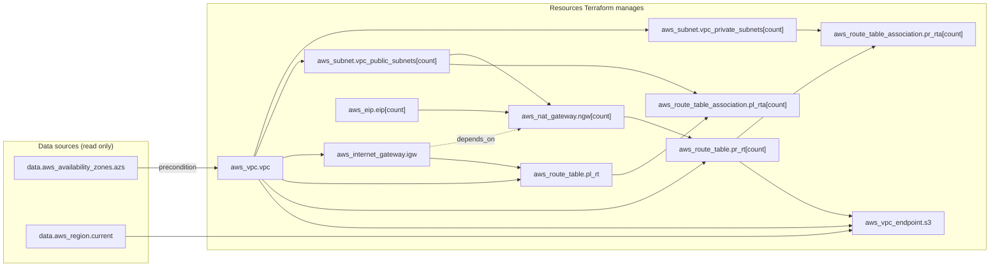
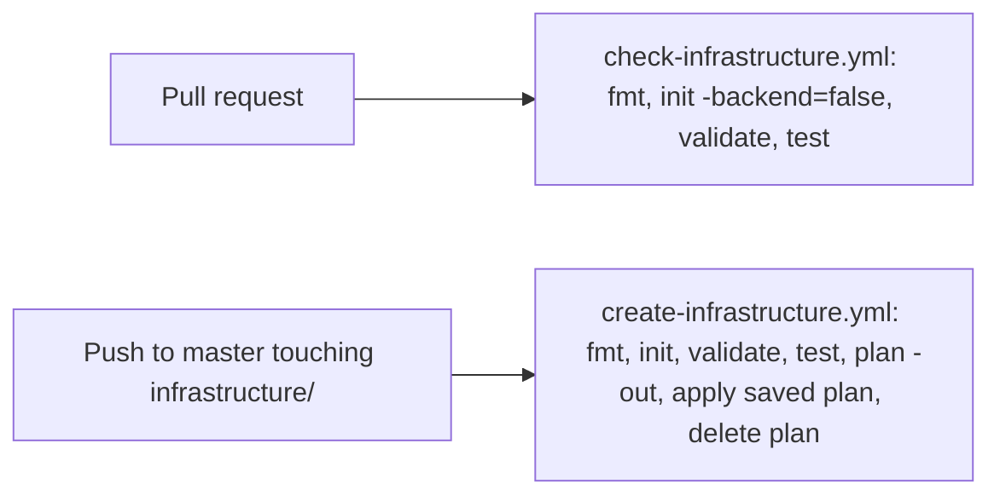

My `tools` repository has one Terraform configuration. It lives in the `infrastructure/` folder and builds an AWS network (a VPC with public and private subnets, NAT gateways and route tables), a set of private container registries (Amazon ECR), Amazon SES email sending for jithendar.com, and some optional IAM roles and an optional EKS cluster. This Terraform tutorial for beginners uses that folder to teach Terraform from the beginning.

You should know basic cloud ideas: what a network, a subnet and an IAM role are. You do not need to know Terraform. Each section explains a problem in plain English, shows a small example, then points to the same idea in the real code. Most sections end with a common mistake, and some with a short exercise.

I checked everything here against the `infrastructure/` folder of the [tools repository](https://github.com/mrjithendar/tools/tree/387bd306d38b6e63d569ecae5121826e2e08d633/infrastructure) at commit `387bd30`, on 3 November 2026. That folder pins Terraform to `>= 1.10, < 2.0`, the AWS provider to `~> 6.0` (the lockfile records 6.69.1) and the Helm provider to `~> 3.0` (lockfile: 3.3.0). Both CI workflows install Terraform 1.16.6. This is HashiCorp Terraform; the repository does not use OpenTofu.

Every code block has one of three labels:

- **Actual repository code**: copied from the file named. Where the file holds an account ID, IP address or bucket name, I replaced it with a placeholder such as `<STATE_BUCKET>` and say so.
- **Simplified from repository code**: shortened from the file named. I say what I left out, and the remaining lines do what they do in the real file.
- **Standalone teaching example**: written for this article. It is not part of the repository.

## What Terraform is

### Infrastructure as Code

Infrastructure as Code means you describe your servers, networks and permissions in text files and let a tool create them. The files go into Git like any other code. You can review a change before it happens, see who changed what, and rebuild the same setup again later.

Terraform is one of those tools. You write `.tf` files in a language called **HCL** (HashiCorp Configuration Language). Terraform reads them, works out what needs to change in your cloud account, shows you a list, and then makes those changes when you approve.

### Declarative: describe the result, not the steps

A shell script is **imperative**: it lists steps. "Create a VPC. Then create a subnet in it. Then create a route table." If you run the script twice you may get two VPCs, unless you write extra code to check what already exists.

Terraform is **declarative**: you describe the result you want. "There is one VPC with this address range, and two subnets inside it." Terraform compares that description with what exists and does only the difference. Run it twice and the second run does nothing, because nothing differs.

That gives you three things to keep apart:

| Term | Meaning |
|---|---|
| Desired configuration | What your `.tf` files describe |
| Actual infrastructure | What really exists in AWS right now |
| State | Terraform's record of which real objects belong to which part of your configuration (covered later) |

Terraform's job is to make the actual infrastructure match the desired configuration, using state to know which objects it is responsible for.

### Providers

Terraform itself knows nothing about AWS. A **provider** is a plugin that teaches Terraform about one platform: what resources exist there, what settings they take, and which API calls create, read, change and delete them. The `infrastructure/` folder uses two providers: `hashicorp/aws` for AWS and `hashicorp/helm` for Helm charts. Terraform downloads providers when you run `terraform init`.

### How Terraform differs from other tools

- **Shell scripts** run commands in order and know nothing about what they created last time.
- **Configuration management tools** such as Ansible mostly configure the inside of machines that already exist: packages, files, services.
- **Terraform** creates and manages the cloud resources themselves, and keeps a record of them so it can update or delete them later.

### Where Terraform fits in this repository

The `tools` repository holds much more than Terraform. It is important to know which tool owns what, because only one tool should manage a given object.

| What | Tool | Where in tools |
|---|---|---|
| AWS network, ECR registries, SES, IAM roles, optional EKS cluster | Terraform | `infrastructure/` |
| Kubernetes objects (Deployments, Services, and so on) | Plain YAML | `deploy/minikube/`, `deploy/eks/manifests/` |
| Cluster controllers such as Istio and the AWS Load Balancer Controller | Argo CD Applications that install Helm charts | `deploy/eks/applications/`, `deploy/eks/helm-values/` |

Terraform builds the ground floor: the cloud resources. Argo CD and Kubernetes YAML run software on top of a cluster. You will see later that a few Helm releases used to live in Terraform and were handed over to Argo CD; the code that did this handover is a good lesson in refactoring.

## Understanding the repository

### The folders that matter

This tree shows only the Terraform-related paths. Everything listed exists in the repository.

```text
tools/
├── .github/
│   ├── dependabot.yml                  # weekly Terraform provider update PRs
│   └── workflows/
│       ├── check-infrastructure.yml    # pull requests: fmt, validate, mock tests
│       └── create-infrastructure.yml   # push to master: plan and apply
└── infrastructure/                     # the only Terraform root module
    ├── .terraform.lock.hcl             # exact provider versions
    ├── Jenkinsfile                     # an alternative pipeline with a manual approval step
    ├── README.md
    ├── _provider.tf                    # terraform block, required_providers, provider blocks
    ├── _remoteState.tf                 # S3 backend
    ├── _variables.tf                   # all input variables
    ├── _locals.tf                      # local values
    ├── _data.tf                        # data sources
    ├── _outputs.tf                     # outputs
    ├── vpc.tf  subnets.tf  gateways.tf  routes.tf  peering.tf
    ├── eks_ecr.tf                      # ECR repositories
    ├── ses.tf                          # SES email identity
    ├── bedrock-minikube.tf             # optional Bedrock IAM role
    ├── eks_cluster.tf  eks-*.tf        # optional EKS cluster and add-ons
    ├── policies/                       # an IAM policy JSON file read by eks-ingress.tf
    ├── tests/*.tftest.hcl              # terraform test files with mocked providers
    └── vars/terraform.tfvars           # the input values CI uses
```

### Root modules and child modules

A **module** is simply a folder of `.tf` files. Terraform treats all the `.tf` files in one folder as a single configuration.

- A **root module** is the folder you run Terraform commands in. It has its own state.
- A **child module** is a folder that another module calls with a `module` block, a bit like calling a function.

The `tools` repository has exactly one root module, `infrastructure/`, and no child modules. Every resource is declared directly in the root. That is a perfectly reasonable shape for a configuration of this size. The section "Modules" shows what a child module looks like.

### File names are only conventions

You will often see `main.tf`, `variables.tf`, `outputs.tf`, `providers.tf` and `versions.tf` in Terraform projects. Terraform does not care about these names. It reads every `.tf` file in the folder, in no particular order, and merges them into one configuration.

This repository uses its own convention: files that start with an underscore (`_variables.tf`, `_outputs.tf`, `_provider.tf`) hold the shared plumbing, and the other files are named after what they build (`vpc.tf`, `ses.tf`). There is no `versions.tf`; the version constraints sit in `_provider.tf`. Moving a block from one file to another inside the folder changes nothing about what Terraform does.

**Common mistake.** Putting a `.tf` file in a subfolder and expecting Terraform to read it. Terraform does not look inside subfolders of the root module. `tests/` and `vars/` work because the `terraform test` command and the `-var-file` flag look there on purpose; `policies/` works because `eks-ingress.tf` reads its file with the `file()` function.

## Terraform and HCL basics

### Blocks, labels and arguments

HCL is made of **blocks**. A block has a type, zero or more labels, and a body in braces. Inside the body you write **arguments**: `name = value`.

*Standalone teaching example.*

```hcl
# A resource block: type "resource", two labels.
resource "aws_vpc" "example" {
  cidr_block           = "10.0.0.0/16" # argument: name = value
  enable_dns_hostnames = true

  tags = {
    Name = "example-vpc"
  }
}
```

- `resource` is the block type.
- `"aws_vpc"` is the first label: the **resource type**. The part before the first underscore, `aws`, tells Terraform which provider handles it.
- `"example"` is the second label: a **local name** you choose. It only has to be unique among `aws_vpc` resources in this module.
- `#` starts a comment. `//` and `/* ... */` also work.

### Values and types

| Type | Example | Notes |
|---|---|---|
| string | `"us-east-1"` | Double quotes only |
| number | `2` | Whole or decimal numbers |
| bool | `true` | No quotes |
| list | `["us-east-1a", "us-east-1b"]` | Ordered; items accessed by position |
| set | `toset(["a", "b"])` | Unordered; no duplicates |
| map | `{ Project = "roboshop-ai" }` | Keys to values of one type |
| object | `{ host = "smtp", port = 587 }` | Named fields, each with its own type |

### Expressions and interpolation

Anything on the right of `=` is an **expression**. It can be a literal value, a reference to something else, a function call, or a string with `${ ... }` inside it. That last one is called **interpolation**: Terraform evaluates the part inside `${ }` and puts the result into the string.

*Actual repository code* from `infrastructure/vpc.tf` (the tags line).

```hcl
tags = merge(local.common_tags, {
  Name = "${local.name_prefix}-vpc-${var.environment}"
})
```

With the values in this repository, the `Name` tag comes out as `roboshop-vpc-demo`. `merge()` is a built-in function that combines maps.

### Addresses and references

Every object in a configuration has an **address**: the way Terraform names it. You use addresses to refer from one block to another.

| You write | It means |
|---|---|
| `var.environment` | The input variable `environment` |
| `local.name_prefix` | The local value `name_prefix` |
| `aws_vpc.vpc` | The resource of type `aws_vpc` named `vpc` |
| `aws_vpc.vpc.id` | That resource's `id` attribute |
| `data.aws_region.current.region` | An attribute of a data source (note the `data.` prefix) |
| `aws_subnet.vpc_private_subnets[0]` | The first instance of a resource that uses `count` |
| `aws_ecr_repository.services["roboshop-web"]` | One instance of a resource that uses `for_each` |
| `module.labels.labels` | An output of a child module |

The pattern for a resource attribute is `resource_type.local_name.attribute`. You will see all of these in the real code below.

## Providers and authentication

### required_providers and version constraints

Before Terraform can use a provider, you tell it where the provider comes from and which versions are acceptable.

*Actual repository code* from `infrastructure/_provider.tf` (the `terraform` block).

```hcl
terraform {
  required_version = ">= 1.10, < 2.0"
  required_providers {
    aws = {
      source  = "hashicorp/aws"
      version = "~> 6.0"
    }
    helm = {
      source  = "hashicorp/helm"
      version = "~> 3.0"
    }
  }
}
```

- `required_version` limits the **Terraform CLI** version. Any 1.x from 1.10 upward works.
- `source = "hashicorp/aws"` means the provider `aws` published by `hashicorp` on the public Terraform Registry.
- `version = "~> 6.0"` is a **pessimistic constraint**. `~>` allows the rightmost number to go up, so `~> 6.0` accepts 6.1, 6.69 and so on, but not 7.0. Major versions can contain breaking changes, so blocking them on purpose is sensible.

### The dependency lockfile

A constraint like `~> 6.0` allows many versions. To make every machine use the **same** one, `terraform init` writes the exact choice to `.terraform.lock.hcl`.

*Simplified from repository code* from `infrastructure/.terraform.lock.hcl`. I left out the long list of checksums (`hashes`) in each block.

```hcl
provider "registry.terraform.io/hashicorp/aws" {
  version     = "6.69.1"
  constraints = "~> 6.0"
}

provider "registry.terraform.io/hashicorp/helm" {
  version     = "3.3.0"
  constraints = "~> 3.0"
}
```

The lockfile is committed to Git. Next time anyone runs `terraform init`, Terraform installs 6.69.1 again even if 6.70 exists. To move to a newer version on purpose, you run `terraform init -upgrade`, review the lockfile change, and commit it. In this repository, Dependabot opens a pull request for provider updates every Monday (see `.github/dependabot.yml`).

### Provider configuration

The `provider` block configures a provider: which region, which credentials, which cluster.

*Actual repository code* from `infrastructure/_provider.tf`.

```hcl
provider "aws" {
  region = var.aws_region
}
```

That is the whole AWS provider configuration. It sets a region and nothing else. In particular, there is no `access_key`, `secret_key` or `profile` here.

### How authentication actually works here

When the provider block names no credentials, the AWS provider looks for them the same way the AWS CLI does: environment variables such as `AWS_ACCESS_KEY_ID` or `AWS_PROFILE`, then your shared config files in `~/.aws`, then an instance role if it runs on EC2, and so on. This is called the **default credential chain**.

The repository relies on that chain everywhere:

- On your laptop, you sign in with your normal AWS profile, for example `export AWS_PROFILE=<YOUR_PROFILE>`, before running Terraform.
- In GitHub Actions, the `create-infrastructure.yml` workflow sets no AWS credentials at all. The README says the self-hosted runner "must already have AWS credentials (for example, an EC2 instance role)" and that "No OIDC role or AWS access keys are configured in this workflow."
- The `Jenkinsfile` has a comment that says the same thing for Jenkins: "Use an IAM role on the Jenkins agent; do not put AWS keys in this file."

**OIDC** (OpenID Connect) is a way for GitHub Actions to swap a short-lived GitHub token for temporary AWS credentials, with no stored keys. This repository does not use it today. I list it as a possible improvement at the end.

### Backend authentication is separate

Terraform stores its state in an S3 bucket (see "Terraform state" below). Reading and writing that bucket is done by the **backend**, not by the AWS provider. The backend has its own settings, including its own `region`, and it reads credentials from the same default chain. So one set of credentials needs two kinds of permission: S3 access for the state, and permission to manage VPC, ECR, SES and IAM for the provider.

### The Helm provider

*Actual repository code* from `infrastructure/_provider.tf`.

```hcl
provider "helm" {
  kubernetes = {
    host                   = try(aws_eks_cluster.main[0].endpoint, null)
    cluster_ca_certificate = try(base64decode(aws_eks_cluster.main[0].certificate_authority[0].data), null)
    token                  = try(data.aws_eks_cluster_auth.main[0].token, null)
  }
}
```

The Helm provider talks to a Kubernetes cluster, so it needs the cluster's address, its certificate and a login token. All three come from the optional EKS cluster in the same configuration. `try(..., null)` returns `null` when the first expression fails, which happens when EKS is turned off and `aws_eks_cluster.main[0]` does not exist. The token comes from the `aws_eks_cluster_auth` data source, which the comment in `_data.tf` says "needs no AWS CLI on the runner."

Today no `helm_release` resources are left in the configuration; the section "Drift, imports and refactoring" explains why the provider is still there.

**Common mistake.** Pasting access keys into a `provider` block "just to test." They end up in Git history, and anyone with read access to the repository can use them. Use your profile or temporary credentials, and keep `provider` blocks free of secrets.

## Resources and data sources

### Managing something versus looking it up

A **resource** block says: "This object should exist, and Terraform owns it." Terraform will create it, update it and, if you remove the block, delete it.

A **data source** says: "Look this information up for me. I do not own it." Terraform reads it during each plan and never changes it.

*Actual repository code* from `infrastructure/_data.tf`.

```hcl
data "aws_availability_zones" "azs" {
  state = "available"
  filter {
    name   = "zone-type"
    values = ["availability-zone"]
  }
}

data "aws_region" "current" {}
```

The first asks AWS which standard availability zones are available in the current region (the filter leaves out Local Zones and Wavelength Zones). The second returns the region the provider is using. The repository also reads `data "aws_caller_identity" "bedrock"` in `bedrock-minikube.tf` to learn the account ID without writing it into the code.

### Your first real resource

*Actual repository code* from `infrastructure/vpc.tf`.

```hcl
resource "aws_vpc" "vpc" {
  cidr_block           = var.vpc_cidr
  instance_tenancy     = "default"
  enable_dns_support   = true
  enable_dns_hostnames = true
  tags = merge(local.common_tags, {
    Name = "${local.name_prefix}-vpc-${var.environment}"
  })
  lifecycle {
    precondition {
      condition     = alltrue([for az in var.availability_zones : contains(data.aws_availability_zones.azs.names, az)])
      error_message = "All selected AZs must be available standard zones in aws_region."
    }
  }
}
```

The arguments map directly to VPC settings in the AWS console: the address range, DNS support and tags. The `lifecycle { precondition { ... } }` part is a safety check. Before Terraform creates or changes the VPC, it checks that every availability zone you asked for appears in the data source's list. If you typed `us-west-2a` while working in `us-east-1`, the plan stops with that error message instead of failing halfway through.

### Declaring a resource does not adopt an existing one

This catches many beginners. Suppose a VPC already exists in your account, created by hand, and you write a matching `resource "aws_vpc"` block. Terraform will **not** recognise the existing VPC. It has no record of it in state, so it plans to create a second one.

To bring an existing object under Terraform's control, you **import** it (see "Drift, imports and refactoring"). The infrastructure README gives this exact warning for ECR: "Import repositories that already exist before planning creation."

### References create dependencies

*Actual repository code* from `infrastructure/gateways.tf`.

```hcl
resource "aws_internet_gateway" "igw" {
  vpc_id = aws_vpc.vpc.id
  tags   = merge(local.common_tags, { Name = "${local.name_prefix}-igw-${var.environment}" })
}
```

`vpc_id = aws_vpc.vpc.id` does two jobs. It passes the VPC's ID to the internet gateway, and it tells Terraform that the gateway depends on the VPC. Terraform builds a **dependency graph** from these references: it creates the VPC first, the gateway second, and when destroying, it removes them in the opposite order. You never write the order yourself.

**Exercise.** Open `infrastructure/routes.tf` and list every resource that `aws_route_table.pr_rt` references. (Answer: `aws_vpc.vpc` through `vpc_id`, and `aws_nat_gateway.ngw` through `nat_gateway_id`.)

## Input variables

### Why variables

Hard-coding `"us-east-1"` or `"demo"` into every resource makes the configuration hard to reuse. **Input variables** are the parameters of a module. You declare them once and refer to them as `var.<name>`.

*Standalone teaching example.*

```hcl
variable "environment" {
  description = "Short environment name used in resource names."
  type        = string
  default     = "dev"
}
```

- `type` says what kind of value is allowed. Terraform rejects anything else.
- `default` makes the variable optional. Without a default, Terraform requires a value.
- `description` is documentation for whoever uses the module.

### Real variables, with validation

All 26 variables in the repository live in `infrastructure/_variables.tf`. Here are three that show the main features.

*Actual repository code* from `infrastructure/_variables.tf`.

```hcl
variable "environment" {
  type = string
  validation {
    condition     = can(regex("^[a-z][a-z0-9-]{0,19}$", var.environment))
    error_message = "Use a lowercase environment name, up to 20 characters."
  }
}

variable "availability_zones" {
  description = "Two or three distinct standard AZs in aws_region, in stable order. Changing order replaces subnets."
  type        = list(string)
  validation {
    condition     = length(var.availability_zones) >= 2 && length(var.availability_zones) <= 3 && length(distinct(var.availability_zones)) == length(var.availability_zones)
    error_message = "Specify two or three distinct availability zones."
  }
}

variable "single_nat_gateway" {
  description = "Cost-saving demo option. True routes all private subnets via the first AZ and loses AZ-level egress redundancy."
  type        = bool
  default     = false
}
```

- `environment` has **no default**, so it is required. Its `validation` block uses `regex()` to check the format, and `can()` turns a regex failure into `false` instead of an error.
- `availability_zones` is a `list(string)` with two checks in one condition: two or three items, and no duplicates. Its description warns that **order matters**; the section "Dependencies and expressions" explains why.
- `single_nat_gateway` is a `bool` that defaults to `false`. The description tells you the trade-off before you change it.

### Nullable

Two variables set `nullable = false`: `ecr_repository_names` and `ecr_pull_principals`. That tells Terraform the value must never end up `null`, so the code that loops over them can rely on always getting a list or a map, even an empty one.

### .tfvars files

You give variables values in a **variable definitions file**, a `.tfvars` file that contains only `name = value` lines.

*Simplified from repository code* from `infrastructure/vars/terraform.tfvars`. I kept only the network settings and replaced the address range with a placeholder.

```hcl
environment        = "demo"
userid             = "<OWNER_TAG>"
aws_region         = "us-east-1"
vpc_cidr           = "<VPC_CIDR>/16"
availability_zones = ["us-east-1a", "us-east-1b"]
# False = one NAT per AZ. True reduces demo costs but makes egress depend on one AZ.
single_nat_gateway = false
```

The defaults in `_variables.tf` are example values that make the module usable. The values in `vars/terraform.tfvars` are the ones CI actually deploys with. For example, `ses_enabled` defaults to `false` but the tfvars file sets it to `true`.

### Where values come from, and which wins

Terraform can get a variable's value from several places. When more than one sets the same variable, the later item in this list wins:

1. The `default` in the `variable` block.
2. Environment variables named `TF_VAR_<name>`, such as `TF_VAR_environment=qa`.
3. A file named exactly `terraform.tfvars` in the working directory.
4. A file named `terraform.tfvars.json` in the working directory.
5. Files ending in `.auto.tfvars` or `.auto.tfvars.json`, in alphabetical order.
6. `-var` and `-var-file` options on the command line, in the order you type them.

Here is the important detail for this repository. The tfvars file is at `vars/terraform.tfvars`, **inside a subfolder**. Terraform only loads `terraform.tfvars` automatically from the working directory itself, so this file is never picked up on its own. Every command that needs it passes it explicitly:

```bash
cd infrastructure
terraform plan -var-file=vars/terraform.tfvars
```

If you forget `-var-file`, Terraform has no value for `environment` or `availability_zones` (neither has a default). It asks you to type them, or, in CI where `TF_INPUT` is `false`, it fails.

### sensitive = true does not keep a value out of state

You can mark a variable `sensitive = true`. Terraform then hides its value in plan and apply output, showing `(sensitive value)` instead. That is all it does. The official documentation is clear: "Terraform still stores the values of sensitive variables in your state." Anyone who can read the state file can read the value. Since Terraform 1.10 there is also `ephemeral = true`, which the documentation says keeps a variable out of state and plan files, but it only works in places that do not need to remember the value.

None of the variables in this repository are marked `sensitive`, because none of them is a secret. The README goes further and says never to pass credentials "through Terraform variables" at all.

**Common mistake.** Confusing Terraform variables with shell variables. `export environment=qa` does nothing to Terraform. The shell variable must be called `TF_VAR_environment`, and inside `.tf` files you always write `var.environment`, never `$environment`.

## Locals and outputs

### Locals: name a value once

A **local value** gives a name to an expression so you do not repeat it. You declare them in a `locals` block (plural) and use them as `local.<name>` (singular).

*Simplified from repository code* from `infrastructure/_locals.tf`. The real block has about twenty entries; I kept the ones the network uses, so `terraform fmt` re-aligned the `=` signs.

```hcl
locals {
  common_tags = merge(var.tags, {
    Project     = "roboshop-ai"
    Environment = var.environment
    ManagedBy   = "Terraform"
  }, var.userid != "" ? { Owner = var.userid } : {})
  name_prefix    = "roboshop"
  privateSubnets = aws_subnet.vpc_private_subnets[*].id
  publicSubnets  = aws_subnet.vpc_public_subnets[*].id
  nat_count      = var.single_nat_gateway ? 1 : length(var.availability_zones)
}
```

- `common_tags` is the repository's **tagging pattern**. It merges any extra tags you pass in, the three standard tags, and an `Owner` tag only when `userid` is set. Almost every resource then writes `tags = merge(local.common_tags, { Name = "..." })`, so the standard tags are defined in one place.
- `privateSubnets` uses the **splat expression** `[*]`. `aws_subnet.vpc_private_subnets[*].id` means "the `id` of every instance", giving a list of subnet IDs.
- `nat_count` decides how many NAT gateways to build. More on `? :` in the section "Dependencies and expressions".

Use a local when an expression appears in several places or when a name makes the intent clearer. Do not wrap every single value in a local; `var.aws_region` is already clear.

### Outputs: values a module hands back

An **output** publishes a value after apply. You see outputs at the end of `terraform apply`, you can print them with `terraform output`, and a parent module can read a child module's outputs.

*Actual repository code* from `infrastructure/_outputs.tf` (two of the 18 outputs).

```hcl
output "vpc_id" {
  value = aws_vpc.vpc.id
}

output "ecr_repository_urls" {
  description = "Docker push/pull URLs keyed by repository name."
  value       = { for name, repository in aws_ecr_repository.services : name => repository.repository_url }
}
```

The second one uses a `for` expression to build a map from repository name to push URL. Other tools can then read it with `terraform output -json ecr_repository_urls`, which is what the infrastructure README tells you to run after applying.

### Sensitive outputs

You can mark an output `sensitive = true`. Terraform then shows `(sensitive value)` in normal output. `terraform output -json` and `terraform output -raw` still print the real value, because they are meant for scripts. And as with variables, the value is still stored in state.

None of the repository's outputs are marked sensitive. The `ses_smtp` output deliberately contains only a host, port, sender address, IAM user name and identity ARN. Its description explains that the SMTP login is created separately, so no password ever passes through Terraform.

**Common mistake.** Marking a password output `sensitive = true` and assuming it is now safe. It is hidden from the screen, not from the state file or from `terraform output -raw`.

## The Terraform workflow

All of these commands run in the root module folder. In this repository that is `infrastructure/`. You can either `cd infrastructure` first, or stay at the repository root and add `-chdir=infrastructure`, which is what the GitHub workflow does.

```bash
# Two equivalent ways to run validate in the right folder
cd infrastructure && terraform validate
terraform -chdir=infrastructure validate
```

### terraform fmt

Rewrites `.tf` files into the standard layout: indentation, aligned `=` signs. `terraform fmt -check` changes nothing and fails if any file needs formatting, which is how both CI workflows use it.

- Remote access: none. Changes infrastructure: no. It only touches local files, and with `-check`, not even those.

### terraform init

Prepares the folder: downloads the providers named in the lockfile into a hidden `.terraform/` folder, and connects to the backend that stores state.

- Remote access: yes. It downloads providers from the registry, and it contacts the S3 backend.
- Changes infrastructure: no.
- `terraform init -backend=false` skips the backend. The pull request workflow uses this, because it has no AWS access.

### terraform validate

Checks that the configuration makes sense: correct block names, types that match, references that point at real things.

- Remote access: no. It does not call AWS or read state. It needs `init` first so the provider schemas are available.
- Changes infrastructure: no.

### terraform plan

Compares your configuration with state and with the real infrastructure, and prints what it would change.

- Remote access: yes. A plan normally **reads** the real infrastructure: it refreshes every resource in state by asking AWS about it, and it reads all data sources. That is how it notices drift (see "Drift, imports and refactoring"). It also takes the state lock unless you pass `-lock=false`.
- Changes infrastructure: no.
- `terraform plan -out=plan.tfplan` saves the plan to a file.

### terraform apply

Makes the changes.

- Remote access: yes. Changes infrastructure: **yes**.
- `terraform apply` on its own makes a fresh plan, shows it, and asks you to type `yes`.
- `terraform apply plan.tfplan` executes the actions recorded in that saved plan file, without asking again. That is the point of saving a plan: what you reviewed is what runs. If the state changed in the meantime, Terraform refuses the stale plan.

### terraform destroy

Deletes every resource in this root module's state.

- Remote access: yes. Changes infrastructure: **yes, and it deletes things**.

### The full sequence

This is the workflow from the infrastructure README.

*Actual repository code* from `infrastructure/README.md`.

```bash
cd infrastructure
terraform init
terraform fmt -check
terraform validate
terraform test
terraform plan -var-file=vars/terraform.tfvars -out=plan.tfplan
# Inspect the plan, especially subnet replacements, before running:
terraform apply plan.tfplan
terraform output
```

`terraform apply` and `terraform destroy` are commands you run deliberately, in your own AWS account, after you have read the plan. I did not run either of them, or any plan against AWS, while writing this article. Read the section "Terraform in CI/CD" before running anything against the real stack, because a push to `master` already applies it automatically.

**Common mistake.** Running commands from the wrong directory. In the repository root there are no `.tf` files, so `terraform plan` there finds nothing to do, or, worse, in some other folder it plans against a different state. Check `pwd` or use `-chdir`.

## Reading a plan

A plan lists each resource with a symbol:

| Symbol | Meaning |
|---|---|
| `+` | Create |
| `~` | Update in place: the object stays, a setting changes |
| `-` | Delete |
| `-/+` | Replace: delete, then create a new one |
| `+/-` | Replace, creating the new one first (when `create_before_destroy` is set) |
| `<=` | Read a data source |

The last line sums it up, for example `Plan: 2 to add, 0 to change, 2 to destroy.`

### "known after apply"

Some values do not exist until AWS creates the object: an ID, an ARN, an assigned IP address. The plan shows them as `(known after apply)`. That is normal for anything new. It also spreads: if a subnet's ID is unknown, every resource that references it also has an unknown value until apply.

### Why a small change can replace a resource

Some settings cannot be changed on an existing object. AWS has no API to move a subnet to a different availability zone, for example. When you change such a setting, the provider marks it `# forces replacement`, and Terraform plans to destroy the old object and create a new one.

The `availability_zones` description warns: "Changing order replaces subnets." Here is what that looks like. Suppose you swap the order to `["us-east-1b", "us-east-1a"]`.

*Illustrative plan excerpt*, written for this article to show the format. It is not output from a real plan of this stack, and the IDs are placeholders.

```text
  # aws_subnet.vpc_private_subnets[0] must be replaced
-/+ resource "aws_subnet" "vpc_private_subnets" {
      ~ arn                     = "arn:aws:ec2:us-east-1:<ACCOUNT_ID>:subnet/subnet-<ID_A>" -> (known after apply)
      ~ availability_zone       = "us-east-1a" -> "us-east-1b" # forces replacement
      ~ id                      = "subnet-<ID_A>" -> (known after apply)
        # (8 unchanged attributes hidden)
    }

  # aws_subnet.vpc_private_subnets[1] must be replaced
-/+ resource "aws_subnet" "vpc_private_subnets" {
      ~ availability_zone       = "us-east-1b" -> "us-east-1a" # forces replacement
      ~ id                      = "subnet-<ID_B>" -> (known after apply)
        # (9 unchanged attributes hidden)
    }

  # ... the public subnets, NAT gateways and route table associations follow
```

You changed the order of two strings, and Terraform wants to delete and recreate both private and both public subnets. Resources whose `subnet_id` points at them, such as the NAT gateways and the route table associations, are replaced too. I cut the excerpt short, so it does not show the summary line. If a cluster were running in those subnets, this would be an outage. Nothing in the plan is wrong; it is doing exactly what the configuration now says.

### Reviewing unexpected changes

When a plan shows something you did not expect:

1. Read every `-/+` and `-` line first. Look for `# forces replacement` to see which setting caused it.
2. Ask what changed: your code, a variable value, the provider version (lockfile), or the real infrastructure (someone edited it by hand).
3. Run `git diff` on the `.tf` files, the tfvars file and `.terraform.lock.hcl`.
4. If you cannot explain a change, do not apply it. A plan that matches your intent is the only safe plan.

## Terraform state

### Why Terraform needs state

Your configuration says "there is an `aws_vpc` called `vpc`." AWS says "there is a VPC with ID `vpc-<ID>`." Something has to connect the two. That is the **state**: a JSON document that maps every resource address in your configuration to the real object's ID and its last known attributes.

Without state, Terraform could not tell which of the VPCs in your account is "its" VPC, and it would not know what to delete when you remove a block.

### Local and remote state

By default, Terraform writes state to a `terraform.tfstate` file in the working folder. That works for one person on one laptop. It breaks as soon as a CI runner and a person both run Terraform, because each would have its own copy.

**Remote state** keeps the file in shared storage. Terraform calls the storage configuration a **backend**.

### The backend in this repository

*Actual repository code* from `infrastructure/_remoteState.tf`, with the bucket name replaced by a placeholder.

```hcl
terraform {
  backend "s3" {
    bucket       = "<STATE_BUCKET>"
    key          = "terraform/vpc.tfstate"
    region       = "us-east-1"
    encrypt      = true
    use_lockfile = true
  }
}
```

- `bucket` and `key` say where the state object lives in S3. The key still says `vpc.tfstate` even though the stack now holds more than a VPC; the README says the existing location "is preserved."
- `encrypt = true` asks S3 to encrypt the object at rest.
- `use_lockfile = true` turns on **state locking** with a lock file stored next to the state in S3.

The backend block cannot use variables. Its values are fixed in the file, or supplied with `terraform init -backend-config=...`.

### Locking, without DynamoDB

Two `terraform apply` runs at the same time against one state can corrupt it. A **lock** prevents that: the first run creates a lock, and the second waits or fails.

For years the S3 backend needed a separate DynamoDB table for locking. That is no longer the case. Terraform 1.10 added S3-native locking, the 1.11 changelog declared it generally available and deprecated the DynamoDB arguments, and the current S3 backend documentation marks `dynamodb_table` as deprecated. This repository uses only `use_lockfile = true`; there is no DynamoDB table anywhere in the configuration.

With `use_lockfile`, Terraform writes a `.tflock` object next to the state key. The S3 backend documentation lists the permissions it needs on that lock object: `s3:GetObject`, `s3:PutObject` and `s3:DeleteObject`. The infrastructure README asks for the same: "state read/write and lockfile read/write/delete permissions."

### Two different "lock" files

These two names are easy to confuse:

| File | What it locks | Where |
|---|---|---|
| `.terraform.lock.hcl` | Provider **versions** | Committed to Git |
| `<key>.tflock` | The **state**, while a command runs | In the S3 bucket, created and deleted automatically |

### State is sensitive

State holds the full attributes of every resource, including any values marked `sensitive`, and the results of data sources. Treat it like a secret:

- Never commit it. The repository's `.gitignore` excludes `*.tfstate`, `*.tfstate.*`, `*.tfplan` and `.terraform/`.
- Limit who can read the bucket. The README says to enable versioning and block public access on it.
- Saved plans contain state data too. The workflow deletes its saved plan in a step that always runs, with the comment "The plan can hold sensitive values; do not leave it on the runner."

Do not open or edit state by hand. If you need to inspect what Terraform manages, `terraform state list` prints only the addresses.

## Modules

### What a module call looks like

The `tools` repository has **no child modules**: every resource sits directly in `infrastructure/`. The infrastructure README mentions that a separate EKS stack lives as "its own reusable root module" in another repository, roboshop-ai, but that is outside `tools` and outside this article.

So here is a **proposed teaching example** of what a child module looks like. It is not in the repository.

*Standalone teaching example.* A child module in `modules/labels/main.tf`:

```hcl
variable "prefix" {
  type = string
}

variable "services" {
  type = list(string)
}

resource "terraform_data" "label" {
  for_each = toset(var.services)

  input = {
    name = "${var.prefix}-${each.key}"
  }
}

output "labels" {
  value = { for name, label in terraform_data.label : name => label.output.name }
}
```

And the root module that calls it:

```hcl
module "labels" {
  source = "./modules/labels"

  prefix   = "practice-dev"
  services = ["web", "cart"]
}

output "service_labels" {
  value = module.labels.labels
}
```

- The child's `variable` blocks are its **inputs**. The caller sets them as arguments in the `module` block.
- The child's `output` blocks are what it gives back. The caller reads them as `module.labels.<output>`.
- `source` says where the module code is. `./modules/labels` is a local folder.

### Module versions are not provider versions

When `source` points at a registry, such as `source = "terraform-aws-modules/vpc/aws"`, you also set `version = "..."` in the `module` block. That pins the **module code**. It has nothing to do with the provider version: the module still uses whatever AWS provider version your root module's lockfile selected. Local modules like `./modules/labels` have no version at all; they change when your Git commit changes.

### When not to make a module

A module is worth it when you create the same group of resources several times, or when you want to hand a clear interface to other teams. Wrapping a single resource in a module just adds a layer of indirection. The `tools` network is built once, and a reader can follow it file by file; it does not need modules.

## Dependencies and expressions

### Implicit dependencies

As you saw, a reference such as `vpc_id = aws_vpc.vpc.id` creates a dependency automatically. Almost every ordering in the `tools` network comes from references.

### When depends_on is justified

`depends_on` adds an ordering that Terraform cannot see from references. The repository uses it in a few places, each for a real reason.

*Actual repository code* from `infrastructure/gateways.tf`.

```hcl
resource "aws_nat_gateway" "ngw" {
  count             = local.nat_count
  connectivity_type = "public"
  allocation_id     = aws_eip.eip[count.index].id
  subnet_id         = local.publicSubnets[count.index]
  tags              = merge(local.common_tags, { Name = "${local.name_prefix}-nat-${count.index + 1}-${var.environment}" })
  depends_on        = [aws_internet_gateway.igw]
}
```

A public NAT gateway needs the VPC's internet gateway to work, but none of its arguments mention the gateway. Without `depends_on`, Terraform could create both at the same time. The AWS provider's documentation for `aws_nat_gateway` recommends this exact `depends_on`.

A second example in `eks-node-groups.tf`: the node group lists the route table associations in `depends_on`. Worker nodes need working routes to join the cluster, but nothing in the node group refers to route tables.

Use `depends_on` only when there is a hidden dependency like these. Adding it "to be safe" makes plans slower and can make Terraform treat more values as unknown.

### Conditional expressions

`condition ? value_if_true : value_if_false` chooses between two values.

*Simplified from repository code* from `infrastructure/_locals.tf`: one line, with the alignment spaces removed.

```hcl
nat_count = var.single_nat_gateway ? 1 : length(var.availability_zones)
```

One NAT gateway when `single_nat_gateway` is true, otherwise one per availability zone.

### count: several copies, numbered

`count = N` creates N instances of a resource, numbered from 0. Inside the block, `count.index` is the current number.

*Actual repository code* from `infrastructure/subnets.tf`.

```hcl
# /20 private networks provide room for node and VPC CNI pod addresses.
resource "aws_subnet" "vpc_private_subnets" {
  count                   = length(var.availability_zones)
  vpc_id                  = aws_vpc.vpc.id
  availability_zone       = var.availability_zones[count.index]
  cidr_block              = cidrsubnet(var.vpc_cidr, 4, count.index)
  map_public_ip_on_launch = false
  tags = merge(local.common_tags, {
    Name                              = "${local.name_prefix}-private-subnet-${var.environment}-${count.index + 1}"
    "kubernetes.io/role/internal-elb" = "1"
  })
}
```

- Two availability zones give two subnets: `vpc_private_subnets[0]` and `vpc_private_subnets[1]`.
- `cidrsubnet(var.vpc_cidr, 4, count.index)` carves a smaller network out of the VPC range. Adding 4 bits to a `/16` gives a `/20`, and `count.index` picks which one. With `10.0.0.0/16` that is `10.0.0.0/20`, then `10.0.16.0/20`. The public subnets use `cidrsubnet(var.vpc_cidr, 8, 240 + count.index)`, giving `/24` networks from `10.0.240.0/24`, well away from the private ranges.

### count with a condition: optional resources

The repository uses `count` a second way: as an on/off switch.

*Actual repository code* from `infrastructure/ses.tf`.

```hcl
resource "aws_sesv2_email_identity" "store" {
  count          = var.ses_enabled ? 1 : 0
  email_identity = var.ses_domain

  dkim_signing_attributes {
    next_signing_key_length = "RSA_2048_BIT"
  }

  tags = local.common_tags
}
```

`count = 0` means the resource does not exist. Everything that refers to it must then use `[0]` and cope with it being absent, which is why outputs such as `eks_cluster_name` say `var.eks_enabled ? aws_eks_cluster.main[0].name : null`.

### Why count and list positions are risky

With `count`, Terraform identifies each instance by **position**. Instance `[0]` is "whatever is first in the list." If the list order changes, what is first changes, and Terraform sees a different setting on instance `[0]`. For subnets, that setting is the availability zone, which forces replacement. That is the plan you saw in the section "Reading a plan".

### for_each: several copies, named

`for_each` takes a map or a set of strings and creates one instance per key. Each instance is identified by its **key**, not its position.

*Actual repository code* from `infrastructure/eks_ecr.tf`.

```hcl
# Repository names are stable resource keys: reordering the list does not replace them.
resource "aws_ecr_repository" "services" {
  for_each = toset(var.ecr_repository_names)

  name                 = each.value
  image_tag_mutability = "MUTABLE"
  force_delete         = false

  encryption_configuration {
    encryption_type = "AES256"
  }

  image_scanning_configuration {
    scan_on_push = false
  }

  tags = merge(local.common_tags, {
    Name = each.value
  })
}
```

- `toset()` turns the list of names into a set; a set's items become the keys.
- The instances are `aws_ecr_repository.services["roboshop-web"]`, `aws_ecr_repository.services["roboshop-cart-service"]`, and so on.
- `each.key` and `each.value` are the current item. For a set they are the same string.
- Reordering the list changes nothing. Removing a name plans the deletion of only that repository, and `force_delete = false` makes AWS refuse to delete a repository that still holds images.

Rule of thumb: use `for_each` when the items have natural names, and `count` for a plain on/off switch or for a number of identical things. The subnets use `count` over a list, which is why the variable description has to warn about order.

### Dynamic blocks

Some resources take repeated nested blocks. A `dynamic` block generates them from a collection. The repository uses one, in `infrastructure/eks-fargate.tf`.

*Actual repository code* from `infrastructure/eks-fargate.tf` (the selector part).

```hcl
dynamic "selector" {
  for_each = var.eks_fargate_namespaces
  content {
    namespace = selector.value
  }
}
```

It writes one `selector { namespace = ... }` block per namespace. Inside `content`, the loop variable is named after the block, here `selector`. This is advanced; you can skip it until you need it.

**Exercise.** In `infrastructure/routes.tf`, find the expression that makes every private route table point at NAT gateway 0 when `single_nat_gateway` is true. (Answer: `nat_gateway_id = aws_nat_gateway.ngw[var.single_nat_gateway ? 0 : count.index].id`.)

## Managing environments

### What this repository actually does

The `tools` repository manages **one** environment from **one** state:

- One root module: `infrastructure/`.
- One variable file: `vars/terraform.tfvars`, with `environment = "demo"`.
- One fixed state key in the backend block: `terraform/vpc.tfstate`.
- No Terraform workspaces.

The `environment` variable only changes names and tags (for example `roboshop-vpc-demo`). It does not separate anything.

### Variable files do not separate state

This is the most important point in this section. If you created `vars/prod.tfvars` and ran `terraform plan -var-file=vars/prod.tfvars` in the same folder, Terraform would use the **same state**. It would plan to change the demo VPC into the prod VPC, because as far as state is concerned there is only one `aws_vpc.vpc`.

The README describes the safe way: "For a new environment, select a distinct state key at init; never share demo and production state." In practice that looks like this.

*Standalone teaching example.* Not used in the repository today.

```bash
cd infrastructure
terraform init -reconfigure -backend-config="key=terraform/<ENVIRONMENT>.tfstate"
terraform plan -var-file=vars/<ENVIRONMENT>.tfvars -out=<ENVIRONMENT>.tfplan
```

### The other common patterns

- **Separate folders** per environment, each a root module with its own backend block. Very clear, at the cost of some copied code.
- **Terraform CLI workspaces** (`terraform workspace new prod`). One folder, several states under the same backend; the S3 backend stores non-default workspaces under a separate prefix. Easy to forget which workspace is selected.
- **HCP Terraform workspaces** are a different thing with the same name: a workspace there is a whole hosted project with its own state, variables, runs and permissions.

I am not claiming any of these is right for `tools`; the repository has one environment and does not need to choose yet.

## Walking through one real implementation: the VPC network

Now put the pieces together. This walk-through follows the network part of the stack, from inputs to CI. It is a manageable example: about a dozen resources, all in five small files.

### Step 1: inputs

From `vars/terraform.tfvars` the network takes `environment`, `aws_region`, `vpc_cidr`, `availability_zones` and `single_nat_gateway`. Validation in `_variables.tf` checks that the CIDR is a `/16` and that there are two or three distinct zones.

### Step 2: provider and backend

`_provider.tf` sets the AWS region from `var.aws_region`. `_remoteState.tf` puts the state in S3 with locking. Credentials come from the environment.

### Step 3: lookups

`_data.tf` reads the available standard zones (used by the VPC precondition) and the current region (used to name the S3 endpoint service).

### Step 4: the VPC and subnets

`vpc.tf` creates the VPC. `subnets.tf` creates one private `/20` and one public `/24` subnet per zone, with Kubernetes load-balancer tags (`kubernetes.io/role/internal-elb` and `kubernetes.io/role/elb`) so that a load balancer controller can find them later.

### Step 5: getting to the internet

`gateways.tf` creates one internet gateway, then, for each NAT gateway, an Elastic IP address and a NAT gateway in a public subnet.

### Step 6: routes

*Simplified from repository code* from `infrastructure/routes.tf`. I left out the `tags` lines and the two route table associations, which connect each subnet to its route table.

```hcl
resource "aws_route_table" "pl_rt" {
  vpc_id = aws_vpc.vpc.id
  route {
    cidr_block = "0.0.0.0/0"
    gateway_id = aws_internet_gateway.igw.id
  }
}

resource "aws_route_table" "pr_rt" {
  count  = length(var.availability_zones)
  vpc_id = aws_vpc.vpc.id
  route {
    cidr_block     = "0.0.0.0/0"
    nat_gateway_id = aws_nat_gateway.ngw[var.single_nat_gateway ? 0 : count.index].id
  }
}

# ECR image layers use S3. Keep this traffic on AWS's gateway endpoint.
resource "aws_vpc_endpoint" "s3" {
  vpc_id            = aws_vpc.vpc.id
  service_name      = "com.amazonaws.${data.aws_region.current.region}.s3"
  vpc_endpoint_type = "Gateway"
  route_table_ids   = aws_route_table.pr_rt[*].id
}
```

- Public subnets share one route table that sends all other traffic (`0.0.0.0/0`) to the internet gateway.
- Each private subnet gets its own route table that sends outbound traffic to a NAT gateway: its own zone's NAT, or NAT 0 when `single_nat_gateway` is true.
- The S3 gateway endpoint attaches to every private route table, so S3 traffic (including container image layers from ECR) stays inside AWS instead of going through NAT.

`peering.tf` contains only comments: "No automatic peering with the account's default VPC."

### Step 7: outputs

`_outputs.tf` publishes `vpc_id`, `vpc_cidr`, `private_subnets`, `public_subnets`, `subnets`, `public_rt`, `private_rt`, `availability_zones`, `nat_gateway_ids` and `eks_subnet_ids` for the network.

### The resource graph

This diagram shows only the dependencies inside Terraform, for the network files. Solid arrows mean "is referenced by"; the dotted arrow is the explicit `depends_on`. With two zones and the default `single_nat_gateway = false`, the counted resources each have two instances.



The deployment workflow is a separate thing: it is the order of commands, not of resources.



### Testing it without AWS

The repository tests this network with Terraform's built-in test framework. Test files end in `.tftest.hcl` and live in `infrastructure/tests/`. They use **mock providers**, which Terraform has supported since 1.7: the AWS provider is replaced by a fake that returns invented values, so no credentials are needed and nothing is created.

*Simplified from repository code* from `infrastructure/tests/network.tftest.hcl`. I kept one of the four assertions in the first test and left out three of the other runs.

```hcl
mock_provider "aws" {
  mock_data "aws_availability_zones" {
    defaults = {
      names = ["us-east-1a", "us-east-1b", "us-east-1c"]
    }
  }
  mock_data "aws_region" {
    defaults = { region = "us-east-1" }
  }
}

variables {
  environment        = "test"
  availability_zones = ["us-east-1a", "us-east-1b"]
}

run "multi_az" {
  command = plan
  assert {
    condition     = length(aws_nat_gateway.ngw) == 2 && length(aws_route_table.pr_rt) == 2
    error_message = "Default egress must have one NAT and private route table per AZ."
  }
}

run "reject_one_az" {
  command = plan
  variables {
    availability_zones = ["us-east-1a"]
  }
  expect_failures = [var.availability_zones]
}
```

- `mock_data` tells the fake provider what the data sources should return.
- Each `run` block makes a plan with the given variables and checks `assert` conditions against it.
- `expect_failures` turns a validation error into a pass: the test proves that one zone is rejected.

The five test files hold 36 test runs between them, covering the network, ECR, ECR pull grants, SES and EKS.

## Terraform in CI/CD

### Two workflows with different jobs

**Check infrastructure** (`.github/workflows/check-infrastructure.yml`) runs on pull requests that touch `infrastructure/` or the infrastructure workflows. It runs on a GitHub-hosted runner with no AWS access:

1. `terraform fmt -check -recursive`
2. `terraform init -backend=false`
3. `terraform validate`
4. `terraform test` (mock providers only)

Its header comment explains why it stays away from AWS: "this repository is public, so pull request code must never reach the self-hosted runner that applies Terraform."

**Create infrastructure** (`.github/workflows/create-infrastructure.yml`) runs on a push to `master` that touches `infrastructure/` or this workflow file, or when started by hand. It runs on a self-hosted Linux runner.

*Simplified from repository code* from `.github/workflows/create-infrastructure.yml`. I left out the checkout and Terraform install steps and the job settings.

```yaml
      - name: terraform format check
        run: |
          terraform -chdir=infrastructure fmt -check

      - name: terraform init & validate
        run: |
          terraform -chdir=infrastructure init -input=false -no-color
          terraform -chdir=infrastructure validate -no-color

      - name: terraform test
        run: terraform -chdir=infrastructure test -no-color

      - name: terraform plan
        run: |
          umask 077
          terraform -chdir=infrastructure plan -input=false -no-color -lock-timeout=5m \
            -out=tf.tfplan --var-file=vars/terraform.tfvars

      - name: terraform apply
        run: terraform -chdir=infrastructure apply -input=false -no-color -lock-timeout=5m tf.tfplan

      # The plan can hold sensitive values; do not leave it on the runner.
      - name: remove saved plan
        if: always()
        run: rm -f infrastructure/tf.tfplan
```

Things worth noticing:

- **The plan is applied without a human approval step.** Every run applies. The README says so directly: "Every run applies changes; there is no plan-only option." The review happens on the pull request, before merging to `master`.
- `umask 077` makes the saved plan readable only by the runner's user.
- `-lock-timeout=5m` waits up to five minutes for the S3 state lock instead of failing at once.
- A `concurrency` group with `cancel-in-progress: false` stops two runs from overlapping and never cancels an apply already in progress.
- The branch filter `branches: [master]` has a comment explaining that it is "what keeps Dependabot and other branches from applying unreviewed Terraform."
- Both GitHub Actions used (`actions/checkout` and `hashicorp/setup-terraform`) are pinned to a full commit SHA, and `persist-credentials: false` keeps the Git token off the runner's disk.

### Credentials and permissions

The workflow sets only `AWS_REGION` and `AWS_DEFAULT_REGION`. AWS credentials come from wherever the self-hosted runner's environment provides them; the workflow neither creates nor stores any. The permissions the runner needs are listed in the README: manage VPC, ECR, SES and IAM, and read and write the state and lock objects in the S3 bucket.

### The Jenkins alternative

`infrastructure/Jenkinsfile` is a second pipeline for the same stack. Unlike the GitHub workflow, it has a manual gate: an `input` step that pauses with "Review the Terraform plan above. Apply this VPC plan?" before applying the saved plan. The README warns not to run Jenkins and GitHub Actions against the same state at the same time.

### What the pipeline does not have

There is no linting step (such as TFLint) and no security scanner (such as Checkov or Trivy) in either workflow. Formatting, validation and mock tests are the only checks.

## Drift, imports and refactoring

### Drift

**Drift** is when the real infrastructure no longer matches state, usually because someone changed it in the console. Because `terraform plan` refreshes each resource from AWS, it notices: it shows the difference and plans to change the object back to what the configuration says. `terraform plan -refresh-only` shows only what changed outside Terraform, without planning to fix it.

The infrastructure README gives a sensible rule for this stack: "read-only" plans to see what an apply would do. Run them, read them, and fix the code or the console change before the next push to `master` applies on top.

### Import: adopting something that already exists

Importing tells Terraform: "this existing object belongs to this resource address." It is two related but separate tasks:

1. **Write the configuration**: a `resource` block that describes the object.
2. **Import the state**: record the object's ID against that address.

Importing without matching configuration leaves you with a plan that wants to change or destroy the object. Configuration without importing gives you a plan that creates a duplicate.

The README shows the older command-line form, which writes to state immediately:

*Actual repository code* from `infrastructure/README.md`.

```bash
terraform import -var-file=vars/terraform.tfvars \
  'aws_ecr_repository.services["roboshop-ai-gateway"]' roboshop-ai-gateway
```

Since Terraform 1.5 you can instead write an `import` block in the configuration. It appears in the plan, so you review it like any other change, and nothing happens until apply. The repository requires at least Terraform 1.10, so this works here.

*Standalone teaching example.* Not in the repository.

```hcl
import {
  to = aws_ecr_repository.services["roboshop-web"]
  id = "roboshop-web"
}
```

For ECR the import ID is the repository name. Each resource type documents its own import ID on its provider documentation page. Running `terraform plan -generate-config-out=generated.tf` can write a starting `resource` block for you, which you then tidy up. I did not run any import while writing this article.

### Refactoring with moved

If you rename a resource, Terraform sees one address disappear and a new one appear, and plans to destroy and recreate. A `moved` block tells it the object simply has a new name.

*Standalone teaching example.* A rename you might do to `routes.tf`; not in the repository.

```hcl
resource "aws_route_table" "public" {
  vpc_id = aws_vpc.vpc.id
  # ... same arguments as the old pl_rt block
}

moved {
  from = aws_route_table.pl_rt
  to   = aws_route_table.public
}
```

The plan then says the resource "has moved" and shows no replacement. You can keep the `moved` block for a while so everyone's state catches up, then delete it.

### Removing from Terraform without deleting: the removed block

The repository has a real example of a related tool. Some Helm charts were first installed by Terraform `helm_release` resources, then handed over to Argo CD. Deleting the `helm_release` blocks would have made Terraform uninstall the charts. Instead the configuration has `removed` blocks.

*Simplified from repository code* from `infrastructure/eks-argocd-handover.tf`. The file has seven of these blocks; I kept the first.

```hcl
# These releases moved to Argo CD (deploy/eks/applications). destroy = false makes Terraform forget them: deleting the resources
# alone would uninstall them, and with the gateway Service the NLB. Delete this file and the helm provider once the
# applied state has no helm_release left; the order is in deploy/eks/RUNBOOK.md.
removed {
  from = helm_release.aws_load_balancer_controller
  lifecycle { destroy = false }
}
```

`destroy = false` means "remove this from state, but leave the real object alone." The documentation puts it as: "remove the resource from state without destroying the actual resource." This is also why the Helm provider block is still in `_provider.tf`: Terraform needs it to process these entries while any remain in state.

### Lifecycle settings

The `lifecycle` block changes how Terraform treats a resource:

- `precondition` and `postcondition`: checks, as in the VPC example. Safe and useful.
- `create_before_destroy = true`: on replacement, build the new object first. Useful for things that must never be missing, but only if two copies can exist at once (names must not clash).
- `prevent_destroy = true`: any plan that would destroy the resource fails. Useful for a state bucket or a database. It also blocks legitimate deletion, and it does not protect against someone deleting the block itself.
- `ignore_changes = [...]`: Terraform stops managing the listed attributes. Useful when another system legitimately owns a field. Added blindly, it hides drift and makes the code lie about what is deployed.

The repository uses only `precondition` (on the VPC and the EKS cluster). It does not use `prevent_destroy` or `ignore_changes`. It protects ECR images differently, with `force_delete = false`, so AWS itself refuses to delete a non-empty repository.

State commands such as `terraform state mv` and `terraform state rm` also exist. Prefer `moved`, `removed` and `import` blocks: they show up in a plan and in code review. I did not run any state command while writing this article.

## Common beginner mistakes

1. **Running commands from the wrong directory.** Use `cd infrastructure` or `-chdir=infrastructure`.
2. **Confusing Terraform variables with shell variables.** The shell form is `TF_VAR_environment`; inside HCL it is `var.environment`.
3. **Assuming variable files separate state.** A different `-var-file` against the same backend key changes the same resources. Separate state needs a separate key, folder or workspace.
4. **Committing state, credentials or `.terraform/`.** The `tools` `.gitignore` excludes state, plans and `.terraform/`. Do commit `.terraform.lock.hcl`.
5. **Misunderstanding sensitive values.** `sensitive = true` hides a value on screen. It is still in state and in `terraform output -raw`.
6. **Ignoring replacements in plans.** Read every `-/+` and find the `# forces replacement` line before applying.
7. **Changing provider versions without reviewing the lockfile.** `terraform init -upgrade` rewrites `.terraform.lock.hcl`; review that diff like code.
8. **Overusing `depends_on`, `-target` or `ignore_changes`.** `-target` applies part of a configuration and leaves the rest unchecked; keep it for emergencies. The other two are covered above.
9. **Editing infrastructure by hand.** The next plan will try to undo it. In this repository the next push to `master` would apply that undo automatically.
10. **Running `destroy` against the wrong environment.** Check your AWS profile (`aws sts get-caller-identity`), your folder and your backend key before any destructive command.

## Hands-on practice

These exercises use a separate, local-only project. It uses only `terraform_data`, a resource built into Terraform itself, so it needs no cloud account, no credentials, and creates nothing that costs money. Keep it outside the `tools` repository:

```bash
mkdir -p ~/terraform-practice && cd ~/terraform-practice
```

Start with two files.

*Standalone teaching example.* `versions.tf`:

```hcl
terraform {
  required_version = ">= 1.10, < 2.0"
}
```

*Standalone teaching example.* `main.tf`:

```hcl
resource "terraform_data" "site" {
  input = {
    name = "practice-site"
  }
}
```

Run `terraform init` and `terraform plan`. You should see `Plan: 1 to add`. You can run `terraform apply` here if you like; in this project it only writes a local `terraform.tfstate` file in the folder.

### Exercise 1: add an input variable

Add a variable named `environment`, of type string, with the default `"dev"`. Use it so the site name becomes `practice-dev-site`.

### Exercise 2: add validation

Make `environment` reject anything that is not lowercase letters, digits and hyphens, starting with a letter, up to 20 characters. Test it with `terraform plan -var environment=Prod`.

### Exercise 3: introduce a local value

Create a local `name_prefix` of `practice-<environment>` and a local `common_tags` map with `Environment` and `ManagedBy`. Use both in the resource.

### Exercise 4: expose a safe output

Add an output `site_name` that returns the name recorded by the resource. Run `terraform plan` and look at what it shows for the output.

### Exercise 5: connect a small child module

Create `modules/labels/` with a module that takes a `prefix`, a list of `services` and a `tags` map, creates one `terraform_data` per service with `for_each`, and outputs a map from service name to label. Call it from the root module and output its result.

### Suggested answers

I checked these answer files with Terraform 1.16.6: `terraform fmt -check`, `terraform init`, `terraform validate` and `terraform plan` all succeed, and the plan shows `3 to add`.

*Standalone teaching example.* `variables.tf` (exercises 1 and 2):

```hcl
variable "environment" {
  description = "Short environment name used in every label."
  type        = string
  default     = "dev"

  validation {
    condition     = can(regex("^[a-z][a-z0-9-]{0,19}$", var.environment))
    error_message = "Use a lowercase environment name, up to 20 characters."
  }
}

variable "services" {
  description = "Service names. Each one becomes a stable key."
  type        = list(string)
  default     = ["web", "cart"]
}
```

With `-var environment=Prod`, the plan stops with `Error: Invalid value for variable` and the error message. The pattern is the same one `tools` uses for its own `environment` variable.

*Standalone teaching example.* `locals.tf` (exercise 3):

```hcl
locals {
  name_prefix = "practice-${var.environment}"
  common_tags = {
    Environment = var.environment
    ManagedBy   = "Terraform"
  }
}
```

*Standalone teaching example.* `main.tf` (exercises 3 and 5):

```hcl
resource "terraform_data" "site" {
  input = {
    name = "${local.name_prefix}-site"
    tags = local.common_tags
  }
}

module "labels" {
  source = "./modules/labels"

  prefix   = local.name_prefix
  services = var.services
  tags     = local.common_tags
}
```

*Standalone teaching example.* `outputs.tf` (exercises 4 and 5):

```hcl
output "site_name" {
  description = "Name recorded by the practice resource."
  value       = terraform_data.site.output.name
}

output "service_labels" {
  description = "One label per service, keyed by service name."
  value       = module.labels.labels
}
```

In the plan, both outputs show `(known after apply)`. The `output` attribute of `terraform_data` is filled in when the resource is created, so even a value you typed yourself is unknown until apply. This is the same behaviour you see with AWS IDs.

*Standalone teaching example.* `modules/labels/main.tf` (exercise 5):

```hcl
variable "prefix" {
  type = string
}

variable "services" {
  type = list(string)
}

variable "tags" {
  type    = map(string)
  default = {}
}

resource "terraform_data" "label" {
  for_each = toset(var.services)

  input = {
    name = "${var.prefix}-${each.key}"
    tags = merge(var.tags, { Service = each.key })
  }
}

output "labels" {
  value = { for name, label in terraform_data.label : name => label.output.name }
}
```

After adding the module, run `terraform init` again: Terraform has to register the new module before `plan` works. Then try reordering `services` to `["cart", "web"]`. Because the module uses `for_each`, the addresses `terraform_data.label["web"]` and `terraform_data.label["cart"]` do not change. If you have applied, the plan shows no changes.

## Reference and next steps

### Concepts at a glance

| Concept | Meaning | Verified example in tools |
|---|---|---|
| Root module | Folder you run Terraform in; owns one state | `infrastructure/` |
| required_providers | Where providers come from and allowed versions | `infrastructure/_provider.tf` |
| Lockfile | Exact provider versions and checksums | `infrastructure/.terraform.lock.hcl` |
| Backend | Where state is stored | `infrastructure/_remoteState.tf` (S3, `use_lockfile`) |
| Resource | An object Terraform owns | `aws_vpc.vpc` in `vpc.tf` |
| Data source | Read-only lookup | `data.aws_availability_zones.azs` in `_data.tf` |
| Variable with validation | Checked input | `environment`, `availability_zones` in `_variables.tf` |
| tfvars | Input values for a run | `vars/terraform.tfvars` (passed with `-var-file`) |
| Local | Named expression | `local.common_tags` in `_locals.tf` |
| Output | Value published after apply | `ecr_repository_urls` in `_outputs.tf` |
| count | Numbered copies or on/off | Subnets in `subnets.tf`; SES in `ses.tf` |
| for_each | Copies identified by key | `aws_ecr_repository.services` in `eks_ecr.tf` |
| depends_on | Hidden ordering | NAT gateway in `gateways.tf` |
| Precondition | Check before change | VPC zones check in `vpc.tf` |
| dynamic block | Generated nested blocks | Fargate selectors in `eks-fargate.tf` |
| removed block | Forget without destroying | `eks-argocd-handover.tf` |
| Tests with mocks | Plan-time tests without AWS | `infrastructure/tests/*.tftest.hcl` |
| CI | Automated checks and apply | `.github/workflows/check-infrastructure.yml`, `create-infrastructure.yml` |

### Checklist for reviewing a Terraform change

- Is it in the right root module, and does it use the right backend key?
- Does `terraform fmt -check`, `validate` and `test` pass?
- Did the lockfile change? If so, was that intended?
- In the plan, are there any `-/+` or `-` lines? Can you explain each `# forces replacement`?
- Are new names stable keys (`for_each`) rather than list positions?
- Are any secrets passed through variables, outputs or tags? They would land in state.
- Is any new `depends_on`, `ignore_changes` or `-target` justified in a comment?
- In this repository: merging to `master` applies. Is the plan what you want to happen right away?

### Next steps

1. Clone `tools`, run `terraform init -backend=false` and `terraform test` in `infrastructure/`. It needs no AWS account.
2. Add a test run to `tests/network.tftest.hcl` that checks the public subnets' CIDR ranges with three zones.
3. Read the AWS provider page for one resource you met here, for example `aws_nat_gateway`, and find which arguments force replacement.
4. When you are ready to see a cloud example built on top of a network like this, the [RoboShop AI project page](/projects/roboshop-ai) and the [RoboShop AI on Amazon EKS guide](/blog/deploy-roboshop-ai-amazon-eks) continue the story. More articles on this topic are collected under [Infrastructure as Code](/category/infrastructure-as-code).
