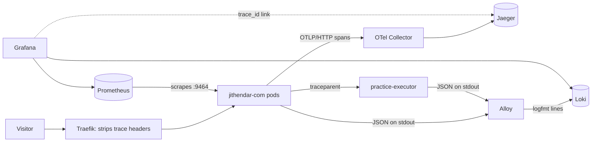

<Todo>(1) Every fix in section 10 is in the working tree of the jithendar.com and tools repositories, uncommitted and not deployed when this draft was written (4 November 2026). Deploy them, run the checks in section 12, and change the wording where a check disagrees. (2) The numbers in sections 9 and 10 were read from the live cluster on 4 November 2026 and are real; keep them only if you are happy to publish them. (3) The Prometheus, Loki and Jaeger URLs in this article are cluster-internal or port-forwarded on purpose; nothing here should send readers to an internal address. (4) Add your own commentary, confirm the AI-assistance line against the AI use policy, then set status and publishedAt.</Todo>

jithendar.com is a Next.js site that I run myself on **mk4**, a four-node minikube cluster on one server. It has articles, an admin area, accounts, comments, an AI image generator for cover images and a Python practice area that runs visitors' code in a separate sandbox service. When something breaks, I want to answer three questions quickly: *what failed*, *where did the time go*, and *is it still happening*.

This article explains how the site answers them today: structured logs in Loki, traces in Jaeger, metrics in Prometheus, all shown in Grafana. It is based on the code in the `jithendar.com` and `tools` repositories and on what I could see on the live cluster on 4 November 2026. That day's review found real gaps, and section 10 lists them with their fixes.

## 1. The application and what it needs from observability

The parts that matter here:

- **Two Next.js 16 pods** (namespace `jithendar`) serve every page, API route and server action. Next.js runs a `proxy.ts` step before each request (redirects, a maintenance page, a request id).
- **PostgreSQL and Redis** in the same namespace.
- **Outside services:** Cloudflare R2 for media, Google's Gemini API for cover images, Cloudflare Turnstile, IndexNow, email providers.
- **practice-executor**, a small FastAPI service that queues and runs Python practice jobs in sandbox pods.
- **Traefik** as the ingress, in front of everything.

The requirements are modest but strict:

1. A visitor who sees an error gets a short reference, and that reference finds the logs and the trace.
2. Request rate, error rate and latency per **route pattern** (`/blog/[slug]`), never per URL.
3. No passwords, tokens, cookies, email addresses or free text in the log store or the trace store.
4. If any of the monitoring stack is down, the site keeps serving pages.

## 2. Logs, metrics and traces in plain words

- A **log line** is one event, written by the code when something happens: "comment submitted", "request completed in 412 ms with status 200". Logs are good for *what exactly happened*.
- A **metric** is a number counted over time: requests per second, the share that failed, how long the slowest 5 % took. Metrics are cheap to keep and good for *is something wrong right now*.
- A **trace** is the story of one request, broken into **spans**: "render the page" took 300 ms, inside it "read the image from R2" took 120 ms. Traces are good for *where did the time go*.

The three are most useful when they share an id. On this site that id is the **trace id**, a 32-character hex string that appears on every log line, every span and every error message a visitor sees.

## 3. The tools, and why these ones

Nothing here was installed just for the site. The cluster already ran a monitoring stack for other projects, configured in the `tools` repository, and the site plugs into it:

| Signal | Tool | Where it runs | Why it fits |
|---|---|---|---|
| Traces | `@vercel/otel` in the app, OpenTelemetry Collector 0.162, Jaeger 2.22 | app pods, namespace `observability` | `@vercel/otel` is the OpenTelemetry setup the Next.js docs describe, and Next.js already creates spans for routing and rendering |
| Logs | JSON on stdout, Grafana Alloy, Loki | namespace `monitoring` | no logging library in the app; Alloy reads pod logs through the Kubernetes API, so no agent per node |
| Metrics | a small Prometheus exporter in the app, Prometheus 3.15 | port 9464 in the pod, namespace `monitoring` | no extra dependency; request metrics come from the spans Next.js already creates |
| Dashboards | Grafana | namespace `monitoring` | one place for Prometheus and Loki |

There is no Alertmanager: alerts show in Prometheus, nobody is paged. Jaeger has no ingress; its UI is reached with `kubectl port-forward`.

## 4. The telemetry flow



The same flow with namespaces and the settings that matter:

![Telemetry flow of jithendar.com on the mk4 cluster. A visitor reaches the Traefik ingress, which strips incoming trace headers, then two Next.js pods in namespace jithendar. The pods send spans over OTLP/HTTP to the OpenTelemetry Collector, which removes URLs, SQL and exception text before Jaeger stores the newest 5000 traces in memory. Alloy reads the pods' JSON logs through the Kubernetes API, keeps allowlisted fields and pushes logfmt lines with trace_id to Loki. Prometheus scrapes metrics from port 9464. Grafana reads Prometheus and Loki and links trace_id to Jaeger. The site sends traceparent only to the practice executor, whose audit lines carry the same trace_id.](/images/jithendar-com-observability/jithendar-com-telemetry-flow.svg)

The editable source is `www/docs/knowledge-sharing/jithendar-com-observability/diagrams/jithendar-com-telemetry-flow.drawio`, generated by `build_diagrams.py` in the same folder.

## 5. Logs: structured, collected, stored, searched

### What the app writes

Every log line is one JSON object on stdout, written by `src/lib/log.ts`:

```ts
const line = JSON.stringify({
  time: new Date().toISOString(),
  level,
  msg,
  event: eventOf(msg),          // "comment submitted" → "comment_submitted"
  service: "jithendar-com",
  version: process.env.GIT_SHA ?? "dev",
  ...traceFields(),             // traceId, spanId of the active span
  ...rest,
  ...(err !== undefined ? serializeError(err) : {}), // errorType, errorCode, short stack
});
```

Three details matter. `event` is a stable name derived from the message, because the collector throws `msg` away (more on that below). `traceId` comes from the active OpenTelemetry span, so any line written during a request carries the request's trace. And in production, `jsonConsole()` reroutes `console.*` from Next.js and libraries through the same function, so Next's own multi-line "⨯ Error" output becomes one JSON line instead of several lines the collector cannot parse.

Two kinds of line describe each request:

- `http_request`, the **access line**, written by `src/proxy.ts` as the request arrives;
- `http_request_completed`, the **completion line**, written by a span processor in `src/lib/request-log.ts` when Next.js ends the request span. It has the final `status`, `durationMs`, the route pattern and an `outcome`: `success`, `redirect`, `client_error` or `server_error`.

Unhandled errors from pages, layouts and route handlers go through Next's `onRequestError` hook in `src/instrumentation.ts` and become one `request_failed` line with the error digest.

### What the collector keeps

Alloy, configured in `tools/deploy/minikube/observability/loki/config.alloy`, does not forward raw lines. It copies a short list of fields, each only if its value matches a strict pattern, and writes a new logfmt line:

```alloy
stage.regex {
  source     = "raw_route"
  expression = `^(?P<route>/[A-Za-z0-9_./{}:\[\]-]{0,150})$`
}
stage.regex {
  source     = "raw_outcome"
  expression = `^(?P<outcome>success|failure|error|redirect|client_error|server_error)$`
}
```

The kept fields are `event`, `level`, `route`, `method`, `status`, `duration_ms`, `dependency`, `operation`, `outcome`, `error_type`, `error_code`, `logger` and `trace_id`. Messages, stack traces, IP addresses, user agents and request ids stay in the pod's own log, which `kubectl logs` can read until the kubelet rotates it. In Loki, a completion line looks like this:

```text
event=http_request_completed level=info route=/blog/[slug] method=GET status=200 duration_ms=212 outcome=success trace_id=<32 hex>
```

### Labels: few and bounded

Loki indexes labels, not line content, and every new label value creates a new stream. The site's streams have only `namespace`, `pod`, `container`, `service_name`, `level` and Alloy's own `job` and `instance`. `trace_id`, routes and user data are inside the line, never labels. A test in the `tools` repository fails if someone turns `trace_id` into a label.

### Searching

All of these run as-is in Grafana → Explore → Loki:

```logql
# Everything for one request (a visitor's error reference is the trace id)
{namespace="jithendar"} |= "trace_id=<trace id>"

# Errors in the last hour, by event and type
sum by (event, error_type) (count_over_time({namespace="jithendar", container="web", level="error"} | logfmt [1h]))

# Failed or slow requests
{namespace="jithendar", container="web"} | logfmt | event="http_request_completed" | status >= 500 or duration_ms > 2000
```

The first query also finds the practice executor's audit lines for the same request (section 6).

## 6. Tracing: how it starts and how context travels

### Initialization

Next.js calls `register()` in `src/instrumentation.ts` once per server start, before it serves requests. That is where tracing is set up:

```ts
registerOTel({
  serviceName: process.env.OTEL_SERVICE_NAME ?? "jithendar-com",
  attributes: { "service.version": process.env.GIT_SHA ?? "dev", "deployment.environment": process.env.APP_ENV ?? process.env.NODE_ENV ?? "development" },
  traceSampler: requestSampler,
  instrumentationConfig: { fetch: fetchInstrumentationConfig() },
  spanProcessors: [outboundSpanNames, "auto", metricsSpanProcessor, requestLogSpanProcessor],
});
```

`"auto"` is the exporter `@vercel/otel` builds from `OTEL_EXPORTER_OTLP_ENDPOINT` (set to the collector's OTLP/HTTP port in the Deployment). Spans are batched and sent in the background, so a slow or missing collector does not hold up a response. The two other processors turn finished request spans into the completion log line and the Prometheus request metrics, so all three signals describe the same requests.

Next.js creates the request, routing and rendering spans itself. `@vercel/otel` adds spans for outgoing `fetch` and `node:http` calls. The site adds its own in `src/lib/trace.ts`: one per AWS SDK call (`r2.PutObject`, `ses.SendEmail`, …), `mail.send`, `job <kind>` for queued jobs, `backup.run` and `startup.migrate`.

### Which requests are traced

Every request, except health probes, by `requestSampler` in `src/lib/tracing-config.ts`:

```ts
shouldSample(context, _traceId, _name, _kind, attributes) {
  if (isHealthProbe(attributes["http.target"])) return { decision: NOT_RECORD };
  const parent = trace.getSpanContext(context);
  if (parent && !parent.isRemote) return { decision: parent.traceFlags & TraceFlags.SAMPLED ? RECORD_AND_SAMPLED : NOT_RECORD };
  return { decision: RECORD_AND_SAMPLED };
}
```

The `isRemote` check is deliberate. Next.js continues any W3C `traceparent` header it receives. Without the check, a request carrying `traceparent: 00-…-00` (the "not sampled" flag) would switch off its own trace, and with it the completion line and the request metric, because both come from the span. A Traefik middleware also removes `traceparent`, `tracestate` and `baggage` from internet requests (`k8s/40-middlewares.yaml`), so visitors cannot pick the trace id that becomes their error reference either.

### Across the one internal service boundary

The site calls practice-executor over HTTP. `@vercel/otel` sends `traceparent` only to URLs listed in `propagateContextUrls`, and the site lists exactly one:

```ts
propagateContextUrls: executor ? [`${executor}/`] : [],
```

Third parties (Gemini, R2, Turnstile) never receive the trace context. The executor has no OpenTelemetry SDK. It reads the header and writes the trace id on its JSON audit lines (`executor/app/main.py`):

```python
TRACEPARENT = re.compile(r"^00-([0-9a-f]{32})-[0-9a-f]{16}-[0-9a-f]{2}$")

def trace_id_of(request: Request) -> str | None:
    m = TRACEPARENT.match(request.headers.get("traceparent", ""))
    return m.group(1) if m and m.group(1) != "0" * 32 else None
```

That is log correlation, not distributed tracing: the executor's work shows up in Loki next to the site's lines, not as spans in Jaeger.

### Useful, safe span names

`@vercel/otel` names outgoing calls after the full URL, which put R2 object keys and query strings into span names. A small processor renames them when they start:

```ts
onStart(span) {
  const m = /^(http|fetch) ([A-Z]+) (.*)$/s.exec(span.name);
  if (m) span.updateName(`${m[1]} ${m[2]} ${outboundHost(m[3]!)}`);
},
```

`http GET https://<account>.r2.cloudflarestorage.com/<bucket>/<key>?x-id=GetObject` becomes `http GET r2.cloudflarestorage.com`. The collector then removes URL, query, client address, SQL and exception attributes and drops `exception` span events (`tools/…/otel-collector/collector.yaml`). A failed span keeps its status and `error.type`, never the error message.

## 7. How logs and traces are correlated

One id ties a request together:

1. The proxy runs inside Next's request span, so the access line, the app's own lines, the completion line and every span share one `traceId`.
2. When something fails unexpectedly, the visitor sees a reference. For API routes it is `{"error": "Something went wrong…", "code": "internal", "reference": "<trace id>"}`; admin and account forms end the message with `Reference: <trace id>`. Error pages show Next's digest, which is also on the `request_failed` line as `error_code`.
3. In Grafana, the Loki data source has a derived field that turns `trace_id=<32 hex>` into a link to the trace in Jaeger. The link points at `localhost:16686`, so it works only with the port-forward running. Jaeger 2.x no longer serves the older query API that Grafana's Jaeger data source uses, so Grafana has no Jaeger data source.

## 8. Metrics, dashboards and alerts

The app serves Prometheus metrics on a second port, 9464, which is not in the public Service; the NetworkPolicy admits only the Prometheus pod to it. Request metrics are built from Next's own server spans:

- `http_server_requests_total{method, route, status}`, with `route` the pattern and `status` a class (`2xx` … `5xx`), so a few dozen series cover the whole site;
- `http_server_request_duration_seconds` with buckets from 25 ms to 10 s;
- process memory, CPU, heap and event-loop delay, `jithendar_build_info{version}`, and a few site gauges read from the database every 30 s (published posts, pending comments, failed jobs).

`route="other"` collects requests without a route, mostly static files and the image optimizer. The image optimizer fetches `/media/[id]/[name]` inside the same process, so one optimized image counts as one `other` request and one `/media/[id]/[name]` request, in the same trace.

Two dashboards are provisioned from the `tools` repository: **Jithendar.com · Overview** (traffic, errors, latency, busiest and slowest routes, pod resources) and **Jithendar.com · Logs** (log volume, errors by type, and a *Failed or slow requests* list with trace ids).

Some of the queries behind them:

```promql
# Requests per second, without health probes
sum(rate(http_server_requests_total{job="jithendar-com", route!="/api/health"}[5m]))

# Slowest routes (p95)
topk(8, histogram_quantile(0.95, sum by (le, route) (rate(http_server_request_duration_seconds_bucket{job="jithendar-com", route!~"other|/api/health"}[10m]))))
```

The alert rules (`tools/deploy/minikube/observability/prometheus/files/alerts.yml`) cover the site and the pipeline that watches it:

```yaml
- alert: JithendarComHighErrorRatio
  expr: |
    (
      sum(rate(http_server_requests_total{job="jithendar-com", route!="/api/health", status="5xx"}[5m]))
        / sum(rate(http_server_requests_total{job="jithendar-com", route!="/api/health"}[5m]))
    ) > 0.05
    and sum(increase(http_server_requests_total{job="jithendar-com", route!="/api/health", status="5xx"}[5m])) >= 3
  for: 5m
```

The second condition stops one failed request on a quiet night from counting as "100 % errors". Next to it are `JithendarComDown`, `JithendarComSlow` (p95 over 2 s for 10 minutes), `ObservabilityTargetDown`, `LogShippingDropped`, `TraceSpansLost` and `JaegerMemoryNearLimit`. Each has a `runbook_url` pointing at a short runbook in `www/docs/OBSERVABILITY.md` or the `tools` observability README.

## 9. An investigation: one slow request

On 4 November 2026, the *Failed or slow requests* query in section 5 returned this line:

```text
event=http_request_completed level=info route=/api/admin/images/generate method=POST status=200 duration_ms=11861 outcome=success trace_id=e45c6cafc2606df636a9ee757f539e2d
```

Nearly 12 seconds, but status 200. Searching for the trace id returned three lines: the access line, the completion line and an `image_generated` event. So the request worked and produced a cover image. The question was where the 12 seconds went.

The trace in Jaeger had 17 spans. The ones longer than 20 ms, with start times relative to the request:

| Starts at | Duration | Span |
|---|---|---|
| 4 ms | 11,861 ms | `POST /api/admin/images/generate` |
| 146 ms | 11,718 ms | `executing api route (app) /api/admin/images/generate` |
| 180 ms | 10,402 ms | `fetch POST https://generativelanguage.googleapis.com/v1beta/interactions` |
| 10,596 ms | 1,256 ms | `r2.PutObject` |

About 10.4 seconds were the call to Google's Gemini API that generates the image, and 1.3 seconds were uploading the result to R2. Nothing in the site's own code was slow. This is an admin-only action, so the right response is to make the wait visible in the admin UI, not to tune the server. It also does not trip `JithendarComSlow`, which looks at the p95 across all routes.

The trace also showed one of the gaps from section 10: the R2 upload had a child span named after the full object URL. After the fix, that name is `http PUT r2.cloudflarestorage.com`.

## 10. Gaps the review found, and what changed

The review compared the code with what the live cluster was doing. Everything below was observed on mk4 on 4 November 2026.

| Gap | Evidence | Fix |
|---|---|---|
| Health probes filled the trace store | The 40 newest site traces in Jaeger were all `/api/health` (8 spans each); about 1,080 of roughly 2,250 requests in an hour were probes | The sampler drops probe traces at the source; the proxy writes no access line for them; dashboards and alerts leave them out |
| Jaeger ran out of memory | `OOMKilled`, 11 restarts, at 235 Mi of a 256 Mi limit; the in-memory store has no limit by default | Explicit config with `max_traces: 5000` and a 384 Mi limit, plus `JaegerMemoryNearLimit` |
| Visitors could choose the trace id | A request sent with a made-up `traceparent` was logged and traced under that id | Traefik strips trace headers; the sampler ignores remote sampling flags |
| URLs in span names | `http GET https://<account>.r2.cloudflarestorage.com/…/<key>?x-id=GetObject`, and a 95 kB `fetch GET data:…` name from the OG image renderer | Names reduced to method and host; `resource.name` is the host; `data:` URLs not traced |
| Route and outcome lost in Loki | Alloy's route pattern had no `[` or `]`, so `/blog/[slug]` and every other dynamic route was dropped; only `outcome=success` passed | Both patterns widened, in the mk4 config and its EKS copy |
| Reset tokens could reach the logs | Better Auth's link is `/api/auth/reset-password/<token>`; the access line logged the raw path (kept by Alloy), and `request_failed` logged it as `path` | `loggedPath()` writes `/api/auth/reset-password/:token` (and `/preview/:token`). No such line was in the last 72 hours of pod logs |
| Log loss went unnoticed | Alloy dropped 541,189 lines on 2 November after Loki answered `500 Ingester is shutting down` | `LogShippingDropped` alert |
| The collector could not be monitored | Its metrics port refused connections from other pods | Listener on `0.0.0.0:8888`, Prometheus jobs `otel-collector` and `jaeger`, `TraceSpansLost` alert |
| Probes diluted the alerts | Half of all requests were fast, successful probes | `route!="/api/health"` in the ratio and latency rules, and at least 3 failures before the error alert |

## 11. Sampling, retention, cardinality, privacy and cost

**Sampling.** Every request except health probes is traced. That is affordable because traffic is small, and it means every completion line has a trace behind it. If traffic grows, the sampler is the place to add ratio sampling. Request metrics come from the spans, so the metrics would have to be built differently first.

**Retention.**

| Store | Kept for | Setting |
|---|---|---|
| Loki | 7 days | `retention_period: 168h` |
| Prometheus | 7 days or 4 GB | `retentionTime`, `retentionSize` |
| Jaeger | newest 5000 traces, lost on restart | `max_traces` |
| Pod stdout | until kubelet rotates it | full lines with messages and stacks |

Traces are the shortest-lived signal by design: an investigation starts from a log line or an alert, and the trace needs to exist only for hours.

**Cardinality.** Metrics use route patterns, status classes and a fixed method list, and any route longer than 120 characters or not starting with `/` becomes `other`. Loki labels are limited to the six listed in section 5.

**Privacy.** Three layers, each assuming the one before can fail: the app does not log secrets and removes tokens from paths; Alloy keeps only allowlisted fields with strict patterns; the collector removes URLs, SQL, addresses and exception text from spans. IP addresses and user agents are on the access line in the pod but never reach Loki.

**Cost.** Everything runs inside the existing cluster, so the cost is CPU, memory and disk: the collector is limited to 256 Mi, Jaeger to 384 Mi, Prometheus has a 5 Gi volume and Loki a 4 MB/s ingestion limit. There is no paid observability service.

## 12. Deploying, verifying and troubleshooting

### Deploy

1. Site: push the code so CI builds the image, then run `./deploy.sh` from the repository root. It applies `k8s/`, including the new `strip-trace-headers` middleware, and restarts the Deployment.
2. `tools`: push, then sync `loki`, `prometheus` and `grafana` in Argo CD.
3. Collector and Jaeger have no Argo CD Application: `kubectl apply -k deploy/minikube/observability/otel-collector` and `kubectl apply -k deploy/minikube/observability/jaeger`. Jaeger restarts with an empty store.

**Rollback:** `kubectl rollout undo deployment/<name> -n <namespace>` for the site, collector or Jaeger; `kubectl delete middleware strip-trace-headers -n jithendar` after re-applying the old Ingress annotation; revert the commits in `tools` and sync again.

### Verify

```bash
# 1. Probes are no longer traced (empty after the new pods have run for a minute)
kubectl -n observability port-forward svc/jaeger 16686 &
curl -s "localhost:16686/api/v3/operations?service=jithendar-com" | grep -c '/api/health'

# 2. A client traceparent is ignored: the logged trace id is not the one sent
curl -s -o /dev/null https://jithendar.com/robots.txt -H "traceparent: 00-0af7651916cd43dd8448eb211c80319c-b7ad6b7169203331-01"
# then in Loki: {namespace="jithendar"} |= "0af7651916cd43dd8448eb211c80319c"  → no lines
```

Then, in Grafana: completion lines for `/blog/[slug]` carry `route=`; Prometheus → Status → Targets shows `jithendar-com` (2 targets), `otel-collector` and `jaeger` up; Prometheus → Alerts shows all rules loaded.

Before deploying, I checked what I could locally. The production build, run with a capture endpoint, sent no spans for `/api/health` and still traced a request that carried a `-00` traceparent. With the collector address pointing at a closed port, 20 requests in a row returned 200 in 2 to 37 ms. A reset-password URL appeared in the logs only as `/api/auth/reset-password/:token`. The site's 448 unit tests, the executor's 19 tests and the `tools` repository's 241 tests passed, and every alert expression evaluated on the live Prometheus.

### Common failures

- **No traces at all.** Check `OTEL_EXPORTER_OTLP_ENDPOINT` in the pod and the `tracing_enabled` line at startup, then `otelcol_receiver_accepted_spans` on the collector. The NetworkPolicy allows egress to the collector on port 4318 only.
- **Traces disappear after a while.** Jaeger is in memory: a restart or the 5000-trace limit removes old ones. Look at `JaegerMemoryNearLimit` and the pod's restart count.
- **A field is in `kubectl logs` but not in Loki.** Alloy drops any field that is not allowlisted or does not match its pattern. Check the pattern in `config.alloy` before changing the app.
- **Grafana's trace link does nothing.** Start the port-forward first; the link points at `localhost:16686`.
- **Request counts look doubled for images.** That is the image optimizer described in section 8.

## 13. Limitations and planned improvements

What the setup does **not** do today:

- **No database or Redis spans.** Drizzle's built-in tracing would put SQL and parameters on spans, and postgres.js has no safe hook. Time spent in SQL shows as a render span with no children.
- **The executor is not traced**, only correlated through its log lines. Its queue and sandbox pods are invisible in Jaeger.
- **No delivered alerts.** Without Alertmanager, someone has to look at Prometheus.
- **No browser telemetry.** Front-end errors and page timings are not collected.
- **Traces are short-lived** and Jaeger is reachable only by port-forward.
- **Resource attributes still say Vercel.** `@vercel/otel` adds `cloud.provider: vercel` by default, although the site runs on minikube.
- **Spans of the last few seconds before a pod stops can be lost**, because nothing flushes the exporter on shutdown.
- **`/metrics` relies only on the NetworkPolicy.** A `METRICS_TOKEN` secret exists, but no code checks it.

Possible next steps, none of them started: Alertmanager with one notification channel, persistent trace storage if traffic justifies it, an OpenTelemetry SDK in the executor and dispatcher, and a privacy-reviewed browser error reporter.
