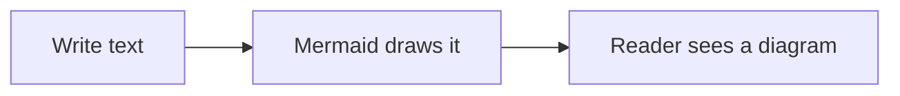
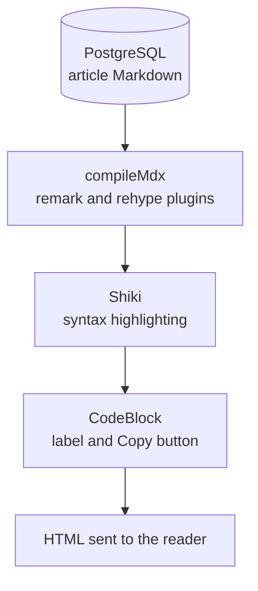
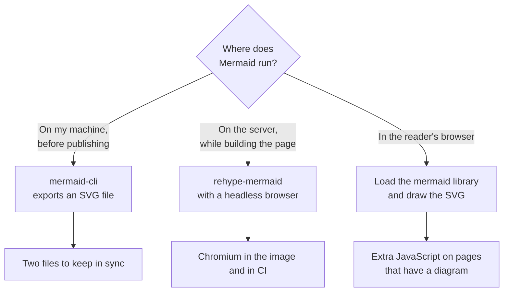
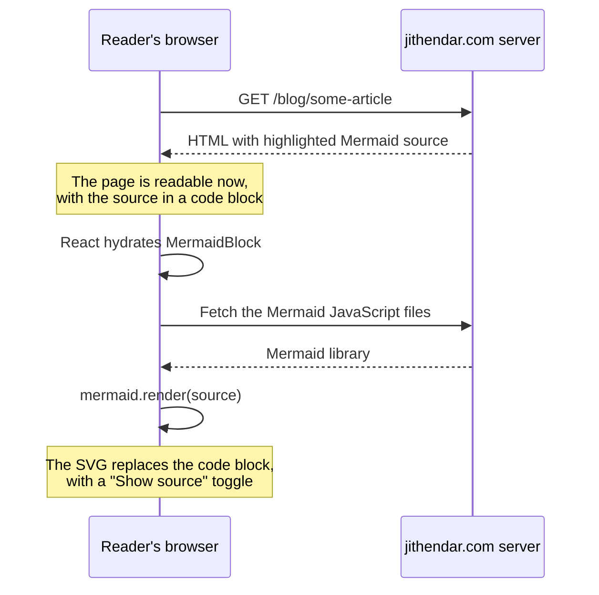
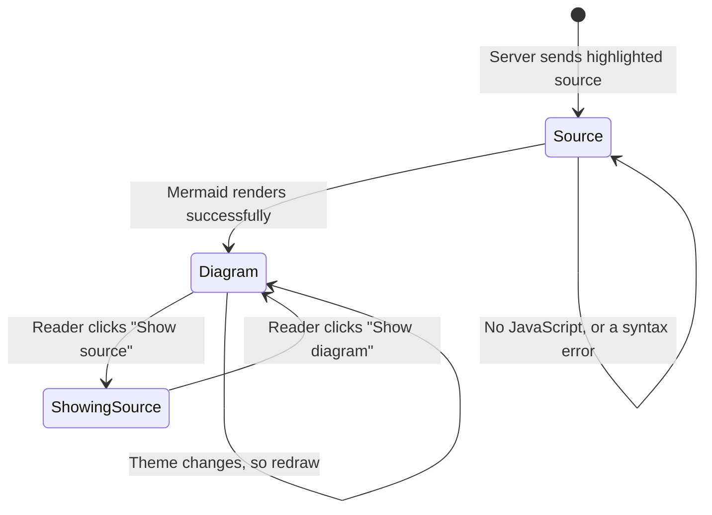

<Todo>Written on 2026-11-03 against jithendar.com dc249e8 plus the uncommitted Mermaid change described in docs/PROGRESS.md ("Mermaid diagrams in articles"). Publish this only after that change is committed and deployed: until then, the diagrams below show as code on the live site. Before publishing: (1) choose the category (devops-sre is a placeholder; no web-development category exists); (2) check the diagrams on a real article page after deploying, in light and dark mode and on a phone; (3) add your own commentary, confirm the AI-assistance line against the AI use policy, then set status and publishedAt.</Todo>

## What is Mermaid?

**Mermaid** is a JavaScript library that turns short text descriptions into diagrams. In its own words, it lets you "create diagrams and visualizations using text and code." Knut Sveidqvist created it "for easier documentation."

Here is a complete Mermaid diagram. It is plain text inside a code block whose language is `mermaid`:

```text
flowchart LR
  Write[Write text] --> Render[Mermaid draws it] --> Read[Reader sees a diagram]
```

And here is what that same text looks like on this site:



Every diagram on this page has a **Show source** button above it. Click it to see the text that produced the diagram.

Mermaid supports many kinds of diagrams. The ones I use most in technical writing are:

| Diagram | Good for |
| --- | --- |
| Flowchart | Architecture, request paths, decision trees |
| Sequence diagram | Who calls whom, and in what order |
| State diagram | Lifecycles, such as a deployment or a UI component |
| Class and entity relationship diagrams | Data models and database tables |
| Gantt chart and timeline | Plans and history |
| Git graph | Branching strategies |

## Why diagrams matter for a technical blog

Most of my articles explain systems: how a request travels through RoboShop AI, how MOKS retrieves knowledge, how Terraform builds a network. Readers understand those faster from a picture than from paragraphs. The question is not whether to use diagrams, but how to keep them easy to make and correct over time.

Before this change, I drew diagrams as separate files. Some were written by hand or by a Python script as SVG; others were written in Mermaid and converted to SVG with the Mermaid command-line tool. Either way, the picture in the article was a copy, and a copy can drift away from the text around it.

Mermaid's documentation calls this problem **doc rot**: documentation goes out of date because updating it is slow. Diagrams written as text help in a few concrete ways:

1. **The diagram lives next to the words.** It sits inside the article, so when I change a paragraph, the diagram that describes it is a few lines away.
2. **Changes are easy to review.** A change to a diagram is a change to a few lines of text. In Git, or in the site's editor history, you can see exactly which arrow or box changed. A changed image file only tells you that something changed.
3. **No drawing tool is needed.** Anyone who can edit the article can edit the diagram.
4. **The diagram follows the site's theme.** Mermaid draws the diagram in the reader's browser, so it can use dark colours when the site is in dark mode. A pre-rendered SVG has fixed colours.
5. **The text is still there.** Readers without JavaScript, and search engines, get the diagram's source, which is readable on its own.

GitHub came to the same conclusion in 2022, when it started rendering Mermaid code blocks in Markdown files. Its announcement put it simply: sometimes you want to keep your diagrams up to date with your docs.

Mermaid also has limits, and they are worth knowing before you rely on it:

- **You do not control the layout.** Mermaid decides where boxes go. For a carefully designed figure, a hand-made SVG is still better.
- **Large diagrams get crowded.** A diagram with many boxes and crossing arrows becomes hard to read, especially on a phone. Split it into smaller diagrams instead.
- **Rendering costs JavaScript.** Someone has to run Mermaid: either the reader's browser or your build. The next sections explain which one I chose and why.

## How jithendar.com rendered code blocks before

Articles on this site are written in Markdown and stored in PostgreSQL. When someone opens an article, the server turns the Markdown into React components. Code blocks go through **Shiki**, which adds syntax highlighting on the server, and then through a React component called `CodeBlock`, which adds the language label and the **Copy** button.



Before this change, a `mermaid` code block went down exactly the same path as a `bash` or `yaml` block. The reader saw the diagram's source text in a grey box, not a diagram. That is why every diagram on the site so far has been a pre-rendered SVG.

## Three ways to render Mermaid

There are three common ways to get from Mermaid text to a diagram on a web page.



**1. Export SVGs with mermaid-cli.** This is what I did before. It needs nothing on the site, but every diagram becomes two files, the `.mmd` source and the exported `.svg`, and you have to remember to re-export after each edit.

**2. Render on the server with a rehype plugin.** `rehype-mermaid` finds Mermaid code blocks and replaces them with SVG during the Markdown pipeline. Readers download no extra JavaScript. The catch: Mermaid needs a real browser to measure text, so outside a browser the plugin uses **Playwright**, which means installing a headless Chromium. This site's server image is small, and its pods run with a read-only root filesystem. Adding a browser to the image and to CI, just to draw boxes, was more weight than I wanted.

**3. Render in the reader's browser.** The server sends the Mermaid source as it does today. In the browser, a small React component loads the `mermaid` library and replaces the code block with the drawn diagram.

I chose option 3, with two conditions: the library must only be downloaded on pages that actually contain a diagram, and the page must still make sense if the diagram never renders.

## How I implemented it

The whole change is one new component, a few lines in an existing one, some CSS and one dependency: `mermaid` 12.2.0, pinned to that exact version like every other dependency on the site.

### Step 1: send Mermaid blocks to their own component

Shiki already records each code block's language on the `<pre>` element as `data-language`. `CodeBlock` now checks that attribute first:

```tsx
type PreProps = ComponentProps<"pre"> & { "data-language"?: string };

/** Highlighted <pre> in a frame with its language and a copy button; ```mermaid fences become diagrams. */
export function CodeBlock(props: PreProps) {
  if (props["data-language"] === "mermaid") return <MermaidBlock {...props} />;
  return <HighlightedCode {...props} />;
}
```

Every other language takes the existing path, which I renamed `HighlightedCode`. Nothing changed for `bash`, `yaml` or any other block.

### Step 2: draw the diagram in the browser

`MermaidBlock` is a client component. It first renders the same highlighted `<pre>` the server sent, so the page looks complete before any JavaScript runs. Then an effect takes the text out of that `<pre>`, loads Mermaid and draws the SVG:

```tsx
useEffect(() => {
  const source = pre.current?.textContent ?? "";
  let cancelled = false;
  import("mermaid")
    .then(async ({ default: mermaid }) => {
      mermaid.initialize({ startOnLoad: false, securityLevel: "strict", theme: dark ? "dark" : "default" });
      const { svg } = await mermaid.render(id, source);
      if (!cancelled) setSvg(svg);
    })
    .catch(() => {
      if (!cancelled) setSvg(null);
    });
  return () => {
    cancelled = true;
  };
}, [id, dark]);
```

A few details in those lines do most of the work:

- **`import("mermaid")` is a dynamic import.** The bundler puts Mermaid in separate files that the browser only fetches when this line runs. This line only runs when a page has a Mermaid block, so articles without diagrams never download Mermaid at all.
- **`startOnLoad: false`** stops Mermaid from scanning the whole page on its own. The component decides exactly which block to draw.
- **`securityLevel: "strict"`** is the most important setting for a blog. Mermaid's documentation says that in strict mode "HTML tags in the text are encoded and click functionality is disabled." A diagram label cannot inject HTML, and a diagram cannot run a click handler. Strict is Mermaid's default, but I set it explicitly so that nobody loosens it by accident.
- **`cancelled`** handles a reader who leaves the page, or switches theme, before Mermaid finishes. A late result is thrown away instead of being written into a component that has moved on.
- **`id`** comes from React's `useId()`, so two diagrams on the same page never collide.

Here is the sequence when a reader opens an article that contains a diagram:



### Step 3: follow the site's theme

jithendar.com has light and dark modes. The reader's choice is stored as a `data-theme` attribute on `<html>`; without a choice, the operating system's preference applies. `MermaidBlock` watches both with React's `useSyncExternalStore`, using the same small helpers as the site's Python practice editor:

```tsx
function siteIsDark() {
  const t = document.documentElement.dataset.theme;
  return t ? t === "dark" : window.matchMedia("(prefers-color-scheme: dark)").matches;
}
```

`dark` is a dependency of the effect, so when the theme changes, the effect runs again and Mermaid redraws the diagram with the matching theme.

### Step 4: fall back gracefully

The component can be in one of a few states. The important part is that every path ends with something readable:



- **No JavaScript** (some readers and some crawlers): the reader sees the source in a code block labelled **Mermaid**. Mermaid's syntax is readable enough to follow.
- **A syntax error in the diagram:** `mermaid.render` rejects, the `catch` keeps `svg` empty, and the code block stays as it is. A typo never leaves a hole in the article.
- **Success:** the code block is hidden with the `hidden` attribute, not removed, and the diagram appears in its place. The **Show source** button swaps them back.

### Step 5: make it fit on a phone

The diagram uses the same frame as other code blocks, so it looks at home in an article. Two CSS rules handle size:

```css
.mermaid-diagram {
  @apply flex justify-center overflow-x-auto px-5 py-6;
}
.mermaid-diagram svg {
  @apply h-auto max-w-full;
}
```

Small diagrams are centred. Wide diagrams shrink to the width of the column, and the frame scrolls sideways if needed instead of widening the page.

## Why the SVG is safe to insert

The component inserts Mermaid's output with React's `dangerouslySetInnerHTML`, which is normally a warning sign. It is acceptable here for three reasons:

1. **Only the site's authors write articles, pages and author profiles**, either in the signed-in editor or with API keys they create. Readers' comments go through a separate, stricter Markdown pipeline that does not render Mermaid.
2. **Strict mode encodes HTML in labels and disables click handlers**, as described above.
3. **The article pipeline itself never runs code from an article.** Articles are compiled as plain Markdown, so JSX, JavaScript expressions and raw HTML in an article body are not executed. That rule was already in place and is covered by an existing test.

## How I tested it

Each of these was run, and its output checked:

- **A unit test** compiles a Mermaid block through the real article pipeline and checks what the server sends: a code block with `data-language="mermaid"`, the label "Mermaid", the diagram's source text, and no SVG. That confirms readers without JavaScript get the readable fallback.
- **Type checking, linting and a production build** all pass.
- **A browser check.** I took the two Mermaid diagrams from a draft Terraform article and rendered them in headless Chrome with Mermaid 12.2.0 and the same settings as the component. Both rendered, and neither SVG contained a `<script>` element.

One thing I have not checked yet is a real article page in a browser, because my machine had no local copy of the site's database. That check happens after deployment, before this article is published.

## What is still missing

The editor's **preview** pane still shows Mermaid blocks as source text. The preview is produced as an HTML string by a separate function, not by the React components, so `MermaidBlock` never runs there. The published page is not affected; it is only a convenience for authors, and the next thing I plan to fix.

## Tips for writing Mermaid diagrams for a blog

- **Start with `flowchart LR` or `flowchart TD`.** `LR` (left to right) suits short pipelines; `TD` (top down) suits decision trees and works better on phones.
- **Keep labels short** and use `<br/>` to break long ones over two lines.
- **Quote labels that contain punctuation**, such as `A["Data sources (read only)"]`. Brackets and parentheses inside an unquoted label confuse the parser.
- **Use a sequence diagram for "who calls whom".** It is clearer than a flowchart with numbered arrows.
- **Split big diagrams.** Two small diagrams with a sentence between them are easier to read than one large one.
- **Check the source.** If a diagram does not appear, the code block stays in place: check the syntax in the Mermaid Live Editor at mermaid.live.

## Conclusion

Mermaid turns a few lines of text into a diagram, which keeps diagrams close to the words that explain them, easy to review and easy to change. For a technical blog, that makes diagrams cheap enough to use whenever they help.

On jithendar.com, Mermaid runs in the reader's browser, only on pages that contain a diagram, in strict security mode, with the readable source as a fallback. The change was one new React component, a small change to an existing one and one dependency. Every diagram in this article was written that way.
