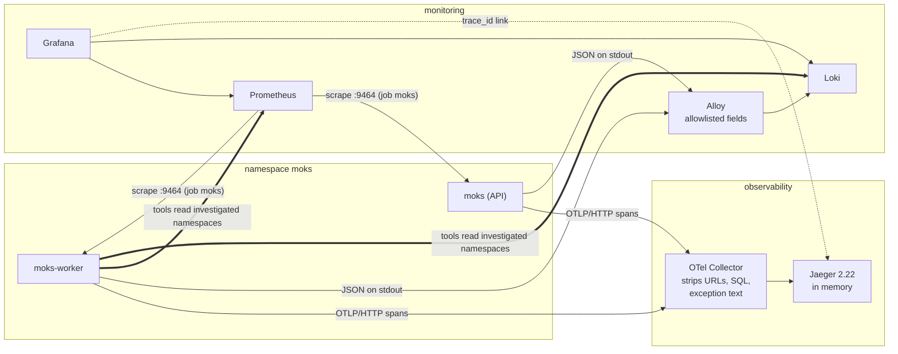
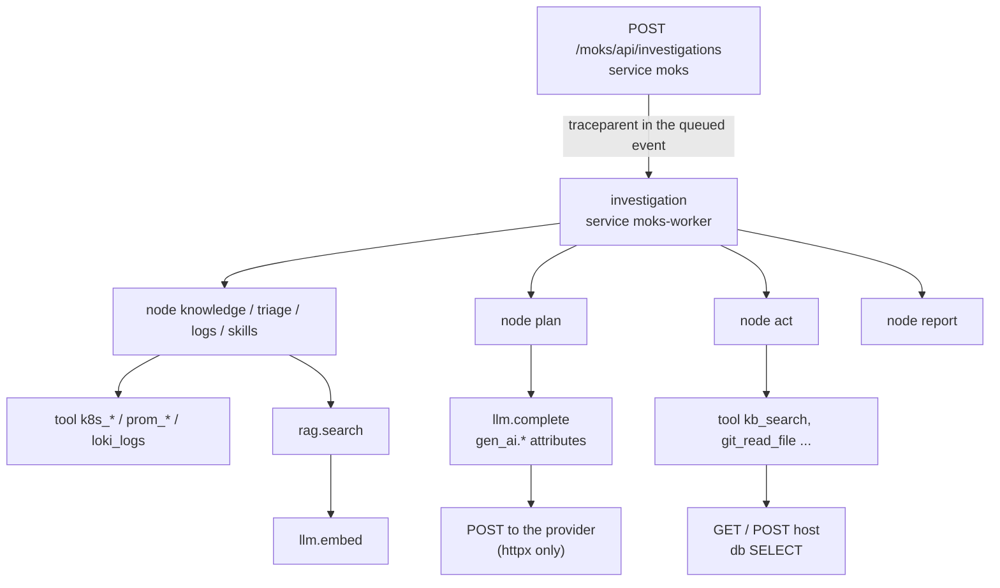

MOKS is the SRE agent and investigation portal I am building. An engineer asks a question about a namespace, and a LangGraph investigation reads live evidence from Kubernetes, Prometheus and Loki, searches the team's documentation and writes a report. When that takes 15 seconds instead of 5, or the report says "rule-based" although a model is configured, I need to be able to say why from telemetry, not by rerunning the question with print statements.

This article describes how MOKS observes itself: structured logs, metrics and OpenTelemetry traces, and how one trace follows a question from the HTTP request through every LangGraph node, tool call and model call. It also covers what a review on the live mk4 cluster on 4 November 2026 found, and what I changed because of it.

I use four labels:

- **Implemented**: behaviour in the code, usually with a test.
- **Configured**: a deployment setting in the MOKS Helm chart or the cluster's `tools` repository.
- **Observed**: something I saw on mk4 on 4 November 2026, with the query that showed it.
- **Not verified**: anything I could not check. I say so.

At the time of writing, the fixes in this article are in the working tree and **not yet deployed to mk4**. Everything marked *Observed* came from the build that was running then (revision `11d3e6a`).

## The short version

- MOKS's own telemetry goes to the same Prometheus, Loki and Jaeger that MOKS queries during investigations. The data is separate: MOKS's lines are `{namespace="moks"}`, its metrics are `job="moks"`.
- The trace id is the key that joins everything. One investigation is one trace, from `POST /moks/api/investigations` in the API to the last LangGraph node in the worker, because the API stores a W3C `traceparent` with the queued run.
- Spans and log lines carry metadata only: names, durations, outcomes, error types and codes, token counts. Never prompts, model output, retrieved text, tool output or queries.
- There is no Langfuse or LangSmith for MOKS. Model calls are ordinary OpenTelemetry spans with `gen_ai.*` attributes.
- The review found that **Prometheus was not scraping MOKS at all**, so the dashboard and alerts in the repository showed nothing. It also found a planning loop that paid for a refused request on every model call, an event stream that would have created thousands of spans, and reports that fell back to rules without saying why anywhere but the report.

## What MOKS is, in one diagram

MOKS runs as four processes from one image: the API (`moks`), the worker that runs investigations and jobs (`moks-worker`), the executor that performs approved actions (`moks-executor`) and the web terminal gateway (`moks-terminal`). PostgreSQL holds state, OpenSearch holds the knowledge index, and an optional PyTorch reranker reorders search results.

An investigation is a LangGraph state machine. Each node calls the investigator: `intake` classifies the question, `knowledge` searches documentation, `triage` and `logs` read the cluster, `skills` runs matching SRE skills, `plan` and `act` let a model ask for more evidence, and `report` writes the answer. If no model is configured, or a model's answer cannot be used, the report is built from rules instead.

The observability requirements follow from that shape:

1. A request in the API and the run in the worker must be one story, even though a database row sits between them.
2. Each step must show its own time, so "slow" can be narrowed to a node, a tool or a model call.
3. A failure must say which dependency failed and how, without copying the error text, which can contain PromQL, SQL or secrets.
4. None of this may slow down or break an investigation.

## Logs, metrics, traces and AI observations

If these words are new:

- A **log line** is one event: "tool call finished, 104 ms, success". MOKS writes JSON lines to stdout.
- A **metric** is a number over time: requests per second, or the 95th percentile of investigation duration. Prometheus scrapes them from each pod.
- A **trace** is a tree of **spans**, one per unit of work, with start time, duration and status. It shows what happened inside one request and in what order.
- An **AI observation**, in tools like Langfuse, is a span for a model call with its prompt and output attached. MOKS deliberately records the call without the content.

## The tools and what each one does

| Component | Version on mk4 | Responsibility |
| --- | --- | --- |
| OpenTelemetry Python SDK | 1.45.2, instrumentation 0.66b2 | Spans for FastAPI requests, httpx calls and MOKS's own work |
| `prometheus_client` | 0.26.0 | Metrics on port 9464, never routed by the ingress |
| OpenTelemetry Collector | 0.162 | Receives OTLP/HTTP, deletes sensitive attributes and exception events, forwards to Jaeger |
| Jaeger | 2.22 | Stores traces in memory and serves the UI and `/api/v3` |
| Grafana Alloy | 1.21.2 | Reads pod logs through the Kubernetes API, keeps allowlisted fields, pushes to Loki |
| Loki | 3.7.9 | Stores logs, labelled by namespace, pod, container and level |
| Prometheus | 3.15 | Scrapes metrics, evaluates alert rules (no Alertmanager on mk4) |
| Grafana | chart 14.0.1 | Dashboards, Loki Explore, a link from `trace_id` to Jaeger |

LangSmith is explicitly switched off in `backend/moks/llm/lc.py`, because LangChain's default tracing would send prompts holding redacted evidence to a third party. The Langfuse Cloud set-up in the cluster's `tools` repository belongs to RoboShop's unrelated shopping assistant, which happens to share the name "Moks". I did not add Langfuse to MOKS: everything I needed for operations fits in OpenTelemetry, and a second backend for model calls would mean a second place where content could leak.

## Two kinds of telemetry in the same backends

MOKS is an observability consumer. Its `prom_query`, `loki_logs` and `k8s_*` tools read the clusters it investigates. On mk4, that is the same Prometheus and Loki that store MOKS's own telemetry.



The solid thin arrows are MOKS's own telemetry. The thick arrows are MOKS reading evidence for an investigation. Keeping them apart in queries is simple, because MOKS's own data is always `{namespace="moks"}` in Loki and `job="moks"` in Prometheus. It still matters when reading an incident: if Loki is down, MOKS both loses its own logs and loses a source of evidence, and its report says the Loki connector was unavailable.

## Structured logging and correlation

Every process formats log records as one JSON object per line (`backend/moks/observability.py`):

```json
{"ts": "2026-11-04T03:59:48.507Z", "level": "info", "logger": "moks.orchestrator",
 "message": "investigation finished", "event": "investigation_finished", "durationMs": 15242,
 "outcome": "success", "operation": "llm_fallback",
 "investigation_id": "f817c1b0-6266-4ab1-9865-926b0f20516f",
 "trace_id": "5e46b29b86122c10ff3a2b03e99ef9c9", "span_id": "..."}
```

That line is real, from the worker on mk4 (*Observed*, span id shortened). Four things make lines useful:

**A log context.** Request, user, job, investigation and plan ids are bound once per unit of work with a `ContextVar` and stamped on every line inside it. asyncio copies context into tasks it creates, so work started inside an investigation keeps its id.

**Trace and span ids** on every line written inside a span, so a line points at its place in the trace.

**Failures by type and code.** `errorType` is the exception class and `errorCode` is a fixed kind such as `timeout`, `not_found` or `auth`. A redacted, shortened message is kept in `kubectl logs` only.

**Process and release.** This review added `service` (`moks`, `moks-worker`, ...) and `version` (package version plus commit) to every line (*Implemented*).

### What Loki actually keeps

The cluster's Alloy pipeline is a privacy boundary for every application on mk4, not just MOKS. It copies a field only when its value matches a strict pattern, then writes a short logfmt line:

```text
event=investigation_finished level=info duration_ms=15242 operation=llm_fallback outcome=success logger=moks.orchestrator trace_id=5e46b29b86122c10ff3a2b03e99ef9c9
```

That is the same event as stored in Loki (*Observed*). The investigation id, the user id and the new `service` and `version` fields are not on the allowlist, so they stay in `kubectl logs`. The **trace id is what crosses**, which is why it is the join key.

Labels are only namespace, pod, container, `service_name` and level. Ids live in the line, never in labels, because [every distinct label value is a separate stream](https://grafana.com/docs/loki/latest/get-started/labels/bp-labels/) in Loki.

## Tracing one question through the agent

The API and the worker are separate pods, and a run can start seconds after the request, or on another worker after a restart. When the API queues an investigation, it stores the current span as a [W3C `traceparent`](https://www.w3.org/TR/trace-context/) in the run's first event. The worker reads it back and opens the `investigation` span as a child of the request. Jobs do the same through a `_traceparent` field in their payload.

Here is a real trace from mk4, trace `5e46b29b86122c10ff3a2b03e99ef9c9`, 45 spans (*Observed*, read from Jaeger's `/api/v3/traces/{id}` and shortened):

```text
POST /moks/api/investigations      [moks]         19 ms
└─ investigation                   [moks-worker]  15 243 ms   starts 794 ms later
   ├─ node triage                                    209 ms
   │  ├─ tool k8s_triage                              104 ms  outcome=ok
   │  └─ tool prom_alerts                               8 ms
   ├─ node logs                                      449 ms   (9 Kubernetes tool calls)
   ├─ node skills                                     16 ms
   ├─ node plan                                    4 631 ms
   │  └─ llm.complete  gpt-6.1-sol                 4 531 ms  15 051 in / 84 out
   │     ├─ POST                                   1 526 ms  ERROR
   │     └─ POST                                   2 980 ms
   ├─ node act                                     2 174 ms
   │  └─ tool kb_search                            2 033 ms
   ├─ node plan                                    3 308 ms  (llm.complete, failed POST first again)
   ├─ node act                                       682 ms
   │  └─ tool git_read_file                          192 ms  outcome=not_found
   ├─ node plan                                    3 528 ms  (llm.complete, failed POST first again)
   ├─ node correlate                                   8 ms
   └─ node report                                     65 ms  no model call
```

As a structure:



Every span name is fixed and small: `node <name>`, `tool <name>`, `llm.complete`, `llm.embed`, `rag.search`, `job <type>`. Attributes say what happened: `moks.tool`, `moks.outcome`, `gen_ai.request.model`, `gen_ai.usage.input_tokens`. HTTP spans are named after the host only, and SQL spans after the verb only, because a path or statement can contain a query or a secret.

This one trace already answers questions the old dashboard could not:

- **Where the time went.** About 11.5 of the 15.2 seconds were the three `plan` nodes, which are model calls.
- **A dependency failure, located.** `git_read_file` returned `not_found`, and the matching log line in Loki says `dependency=git error_code=not_found` with the same trace id.
- **Two problems that no metric showed.** I come back to both below: every model call started with a failed request, and the report fell back to rules without calling the model.

### Model calls

`llm.complete` follows the [OpenTelemetry generative AI conventions](https://opentelemetry.io/docs/specs/semconv/gen-ai/gen-ai-spans/) for names: `gen_ai.system`, `gen_ai.request.model`, `gen_ai.request.max_tokens` and token usage. This review added:

- `gen_ai.response.model`: what the provider says answered.
- `moks.llm.fallback`: set only when the provider itself signals that another model served the turn. For Claude's [server-side fallback](https://platform.claude.com/docs/en/build-with-claude/refusals-and-fallback), that is a `fallback_message` entry in `usage.iterations`. I do not infer it from a model name mismatch, because OpenAI-compatible servers often answer with a dated model name.
- `moks.llm.retries`: rate-limit and overload retries that MOKS makes itself.
- `moks.llm.adjusted`: parameters a server refused and MOKS dropped (see below).

Prometheus gets the same picture as counters: `moks_llm_requests_total{provider, model, outcome}`, latency, tokens, an estimated cost from the configured per-million prices, and the new `moks_llm_retries_total` and `moks_llm_fallbacks_total`. The model label is bounded because it comes from admin-configured models, not from requests.

Two honest limits:

- MOKS does not stream model output. Every call waits for the complete answer, so time to first token does not exist here. The streaming that does exist is the investigation event stream to the browser, covered below.
- The Anthropic SDK version in use (2.3.0) is built on `httpx2`, which the httpx instrumentation does not see. Claude calls get an `llm.complete` span but no HTTP child spans, and the SDK's own retries are not counted. mk4 currently uses an OpenAI-compatible model through `httpx`, which is why the trace above shows the provider's POSTs.

### Retrieval and skills

The knowledge stage calls the same search as the API. This review wrapped it in one `rag.search` span that records the mode that actually ran (hybrid, keyword, vector), how many candidates survived the access check, how many results came back, whether it fell back, whether the reranker was applied and whether the evidence was too weak to answer (`moks.rag.abstain`). It does not record the query. Embedding calls are now `llm.embed` spans with the purpose (search, indexing, dimension probe) and the number of texts, plus `moks_embedding_requests_total` and a latency histogram. Before, embedding failures were visible only as a fallback reason on the search.

These are operational signals. A search that returns 8 results with `abstain=false` is a search that worked as designed, not proof that the answer was right. Answer quality is measured separately, by the evaluation datasets in `backend/moks/evals`, and the [reranking article](/blog/pytorch-rag-reranking-moks-sre-agent) explains why the current dataset is not yet enough to trust.

Skills run inside `node skills`. Each skill step is a normal tool call with its own span, and the skill run's selections, skips and budget stops are recorded in the investigation itself. I did not add per-skill spans in this round.

## Source ingestion and retrieval visibility

Indexing runs as jobs (`job knowledge_sync`, `job reindex`), each a root span or a child of the request that queued it. The worker probes the search cluster and exports gauges under `moks_search_backend{metric=...}`: up, health, read-only block, disk free, outbox pending and dead, documents behind the index, vector coverage. The [RAG and skills article](/blog/moks-rag-and-skills-design) describes the pipeline. For this article the point is that ingestion failures surface as metrics and alerts, `MoksIndexDeadLetters` and `MoksRetrievalFallingBack` among them, and per-document state lives in the Knowledge pages. I did not run an ingestion failure on mk4 during this review, so that path is *Not verified* end to end.

## The event stream

The browser follows a running investigation over Server-Sent Events: the API polls PostgreSQL every half second for new events, for up to ten minutes per connection.

The FastAPI instrumentation keeps the request span open for the whole stream, which is correct: the span should end when the stream ends. But inside it, every poll ran SQL, and the review before this one had made SQL statements into child spans whenever a recording span was current. In a test, a 1.2-second stream produced 14 SQL spans (*Implemented*: `tests/test_telemetry_boundaries.py`). A ten-minute stream would produce thousands of spans in one trace and push everything else out of the exporter's queue. The build running on mk4 predates SQL spans, so this had not happened there yet. It would have arrived with the next deployment.

The fix keeps the trace id for log lines but records nothing under the stream, and puts the outcome on the request span when the stream closes:

```python
# backend/moks/observability.py
@contextmanager
def unrecorded() -> Iterator[None]:
    from opentelemetry import trace

    with trace.use_span(trace.NonRecordingSpan(trace.get_current_span().get_span_context()), end_on_exit=False):
        yield
```

```python
# backend/moks/api/investigations.py (shortened)
server, start = trace.get_current_span(), asyncio.get_running_loop().time()
SSE_STREAMS_OPEN.inc()
try:
    with unrecorded():
        async for chunk in poll():
            yield chunk
finally:
    SSE_STREAMS_OPEN.dec()
    SSE_STREAMS.labels(ended["outcome"]).inc()
    server.set_attribute("moks.stream.outcome", ended["outcome"])  # end, timeout, revoked, disconnected, cancelled
    server.set_attribute("moks.stream.events", ended["events"])
```

`moks_sse_streams_open` and `moks_sse_streams_total{outcome}` show how many streams are open and how they end. "Cancelled" means the server stopped the stream, usually because the browser went away.

## Sampling, limits and orphan spans

The worker makes HTTP calls outside any request or job: search probes, outbox flushes. The httpx instrumentation turns each into a span, and with no parent each becomes its own one-span trace. On mk4, **150 of the 200 most recent `moks-worker` traces were a single unnamed `POST`** (*Observed*). They carry nothing and crowd real traces out of an in-memory store.

MOKS now uses its own sampler: children follow their parent, and a new trace is kept at a configured ratio, except an outgoing call with no parent, which is dropped:

```python
# backend/moks/observability.py
def sampler(ratio: float):
    ratio_sampler = TraceIdRatioBased(max(0.0, min(1.0, ratio)))

    class Roots(Sampler):
        def should_sample(self, parent_context, trace_id, name, kind=None, attributes=None, links=None, trace_state=None):
            if kind == SpanKind.CLIENT:
                return SamplingResult(Decision.DROP)
            return ratio_sampler.should_sample(parent_context, trace_id, name, kind, attributes, links, trace_state)
        ...

    return ParentBased(root=Roots())
```

The ratio is `config.traceSampleRatio` in the Helm chart (`MOKS_TRACE_SAMPLE_RATIO`), default 1. Because sampling is decided at the root, an investigation is kept or dropped whole ([head sampling](https://opentelemetry.io/docs/concepts/sampling/)).

The exporter's queue is bounded at 2048 spans with a 5-second export timeout. When the collector is down, spans are dropped and requests carry on. A test runs a request against an exporter that raises on every batch (*Implemented*). I did not stop the real collector to check this on mk4.

On the storage side, Jaeger keeps traces in memory. On mk4 it had been **OOMKilled 11 times at its 256 MiB limit** (*Observed*): Jaeger 2.22's [default all-in-one configuration](https://github.com/jaegertracing/jaeger/blob/v2.22.0/cmd/jaeger/internal/all-in-one.yaml) keeps up to 100,000 traces, and each restart lost every trace. The `tools` repository now has a Jaeger configuration capped at 5000 traces with a larger memory limit, written alongside this review. It is not applied yet, and I could not validate it with the Jaeger binary in this environment.

## Model answers that were never used

Back to the trace. `node report` took 65 ms and contains no `llm.complete` span, yet the run finished with `operation=llm_fallback`: a model was configured and answered three times, but the report was built from rules. On mk4, all 5 investigations the worker had run since it started ended that way, while all 15 model calls succeeded (*Observed*, from the worker's `moks_investigations_total` and `moks_llm_requests_total`).

The reason was recorded only in the report's notes. No log line, metric or span said why. There are three ways to get there: the model call fails, the answer is not valid JSON or fails the schema, or the investigation's token budget has no room for the report. MOKS now records which one, as a fixed code, on the span, as a counter and as a log line:

```python
# backend/moks/observability.py (shortened)
def llm_answer_unused(stage: str, exc: BaseException) -> str:
    kind = getattr(exc, "kind", None)
    reason = kind if isinstance(kind, str) and kind else next(
        (code for words, code in _UNUSABLE if words in str(exc)), type(exc).__name__)
    LLM_ANSWERS_UNUSED.labels(stage, reason[:40]).inc()
    trace.get_current_span().set_attribute("moks.llm.answer_unused", reason)
    log.warning("model answer not used", extra={"event": "llm_answer_unused", "operation": stage,
                                                 "errorType": type(exc).__name__, "errorCode": reason})
    return reason
```

For this trace, the numbers point to the budget. The three planning calls used 48,859 tokens, the default budget is 60,000 per investigation, and the report prompt carries the same evidence again, so the check that runs before the call (`_capacity`) would have found less than the 300 output tokens it needs and raised `BudgetExceeded`. That fits a 65 ms node with no model call. But I am inferring it: the stated reason sits in that investigation's notes, which I did not open. After deployment, `{namespace="moks"} | logfmt | event="llm_answer_unused"` will show it directly. Whether to raise the budget or send less context to the planner is a cost decision, so I left the budget alone.

## A refused request on every model call

The second problem in the trace: each `llm.complete` started with a `POST` that failed, then a second one that succeeded. The OpenAI-compatible path retries once without a parameter the server refuses (temperature, `response_format`, or the name of the max-tokens field). That is reasonable once. But it happened on every call, because nothing remembered it. In this trace the failed attempts cost 1.5 s, 0.3 s and 0.5 s, about 2.3 s of a 15-second run.

MOKS now remembers per endpoint and model which adjustment a server needed, applies it to later calls in the same process, and records it on the span as `moks.llm.adjusted` and in an `llm_parameter_adjusted` log line. A test checks that the second call to the same model sends one request. The saving on mk4 is not measured yet.

## Metrics that nobody collected

The most basic gap was outside the code. MOKS has exported Prometheus metrics on port 9464 since its first phase, and the repository had a dashboard, a scrape job and alert rules. But the scrape job had never been added to mk4's Prometheus, so `absent(up{job="moks"})` returned a series and every MOKS panel was empty (*Observed*). Reading a worker's `/metrics` endpoint directly showed the counters were there: 95,045 successful `k8s_triage` calls since the pod started, for example.

The `tools` repository now has the `moks` job, discovering every MOKS pod through the headless Service `moks-metrics`. The MOKS NetworkPolicy already admits the `monitoring` namespace on 9464.

### Alerts

The new rules are in `deploy/minikube/observability/prometheus/files/alerts.yml`, groups `moks`, `moks-durability` and `moks-search`. Each one evaluated without error against mk4's Prometheus:

| Alert | Fires when |
| --- | --- |
| `MoksMetricsDown` | a MOKS pod stops answering scrapes, or none is found |
| `MoksApiErrors` | more than 5% of API requests return 5xx for 10 minutes |
| `MoksModelCallsFailing` | more than half of a provider's model calls fail for 15 minutes |
| `MoksInvestigationsFailing` | at least 3 and over 30% of investigations failed in the last hour |
| `MoksToolCallsFailing` | a tool fails more than half the time, with at least 5 calls in 15 minutes |
| `MoksJobsWaiting` | a due job has waited more than 15 minutes |
| `MoksSearchDown`, `MoksSearchWriteBlocked`, `MoksIndexDeadLetters`, `MoksRetrievalFallingBack` | the knowledge search cluster is unreachable, read-only, losing index changes or answering with less than asked |
| `MoksBackupOverdue`, `MoksBackupFailed`, `MoksDatabaseVolumeFilling` | backups and database disk |

mk4 has no Alertmanager, so these show in Prometheus and Grafana and notify nobody. That is a known gap, not a design choice.

### Dashboard

The dashboard gained a row for this round: model answers not used, retries and fallbacks, embedding calls, open and closed event streams, the job backlog, the trace collector's accepted, sent and refused spans, and a panel of MOKS warning and error lines. It is provisioned into a Grafana folder called MOKS through the same ConfigMap mechanism as the other dashboards. Until the scrape job is live, its panels are empty.

## Investigating a slow or failed request, step by step

This is the routine I used on the trace above, and it works on any investigation.

**1. Find the trace id.** The investigation page now shows it once the run has finished, and the API returns it as `trace_id`. From Loki:

```logql
{namespace="moks"} | logfmt | event="investigation_finished" | duration_ms > 10000
```

**2. Read the trace.** There is no Jaeger ingress on mk4. Use a port-forward for the UI, or the API through the Kubernetes API server:

```bash
kubectl --context mk4 get --raw \
  "/api/v1/namespaces/observability/services/jaeger:16686/proxy/api/v3/traces/5e46b29b86122c10ff3a2b03e99ef9c9"
```

The longest `node` is where the time went. Under it, `llm.complete` shows model latency and tokens, and a `tool` span whose `moks.outcome` is not `ok` names the failing dependency.

**3. Read the lines.** In Grafana Explore, or with LogQL:

```logql
{namespace="moks"} |= "trace_id=5e46b29b86122c10ff3a2b03e99ef9c9"
```

For the redacted error messages that Loki does not keep:

```bash
kubectl --context mk4 -n moks logs deploy/moks-worker | grep 5e46b29b86122c10ff3a2b03e99ef9c9
```

**4. Check whether it is one run or a pattern:**

```promql
histogram_quantile(0.95, sum by (le, mode) (rate(moks_investigation_duration_seconds_bucket[30m])))
sum by (stage, reason) (increase(moks_llm_answers_unused_total[1h]))
sum by (tool, outcome) (rate(moks_tool_calls_total[5m]))
```

## Privacy, redaction, retention and cost

- **Content stays out.** Spans and lines carry names, durations, outcomes, error types and codes, token counts and ids. A test checks that a search with `password=hunter2` in the query leaves no trace of it on the span, and that an unusable model answer is recorded by code, not message.
- **Two layers of stripping.** MOKS never sets exception text on spans (OpenTelemetry's default puts `str(exc)` in the status). The collector also deletes URL, SQL, client address, auth and cookie attributes, `gen_ai.input.messages` and `gen_ai.output.messages`, and drops exception events, in case another service sends them.
- **Alloy keeps an allowlist** of fields with strict value patterns; anything unexpected is dropped rather than stored.
- **Bounded labels.** Metric labels are routes as templates, tool names, provider and model from configuration, and fixed outcome and reason codes. No user, conversation or trace ids.
- **Retention.** Prometheus keeps 7 days or 4 GB. Jaeger keeps traces in memory only, so a restart empties it. Loki's retention is set in the `tools` repository and was not part of this review.
- **Cost.** All of it is self-hosted on mk4. The model cost figures are estimates from configured per-million-token prices, and are zero where no price is configured.

## Deployment and verification

Nothing here is live until both repositories are committed and deployed.

**MOKS:** push, let CI build the image, sync the MOKS Argo CD applications (the ConfigMap gains `MOKS_TRACE_SAMPLE_RATIO`), then restart the API, worker, executor and terminal so they run the new image.

**Cluster (`tools` repository):** push, then sync Prometheus and Grafana, and apply the trace components, which have no Argo CD application:

```bash
./deploy-argocd.sh prometheus grafana --context mk4
kubectl --context mk4 apply -k deploy/minikube/observability/otel-collector
kubectl --context mk4 apply -k deploy/minikube/observability/jaeger
```

Then check, in this order:

1. `up{job="moks"}` in Prometheus shows one series per MOKS pod, all 1.
2. The MOKS dashboard has data, and `ALERTS{alertname=~"Moks.*"}` lists nothing unexpected.
3. In Jaeger, `moks-worker` no longer has one-span `POST` traces, and a new investigation shows `rag.search` and `llm.embed` spans.
4. A new investigation's `llm.complete` spans have only one POST after the first call to each model.
5. `{namespace="moks"} | logfmt | event="llm_answer_unused"` shows why reports fall back, if they still do.
6. Jaeger's restart count stops rising.

To roll back, revert the commits and redeploy. `MOKS_TRACE_SAMPLE_RATIO=0` stops new traces without a code change, and removing the `moks` scrape job stops collection.

## What was verified, and what was not

| Check | Result |
| --- | --- |
| A request produces correlated logs and traces | Passed on mk4 (the trace and Loki lines above) |
| An agent run links nodes, tools and model calls in one trace | Passed on mk4 |
| Context survives the API-to-worker boundary | Passed on mk4 |
| A dependency failure records a useful error | Passed on mk4 (`git_read_file`, `not_found`, in the span and the log line) |
| Logs can be found by trace id | Passed on mk4 with LogQL. The Grafana link to Jaeger was not clicked |
| Retry and fallback are visible | Unit tests only. Claude SDK retries are not visible |
| Stream completion and timeout are recorded | Unit tests only. Cancellation is not tested |
| Sensitive fields stay out of spans and lines | Unit tests |
| Telemetry backend failure does not break requests | Unit test with a failing exporter. Not tested on mk4 |
| Alert expressions evaluate | Passed against mk4 Prometheus. No data until the scrape job is deployed |
| Dashboards return data | Not verified: depends on the scrape job |
| Ingestion success and failure can be diagnosed | Not verified in this review |

The MOKS backend suite passed with the changes, apart from three Helm chart tests about the web terminal that already failed before this work. The frontend type-check and its 141 tests passed.

## Remaining limitations

- Jaeger stores traces in memory only. A restart still loses them; persistent storage would need a real backend.
- No Alertmanager on mk4, so alerts notify nobody.
- Claude calls through the Anthropic SDK have no HTTP child spans and no retry count.
- Skills have no span of their own beyond `node skills` and their tool calls.
- The investigation id is not in Loki, only the trace id. If tracing is off, a run's Loki lines can only be found by time.
- Retrieval scores and `abstain` are diagnostics. Whether answers are good is a question for evaluation, and the evaluation data is still synthetic.

## Closing

What I learned from this round is that the most useful telemetry was not new. The trace that showed the failed first request and the report that never called the model was already being exported. The worker's counters already said every report fell back. What was missing was a scrape job, one log line in three fallback paths, and the habit of opening a real trace instead of trusting the dashboard. If you build an agent, export one trace per question with fixed span names and no content, put the trace id on every line, and read a few traces by hand before you design the dashboards.
