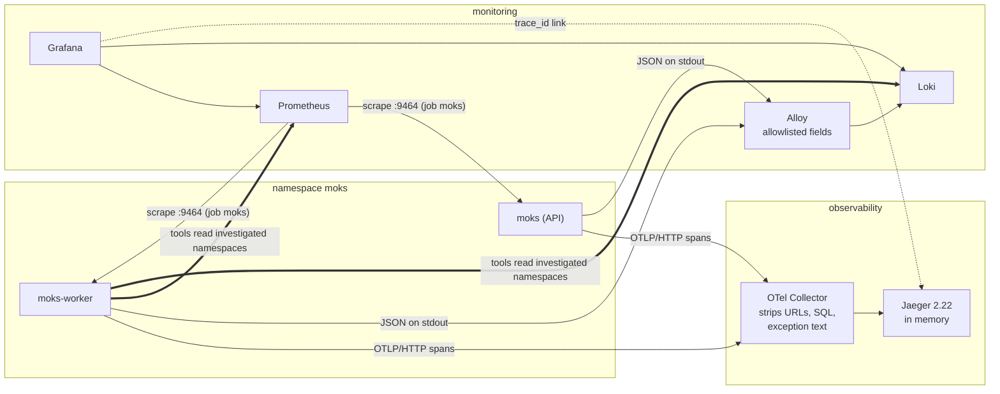
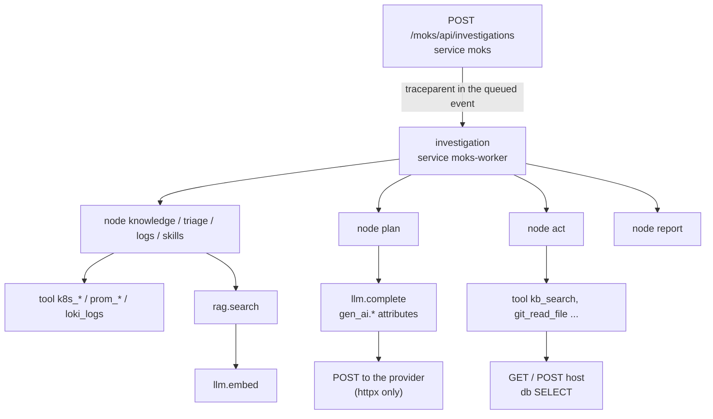

MOKS is the SRE agent and investigation portal I am building. An engineer asks about a namespace, and a LangGraph investigation reads live evidence from Kubernetes, Prometheus and Loki, searches the team's documentation and writes a report. When that takes 15 seconds instead of 5, or the report says "rule-based" although a model is configured, I want telemetry to say why.

This article shows how MOKS observes itself with structured logs, metrics and OpenTelemetry traces, how one trace follows a question through every LangGraph node, tool call and model call, and what a review on the live mk4 cluster on 4 November 2026 found and fixed. I label claims as **Implemented** (in code, usually tested), **Configured** (Helm chart or the cluster's `tools` repository), **Observed** (seen on mk4, from build `11d3e6a`) or **Not verified**.

The fixes have since shipped. On 6 November Prometheus was scraping every MOKS pod (`up{job="moks"}` = 1), the new metrics were present, and Jaeger had not restarted since its new limits.

## The short version

- MOKS's own telemetry goes to the same Prometheus, Loki and Jaeger that MOKS queries during investigations, kept apart as `{namespace="moks"}` in Loki and `job="moks"` in Prometheus.
- The trace id joins everything. One investigation is one trace, from `POST /moks/api/investigations` in the API to the last node in the worker, because the API stores a W3C `traceparent` with the queued run.
- Spans and log lines carry metadata only: names, durations, outcomes, error types and codes, token counts. Never prompts, model output, retrieved text, tool output or queries.
- There is no Langfuse or LangSmith. Model calls are ordinary OpenTelemetry spans with `gen_ai.*` attributes.
- The review found that **Prometheus was not scraping MOKS at all**, a planning loop that paid for a refused request on every model call, an event stream that would have created thousands of spans, and reports that fell back to rules without saying why anywhere but the report.

## What is being observed

MOKS runs as four processes from one image: the API (`moks`), the worker (`moks-worker`), the executor (`moks-executor`) and the terminal gateway (`moks-terminal`), with PostgreSQL, OpenSearch and an optional PyTorch reranker. An investigation is a LangGraph state machine: `intake`, `knowledge`, `triage`, `logs`, `skills`, a `plan`/`act` loop where a model asks for more evidence, and `report`, built from rules when no usable model answer exists. That shape sets four requirements:

1. A request in the API and the run in the worker must be one story, although a database row sits between them.
2. Each step must show its own time, so "slow" narrows to a node, a tool or a model call.
3. A failure must say which dependency failed and how, without copying error text, which can contain PromQL, SQL or secrets.
4. None of this may slow down or break an investigation.

## The tools

| Component | Version on mk4 | Responsibility |
| --- | --- | --- |
| OpenTelemetry Python SDK | 1.45.2, instrumentation 0.66b2 | Spans for FastAPI requests, httpx calls and MOKS's own work |
| `prometheus_client` | 0.26.0 | Metrics on port 9464, never routed by the ingress |
| OpenTelemetry Collector | 0.162 | Receives OTLP/HTTP, deletes sensitive attributes and exception events, forwards to Jaeger |
| Jaeger | 2.22 | Stores traces in memory and serves the UI and `/api/v3` |
| Grafana Alloy | 1.21.2 | Reads pod logs through the Kubernetes API, keeps allowlisted fields, pushes to Loki |
| Loki | 3.7.9 | Stores logs, labelled by namespace, pod, container and level |
| Prometheus | 3.15 | Scrapes metrics, evaluates alert rules (no Alertmanager on mk4) |
| Grafana | chart 14.0.1 | Dashboards, Loki Explore, a link from `trace_id` to Jaeger |

LangSmith is switched off in `backend/moks/llm/lc.py`, because LangChain's default tracing would send prompts holding redacted evidence to a third party, and a second backend for model calls would be a second place for content to leak. (The Langfuse set-up in `tools` belongs to RoboShop's unrelated "Moks" assistant.)

## Two kinds of telemetry in the same backends

MOKS's `prom_query`, `loki_logs` and `k8s_*` tools read the clusters it investigates, and on mk4 that is the same Prometheus and Loki that store MOKS's own telemetry.



Thin arrows are MOKS's own telemetry; thick arrows are MOKS reading evidence. The overlap matters during an incident: if Loki is down, MOKS loses its own logs and a source of evidence at once, and its report says the Loki connector was unavailable.

## Structured logging and correlation

Every process writes one JSON object per line (`backend/moks/observability.py`). This line is real, from the worker on mk4 (*Observed*, span id shortened):

```json
{"ts": "2026-11-04T03:59:48.507Z", "level": "info", "logger": "moks.orchestrator",
 "message": "investigation finished", "event": "investigation_finished", "durationMs": 15242,
 "outcome": "success", "operation": "llm_fallback",
 "investigation_id": "f817c1b0-6266-4ab1-9865-926b0f20516f",
 "trace_id": "5e46b29b86122c10ff3a2b03e99ef9c9", "span_id": "..."}
```

- **A log context.** Request, user, job, investigation and plan ids are bound once per unit of work with a `ContextVar` and stamped on every line; asyncio copies context into tasks, so work started inside an investigation keeps its id.
- **Trace and span ids** on every line written inside a span.
- **Failures by type and code:** `errorType` is the exception class, `errorCode` a fixed kind such as `timeout`, `not_found` or `auth`. A redacted message stays in `kubectl logs` only.
- **Process and release:** this review added `service` and `version` (package version plus commit) to every line (*Implemented*).

### What Loki keeps

The cluster's Alloy pipeline is a privacy boundary for every application on mk4. It copies a field only when its value matches a strict pattern, then writes a short logfmt line. The same event in Loki (*Observed*):

```text
event=investigation_finished level=info duration_ms=15242 operation=llm_fallback outcome=success logger=moks.orchestrator trace_id=5e46b29b86122c10ff3a2b03e99ef9c9
```

The investigation id, user id, `service` and `version` are not on the allowlist, so they stay in `kubectl logs`. The **trace id is what crosses**, which is why it is the join key. Labels are only namespace, pod, container, `service_name` and level, because [every distinct label value is a separate stream](https://grafana.com/docs/loki/latest/get-started/labels/bp-labels/).

## Tracing one question through the agent

The API and worker are separate pods, and a run can start seconds after the request or on another worker after a restart. When the API queues an investigation, it stores the current span as a [W3C `traceparent`](https://www.w3.org/TR/trace-context/) in the run's first event; the worker opens the `investigation` span as its child. Jobs do the same through a `_traceparent` payload field.

A real trace from mk4, `5e46b29b86122c10ff3a2b03e99ef9c9`, 45 spans (*Observed*, from Jaeger's `/api/v3/traces/{id}`, shortened):

```text
POST /moks/api/investigations      [moks]         19 ms
└─ investigation                   [moks-worker]  15 243 ms   starts 794 ms later
   ├─ node triage                                    209 ms
   │  ├─ tool k8s_triage                              104 ms  outcome=ok
   │  └─ tool prom_alerts                               8 ms
   ├─ node logs                                      449 ms   (9 Kubernetes tool calls)
   ├─ node skills                                     16 ms
   ├─ node plan                                    4 631 ms
   │  └─ llm.complete  gpt-6.1-sol                 4 531 ms  15 051 in / 84 out
   │     ├─ POST                                   1 526 ms  ERROR
   │     └─ POST                                   2 980 ms
   ├─ node act                                     2 174 ms
   │  └─ tool kb_search                            2 033 ms
   ├─ node plan                                    3 308 ms  (llm.complete, failed POST first again)
   ├─ node act                                       682 ms
   │  └─ tool git_read_file                          192 ms  outcome=not_found
   ├─ node plan                                    3 528 ms  (llm.complete, failed POST first again)
   ├─ node correlate                                   8 ms
   └─ node report                                     65 ms  no model call
```



Span names are fixed and few: `node <name>`, `tool <name>`, `llm.complete`, `llm.embed`, `rag.search`, `job <type>`. Attributes say what happened (`moks.tool`, `moks.outcome`, `gen_ai.request.model`, `gen_ai.usage.input_tokens`). HTTP spans are named after the host and SQL spans after the verb, because a path or statement can contain a query or a secret.

This trace shows that about 11.5 of the 15.2 seconds were the three `plan` model calls, that `git_read_file` returned `not_found` (the Loki line with the same trace id says `dependency=git error_code=not_found`), and two problems no metric showed, covered below.

### Model calls

`llm.complete` follows the [OpenTelemetry generative AI conventions](https://opentelemetry.io/docs/specs/semconv/gen-ai/gen-ai-spans/) (`gen_ai.system`, `gen_ai.request.model`, token usage). This review added `gen_ai.response.model`, `moks.llm.retries`, `moks.llm.adjusted`, and `moks.llm.fallback`, set only when the provider signals that another model served the turn: for Claude's [server-side fallback](https://platform.claude.com/docs/en/build-with-claude/refusals-and-fallback), a `fallback_message` entry in `usage.iterations`. Prometheus gets matching counters (`moks_llm_requests_total{provider, model, outcome}`, latency, tokens, estimated cost, retries, fallbacks), with the model label bounded by admin configuration.

Two limits: MOKS does not stream model output, so time to first token does not exist here. And the Anthropic SDK in use (2.3.0) is built on `httpx2`, which the httpx instrumentation does not see, so Claude calls get an `llm.complete` span but no HTTP children and no count of the SDK's own retries. mk4 used an OpenAI-compatible model through `httpx`, which is why the trace shows the provider's POSTs.

### Retrieval, skills and ingestion

The knowledge stage runs in one `rag.search` span recording the mode that ran, candidates surviving the access check, results, fallback, reranker use and `moks.rag.abstain`, never the query; embeddings are `llm.embed` spans with a counter and histogram. These are operational signals, not proof of a right answer; the [reranking article](/blog/pytorch-rag-reranking-moks-sre-agent) explains why the evaluation data is not yet enough.

Skill steps are ordinary tool spans inside `node skills`. Indexing runs as `job knowledge_sync` and `job reindex`, and `moks_search_backend{metric=...}` gauges feed alerts such as `MoksIndexDeadLetters`; an ingestion failure was *Not verified* on mk4. The [RAG and skills article](/blog/moks-rag-and-skills-design) describes the pipeline.

## The event stream

The browser follows an investigation over Server-Sent Events, with the API polling PostgreSQL every half second for up to ten minutes. The request span stays open for the whole stream, and since an earlier change made SQL statements child spans, a 1.2-second test stream produced 14 of them (*Implemented*: `tests/test_telemetry_boundaries.py`). A ten-minute stream would produce thousands and flood the exporter queue; the mk4 build predated SQL spans, so it had not happened yet.

The fix keeps the trace id for log lines, records nothing under the stream, and puts the outcome on the request span when it closes:

```python
# backend/moks/observability.py
@contextmanager
def unrecorded() -> Iterator[None]:
    from opentelemetry import trace

    with trace.use_span(trace.NonRecordingSpan(trace.get_current_span().get_span_context()), end_on_exit=False):
        yield
```

```python
# backend/moks/api/investigations.py (shortened)
server, start = trace.get_current_span(), asyncio.get_running_loop().time()
SSE_STREAMS_OPEN.inc()
try:
    with unrecorded():
        async for chunk in poll():
            yield chunk
finally:
    SSE_STREAMS_OPEN.dec()
    SSE_STREAMS.labels(ended["outcome"]).inc()
    server.set_attribute("moks.stream.outcome", ended["outcome"])  # end, timeout, revoked, disconnected, cancelled
    server.set_attribute("moks.stream.events", ended["events"])
```

`moks_sse_streams_open` and `moks_sse_streams_total{outcome}` show how many streams are open and how they end; "cancelled" usually means the browser went away.

## Sampling, limits and orphan spans

Worker HTTP calls outside any request, such as search probes, each became a one-span trace: **150 of the 200 most recent `moks-worker` traces were a single unnamed `POST`** (*Observed*). MOKS's own sampler now lets children follow their parent, keeps new traces at a configured ratio, and drops an outgoing call with no parent:

```python
# backend/moks/observability.py
def sampler(ratio: float):
    ratio_sampler = TraceIdRatioBased(max(0.0, min(1.0, ratio)))

    class Roots(Sampler):
        def should_sample(self, parent_context, trace_id, name, kind=None, attributes=None, links=None, trace_state=None):
            if kind == SpanKind.CLIENT:
                return SamplingResult(Decision.DROP)
            return ratio_sampler.should_sample(parent_context, trace_id, name, kind, attributes, links, trace_state)
        ...

    return ParentBased(root=Roots())
```

The ratio is `config.traceSampleRatio` (`MOKS_TRACE_SAMPLE_RATIO`, default 1), decided at the root so an investigation is kept or dropped whole ([head sampling](https://opentelemetry.io/docs/concepts/sampling/)). The exporter queue holds 2048 spans with a 5-second timeout, so with the collector down, spans drop and requests carry on (*Implemented*, tested with a failing exporter, not on mk4).

Jaeger had been **OOMKilled 11 times at its 256 MiB limit** (*Observed*): its [default all-in-one configuration](https://github.com/jaegertracing/jaeger/blob/v2.22.0/cmd/jaeger/internal/all-in-one.yaml) keeps up to 100,000 traces in memory, and each restart lost them all. It now runs capped at 5000 traces with a 384 MiB limit, and had 0 restarts in its first 45 hours.

## Model answers that were never used

`node report` took 65 ms with no `llm.complete` span, yet the run finished with `operation=llm_fallback`: a model was configured and answered three times, but the report was built from rules. All 5 investigations since the worker started ended that way, while all 15 model calls succeeded (*Observed*, from `moks_investigations_total` and `moks_llm_requests_total`).

The reason was only in the report's notes. The model call can fail, the answer can fail the schema, or the token budget can have no room; MOKS now records which as a fixed code on the span, a counter and a log line:

```python
# backend/moks/observability.py (shortened)
def llm_answer_unused(stage: str, exc: BaseException) -> str:
    kind = getattr(exc, "kind", None)
    reason = kind if isinstance(kind, str) and kind else next(
        (code for words, code in _UNUSABLE if words in str(exc)), type(exc).__name__)
    LLM_ANSWERS_UNUSED.labels(stage, reason[:40]).inc()
    trace.get_current_span().set_attribute("moks.llm.answer_unused", reason)
    log.warning("model answer not used", extra={"event": "llm_answer_unused", "operation": stage,
                                                 "errorType": type(exc).__name__, "errorCode": reason})
    return reason
```

During the review I inferred the budget: the three planning calls used 48,859 tokens of the default 60,000, and the report prompt carries the same evidence again, so the pre-call check (`_capacity`) would find less than the 300 output tokens it needs. After deployment the counter confirmed it. On 6 November, `moks_llm_answers_unused_total` held one series, `stage="report", reason="BudgetExceeded"` (*Observed*). Raising the budget or sending less context to the planner is a cost decision, so the budget is unchanged.

## A refused request on every model call

Each `llm.complete` began with a failed `POST`. The OpenAI-compatible path retries once without a parameter the server refuses (temperature, `response_format`, the max-tokens field name), but forgot it every time, costing about 2.3 s of a 15-second run. MOKS now remembers the adjustment per endpoint and model and records it as `moks.llm.adjusted`; a test checks the second call sends one request, but the saving on mk4 is not measured.

## Metrics that nobody collected

MOKS had exported metrics on port 9464 since its first phase, with a dashboard and alert rules in the repository, but mk4's Prometheus had no scrape job: every panel was empty while a worker's `/metrics` showed 95,045 successful `k8s_triage` calls (*Observed*). `tools` now has a `moks` job that discovers pods through the headless Service `moks-metrics`.

The new rules are in `deploy/minikube/observability/prometheus/files/alerts.yml`, groups `moks`, `moks-durability` and `moks-search`, and each evaluated without error on mk4:

| Alert | Fires when |
| --- | --- |
| `MoksMetricsDown` | a MOKS pod stops answering scrapes, or none is found |
| `MoksApiErrors` | more than 5% of API requests return 5xx for 10 minutes |
| `MoksModelCallsFailing` | more than half of a provider's model calls fail for 15 minutes |
| `MoksInvestigationsFailing` | at least 3 and over 30% of investigations failed in the last hour |
| `MoksToolCallsFailing` | a tool fails more than half the time, with at least 5 calls in 15 minutes |
| `MoksJobsWaiting` | a due job has waited more than 15 minutes |
| `MoksSearchDown`, `MoksSearchWriteBlocked`, `MoksIndexDeadLetters`, `MoksRetrievalFallingBack` | the knowledge search cluster is unreachable, read-only, losing index changes or answering with less than asked |
| `MoksBackupOverdue`, `MoksBackupFailed`, `MoksDatabaseVolumeFilling` | backups and database disk |

mk4 has no Alertmanager, so these notify nobody; that is a known gap, not a design choice. The dashboard, provisioned into Grafana's MOKS folder, gained panels for unused model answers, retries and fallbacks, embedding calls, event streams, the job backlog, the collector's span counts and MOKS warning and error lines.

## Investigating a slow or failed request, step by step

**1. Find the trace id.** The investigation page shows it once the run has finished, and the API returns it as `trace_id`. From Loki:

```logql
{namespace="moks"} | logfmt | event="investigation_finished" | duration_ms > 10000
```

**2. Read the trace.** There is no Jaeger ingress on mk4; use a port-forward for the UI, or the API through the Kubernetes API server. The longest `node` is where the time went, `llm.complete` shows model latency and tokens, and a `tool` span whose `moks.outcome` is not `ok` names the failing dependency.

```bash
kubectl --context mk4 get --raw \
  "/api/v1/namespaces/observability/services/jaeger:16686/proxy/api/v3/traces/5e46b29b86122c10ff3a2b03e99ef9c9"
```

**3. Read the lines**, in Grafana Explore or with LogQL, and in `kubectl logs` for the redacted error messages Loki does not keep:

```logql
{namespace="moks"} |= "trace_id=5e46b29b86122c10ff3a2b03e99ef9c9"
```

```bash
kubectl --context mk4 -n moks logs deploy/moks-worker | grep 5e46b29b86122c10ff3a2b03e99ef9c9
```

**4. Check whether it is one run or a pattern:**

```promql
histogram_quantile(0.95, sum by (le, mode) (rate(moks_investigation_duration_seconds_bucket[30m])))
sum by (stage, reason) (increase(moks_llm_answers_unused_total[1h]))
sum by (tool, outcome) (rate(moks_tool_calls_total[5m]))
```

## Privacy, retention and cost

- **Content stays out.** A test checks that `password=hunter2` in a search query never reaches the span.
- **Two layers of stripping.** MOKS never puts exception text on spans, and the collector also deletes URL, SQL, client address, auth and cookie attributes, `gen_ai.input.messages`, `gen_ai.output.messages` and exception events from any service.
- **Bounded labels:** route templates, tool names, configured provider and model, fixed outcome and reason codes. No user, conversation or trace ids.
- **Retention:** Prometheus 7 days or 4 GB; Jaeger in memory only, emptied by a restart. Loki retention lives in `tools` and was not part of this review.
- **Cost:** all self-hosted on mk4; model costs are estimates from configured prices, zero where none is set.

## How it was deployed, and what was verified

CI builds the MOKS image, its Argo CD applications sync and the pods restart onto it; the `tools` changes sync through the `prometheus`, `grafana`, `otel-collector` and `jaeger` applications. To roll back, revert and resync; `MOKS_TRACE_SAMPLE_RATIO=0` stops new traces without a code change.

After a deployment, check in this order: `up{job="moks"}` is 1 for every MOKS pod; the MOKS dashboard has data and `ALERTS{alertname=~"Moks.*"}` lists nothing unexpected; `moks-worker` has no one-span `POST` traces and new investigations show `rag.search` and `llm.embed`; `llm.complete` spans have one POST after the first call to each model; and Jaeger's restart count stays flat.

| Check | Result |
| --- | --- |
| Correlated logs and traces; one trace across API, worker, nodes, tools and model calls | Passed on mk4 (the trace and Loki lines above) |
| A dependency failure records a useful error | Passed on mk4 (`git_read_file`, `not_found`) |
| Logs can be found by trace id | Passed with LogQL; the Grafana link to Jaeger was not clicked |
| MOKS is scraped and the new metrics exist | Passed on mk4, 6 November |
| The reason a report falls back is recorded | Passed on mk4, 6 November (`BudgetExceeded`) |
| Retry and fallback are visible | Unit tests only. Claude SDK retries are not visible |
| Stream completion and timeout are recorded | Unit tests only. Cancellation is not tested |
| Sensitive fields stay out of spans and lines | Unit tests |
| Telemetry backend failure does not break requests | Unit test with a failing exporter. Not tested on mk4 |
| Dashboard panels show data | Not opened in this review |
| Ingestion success and failure can be diagnosed | Not verified |

The MOKS backend suite passed with the changes, apart from three web-terminal Helm chart tests that already failed before, and the frontend type-check and its 141 tests passed.

## Remaining limitations

- Jaeger stores traces in memory only, and mk4 has no Alertmanager.
- Claude calls through the Anthropic SDK have no HTTP child spans and no retry count.
- Skills have no span of their own beyond `node skills` and their tool calls.
- The investigation id is not in Loki, only the trace id, so with tracing off a run's Loki lines can only be found by time.
- Retrieval scores and `abstain` are diagnostics; answer quality is a question for evaluation, and the evaluation data is still synthetic.

The most useful telemetry here was not new: the revealing trace was already exported, and the worker's counters already said every report fell back. What was missing was a scrape job, one log line in three fallback paths, and the habit of reading a real trace. If you build an agent, export one trace per question with fixed span names and no content, put the trace id on every line, and read a few traces by hand before designing dashboards.
