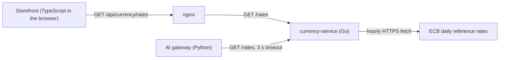

<Todo>Written on 2026-11-03 against roboshop-ai c81e85a, jithendar.com f12f8cc, moks 74a097d and tools 387bd30. SEO title, excerpt and keywords are in docs/knowledge-sharing/python-vs-go-vs-typescript/README.md. Before publishing: (1) confirm the category (ai-engineering matches the Python vs TypeScript post, but no category is a natural fit for a language comparison); (2) the repositories record where each language is used, not why it was chosen, so the article never states your reasons. Add them in "Real examples from my projects" if you want to; (3) the article uses one Mermaid diagram, so confirm Mermaid rendering is deployed; (4) rerun docs/knowledge-sharing/python-vs-go-vs-typescript/verify_examples.py after editing any example; (5) add your own commentary, confirm the AI-assistance line against the AI use policy, then set status and publishedAt.</Todo>

Most comparisons of Python, Go and TypeScript turn into a ranking. This one doesn't. All three are good general-purpose languages, and each makes different trade-offs about types, errors, concurrency and deployment. If you know one of them well, the fastest way to learn another is to see the same small programs written three ways and to know which habits will trip you up.

This programming language comparison does exactly that. You will find equivalent, runnable Python vs Go vs TypeScript examples for everyday tasks, a plain-English tour of the three type systems, the behavioral differences that cause real bugs, and the tooling you need to ship each language. At the end, I look at a real request path in my RoboShop AI project where a TypeScript storefront, a Python gateway and a Go service all handle the same currency data.

I assume you understand basic programming ideas such as variables, functions and loops, but you may know only one of these languages. Advanced material is marked as optional.

## Python vs Go vs TypeScript in one minute

**Python** is a dynamically typed, interpreted language. "Dynamically typed" means a variable can hold any kind of value, and types are checked while the program runs, not before. Python lets you add optional *type hints*: annotations such as `count: int` that tools like mypy check before you run the code, but that the Python interpreter itself does not enforce. Python is common in data analysis, machine learning, AI integrations, automation scripts and web back ends.

**Go** is a statically typed, compiled language from Google. "Statically typed" means every variable has a fixed type that the compiler checks before the program can run. The Go compiler turns your code into a native executable for one operating system and CPU architecture, and that file runs without a separate interpreter. Go is common in network services, command-line tools and cloud infrastructure software.

**TypeScript** is JavaScript with a static type system added. You write `.ts` files; a tool checks the types and then removes them, leaving ordinary JavaScript that runs. TypeScript never runs by itself. The resulting JavaScript runs in a browser, in a server runtime such as Node.js, or in other JavaScript runtimes, and each environment offers different built-in APIs. TypeScript is the usual choice for browser interfaces, and it is common for full-stack web applications and Node.js services.

None of them wins everywhere. The rest of this article shows where each one fits better and why.

## Where each language appears in my projects

I didn't want to assume anything here, so I checked the four repositories (counts are tracked source files, tests included, at the commits in the sources list). Go turned out to be present, which I had not expected before looking.

| Repository | Python | Go | TypeScript |
| --- | --- | --- | --- |
| RoboShop AI (a demo shop on Kubernetes) | 121 `.py` files: the AI gateway, cart, user, MCP and assistant services | 6 `.go` files: the currency rate service in `services/currency-service/` | 8 `.ts` files: the storefront scripts in `services/web/frontend/src/` |
| jithendar.com (this site) | 25 `.py` files: the practice code runner in `executor/` and article-check scripts | none | 396 `.ts` and `.tsx` files: the website in `www/` |
| MOKS (an SRE investigation portal) | 222 `.py` files: the API, worker, CLI and reranker | none | 45 `.ts` and `.tsx` files: the React web UI in `frontend/` |
| tools (infrastructure) | 42 `.py` files: tests and deployment helpers | 1 file, `devops-tools/dependencies/dispatch.go`, with no `go.mod`, not referenced by any workflow | none (mostly Terraform and shell) |

RoboShop AI also has 52 plain JavaScript `.mjs` files and a Java shipping service. The single Go file in tools can't be built as it stands (it has no module file), so I don't use it as an example. The real Go example in this article is the RoboShop currency service.

The versions each part pins:

| Part | Language and version | Evidence |
| --- | --- | --- |
| RoboShop currency service | Go 1.27 (`go 1.27.0` in `go.mod`, `golang:1.27-alpine` build image) | `services/currency-service/go.mod`, `Dockerfile` |
| RoboShop AI gateway | Python 3.14 (`python:3.14-slim`), FastAPI 0.159.1 | `services/ai-gateway/Dockerfile`, `requirements.txt` |
| RoboShop storefront | TypeScript 7.0.2, compiled by `tsc` to plain JavaScript | `services/web/frontend/package.json` |
| jithendar.com website | TypeScript 6.0.3 on Node.js 26 (`node:26-alpine`) | `www/package.json`, `www/Dockerfile` |
| jithendar.com executor | Python 3.13 (`python:3.13-slim`) | `executor/Dockerfile` |
| MOKS backend and UI | Python 3.12; TypeScript 5.9.3 with Vite | `Dockerfile`, `frontend/package.json` |

## What Python, Go and TypeScript have in common

Before looking at differences, it helps to see how much carries over. If you can write a small program in one of these languages, you already understand most of the ideas in the other two.

| Aspect | Python | Go | TypeScript |
| --- | --- | --- | --- |
| Variables and expressions | Assignment creates a name; no declaration keyword | `:=` or `var` declares; `const` for compile-time constants | `const` and `let` declare; `const` stops reassignment, not mutation |
| Functions | `def`; functions are values | `func`; functions are values; multiple return values are built in | `function` or arrow functions; functions are values |
| Code organization | Modules (files) and packages (folders) | Packages (folders) inside a module (`go.mod`) | ES modules (files) with `import` and `export`; npm packages |
| Collections | `list`, `dict`, `set`, `tuple` | slices, maps, arrays; no built-in set type | arrays, objects, `Map`, `Set` |
| Structured data | classes and dataclasses | structs | object types described by interfaces or type aliases; classes |
| Reusable abstractions | duck typing, protocols, inheritance | implicit interfaces, composition, generics | structural types, generics, classes |
| Error handling | exceptions | errors returned as values; panics for unrecoverable bugs | exceptions and rejected promises |
| Concurrency | `asyncio`, threads, processes | goroutines and channels | an event loop with promises; worker threads or Web Workers |
| Testing | `unittest` in the standard library; pytest is popular | the `testing` package and `go test`, both standard | no built-in framework in the language; Node.js has `node:test`; Vitest and Jest are popular |
| Dependencies | pip and PyPI, usually in a virtual environment | Go modules, fetched from version control or a proxy | npm (or pnpm, Yarn) and the npm registry |
| Typical uses | APIs, automation, data, ML, AI integrations | network services, CLIs, infrastructure | browser UIs, full-stack web apps, Node.js services |

Two cells deserve a warning. "Exceptions" in Python and TypeScript look alike, but TypeScript doesn't track which functions throw. And all three have "concurrency", but the models are so different that section [Concurrency and parallelism](#concurrency-and-parallelism) gets its own space.

## How to run the examples

Every example in this article has a label:

- **Standalone comparison example**: a complete program I wrote for this article. Each one ends with an `Output:` comment showing exactly what it prints.
- **Actual project code**: copied exactly from one of my repositories, with the path and line numbers.
- **Simplified from project code**: shortened from a repository file, with the changes explained.

Where an example says **Same output in all three languages**, the three programs print identical text. **Same values; the printed format differs** means the results match but, for example, Python prints `True` and Go prints `true`. **The outputs differ on purpose** means the example exists to show a difference.

**Python.** Save the code as a `.py` file and run `python3 example.py`. The examples use syntax that works on Python 3.11 and later. To check type hints, install mypy into a virtual environment:

```bash
python3 -m venv .venv
source .venv/bin/activate
python -m pip install mypy pytest
mypy example.py
```

**Go.** Install Go 1.25 or later from go.dev (some examples use `sync.WaitGroup.Go`, added in 1.25). A single-file program runs with `go run example.go`. For examples with more than one file, create a module first:

```bash
mkdir example && cd example
go mod init example
go run .
```

`go mod init` writes a `go.mod` file that names the module. `go vet ./...` runs Go's built-in static checks, and `gofmt -l .` lists files that are not in the standard format.

**TypeScript.** Node.js 22.18 and later can run a `.ts` file directly with `node example.ts`. Node strips the type annotations and runs what's left, but it doesn't check the types and it ignores `tsconfig.json`. To check them, add a `package.json` containing `{"type": "module"}`, install the compiler with `npm install --save-dev typescript @types/node`, and use this `tsconfig.json`:

```json
{
  "compilerOptions": {
    "strict": true,
    "noEmit": true,
    "target": "es2022",
    "module": "nodenext",
    "allowImportingTsExtensions": true,
    "erasableSyntaxOnly": true,
    "moduleDetection": "force",
    "types": ["node"]
  }
}
```

Then run `npx tsc`. `noEmit` means "check only, don't write JavaScript files". `erasableSyntaxOnly` makes the compiler reject the few TypeScript features that Node's type stripping can't run, such as `enum` and constructor parameter properties.

## Python vs Go vs TypeScript examples, side by side

### Hello world and the entry point

Every program needs a place to start. Python runs a file from top to bottom; the `if __name__ == "__main__":` check runs `main()` only when the file is executed directly, not when another file imports it. Go always starts at `func main()` in `package main`, and the `fmt` package (short for "format") provides printing. A TypeScript file run by Node.js also runs from top to bottom, so you simply call your function.

*Standalone comparison example. Same output in all three languages.*

```python
# hello.py
def main() -> None:
    print("Hello, world!")


if __name__ == "__main__":
    main()

# Output:
# Hello, world!
```

```go
// hello.go
package main

import "fmt"

func main() {
	fmt.Println("Hello, world!")
}

// Output:
// Hello, world!
```

```typescript
// hello.ts
function main(): void {
  console.log("Hello, world!");
}

main();

// Output:
// Hello, world!
```

Go is the only one of the three that refuses to compile a file with an unused import. Delete the `fmt.Println` line and keep `import "fmt"`, and the build fails. That feels strict at first, but it keeps imports honest.

**Common mistake when switching:** writing Python-style top-level statements in Go. Go allows only declarations (functions, types, variables, constants) at the top level of a file; statements must live inside a function.

### Variables and constants

*Standalone comparison example. Same output in all three languages.*

```python
# variables.py
from typing import Final

MAX_RETRIES: Final = 3

name = "Ada"
count = 2
count += 1
print(name, count, MAX_RETRIES)

# Output:
# Ada 3 3
```

```go
// variables.go
package main

import "fmt"

const maxRetries = 3

func main() {
	name := "Ada"
	var count int = 2
	count++
	fmt.Println(name, count, maxRetries)
}

// Output:
// Ada 3 3
```

```typescript
// variables.ts
const MAX_RETRIES = 3;

const name = "Ada";
let count = 2;
count += 1;
console.log(name, count, MAX_RETRIES);

// Output:
// Ada 3 3
```

What to notice:

- **Python** has no declaration keyword. `name = "Ada"` creates the variable. `Final` is a type hint that tells a type checker not to allow reassignment; Python itself would still let you reassign it.
- **Go** has two forms. `name := "Ada"` declares and infers the type (only inside functions). `var count int = 2` spells the type out. `const` values must be known at compile time. Go also reports an *unused local variable* as a compile error.
- **TypeScript** uses `const` for bindings that are never reassigned and `let` for ones that are. `const` doesn't make an object immutable: `const list = [1]; list.push(2)` is allowed.

**Common mistake when switching:** in Go, `:=` inside an `if` or `for` block declares a *new* variable that shadows an outer one with the same name. If you meant to update the outer variable, use `=`.

### Strings and formatting

*Standalone comparison example. Same output in all three languages.*

```python
# strings.py
name = "Ada"
items = 3
price = 4.5

print(f"{name} has {items} items costing {price:.2f}")
print(name.upper(), len(name))
print(", ".join(["a", "b", "c"]))

# Output:
# Ada has 3 items costing 4.50
# ADA 3
# a, b, c
```

```go
// strings.go
package main

import (
	"fmt"
	"strings"
)

func main() {
	name := "Ada"
	items := 3
	price := 4.5

	fmt.Printf("%s has %d items costing %.2f\n", name, items, price)
	fmt.Println(strings.ToUpper(name), len(name))
	fmt.Println(strings.Join([]string{"a", "b", "c"}, ", "))
}

// Output:
// Ada has 3 items costing 4.50
// ADA 3
// a, b, c
```

```typescript
// strings.ts
const name = "Ada";
const items = 3;
const price = 4.5;

console.log(`${name} has ${items} items costing ${price.toFixed(2)}`);
console.log(name.toUpperCase(), name.length);
console.log(["a", "b", "c"].join(", "));

// Output:
// Ada has 3 items costing 4.50
// ADA 3
// a, b, c
```

Python's f-strings (`f"..."`) and TypeScript's template literals (`` `...${x}` ``) put expressions directly inside the string. Go has no string interpolation; you use `fmt.Printf` or `fmt.Sprintf` with *verbs* such as `%s` (string), `%d` (integer) and `%.2f` (float with two decimals). `%v` prints any value in a default format. String helpers live in the `strings` package rather than as methods.

`len(name)` and `name.length` both return 3 here, but they count different things. Go counts bytes, and JavaScript counts UTF-16 code units. For text outside plain ASCII, all three languages give different answers; see [Unicode and string indexing](#unicode-and-string-indexing).

**Common mistake when switching:** `fmt.Println` with a format verb. `fmt.Println("%d", n)` prints the literal `%d` followed by the number. Use `fmt.Printf` (and add `\n` yourself) when you need formatting.

### Numbers and booleans

*Standalone comparison example. Same values; the printed format differs.*

```python
# numbers.py
print(7 + 2, 7 - 2, 7 * 2, 7 / 2)
print(7 // 2, 7 % 2, 2 ** 10)

is_admin = True
is_active = False
print(is_admin and not is_active)

# Output:
# 9 5 14 3.5
# 3 1 1024
# True
```

```go
// numbers.go
package main

import (
	"fmt"
	"math"
)

func main() {
	fmt.Println(7+2, 7-2, 7*2, 7.0/2)
	fmt.Println(7/2, 7%2, math.Pow(2, 10))

	isAdmin := true
	isActive := false
	fmt.Println(isAdmin && !isActive)
}

// Output:
// 9 5 14 3.5
// 3 1 1024
// true
```

```typescript
// numbers.ts
console.log(7 + 2, 7 - 2, 7 * 2, 7 / 2);
console.log(Math.trunc(7 / 2), 7 % 2, 2 ** 10);

const isAdmin = true;
const isActive = false;
console.log(isAdmin && !isActive);

// Output:
// 9 5 14 3.5
// 3 1 1024
// true
```

Division is where the languages first disagree:

- **Python** has two operators. `/` always gives a float (`3.5`); `//` gives floor division (`3`).
- **Go** decides by type. `7/2` divides two integers and gives `3`; `7.0/2` divides floats and gives `3.5`. Go has no `**` operator; `math.Pow` works on `float64`.
- **JavaScript** has one number type for both, so `7 / 2` is `3.5` and you use `Math.trunc` or `Math.floor` to drop the fraction.

Booleans are spelled `True`/`False` in Python and `true`/`false` in Go and TypeScript. Python uses the words `and`, `or` and `not`; Go and TypeScript use `&&`, `||` and `!`.

**Common mistake when switching:** in Go you can't mix types in arithmetic. If `n` is an `int` and `f` is a `float64`, `n * f` doesn't compile; you write `float64(n) * f`. Only untyped constants, such as the literal `2`, adapt automatically.

### Lists, slices and arrays

*Standalone comparison example. Same values; the printed format differs.*

```python
# collections_demo.py
nums = [3, 1, 2]
nums.append(4)
print(nums, len(nums))
print(sorted(nums))
print(nums[1:3])

# Output:
# [3, 1, 2, 4] 4
# [1, 2, 3, 4]
# [1, 2]
```

```go
// collections.go
package main

import (
	"fmt"
	"slices"
)

func main() {
	nums := []int{3, 1, 2}
	nums = append(nums, 4)
	fmt.Println(nums, len(nums))

	sorted := slices.Clone(nums)
	slices.Sort(sorted)
	fmt.Println(sorted)
	fmt.Println(nums[1:3])
}

// Output:
// [3 1 2 4] 4
// [1 2 3 4]
// [1 2]
```

```typescript
// collections.ts
const nums = [3, 1, 2];
nums.push(4);
console.log(JSON.stringify(nums), nums.length);
console.log(JSON.stringify([...nums].sort((a, b) => a - b)));
console.log(JSON.stringify(nums.slice(1, 3)));

// Output:
// [3,1,2,4] 4
// [1,2,3,4]
// [1,2]
```

All three use zero-based indexes and half-open ranges: `[1:3]` and `slice(1, 3)` include index 1 and exclude index 3.

- A Python **list** holds values of any type and grows with `append`.
- A Go **slice** (`[]int`) holds values of one type. `append` returns a slice, and you must assign the result back: `nums = append(nums, 4)`. The `slices` package (standard library since Go 1.21) provides `Sort`, `Clone`, `Contains` and similar helpers. Go also has fixed-length *arrays* such as `[3]int`, but you will use slices far more often.
- A JavaScript **array** grows with `push`. `sort()` sorts in place, which is why the example copies the array first with `[...nums]`.

**Common mistake when switching:** calling `sort()` on numbers in JavaScript without a comparison function. The default sort compares values as strings, so `[10, 9, 1].sort()` gives `[1, 10, 9]`. Always pass `(a, b) => a - b` for numbers.

### Dictionaries, maps and JavaScript objects

A *dictionary* or *map* stores values by key. Python has `dict`, Go has `map[K]V`, and JavaScript has two options: plain objects (often typed as `Record<string, V>` in TypeScript) and the `Map` class.

*Standalone comparison example. Same values; the printed format differs.*

```python
# maps_demo.py
ages = {"ada": 36, "linus": 29}
ages["grace"] = 45

print(ages["ada"], len(ages), "bob" in ages)
for name in sorted(ages):
    print(name, ages[name])

# Output:
# 36 3 False
# ada 36
# grace 45
# linus 29
```

```go
// maps.go
package main

import (
	"fmt"
	"maps"
	"slices"
)

func main() {
	ages := map[string]int{"ada": 36, "linus": 29}
	ages["grace"] = 45

	_, hasBob := ages["bob"]
	fmt.Println(ages["ada"], len(ages), hasBob)
	for _, name := range slices.Sorted(maps.Keys(ages)) {
		fmt.Println(name, ages[name])
	}
}

// Output:
// 36 3 false
// ada 36
// grace 45
// linus 29
```

```typescript
// maps.ts
const ages: Record<string, number> = { ada: 36, linus: 29 };
ages["grace"] = 45;

console.log(ages["ada"], Object.keys(ages).length, "bob" in ages);
for (const name of Object.keys(ages).sort()) {
  console.log(name, ages[name]);
}

// Output:
// 36 3 false
// ada 36
// grace 45
// linus 29
```

Iteration order is a real difference. Python dicts keep insertion order. JavaScript objects mostly keep insertion order for string keys (integer-like keys come first). Go deliberately randomizes map iteration order, so code that depends on it breaks quickly. That's why all three examples sort the keys.

Use a JavaScript `Map` instead of a plain object when keys are not strings, when keys come from users (a key such as `"__proto__"` behaves specially on plain objects), or when you add and remove keys often.

**Common mistake when switching:** treating Go's `ages["bob"]` as an error. It returns the *zero value* for the value type (here `0`) and doesn't fail. Use the two-value form `value, ok := ages["bob"]` to tell "missing" apart from "present with value 0".

### Conditions

*Standalone comparison example. Same output in all three languages.*

```python
# conditions.py
def grade(score: int) -> str:
    if score >= 90:
        return "A"
    elif score >= 75:
        return "B"
    else:
        return "C"


def label(status: str) -> str:
    match status:
        case "paid" | "shipped":
            return "done"
        case "pending":
            return "waiting"
        case _:
            return "unknown"


print(grade(95), grade(82), grade(40))
print(label("paid"), label("pending"), label("lost"))

# Output:
# A B C
# done waiting unknown
```

```go
// conditions.go
package main

import "fmt"

func grade(score int) string {
	if score >= 90 {
		return "A"
	} else if score >= 75 {
		return "B"
	}
	return "C"
}

func label(status string) string {
	switch status {
	case "paid", "shipped":
		return "done"
	case "pending":
		return "waiting"
	default:
		return "unknown"
	}
}

func main() {
	fmt.Println(grade(95), grade(82), grade(40))
	fmt.Println(label("paid"), label("pending"), label("lost"))
}

// Output:
// A B C
// done waiting unknown
```

```typescript
// conditions.ts
function grade(score: number): string {
  if (score >= 90) {
    return "A";
  } else if (score >= 75) {
    return "B";
  }
  return "C";
}

function label(status: string): string {
  switch (status) {
    case "paid":
    case "shipped":
      return "done";
    case "pending":
      return "waiting";
    default:
      return "unknown";
  }
}

console.log(grade(95), grade(82), grade(40));
console.log(label("paid"), label("pending"), label("lost"));

// Output:
// A B C
// done waiting unknown
```

Python uses `elif`; Go and TypeScript use `else if`. Go's `if` needs no parentheses but always needs braces. Python's `match` statement (Python 3.10 and later) is pattern matching, which can also destructure values. Here it's used like a simple switch.

**Common mistake when switching:** fall-through. In JavaScript, a `case` without `return` or `break` keeps running into the next case. Go stops at the end of each case unless you write `fallthrough`, and Python's `match` never falls through.

### Loops

Python has `for` and `while`. Go has only `for`, which covers both. TypeScript has `for...of`, the classic three-part `for`, and `while`.

*Standalone comparison example. Same output in all three languages.*

```python
# loops.py
names = ["ada", "linus"]
for i, name in enumerate(names):
    print(i, name)

n = 3
while n > 0:
    print("tick", n)
    n -= 1

# Output:
# 0 ada
# 1 linus
# tick 3
# tick 2
# tick 1
```

```go
// loops.go
package main

import "fmt"

func main() {
	names := []string{"ada", "linus"}
	for i, name := range names {
		fmt.Println(i, name)
	}

	n := 3
	for n > 0 {
		fmt.Println("tick", n)
		n--
	}
}

// Output:
// 0 ada
// 1 linus
// tick 3
// tick 2
// tick 1
```

```typescript
// loops.ts
const names = ["ada", "linus"];
for (const [i, name] of names.entries()) {
  console.log(i, name);
}

let n = 3;
while (n > 0) {
  console.log("tick", n);
  n--;
}

// Output:
// 0 ada
// 1 linus
// tick 3
// tick 2
// tick 1
```

Go's `for i, name := range names` gives the index and a *copy* of each element. Since Go 1.22, each iteration gets a fresh `i` and `name`, so closures and goroutines that capture them behave as you would expect. Go 1.22 also lets you write `for i := range 3` to count from 0 to 2.

**Common mistake when switching:** using `for...in` on a JavaScript array. `for (const i in names)` loops over the *keys* as strings (`"0"`, `"1"`), not the values. Use `for...of` for values.

### Functions and return values

*Standalone comparison example. Same output in all three languages.*

```python
# functions.py
from typing import Callable


def divide(a: int, b: int) -> tuple[int, int]:
    return a // b, a % b


def apply_twice(fn: Callable[[int], int], value: int) -> int:
    return fn(fn(value))


quotient, remainder = divide(7, 2)
print(quotient, remainder)
print(apply_twice(lambda x: x * 2, 5))

# Output:
# 3 1
# 20
```

```go
// functions.go
package main

import "fmt"

func divide(a, b int) (int, int) {
	return a / b, a % b
}

func applyTwice(fn func(int) int, value int) int {
	return fn(fn(value))
}

func main() {
	quotient, remainder := divide(7, 2)
	fmt.Println(quotient, remainder)
	fmt.Println(applyTwice(func(x int) int { return x * 2 }, 5))
}

// Output:
// 3 1
// 20
```

```typescript
// functions.ts
function divide(a: number, b: number): [number, number] {
  return [Math.trunc(a / b), a % b];
}

function applyTwice(fn: (x: number) => number, value: number): number {
  return fn(fn(value));
}

const [quotient, remainder] = divide(7, 2);
console.log(quotient, remainder);
console.log(applyTwice((x) => x * 2, 5));

// Output:
// 3 1
// 20
```

Returning two values looks similar in all three, but works differently. Python returns one tuple and unpacks it. TypeScript returns one array, typed as a *tuple* `[number, number]`, and destructures it. Go has true multiple return values, which is why Go's error handling (`value, err := ...`) feels natural there. In Go, parameter types come *after* names, and `a, b int` shares one type between two parameters.

All three treat functions as values: `lambda`, Go's function literals and TypeScript's arrow functions are anonymous functions you can pass around.

**Common mistake when switching:** Python functions without a `return` statement return `None`; JavaScript functions return `undefined`. Go makes you declare the return type, and the compiler reports a missing `return`.

### Optional and default inputs

Python and TypeScript have default parameter values. Go has neither defaults nor keyword arguments, and that is deliberate: every call shows every argument. Go code uses other patterns instead.

*Standalone comparison example. Same output in all three languages.*

```python
# defaults.py
def greet(name: str, greeting: str = "Hello") -> str:
    return f"{greeting}, {name}!"


print(greet("Ada"))
print(greet("Ada", greeting="Hi"))

# Output:
# Hello, Ada!
# Hi, Ada!
```

```go
// defaults.go
package main

import "fmt"

// GreetOptions groups optional settings. Its zero value means "use the defaults".
type GreetOptions struct {
	Greeting string
}

func greet(name string, opts GreetOptions) string {
	greeting := opts.Greeting
	if greeting == "" {
		greeting = "Hello"
	}
	return greeting + ", " + name + "!"
}

func main() {
	fmt.Println(greet("Ada", GreetOptions{}))
	fmt.Println(greet("Ada", GreetOptions{Greeting: "Hi"}))
}

// Output:
// Hello, Ada!
// Hi, Ada!
```

```typescript
// defaults.ts
interface GreetOptions {
  greeting?: string;
}

function greet(name: string, { greeting = "Hello" }: GreetOptions = {}): string {
  return `${greeting}, ${name}!`;
}

console.log(greet("Ada"));
console.log(greet("Ada", { greeting: "Hi" }));

// Output:
// Hello, Ada!
// Hi, Ada!
```

Python's `greeting="Hi"` is a *keyword argument*: you name the parameter at the call site. TypeScript has no keyword arguments, so the common pattern is an options object, destructured with defaults. The `?` in `greeting?: string` makes the property optional. Go's options struct works the same way, but relies on the field's zero value (`""`) to mean "not set". When the zero value is a valid setting, Go code uses a pointer field (`*string`) or the *functional options* pattern (variadic functions such as `WithGreeting("Hi")`).

**Common mistake when switching:** Python evaluates a default value once, when the function is defined. See [mutable default arguments](#mutable-default-arguments-in-python) for the bug that causes.

### Structured data models

Most programs pass around records such as a user. Python commonly uses a *dataclass*, Go uses a *struct*, and TypeScript describes plain objects with an *interface* (a class also works).

*Standalone comparison example. Same values; the printed format differs.*

```python
# models.py
from dataclasses import dataclass


@dataclass
class User:
    name: str
    email: str
    active: bool = True

    def label(self) -> str:
        return f"{self.name} <{self.email}>"


user = User("Ada", "ada@example.com")
print(user.label(), user.active)

# Output:
# Ada <ada@example.com> True
```

```go
// models.go
package main

import "fmt"

type User struct {
	Name   string
	Email  string
	Active bool
}

func NewUser(name, email string) User {
	return User{Name: name, Email: email, Active: true}
}

func (u User) Label() string {
	return u.Name + " <" + u.Email + ">"
}

func main() {
	user := NewUser("Ada", "ada@example.com")
	fmt.Println(user.Label(), user.Active)
}

// Output:
// Ada <ada@example.com> true
```

```typescript
// models.ts
interface User {
  name: string;
  email: string;
  active: boolean;
}

function label(user: User): string {
  return `${user.name} <${user.email}>`;
}

const user: User = { name: "Ada", email: "ada@example.com", active: true };
console.log(label(user), user.active);

// Output:
// Ada <ada@example.com> true
```

- `@dataclass` generates `__init__`, `__repr__` and `__eq__` from the annotated fields.
- A Go struct has no constructor and no default field values. Every field starts at its zero value, so `Active` would be `false` unless set. A `NewUser` function is the usual way to supply defaults. `func (u User) Label()` is a *method*: a function with a *receiver* `u`. Capitalized names (`User`, `Name`, `Label`) are *exported*, meaning visible to other packages.
- A TypeScript `interface` only describes a shape. The object is an ordinary JavaScript object, and the interface disappears when the types are removed.

**Common mistake when switching:** expecting a TypeScript interface to check data at runtime. It can't, because it doesn't exist at runtime. See [annotations versus runtime validation](#annotations-versus-runtime-validation).

### Handling missing values

Each language has a different way to say "there's nothing here".

*Standalone comparison example. The outputs differ on purpose.*

```python
# missing.py
emails = {"ada": "ada@example.com"}

email = emails.get("bob")
print(email)
print(email if email is not None else "unknown")
print(emails.get("ada", "unknown"))

# Output:
# None
# unknown
# ada@example.com
```

```go
// missing.go
package main

import "fmt"

func main() {
	emails := map[string]string{"ada": "ada@example.com"}

	email, ok := emails["bob"]
	fmt.Printf("%q %t\n", email, ok)
	if !ok {
		email = "unknown"
	}
	fmt.Println(email)
	fmt.Println(emails["ada"])
}

// Output:
// "" false
// unknown
// ada@example.com
```

```typescript
// missing.ts
const emails = new Map<string, string>([["ada", "ada@example.com"]]);

const email = emails.get("bob");
console.log(email);
console.log(email ?? "unknown");
console.log(emails.get("ada") ?? "unknown");

// Output:
// undefined
// unknown
// ada@example.com
```

Python has one "nothing" value, `None`, and you test it with `is None`. Go has no general null; a missing map entry is the zero value (`""` here), plus a boolean that says whether the key was there. JavaScript has two "nothing" values, `undefined` and `null`. TypeScript's `??` (nullish coalescing) uses the right side only when the left side is `null` or `undefined`, and `?.` (optional chaining) stops at either one.

**Common mistake when switching:** using `or` in Python or `||` in TypeScript as a default operator. `count or 10` replaces a real `0` with `10`, because `0` is *falsy*. Use `is None` in Python and `??` in TypeScript.

### Errors: a first look

The full comparison comes in [Error handling](#error-handling-in-python-go-and-typescript); this small example shows the basic shape: converting text to a number.

*Standalone comparison example. The outputs differ on purpose.*

```python
# parse_number.py
for raw in ["42", "abc"]:
    try:
        print(int(raw))
    except ValueError as err:
        print("error:", err)

# Output:
# 42
# error: invalid literal for int() with base 10: 'abc'
```

```go
// parse_number.go
package main

import (
	"fmt"
	"strconv"
)

func main() {
	for _, raw := range []string{"42", "abc"} {
		n, err := strconv.Atoi(raw)
		if err != nil {
			fmt.Println("error:", err)
			continue
		}
		fmt.Println(n)
	}
}

// Output:
// 42
// error: strconv.Atoi: parsing "abc": invalid syntax
```

```typescript
// parse_number.ts
for (const raw of ["42", "abc"]) {
  const n = Number(raw);
  if (Number.isNaN(n)) {
    console.log("error: not a number:", raw);
    continue;
  }
  console.log(n);
}

console.log(Number(""), Number(" 42 "), Number.parseInt("42px", 10));

// Output:
// 42
// error: not a number: abc
// 0 42 42
```

Python raises an exception; Go returns an `error` value next to the result; JavaScript's `Number()` returns the special value `NaN` ("not a number") and doesn't throw at all. The last TypeScript line shows why JavaScript parsing needs care: an empty string becomes `0`, and `parseInt` silently stops at the first non-digit.

### JSON serialization and parsing

*Standalone comparison example. Same output in all three languages.*

```python
# json_demo.py
import json

raw = '{"name": "Ada", "tags": ["admin", "dev"], "age": 36}'
data = json.loads(raw)
print(data["name"], data["tags"][0], data["age"] + 1)

print(json.dumps({"ok": True, "count": 2}, separators=(",", ":")))

# Output:
# Ada admin 37
# {"ok":true,"count":2}
```

```go
// json_demo.go
package main

import (
	"encoding/json"
	"fmt"
)

type Profile struct {
	Name string   `json:"name"`
	Tags []string `json:"tags"`
	Age  int      `json:"age"`
}

type Result struct {
	OK    bool `json:"ok"`
	Count int  `json:"count"`
}

func main() {
	raw := `{"name": "Ada", "tags": ["admin", "dev"], "age": 36}`
	var p Profile
	if err := json.Unmarshal([]byte(raw), &p); err != nil {
		fmt.Println("error:", err)
		return
	}
	fmt.Println(p.Name, p.Tags[0], p.Age+1)

	out, err := json.Marshal(Result{OK: true, Count: 2})
	if err != nil {
		fmt.Println("error:", err)
		return
	}
	fmt.Println(string(out))
}

// Output:
// Ada admin 37
// {"ok":true,"count":2}
```

```typescript
// json_demo.ts
interface Profile {
  name: string;
  tags: string[];
  age: number;
}

const raw = '{"name": "Ada", "tags": ["admin", "dev"], "age": 36}';
const profile = JSON.parse(raw) as Profile;
console.log(profile.name, profile.tags[0], profile.age + 1);

console.log(JSON.stringify({ ok: true, count: 2 }));

// Output:
// Ada admin 37
// {"ok":true,"count":2}
```

- **Python** turns JSON into plain `dict`, `list`, `str`, `int`, `float`, `bool` and `None` values. By default `json.dumps` adds spaces after `,` and `:`; `separators` removes them.
- **Go** decodes into a struct. The text in backquotes after each field, such as `` `json:"name"` ``, is a *struct tag*: metadata that tells `encoding/json` which JSON key to use. Only exported (capitalized) fields are encoded. `&p` passes a pointer so `Unmarshal` can fill in `p`. Unknown JSON keys are ignored, missing keys leave the zero value, and key matching is case-insensitive by default (`"NAME"` would also fill `Name`). Since Go 1.27, `encoding/json` is implemented on top of the new `encoding/json/v2`; the release notes say the behavior is preserved, but error message text may differ.
- **TypeScript**: `JSON.parse` returns `any`, and `as Profile` is a *type assertion*. It tells the compiler "trust me"; nothing checks that the data really has that shape.

**Common mistake when switching:** lowercase struct fields in Go. A field named `name` (unexported) is silently skipped by `encoding/json`, so your output is `{}`.

### Modules and imports

A *module* is a unit of code you can import. Here each language splits a greeting function into its own file.

*Standalone comparison example. Same output in all three languages.*

```python
# greetings.py
def hello(name: str) -> str:
    return f"Hello, {name}!"
```

```python
# main.py
from greetings import hello

if __name__ == "__main__":
    print(hello("Ada"))

# Output:
# Hello, Ada!
```

```go
// greetings/greetings.go
package greetings

// Hello is exported because its name starts with a capital letter.
func Hello(name string) string {
	return prefix() + name + "!"
}

// prefix is unexported: only code in package greetings can call it.
func prefix() string {
	return "Hello, "
}
```

```go
// main.go
package main

import (
	"fmt"

	"example/greetings"
)

func main() {
	fmt.Println(greetings.Hello("Ada"))
}

// Output:
// Hello, Ada!
```

```typescript
// greetings.ts
export function hello(name: string): string {
  return `Hello, ${name}!`;
}
```

```typescript
// main.ts
import { hello } from "./greetings.ts";

console.log(hello("Ada"));

// Output:
// Hello, Ada!
```

- **Python**: every `.py` file is a module. `from greetings import hello` finds `greetings.py` on the module search path, which includes the script's folder. Everything is importable; a leading underscore (`_helper`) is only a convention for "private".
- **Go**: a *package* is a folder. The import path `example/greetings` is the module name from `go.mod` plus the folder name. Visibility is decided by the first letter: `Hello` is exported, `prefix` is not. Go also rejects circular imports between packages.
- **TypeScript**: every file with `import` or `export` is an ES module, and you export names explicitly. Node's type stripping needs the real `.ts` extension in relative imports. If you compile with `tsc` to `.js` files instead, TypeScript can rewrite these extensions for you (the `rewriteRelativeImportExtensions` option), or you can import the `.js` name.

**Common mistake when switching:** naming a Python file after a standard library module, such as `json.py` or `random.py`. Your file *shadows* the real module, and `import json` loads your file instead.

### A small HTTP request

This example fetches JSON from a local mock server, so it needs no credentials and touches no real service. Save this file as `user.json` in an empty folder:

*Mock API response.*

```json
{"id": 1, "name": "Ada Lovelace", "role": "admin"}
```

Then start a local server in that folder with `python3 -m http.server 8000 --bind 127.0.0.1`, and run each program in another terminal.

*Standalone comparison example. Same output in all three languages.*

```python
# http_get.py
import json
from urllib.request import urlopen

URL = "http://127.0.0.1:8000/user.json"

with urlopen(URL, timeout=5) as response:
    status = response.status
    user = json.load(response)

print(status, user["name"], user["role"])

# Output:
# 200 Ada Lovelace admin
```

```go
// http_get.go
package main

import (
	"encoding/json"
	"fmt"
	"net/http"
	"time"
)

type User struct {
	Name string `json:"name"`
	Role string `json:"role"`
}

func main() {
	client := &http.Client{Timeout: 5 * time.Second}
	resp, err := client.Get("http://127.0.0.1:8000/user.json")
	if err != nil {
		fmt.Println("request failed:", err)
		return
	}
	defer resp.Body.Close()

	if resp.StatusCode != http.StatusOK {
		fmt.Println("unexpected status:", resp.StatusCode)
		return
	}
	var user User
	if err := json.NewDecoder(resp.Body).Decode(&user); err != nil {
		fmt.Println("bad JSON:", err)
		return
	}
	fmt.Println(resp.StatusCode, user.Name, user.Role)
}

// Output:
// 200 Ada Lovelace admin
```

```typescript
// http_get.ts
interface User {
  name: string;
  role: string;
}

const response = await fetch("http://127.0.0.1:8000/user.json", {
  signal: AbortSignal.timeout(5000),
});
if (!response.ok) {
  throw new Error(`unexpected status: ${response.status}`);
}
const user = (await response.json()) as User;
console.log(response.status, user.name, user.role);

// Output:
// 200 Ada Lovelace admin
```

All three use only the standard library (or, for TypeScript, the `fetch` built into Node.js and browsers). In real Python projects, people often use the third-party `httpx` or `requests` packages instead of `urllib`.

Two details matter in production code:

- **Timeouts.** None of these clients should wait forever. Python's `timeout=5`, Go's `http.Client{Timeout: ...}` and `AbortSignal.timeout(5000)` each set a limit. Go's zero-value `http.Client` and `http.Get` have *no* timeout.
- **Status codes.** Python's `urlopen` raises an exception for 4xx and 5xx responses. Go and `fetch` treat any response as success, so you must check `resp.StatusCode` or `response.ok` yourself.

`defer resp.Body.Close()` schedules the close to run when `main` returns. Forgetting to close response bodies in Go leaks connections.

## Type systems explained simply

### Dynamic typing versus static typing

A *type* says what kind of value something is and what you can do with it. In a *dynamically typed* language, values carry their types and the interpreter checks them while running. In a *statically typed* language, the compiler checks types before the program runs.

That makes three different situations:

- **Python**: dynamically typed, with optional static checking. Type hints are stored but not enforced; an external tool such as mypy or Pyright checks them.
- **Go**: statically typed. A type error is a compile error, and there is no program to run until you fix it.
- **TypeScript**: statically typed at *check* time, dynamically typed at *run* time. The compiler checks your types, then the types are erased and plain JavaScript runs.

The same mistake shows all three:

*Standalone comparison example. The outputs differ on purpose.*

```python
# hints.py
def add(a: int, b: int) -> int:
    return a + b


print(add(2, 3))
print(add("2", "3"))  # a type checker flags this line

# Output:
# 5
# 23
```

```go
// hints.go
package main

import "fmt"

func add(a, b int) int {
	return a + b
}

func main() {
	fmt.Println(add(2, 3))
	fmt.Println(add("2", "3"))
}

// Error: cannot use "2" (untyped string constant) as int value in argument to add
```

```typescript
// hints.ts
function add(a: number, b: number): number {
  return a + b;
}

console.log(add(2, 3));
// @ts-expect-error: tsc rejects these arguments, but Node.js still runs the line
console.log(add("2", "3"));

// Output:
// 5
// 23
```

Python runs the bad call and joins the strings into `"23"`; mypy would have reported it. The Go program doesn't build, and the compiler prints the error shown. The TypeScript program fails `tsc`, but `node hints.ts` runs it anyway and also prints `23`, because Node.js only strips the types. (`@ts-expect-error` tells `tsc` that the next line is expected to fail, which lets this article's checker confirm that it does.)

The lesson for TypeScript: **running a `.ts` file is not checking it.** Put `tsc --noEmit` (or your framework's equivalent) in CI.

### Type inference and structural typing

*Type inference* means the compiler works out a type you didn't write. Go infers types for `x := 42`, TypeScript infers `const n = 42` as `number` (actually the literal type `42`), and Python type checkers infer `n = 42` as `int`.

*Structural typing* means two types are compatible if they have the same shape, regardless of their names. TypeScript is structural, and so are Go interfaces and Python `Protocol` classes. None of them requires you to declare "this class implements that interface".

*Standalone comparison example. Same output in all three languages.*

```python
# shapes.py
from dataclasses import dataclass
from typing import Protocol


class Shape(Protocol):
    def area(self) -> int: ...


@dataclass
class Rect:
    width: int
    height: int

    def area(self) -> int:
        return self.width * self.height


@dataclass
class Square:
    side: int

    def area(self) -> int:
        return self.side * self.side


def total_area(shapes: list[Shape]) -> int:
    return sum(s.area() for s in shapes)


print(total_area([Rect(2, 3), Square(2)]))

# Output:
# 10
```

```go
// shapes.go
package main

import "fmt"

type Shape interface {
	Area() int
}

type Rect struct{ Width, Height int }

func (r Rect) Area() int { return r.Width * r.Height }

type Square struct{ Side int }

func (s Square) Area() int { return s.Side * s.Side }

func totalArea(shapes []Shape) int {
	total := 0
	for _, s := range shapes {
		total += s.Area()
	}
	return total
}

func main() {
	fmt.Println(totalArea([]Shape{Rect{2, 3}, Square{2}}))
}

// Output:
// 10
```

```typescript
// shapes.ts
interface Shape {
  area(): number;
}

class Rect {
  width: number;
  height: number;

  constructor(width: number, height: number) {
    this.width = width;
    this.height = height;
  }

  area(): number {
    return this.width * this.height;
  }
}

// A plain object with the right shape is also a Shape.
const square = {
  side: 2,
  area(): number {
    return this.side * this.side;
  },
};

function totalArea(shapes: Shape[]): number {
  return shapes.reduce((sum, s) => sum + s.area(), 0);
}

console.log(totalArea([new Rect(2, 3), square]));

// Output:
// 10
```

These look alike, but they are not the same feature:

- A **Go interface** is a real runtime value. A variable of type `Shape` holds a pair: the concrete type (`Rect`) and the value. That's why Go can ask at runtime, `r, ok := s.(Rect)` (a *type assertion*) or use a *type switch*. Go interfaces contain only methods, never fields.
- A **TypeScript interface** exists only at check time. It can describe fields, methods, optional properties and index signatures, but you can't write `value instanceof Shape`, because nothing named `Shape` exists in the running JavaScript.
- A **Python Protocol** exists only for type checkers too, unless you add `@runtime_checkable`, which then allows a basic `isinstance` check of method names.

TypeScript's constructor is written out longhand on purpose. The shortcut `constructor(public width: number)` (a *parameter property*) generates code, so Node's type stripping can't run it and `erasableSyntaxOnly` rejects it.

### Python Any, Go any, and TypeScript any and unknown

All three have a type meaning "could be anything", and the name `any` means something different in Go and TypeScript.

- **Python `Any`** turns off checking: a type checker allows any operation on it. Use `object` when you mean "any value, but make me check before using it".
- **Go `any`** is an alias for `interface{}`, the empty interface. Every type satisfies it, but it is *not* an escape hatch. You can't add to it, call methods on it or index it until you get the concrete type back with a type assertion or type switch. In TypeScript terms, Go's `any` behaves like `unknown`.
- **TypeScript `any`** turns off checking, like Python's `Any`. **`unknown`** accepts any value but requires you to narrow it before use.

*Standalone comparison example. Same output in all three languages.*

```python
# describe.py
def describe(value: object) -> str:
    if isinstance(value, int):
        return f"number {value}"
    if isinstance(value, str):
        return f"text {value}"
    if value is None:
        return "nothing"
    return "something else"


for v in [42, "hi", None, [1]]:
    print(describe(v))

# Output:
# number 42
# text hi
# nothing
# something else
```

```go
// describe.go
package main

import "fmt"

func describe(value any) string {
	switch v := value.(type) {
	case int:
		return fmt.Sprintf("number %d", v)
	case string:
		return "text " + v
	case nil:
		return "nothing"
	default:
		return "something else"
	}
}

func main() {
	for _, v := range []any{42, "hi", nil, []int{1}} {
		fmt.Println(describe(v))
	}
}

// Output:
// number 42
// text hi
// nothing
// something else
```

```typescript
// describe.ts
function describe(value: unknown): string {
  if (typeof value === "number") return `number ${value}`;
  if (typeof value === "string") return `text ${value}`;
  if (value === null || value === undefined) return "nothing";
  return "something else";
}

for (const v of [42, "hi", null, [1]]) {
  console.log(describe(v));
}

// Output:
// number 42
// text hi
// nothing
// something else
```

`isinstance`, Go's type switch and `typeof` all *narrow* the type: inside each branch, the checker knows the more specific type. One trap is Python-specific: `bool` is a subclass of `int`, so `isinstance(True, int)` is `True`. If booleans can reach code like this, check for `bool` first.

### Annotations versus runtime validation

Data from outside your program (JSON, form input, environment variables) has whatever shape the sender gave it. Here a client sends the age as a string:

*Standalone comparison example. The outputs differ on purpose.*

```python
# runtime_check.py
import json
from dataclasses import dataclass


@dataclass
class Person:
    name: str
    age: int


person = Person(**json.loads('{"name": "Ada", "age": "36"}'))
print(repr(person.age))
try:
    print(person.age + 1)
except TypeError as err:
    print("TypeError:", err)

# Output:
# '36'
# TypeError: can only concatenate str (not "int") to str
```

```go
// runtime_check.go
package main

import (
	"encoding/json"
	"fmt"
)

type Person struct {
	Name string `json:"name"`
	Age  int    `json:"age"`
}

func main() {
	var p Person
	err := json.Unmarshal([]byte(`{"name": "Ada", "age": "36"}`), &p)
	fmt.Println(err)
}

// Output:
// json: cannot unmarshal string into Go struct field Person.age of type int
```

```typescript
// runtime_check.ts
interface Person {
  name: string;
  age: number;
}

const person = JSON.parse('{"name": "Ada", "age": "36"}') as Person;
console.log(typeof person.age);
console.log(person.age + 1);

// Output:
// string
// 361
```

- The **Python** dataclass happily stores a string in a field annotated `int`, and the problem surfaces later as a `TypeError`.
- **Go** refuses at the boundary, because `encoding/json` must put a value of the declared type into the field. Go checks types only, though, not rules such as "age must be positive".
- **TypeScript** gives the worst result: no error at all, and `"36" + 1` quietly becomes the string `"361"`. The `as Person` assertion promised something nobody checked.

The fix in Python and TypeScript is a runtime validation library. My projects use Pydantic in the Python services (MOKS and the jithendar.com executor) and Zod in the jithendar.com website; you will see a real Zod schema in the project section. In Go, you decode into a struct and then validate the rules yourself, or use a third-party validation package.

### Python None, Go nil and zero values, JavaScript null and undefined

Go's approach is the least familiar, so here it is on its own. Every Go variable starts with a *zero value*: `0` for numbers, `""` for strings, `false` for booleans, and `nil` for pointers, slices, maps, channels, functions and interfaces.

*Standalone comparison example. Go only.*

```go
// zero_values.go
package main

import "fmt"

type User struct{ Name string }

func main() {
	var count int
	var name string
	var ready bool
	var tags []string
	var owner *User

	fmt.Println(count, name == "", ready)
	fmt.Println(tags == nil, len(tags), owner == nil)

	tags = append(tags, "go") // appending to a nil slice works
	fmt.Println(tags)
}

// Output:
// 0 true false
// true 0 true
// [go]
```

Zero values mean you rarely see "uninitialized variable" bugs, and many types are usable without setup (a nil slice can be appended to and has length 0). The costs: you can't tell "not set" from "set to zero" without an extra boolean or a pointer, and two things do fail at runtime. Writing to a nil map panics, and so does reading a field through a nil pointer.

Python has only `None`. JavaScript has `undefined` (a missing property, a variable with no value) and `null` (an explicit "no value"). With `strict` enabled, TypeScript makes you handle both: a value of type `string | undefined` can't be used as a `string` until you check it.

### Classes, dataclasses, structs and interfaces

| Need | Python | Go | TypeScript |
| --- | --- | --- | --- |
| A record of named fields | `@dataclass` or a class | `struct` | `interface` or `type` alias describing an object |
| Behavior attached to data | methods on a class | methods with a receiver | methods on a class, or functions taking the object |
| "Anything with this behavior" | `Protocol` (checked statically) | `interface` (implicit, real at runtime) | `interface` (structural, erased at runtime) |
| Inheritance | yes, including multiple inheritance | no; use embedding and interfaces | yes, single inheritance with `extends` |
| Generics | yes, for type checkers (`list[T]`, `TypeVar`, and the `def f[T]()` syntax since 3.12) | yes, since Go 1.18; generic methods since Go 1.27 | yes |

## Important behavioral differences

These are the differences that cause bugs when you switch languages, because the code looks right.

### Indentation versus braces

Python uses indentation to mark blocks: the body of an `if` is the indented lines beneath it, and inconsistent indentation is a syntax error. Go and TypeScript use braces, so indentation is just for people. Go removes the debate entirely: `gofmt` defines one standard layout, using tabs, and almost all Go code is formatted with it. TypeScript projects usually pick a formatter such as Prettier, and Python projects often use Black or Ruff's formatter. Neither of those is part of the language.

Go also inserts semicolons automatically at the end of certain lines, which is why the opening brace must be on the same line as `if` or `func`. Putting it on the next line is a compile error.

### Truthiness: Go conditions require booleans

*Truthiness* is the rule that decides whether a non-boolean value counts as true in a condition.

*Standalone comparison example. The outputs differ on purpose.*

```python
# truthiness.py
items: list[str] = []
print("empty" if not items else "has items")
print(bool(""), bool("0"), bool(0), bool([]))
print(isinstance(True, int), True + True)

# Output:
# empty
# False True False False
# True 2
```

```go
// truthiness.go
package main

import "fmt"

func main() {
	items := []string{}
	// if items { ... } does not compile: non-boolean condition in if statement
	if len(items) == 0 {
		fmt.Println("empty")
	}
}

// Output:
// empty
```

```typescript
// truthiness.ts
const items: string[] = [];
console.log(items ? "has items" : "empty");
console.log(items.length === 0 ? "empty" : "has items");
console.log(Boolean(""), Boolean("0"), Boolean(0), Boolean([]));

// Output:
// has items
// empty
// false true false true
```

In Python, empty collections, `0`, `""` and `None` are falsy. In JavaScript, `0`, `""`, `null`, `undefined` and `NaN` are falsy, but **an empty array and an empty object are truthy**. That's why `items ? ...` says "has items" for an empty array. Go has no truthiness at all: a condition must be a `bool`, so you write what you mean.

**Common mistake when switching:** Python developers writing `if (items)` in TypeScript to test for an empty list. It's always true. Test `items.length === 0`.

### Equality, identity and references

*Standalone comparison example. The outputs differ on purpose.*

```python
# equality.py
a = [1, 2]
b = [1, 2]
c = a
print(a == b, a is b, a is c)
c.append(3)
print(a)

# Output:
# True False True
# [1, 2, 3]
```

```go
// equality.go
package main

import (
	"fmt"
	"slices"
)

type Point struct{ X, Y int }

func main() {
	a := []int{1, 2}
	b := []int{1, 2}
	// a == b does not compile: slices can only be compared to nil
	fmt.Println(slices.Equal(a, b))
	fmt.Println(Point{1, 2} == Point{1, 2})

	c := a
	c[0] = 99
	fmt.Println(a)
}

// Output:
// true
// true
// [99 2]
```

```typescript
// equality.ts
const a = [1, 2];
const b = [1, 2];
const c = a;
console.log(a === b, JSON.stringify(a) === JSON.stringify(b), a === c);
c.push(3);
console.log(JSON.stringify(a));

// Output:
// false true true
// [1,2,3]
```

- **Python**: `==` compares contents; `is` asks "is this the same object?". Assigning `c = a` makes a second name for one list.
- **Go**: `==` works on numbers, strings, booleans, pointers, and structs or arrays made of comparable fields. It does not compile for slices, maps or functions; use `slices.Equal` or `maps.Equal`.
- **JavaScript**: `===` on objects and arrays compares *references*, so two arrays with the same contents are not equal. There is no built-in deep equality; test libraries provide one (`toEqual` in Vitest). Always use `===` rather than `==`, which converts types first (`"1" == 1` is `true`).

### Python lists, Go slices and JavaScript arrays in functions

You may have read that some language "passes objects by reference". That phrase causes confusion, so here is what actually happens:

- **Python and JavaScript** pass a reference to the object *by value*. The function gets its own variable pointing at the same list. Mutating the list (`append`, `push`) is visible to the caller; assigning a new list to the parameter is not.
- **Go passes everything by value**: the function gets a copy of the argument. For a slice, the copied value is a small *slice header* (a pointer to an underlying array, a length and a capacity). The copy points at the same array, so changing an element is visible to the caller, but changing the length with `append` is not, because the caller still has its old header.

*Standalone comparison example. The outputs differ on purpose.*

```python
# passing.py
def add_item(items: list[int]) -> None:
    items.append(4)


def replace(items: list[int]) -> None:
    items = [0]


nums = [1, 2, 3]
add_item(nums)
replace(nums)
print(nums)

# Output:
# [1, 2, 3, 4]
```

```go
// passing.go
package main

import "fmt"

func setFirst(s []int) {
	s[0] = 99 // writes to the shared underlying array
}

func appendItem(s []int) {
	s = append(s, 4) // updates only this function's copy of the slice header
}

func appendItemReturning(s []int) []int {
	return append(s, 4)
}

func main() {
	nums := []int{1, 2, 3}
	setFirst(nums)
	appendItem(nums)
	fmt.Println(nums, len(nums))

	nums = appendItemReturning(nums)
	fmt.Println(nums, len(nums))
}

// Output:
// [99 2 3] 3
// [99 2 3 4] 4
```

```typescript
// passing.ts
function addItem(items: number[]): void {
  items.push(4);
}

function replace(items: number[]): void {
  items = [0];
}

const nums = [1, 2, 3];
addItem(nums);
replace(nums);
console.log(JSON.stringify(nums));

// Output:
// [1,2,3,4]
```

That's why Go's `append` returns a slice, and why Go functions that grow a slice return it. A related subtlety: two slices of the same array can affect each other until one of them grows past its capacity and `append` copies it to a new array. Use `slices.Clone` when you need an independent copy.

### Map and dictionary access with missing keys

*Standalone comparison example. Same values; the printed format differs.*

```python
# word_count.py
counts: dict[str, int] = {}
for word in "a b a".split():
    counts[word] = counts.get(word, 0) + 1
print(counts)

try:
    counts["z"]
except KeyError as err:
    print("KeyError:", err)

# Output:
# {'a': 2, 'b': 1}
# KeyError: 'z'
```

```go
// word_count.go
package main

import (
	"fmt"
	"strings"
)

func main() {
	counts := map[string]int{}
	for _, word := range strings.Fields("a b a") {
		counts[word]++ // a missing key reads as 0
	}
	fmt.Println(counts, counts["z"])

	var missing map[string]int // nil map: reading works, writing would panic
	fmt.Println(missing["z"], len(missing))
}

// Output:
// map[a:2 b:1] 0
// 0 0
```

```typescript
// word_count.ts
const counts: Record<string, number> = {};
for (const word of "a b a".split(" ")) {
  counts[word] = (counts[word] ?? 0) + 1;
}
console.log(JSON.stringify(counts), counts["z"]);

// Output:
// {"a":2,"b":1} undefined
```

Python raises `KeyError` for a missing key with `[]`; use `.get()`, `in`, or `collections.defaultdict` / `Counter`. Go returns the zero value, which makes counting a one-liner. JavaScript returns `undefined`, and `undefined + 1` is `NaN`, hence the `?? 0`. With the compiler option `noUncheckedIndexedAccess`, TypeScript makes `counts[word]` have type `number | undefined`, which forces you to handle the missing case.

### Mutable default arguments in Python

This one is Python-only, but it surprises everyone coming from TypeScript.

*Standalone comparison example. The outputs differ on purpose.*

```python
# mutable_default.py
def add_tag(tag: str, tags: list[str] = []) -> list[str]:
    tags.append(tag)
    return tags


def add_tag_fixed(tag: str, tags: list[str] | None = None) -> list[str]:
    if tags is None:
        tags = []
    tags.append(tag)
    return tags


print(add_tag("a"))
print(add_tag("b"))
print(add_tag_fixed("a"))
print(add_tag_fixed("b"))

# Output:
# ['a']
# ['a', 'b']
# ['a']
# ['b']
```

```typescript
// mutable_default.ts
function addTag(tag: string, tags: string[] = []): string[] {
  tags.push(tag);
  return tags;
}

console.log(JSON.stringify(addTag("a")));
console.log(JSON.stringify(addTag("b")));

// Output:
// ["a"]
// ["b"]
```

Python evaluates `= []` once, when `def` runs, so every call that uses the default shares one list. JavaScript evaluates default values on every call. The Python fix is the `None` sentinel shown in `add_tag_fixed`. Go has no default arguments, so the problem can't occur there.

### Integer arithmetic, division, overflow and precision

*Standalone comparison example. The outputs differ on purpose.*

```python
# arithmetic.py
print(-7 // 2, -7 % 2, int(-7 / 2))
print(2 ** 64)
print(0.1 + 0.2)

# Output:
# -4 1 -3
# 18446744073709551616
# 0.30000000000000004
```

```go
// arithmetic.go
package main

import "fmt"

func main() {
	fmt.Println(-7/2, -7%2)

	var small int8 = 127
	small++
	fmt.Println(small)

	var big uint64 = 1 << 63
	fmt.Println(big * 2)

	a, b := 0.1, 0.2
	fmt.Println(a + b)
}

// Output:
// -3 -1
// -128
// 0
// 0.30000000000000004
```

```typescript
// arithmetic.ts
console.log(Math.floor(-7 / 2), -7 % 2, Math.trunc(-7 / 2));
console.log(2 ** 64, 2n ** 64n);
console.log(2 ** 53 + 1 === 2 ** 53);
console.log(0.1 + 0.2);

// Output:
// -4 -1 -3
// 18446744073709552000 18446744073709551616n
// true
// 0.30000000000000004
```

- **Integer size.** Python's `int` has arbitrary precision: it grows as large as memory allows. Go has fixed-size types (`int8` to `int64`, unsigned `uint8` to `uint64`, and `int`, which is 64 bits on common 64-bit platforms). Go integer overflow at runtime *wraps around* silently, as `small++` shows; overflow in a constant expression is a compile error instead. Use `math/big` for larger values. JavaScript's `number` is a 64-bit float, so integers are exact only up to 2⁵³ − 1 (`Number.MAX_SAFE_INTEGER`). `BigInt` (the `n` suffix) gives arbitrary-size integers, but you can't mix it with `number` in arithmetic.
- **Negative division.** Python's `//` rounds toward negative infinity and its `%` takes the sign of the divisor. Go and JavaScript truncate toward zero, and their `%` takes the sign of the dividend.
- **Floating point.** All three use IEEE 754 64-bit floats, so `0.1 + 0.2` is not exactly `0.3`. For money, use integer cents or a decimal type: Python's `decimal.Decimal`, a decimal package in Go, or integer cents in JavaScript. RoboShop's Python gateway uses `Decimal` for checkout conversion, as the project section shows.

One Go oddity: `fmt.Println(0.1 + 0.2)` with literal constants prints `0.3`, because Go evaluates constant expressions exactly before converting to `float64`. The variables in the example show normal float behavior.

### Unicode and string indexing

A string is text, but each language stores and counts it differently. The example string has an accented letter and an emoji.

*Standalone comparison example. The outputs differ on purpose.*

```python
# unicode_demo.py
s = "héllo😀"
print(len(s), s[1], s[-1])
print(len(s.encode("utf-8")))

# Output:
# 6 é 😀
# 10
```

```go
// unicode.go
package main

import (
	"fmt"
	"unicode/utf8"
)

func main() {
	s := "héllo😀"
	fmt.Println(len(s), utf8.RuneCountInString(s))
	fmt.Println(s[1], string([]rune(s)[1]))
	for i, r := range "hé" {
		fmt.Println(i, string(r))
	}
}

// Output:
// 10 6
// 195 é
// 0 h
// 1 é
```

```typescript
// unicode.ts
const s = "héllo😀";
console.log(s.length, [...s].length, s[1]);
console.log(new TextEncoder().encode(s).length);
console.log(s.slice(-1) === "😀", s.slice(-2) === "😀");

// Output:
// 7 6 é
// 10
// false true
```

- **Python** strings are sequences of Unicode code points, so `len` is 6 and indexing returns characters.
- **Go** strings are read-only byte sequences, usually UTF-8. `len` counts bytes (10), and `s[1]` is a single byte (195, the first byte of `é`). A *rune* is Go's name for a Unicode code point; `range` over a string walks runes and gives the byte offset of each.
- **JavaScript** strings are UTF-16 code units. Most characters take one unit, but the emoji takes two (a *surrogate pair*), so `length` is 7 and slicing can cut a character in half. Spreading `[...s]` iterates by code point.

What a user sees as one character can still be several code points (a flag emoji, or `e` plus a combining accent), in all three languages. For user-facing text operations, use a library or API that understands *grapheme clusters*, such as `Intl.Segmenter` in JavaScript.

### Go pointers, briefly

A *pointer* holds the memory address of a value. `&x` takes the address of `x`, and `*p` reads or writes the value that `p` points to. Python and JavaScript have no pointers you can see; objects are always accessed through references, and numbers and strings are immutable.

*Standalone comparison example. Go only.*

```go
// pointers.go
package main

import "fmt"

type Counter struct{ N int }

// Value receiver: the method gets a copy of the Counter.
func (c Counter) IncrementCopy() { c.N++ }

// Pointer receiver: the method can change the caller's Counter.
func (c *Counter) Increment() { c.N++ }

func double(n *int) { *n *= 2 }

func main() {
	c := Counter{}
	c.IncrementCopy()
	fmt.Println(c.N)
	c.Increment()
	fmt.Println(c.N)

	x := 21
	double(&x)
	fmt.Println(x)
}

// Output:
// 0
// 1
// 42
```

The rule of thumb for beginners: use a pointer receiver (`*Counter`) when a method must change the struct or when the struct is large; otherwise a value receiver is fine. Go has no pointer arithmetic, and the garbage collector frees memory you no longer reference, so pointers in Go are much safer than in C.

## Error handling in Python, Go and TypeScript

Here is one validation task in all three languages: parse an age from text and reject empty, non-numeric or out-of-range input.

*Standalone comparison example. Same output in all three languages.*

```python
# validate_age.py
class ValidationError(ValueError):
    """Raised when user input is invalid."""


def parse_age(raw: str) -> int:
    text = raw.strip()
    if not text:
        raise ValidationError("invalid age: required")
    if not (text.isascii() and text.isdigit()):
        raise ValidationError("invalid age: not a whole number")
    age = int(text)
    if age > 150:
        raise ValidationError("invalid age: must be between 0 and 150")
    return age


failures = 0
for raw in ["36", "", "abc", "200"]:
    try:
        print("ok", parse_age(raw))
    except ValidationError as err:
        failures += 1
        print("error:", err)
print("failures:", failures)

# Output:
# ok 36
# error: invalid age: required
# error: invalid age: not a whole number
# error: invalid age: must be between 0 and 150
# failures: 3
```

```go
// validate_age.go
package main

import (
	"errors"
	"fmt"
	"strconv"
	"strings"
)

// ErrInvalidAge is a sentinel error that callers can test with errors.Is.
var ErrInvalidAge = errors.New("invalid age")

func parseAge(raw string) (int, error) {
	text := strings.TrimSpace(raw)
	if text == "" {
		return 0, fmt.Errorf("%w: required", ErrInvalidAge)
	}
	age, err := strconv.Atoi(text)
	if err != nil || age < 0 || strings.HasPrefix(text, "+") {
		return 0, fmt.Errorf("%w: not a whole number", ErrInvalidAge)
	}
	if age > 150 {
		return 0, fmt.Errorf("%w: must be between 0 and 150", ErrInvalidAge)
	}
	return age, nil
}

func main() {
	failures := 0
	for _, raw := range []string{"36", "", "abc", "200"} {
		age, err := parseAge(raw)
		if err != nil {
			if errors.Is(err, ErrInvalidAge) {
				failures++
			}
			fmt.Println("error:", err)
			continue
		}
		fmt.Println("ok", age)
	}
	fmt.Println("failures:", failures)
}

// Output:
// ok 36
// error: invalid age: required
// error: invalid age: not a whole number
// error: invalid age: must be between 0 and 150
// failures: 3
```

```typescript
// validate_age.ts
class ValidationError extends Error {
  constructor(message: string) {
    super(message);
    this.name = "ValidationError";
  }
}

function parseAge(raw: string): number {
  const text = raw.trim();
  if (text === "") throw new ValidationError("invalid age: required");
  if (!/^\d+$/.test(text)) throw new ValidationError("invalid age: not a whole number");
  const age = Number(text);
  if (age > 150) throw new ValidationError("invalid age: must be between 0 and 150");
  return age;
}

let failures = 0;
for (const raw of ["36", "", "abc", "200"]) {
  try {
    console.log("ok", parseAge(raw));
  } catch (err) {
    if (!(err instanceof ValidationError)) throw err;
    failures++;
    console.log("error:", err.message);
  }
}
console.log("failures:", failures);

// Output:
// ok 36
// error: invalid age: required
// error: invalid age: not a whole number
// error: invalid age: must be between 0 and 150
// failures: 3
```

**Python exceptions.** `raise` stops the function and unwinds the call stack until some `try`/`except` catches the exception. A custom class (`ValidationError`, a subclass of `ValueError`) lets callers catch exactly this kind of failure. The benefit is that the "happy path" reads cleanly and errors can't be silently ignored: an uncaught exception stops the program. The cost is that nothing in a function's signature says what it can raise. Note the `isascii()` check: `str.isdigit()` alone accepts characters such as `²`, which `int()` then rejects.

**Go returned errors.** `parseAge` returns two values, the result and an `error`. `nil` means success. The caller checks `if err != nil` right away. `fmt.Errorf` with the `%w` verb *wraps* the sentinel error `ErrInvalidAge` inside a more specific message, and `errors.Is` finds it again anywhere in the chain. The benefit is that every failure point is visible in the code and in the signature. The cost is repetition, and the compiler won't stop you from ignoring an error you assign to `_`. (Third-party linters such as errcheck catch many of these cases.)

Go also has `panic` and `recover`, but they are not the normal error-handling tool. A panic means a bug or an impossible state, such as indexing past the end of a slice or writing to a nil map. One place you will see recovery in practice is `net/http`: if a handler panics, the server recovers, logs a stack trace and closes that connection (or resets the HTTP/2 stream), so one bad request doesn't stop the whole service.

**TypeScript exceptions.** `throw` and `try`/`catch` work like Python's. Under `strict`, the caught value `err` has type `unknown`, because JavaScript can throw *anything*, not just `Error` objects; `instanceof ValidationError` narrows it. Rethrowing unknown errors (`throw err`) keeps real bugs visible. **TypeScript does not track which functions throw**, so neither the signature nor the compiler tells callers they need a `try`.

In asynchronous code, a thrown error becomes a *rejected promise*:

*Standalone comparison example. TypeScript only.*

```typescript
// rejection.ts
async function loadAge(raw: string): Promise<number> {
  const text = raw.trim();
  if (!/^\d+$/.test(text)) throw new Error("invalid age: not a whole number");
  return Number(text);
}

try {
  console.log("ok", await loadAge("36"));
  await loadAge("abc");
} catch (err) {
  console.log("rejected:", err instanceof Error ? err.message : String(err));
}

// Output:
// ok 36
// rejected: invalid age: not a whole number
```

`await` turns the rejection back into an exception you can catch. If you call `loadAge("abc")` without `await` or `.catch()`, the rejection goes unhandled, and Node.js's default behavior is to report it and exit the process. In Python's `asyncio`, an exception inside a coroutine also surfaces when it is awaited; a task that is never awaited only logs a warning when it is garbage-collected.

| | Python | Go | TypeScript |
| --- | --- | --- | --- |
| Normal failures | `raise` an exception | return an `error` value | `throw`; rejected promise in async code |
| Visible in the signature | no | yes (`(int, error)`) | no |
| Ignoring an error | impossible to do silently; uncaught exceptions stop the program | possible (`_`); linters help | possible with floating promises; typescript-eslint's `no-floating-promises` rule helps |
| Adding context | `raise NewError(...) from err` | `fmt.Errorf("...: %w", err)` | `new Error("...", { cause: err })` |
| Checking the kind | `except ValidationError` | `errors.Is`, `errors.As` | `instanceof`, or a `name`/`code` property |

## Concurrency and parallelism

### Two ideas first

**Concurrency** means dealing with several tasks at once: starting one, switching to another while the first waits, then coming back. **Parallelism** means *executing* several tasks at the same moment on different CPU cores. A single core can run concurrent tasks but not parallel ones.

Which you need depends on the workload:

- **I/O-bound** work spends most of its time waiting: for a network response, a database or a disk. Concurrency helps a lot, because the program can start other requests while waiting. Parallelism adds little.
- **CPU-bound** work keeps the processor busy: compressing files, parsing large documents, numeric computation. Only parallelism (more cores) makes it faster.

`async`/`await` is a concurrency tool. It does not make CPU-heavy work run in parallel. If an `async` function spends two seconds computing, everything else on that event loop waits two seconds.

### The same I/O task in all three

Each program runs three simulated network calls concurrently. Each call has its own 300 ms timeout, and job `c` takes too long, so it gets cancelled. The whole run takes about 300 ms instead of 1.25 seconds.

*Standalone comparison example. Same output in all three languages.*

```python
# concurrent_jobs.py
import asyncio
import time


async def job(name: str, seconds: float) -> str:
    await asyncio.sleep(seconds)  # stands in for a network call
    return f"job {name} done"


async def run(name: str, seconds: float) -> str:
    try:
        return await asyncio.wait_for(job(name, seconds), timeout=0.3)
    except TimeoutError:
        return f"job {name} timed out"


async def main() -> None:
    start = time.perf_counter()
    results = await asyncio.gather(run("a", 0.1), run("b", 0.15), run("c", 1.0))
    for result in results:
        print(result)
    print("fast enough" if time.perf_counter() - start < 0.6 else "too slow")


asyncio.run(main())

# Output:
# job a done
# job b done
# job c timed out
# fast enough
```

```go
// concurrent_jobs.go
package main

import (
	"context"
	"fmt"
	"sync"
	"time"
)

func job(ctx context.Context, name string, d time.Duration) string {
	select {
	case <-time.After(d): // stands in for a network call
		return "job " + name + " done"
	case <-ctx.Done():
		return "job " + name + " timed out"
	}
}

func main() {
	jobs := []struct {
		name string
		d    time.Duration
	}{
		{"a", 100 * time.Millisecond},
		{"b", 150 * time.Millisecond},
		{"c", time.Second},
	}

	start := time.Now()
	results := make([]string, len(jobs))
	var wg sync.WaitGroup
	for i, j := range jobs {
		wg.Go(func() {
			ctx, cancel := context.WithTimeout(context.Background(), 300*time.Millisecond)
			defer cancel()
			results[i] = job(ctx, j.name, j.d) // each goroutine writes its own index
		})
	}
	wg.Wait()

	for _, result := range results {
		fmt.Println(result)
	}
	if time.Since(start) < 600*time.Millisecond {
		fmt.Println("fast enough")
	} else {
		fmt.Println("too slow")
	}
}

// Output:
// job a done
// job b done
// job c timed out
// fast enough
```

```typescript
// concurrent_jobs.ts
import { setTimeout as sleep } from "node:timers/promises";

async function job(name: string, ms: number, signal: AbortSignal): Promise<string> {
  try {
    await sleep(ms, undefined, { signal }); // stands in for a network call
    return `job ${name} done`;
  } catch (err) {
    if (signal.aborted) return `job ${name} timed out`;
    throw err;
  }
}

const jobs: Array<[string, number]> = [
  ["a", 100],
  ["b", 150],
  ["c", 1000],
];

const start = performance.now();
const results = await Promise.all(
  jobs.map(([name, ms]) => job(name, ms, AbortSignal.timeout(300))),
);
for (const result of results) {
  console.log(result);
}
console.log(performance.now() - start < 600 ? "fast enough" : "too slow");

// Output:
// job a done
// job b done
// job c timed out
// fast enough
```

**Python `asyncio`.** An `async def` function is a *coroutine*: calling it creates a paused computation, and `await` runs it until it has to wait. `asyncio.gather` runs several coroutines concurrently on one thread and returns their results in order. `asyncio.wait_for` cancels a coroutine that exceeds its timeout and raises `TimeoutError`. (Since Python 3.11, `asyncio.TaskGroup` and `asyncio.timeout()` offer more structured alternatives.)

**Go goroutines.** A *goroutine* is a function running concurrently, started with the `go` keyword; the Go runtime schedules many goroutines onto a few operating-system threads, and they run in parallel on multiple cores. `sync.WaitGroup` waits for a group of goroutines, and `wg.Go` (Go 1.25) starts one and does the counting for you. Cancellation and timeouts travel through a `context.Context`: `ctx.Done()` is a channel that closes when the deadline passes, and `select` waits on whichever channel is ready first. Each goroutine writes to a different slice index, so they don't conflict.

**TypeScript promises.** A *promise* represents a value that will arrive later. JavaScript runs your code on one thread with an *event loop*: when code awaits a timer or a network response, the runtime runs other ready work and comes back later. `Promise.all` waits for all promises. Cancellation in JavaScript is cooperative: an `AbortSignal` is passed to APIs that support it (`fetch`, Node's promise timers), and `AbortSignal.timeout(300)` aborts automatically. The import from `node:timers/promises` is Node-specific; a browser would use a different sleep helper.

### Channels, locks and data races in Go

Go also offers *channels*: typed pipes that goroutines use to send values to each other. Shared variables still need protection.

*Standalone comparison example. Go only.*

```go
// channels.go
package main

import (
	"fmt"
	"slices"
	"sync"
)

func main() {
	results := make(chan string)
	for _, name := range []string{"a", "b", "c"} {
		go func() {
			results <- "job " + name + " done"
		}()
	}
	var collected []string
	for range 3 {
		collected = append(collected, <-results)
	}
	slices.Sort(collected) // arrival order is not guaranteed
	fmt.Println(collected)

	var mu sync.Mutex
	var wg sync.WaitGroup
	count := 0
	for range 1000 {
		wg.Go(func() {
			mu.Lock()
			count++
			mu.Unlock()
		})
	}
	wg.Wait()
	fmt.Println(count)
}

// Output:
// [job a done job b done job c done]
// 1000
```

Goroutines do **not** prevent data races. A *data race* happens when two goroutines access the same variable at the same time and at least one writes. Remove the `mu.Lock()` and `mu.Unlock()` lines, and `count++` from 1000 goroutines can lose updates. Go ships a race detector: run `go test -race` or `go run -race`, and it reports races it observes while the program runs. It can only catch races that actually happen during that run, so it complements careful design rather than replacing it.

### CPU-bound work

**Python.** The standard CPython build has a *global interpreter lock* (GIL), which lets only one thread execute Python bytecode at a time. Threads still help with I/O, because the lock is released while waiting, and many native libraries (NumPy, for example) release it during heavy computation. For pure-Python CPU work, use processes:

*Standalone comparison example. Python only.*

```python
# cpu_bound.py
from concurrent.futures import ProcessPoolExecutor


def sum_of_squares(n: int) -> int:
    return sum(i * i for i in range(n))


if __name__ == "__main__":
    with ProcessPoolExecutor(max_workers=2) as pool:
        results = list(pool.map(sum_of_squares, [10, 100, 1000]))
    print(results)

# Output:
# [285, 328350, 332833500]
```

Each worker is a separate Python process with its own memory, so arguments and results are copied between processes. The `if __name__ == "__main__":` guard is required here, because on macOS and Windows each worker process imports your file again.

The GIL statement above depends on the build. CPython 3.13 added an optional *free-threaded* build without the GIL, and Python 3.14 made that build officially supported, but it is a separate build (often installed as `python3.14t`), not the default, and some C extensions don't support it yet. My projects' container images use the standard `python:3.x-slim` images.

**Go** needs nothing extra: goroutines already run in parallel, up to `GOMAXPROCS` threads at once. Since Go 1.25, `GOMAXPROCS` defaults to the container's CPU limit on Linux when that limit is lower than the machine's core count.

**TypeScript** depends on the runtime. In Node.js, the main thread runs one piece of JavaScript at a time; CPU-heavy work goes to the `worker_threads` module (or a child process). Browsers use Web Workers. Workers don't share ordinary objects; they exchange messages (and can share memory explicitly through `SharedArrayBuffer`). Deno and Bun also run TypeScript and have their own worker implementations and APIs. "TypeScript concurrency" always means "the concurrency model of whichever JavaScript runtime you use".

## Execution, packaging and deployment

### Python

You run Python source directly with an interpreter. Third-party packages come from PyPI via pip, and the standard advice is to install them into a *virtual environment* (`python -m venv .venv`), an isolated folder of packages per project, so projects don't conflict. Dependencies are listed in `requirements.txt` or in `pyproject.toml`; tools such as uv and Poetry add lock files and faster installs, but they are third-party.

For deployment, you ship the interpreter, your source and your dependencies, usually as a container image. That's what RoboShop's AI gateway does: its `Dockerfile` starts from `python:3.14-slim`, runs `pip install --no-cache-dir -r requirements.txt`, copies the service code, switches to a non-root user and runs `python services/ai-gateway/server.py`. Packages with native code need wheels built for the target platform, which matters when building images for a different CPU architecture.

### Go

`go build` compiles a package and its dependencies into one executable. Dependencies are declared in `go.mod` and pinned by checksums in `go.sum`; `go mod tidy` keeps both in sync. Cross-compiling is built in: set `GOOS` and `GOARCH`.

```bash
CGO_ENABLED=0 GOOS=linux GOARCH=arm64 go build -trimpath -ldflags="-s -w" -o currency-service .
```

Whether the result is *statically linked* (no dependence on system C libraries) depends on cgo, Go's mechanism for calling C code. The cgo documentation says it is enabled by default for native builds where a C compiler is available, and disabled by default when cross-compiling. Some standard packages, such as `net` and `os/user`, can use C implementations when cgo is enabled. Setting `CGO_ENABLED=0`, as above, forces pure-Go builds. So "Go binaries are static" is often true, but not automatically.

The RoboShop currency service follows this pattern. Here is its build file:

*Actual project code. Repository: roboshop-ai. File: `services/currency-service/Dockerfile`, lines 1–12.*

```dockerfile
FROM golang:1.27-alpine AS build
WORKDIR /src
COPY go.mod ./
COPY *.go ./
RUN go test ./... && CGO_ENABLED=0 go build -trimpath -ldflags="-s -w" -o /currency-service .

FROM alpine:3.23
RUN apk add --no-cache ca-certificates
COPY --from=build /currency-service /usr/local/bin/currency-service
USER 65532:65532
EXPOSE 4111
ENTRYPOINT ["/usr/local/bin/currency-service"]
```

This is a *multi-stage build*. The first stage has the full Go toolchain, runs the tests and compiles. The second stage copies only the binary into a small Alpine image, adds CA certificates (needed for the HTTPS call to the rate feed) and runs as an unprivileged user. `-trimpath` removes local file paths from the binary, and `-ldflags="-s -w"` strips debugging symbols to make it smaller.

I built the service the same way on my Mac with Go 1.27.3 for both Linux architectures. Both binaries were reported as statically linked by `file`; the arm64 binary was 7,078,048 bytes and the amd64 binary 7,626,912 bytes. That's one measurement of one small, standard-library-only service, not a general rule about Go binary sizes.

### TypeScript

TypeScript has two separate steps that people often blur: **type checking** and **producing JavaScript**. Depending on the tool, they happen together or separately.

- `tsc` checks types and, unless `noEmit` is set, writes `.js` files.
- Bundlers and frameworks (Vite, Next.js, esbuild) usually strip types very quickly *without* checking them, so projects run `tsc --noEmit` as a separate step.
- Node.js 22.18 and later strips types itself and runs `.ts` files directly, without checking. Deno and Bun also run TypeScript directly.

So TypeScript doesn't always need a separate manual compile step, but it always needs a type-check step somewhere if you want the types to mean anything. My three TypeScript projects show three setups:

- **RoboShop storefront**: `scripts/build.mjs` runs `tsc -p tsconfig.json` to emit plain JavaScript into `dist/`, then copies HTML and CSS. nginx serves the result, so no Node.js runs in production.
- **MOKS web UI**: `"build": "tsc --noEmit && vite build"`. `tsc` checks, then Vite bundles.
- **jithendar.com**: `"typecheck": "next typegen && tsc --noEmit"`, and Next.js builds a standalone Node.js server that runs on `node:26-alpine`.

Dependencies come from the npm registry and are pinned in `package-lock.json` (or pnpm/Yarn lock files). Packages under `devDependencies`, such as `typescript` itself, are needed only to build.

TypeScript 7.0, released in July 2026, is a native port of the compiler written in Go. It's still installed as the `typescript` npm package and run as `tsc`, but builds are much faster, and some defaults changed (for example, `strict` is now on by default). The RoboShop storefront already uses 7.0.2.

### Containers and configuration

All three languages end up in container images in my projects, configured through environment variables. The differences are in the image contents: a Python image carries an interpreter and packages, a Node.js image carries the runtime and `node_modules`, and a Go image can carry just the binary (plus certificates if it makes TLS calls). In all three, read configuration at startup and fail clearly when something required is missing. The RoboShop gateway does that with `os.getenv('CURRENCY_URL', 'http://currency-service:4111')`, as you will see below.

## Performance and resource usage

I'm not going to give you a benchmark table, because I haven't run a fair one, and numbers from someone else's workload rarely transfer to yours. Here is what actually drives performance for each.

**Startup time.** A Go binary starts quickly: it's already compiled to machine code. Python and Node.js start an interpreter or engine, then load modules, which takes longer, especially when an application imports many packages. That matters for command-line tools and short-lived jobs, and much less for long-running services.

**Memory use.** All three use garbage collection. Python objects carry per-object overhead; Node.js reserves a JavaScript heap; Go values are compact, and slices of structs store data contiguously. Each runtime has settings (Go's `GOMEMLIMIT`, Node's `--max-old-space-size`) that change behavior inside container limits. Measure your own service under realistic load.

**CPU-heavy work.** Go compiles to native code and runs goroutines in parallel. Pure-Python loops are slow in comparison, but much serious Python computation runs in native code: NumPy, PyTorch and many parsing libraries do the heavy work in C, C++ or Rust. JavaScript engines compile hot code just in time and can be fast for single-threaded work. TypeScript itself adds no runtime cost, since its runtime performance is the performance of the JavaScript it produces and the engine running it.

**I/O-heavy APIs.** For services that mostly wait on databases and other APIs, all three are usually limited by the things they wait on. What matters more is using async I/O or goroutines correctly, connection pooling, timeouts and avoiding blocking calls on an event loop.

**Developer iteration speed.** Python and TypeScript have no required compile step during development, and Go compiles quickly. Static types (Go, TypeScript, or Python with a type checker) slow down the first draft a little and speed up refactoring a lot.

**Deployment size.** Go binaries are self-contained, so images can be small. Python and Node.js images include a runtime and dependencies, and size depends heavily on what you install.

**How to benchmark fairly:**

1. Implement the *same* workload with the same algorithm and data, and check that all versions produce identical output.
2. Use each language's benchmarking tools: Python's `timeit` (or the third-party `pyperf`), Go's `testing.B` benchmarks run with `go test -bench` (`b.Loop()` since Go 1.24), and a dedicated benchmark tool for Node.js. For whole programs, measure wall time across many runs with a tool such as `hyperfine`.
3. Warm up first (JavaScript's JIT compiler needs time), run many iterations and report the spread, not just the best number.
4. Use the versions and build modes you deploy, on hardware like production, with the same container CPU and memory limits.
5. Measure what you care about: latency percentiles and memory for services, total time for batch jobs.

## Testing and maintainability

Here is the same tiny function, which turns a tag like `"  Hello World "` into `"hello-world"`, with a table of test cases in each language's common test style.

*Standalone comparison example. Test example.*

```python
# tags.py
def normalize_tag(raw: str) -> str:
    return "-".join(raw.lower().split())
```

```python
# test_tags.py
import pytest

from tags import normalize_tag


@pytest.mark.parametrize(
    ("raw", "expected"),
    [("  Hello World ", "hello-world"), ("Go", "go"), ("", "")],
)
def test_normalize_tag(raw: str, expected: str) -> None:
    assert normalize_tag(raw) == expected
```

```go
// tags.go
package tags

import "strings"

func NormalizeTag(raw string) string {
	return strings.Join(strings.Fields(strings.ToLower(raw)), "-")
}
```

```go
// tags_test.go
package tags

import "testing"

func TestNormalizeTag(t *testing.T) {
	tests := []struct {
		raw, want string
	}{
		{"  Hello World ", "hello-world"},
		{"Go", "go"},
		{"", ""},
	}
	for _, tt := range tests {
		if got := NormalizeTag(tt.raw); got != tt.want {
			t.Errorf("NormalizeTag(%q) = %q, want %q", tt.raw, got, tt.want)
		}
	}
}
```

```typescript
// tags.ts
export function normalizeTag(raw: string): string {
  return raw.toLowerCase().split(/\s+/).filter(Boolean).join("-");
}
```

```typescript
// tags.test.ts
import { describe, expect, it } from "vitest";
import { normalizeTag } from "./tags.ts";

describe("normalizeTag", () => {
  it.each([
    ["  Hello World ", "hello-world"],
    ["Go", "go"],
    ["", ""],
  ])("normalizes %j", (raw, expected) => {
    expect(normalizeTag(raw)).toBe(expected);
  });
});
```

Run them with `python -m pytest -q`, `go test ./...` and `npx vitest run`.

- **pytest** is third-party, but it's the common choice: test files are named `test_*.py`, tests are plain functions, and the plain `assert` statement shows useful detail when it fails. MOKS uses pytest. The standard library's `unittest` also works; RoboShop's AI gateway tests use `unittest`.
- **Go's `testing` package** is part of the standard toolchain. Files ending in `_test.go` hold `TestXxx(t *testing.T)` functions, and the *table-driven* style above is the usual Go idiom. There is no assertion library in the standard library; you compare values and call `t.Errorf`.
- **Vitest** is a third-party framework with a Jest-compatible API. jithendar.com and MOKS use Vitest; the RoboShop storefront uses Node's built-in `node:test` runner.

A small detail in the TypeScript version: JavaScript's `split(/\s+/)` on a string with leading spaces returns an empty first element, so `filter(Boolean)` removes empty strings. Python's `split()` with no argument and Go's `strings.Fields` handle this for you.

**Tooling for maintainability:**

| Task | Python | Go | TypeScript |
| --- | --- | --- | --- |
| Formatting | third-party: Black, Ruff formatter | standard: `gofmt` | third-party: Prettier, Biome |
| Linting | third-party: Ruff, Pylint | standard: `go vet`; third-party: staticcheck, golangci-lint | third-party: ESLint, typescript-eslint |
| Type checking | third-party: mypy, Pyright | the compiler | the compiler (`tsc`) |
| Dependency updates | pip, uv or Poetry; Dependabot | `go get -u`, `go mod tidy`; Dependabot | npm, pnpm; Dependabot |

Go's advantage is that its essential tools ship with the language, so every Go project looks alike. Python and TypeScript projects need more decisions up front. In my repositories, none of the Python projects configure a linter or type checker; the TypeScript projects run `tsc` and ESLint (jithendar.com) as part of their scripts.

On readability: Go optimizes for code that looks the same everywhere and hides little. Python optimizes for short, readable code and gives you powerful features (decorators, metaclasses, dynamic attributes) that can make code harder to follow if overused. TypeScript's type system is very expressive; that helps model real data, but complex generic and conditional types can become hard to read.

## Real examples from my projects

The best real example I found is in RoboShop AI, where one piece of data, the currency exchange rates, passes through all three languages:

1. A **Go** service, `currency-service`, downloads the European Central Bank's daily reference rates every hour and serves them as JSON.
2. The **TypeScript** storefront in the browser fetches those rates through nginx to show estimated local prices.
3. The **Python** AI gateway fetches the same rates to produce a signed checkout quote in INR.

The repository README explains *what* this design does. It doesn't record why each part is written in a particular language, so I won't invent reasons. What I can show is how each language's features appear in the code.

### Go: the currency rate service

The response is a struct with JSON tags:

*Actual project code. Repository: roboshop-ai. File: `services/currency-service/main.go`, lines 40–48.*

```go
type quote struct {
	Base              string             `json:"base"`
	Rates             map[string]float64 `json:"rates"`
	AsOf              string             `json:"asOf"`
	Source            string             `json:"source"`
	DisplayOnly       bool               `json:"displayOnly"`
	Stale             bool               `json:"stale"`
	SuggestedCurrency *string            `json:"suggestedCurrency"`
}
```

Note `SuggestedCurrency *string`: a pointer, because the service needs to distinguish "no suggestion" from an empty string. A nil pointer encodes as JSON `null`. That's the Go zero-value trade-off from earlier, handled with a pointer.

The rates are cached in memory and shared between HTTP requests and a background refresh:

*Actual project code. Repository: roboshop-ai. File: `services/currency-service/main.go`, lines 96–101.*

```go
type rateCache struct {
	mu      sync.RWMutex
	value   *quote // Immutable after publication; refresh swaps the pointer.
	checked time.Time
	client  *http.Client
}
```

A `sync.RWMutex` allows many readers at once or one writer. The comment documents the design: a refresh builds a new `quote` and swaps the pointer under the lock, so readers never see a half-updated value.

The refresh loop runs in its own goroutine:

*Actual project code. Repository: roboshop-ai. File: `services/currency-service/main.go`, lines 169–183.*

```go
func (c *rateCache) run(ctx context.Context) {
	ticker := time.NewTicker(time.Hour)
	defer ticker.Stop()
	for {
		if err := c.refresh(ctx); err != nil && ctx.Err() == nil {
			serviceMetrics.refreshFailure()
			slog.Warn("fx_refresh_failed", "service", "currency-service", "action", "retaining_unexpired_cache", "errorCode", "FX_REFRESH_FAILED", "errorType", fmt.Sprintf("%T", err), "retryAfterSeconds", 3600)
		}
		select {
		case <-ctx.Done():
			return
		case <-ticker.C:
		}
	}
}
```

This uses most of the Go concurrency vocabulary from earlier: a `context.Context` for cancellation, a `select` waiting on two channels (the context's `Done` channel and the ticker's channel), and returned errors handled with `if err != nil`. A failed refresh is logged with the standard library's structured logger `log/slog` and the old cache is kept. `main` starts this loop with `go cache.run(ctx)`, where `ctx` comes from `signal.NotifyContext`, so a SIGTERM from Kubernetes stops it. Inside `refresh`, `context.WithTimeout(ctx, 5*time.Second)` bounds each download.

The concurrency is also tested:

*Actual project code. Repository: roboshop-ai. File: `services/currency-service/main_test.go`, lines 112–133.*

```go
func TestConcurrentRefreshAndRequests(t *testing.T) {
	c := testCache(t)
	c.client = &http.Client{Transport: transport(func(*http.Request) (*http.Response, error) {
		return &http.Response{StatusCode: 200, Body: io.NopCloser(strings.NewReader(feed(time.Now(), "92")))}, nil
	})}
	var wg sync.WaitGroup
	for i := 0; i < 50; i++ {
		wg.Add(1)
		go func() {
			defer wg.Done()
			if err := c.refresh(context.Background()); err != nil {
				t.Error(err)
			}
			w := httptest.NewRecorder()
			c.ServeHTTP(w, httptest.NewRequest("GET", "/rates?country=IN", nil))
			if w.Code != 200 {
				t.Error(w.Code)
			}
		}()
	}
	wg.Wait()
}
```

Fifty goroutines refresh and read at the same time. The HTTP client gets a fake `Transport` (a function type that satisfies the `http.RoundTripper` interface), so the test never contacts the real feed. `httptest.NewRecorder` captures the handler's response without starting a server. On its own, this test only proves nothing crashes; run with `-race`, as the service README and its CI workflow do, it also checks for data races. I ran `go vet`, `gofmt -l` and `go test -race -count=1 ./...` on this service with Go 1.27.3, and all eight tests passed.

**What this shows about Go:** a small standard-library-only service (its `go.mod` has no dependencies) with an HTTP server, JSON, XML parsing, structured logging, metrics and tests, all from the standard library, built into one binary.

### TypeScript: the storefront's rate loader

The browser describes the same JSON with a TypeScript type, and checks it at runtime before using it:

*Actual project code. Repository: roboshop-ai. File: `services/web/frontend/src/paths.ts`, lines 29–36.*

```typescript
type Fx = { rates: Record<string, number>; asOf: string; suggestedCurrency?: string; stale?: boolean; displayOnly: boolean };
let fx: Fx | null = null, displayCurrency = '';
const priceBindings = new Map<HTMLElement, PriceListing>();
function validFx(value: Fx | null): value is Fx {
  if (!value || value.displayOnly !== true || !/^\d{4}-\d{2}-\d{2}$/.test(value.asOf)) return false;
  const age = Date.now() - Date.parse(value.asOf + 'T00:00:00Z');
  return age >= 0 && age < 8 * 86400000 && !!value.rates && Object.entries(value.rates).every(([code, rate]) => /^[A-Z]{3}$/.test(code) && Number.isFinite(rate) && rate > 0 && rate <= 1000000);
}
```

`value is Fx` makes `validFx` a *type guard*: a function whose `true` result tells the compiler that the value has type `Fx`. This is the TypeScript answer to the "types are erased" problem: the `Fx` type gives editor help and compile-time checks, and `validFx` checks the data that actually arrives.

*Actual project code. Repository: roboshop-ai. File: `services/web/frontend/src/paths.ts`, lines 46–58.*

```typescript
export async function loadCurrencyRates(): Promise<Fx> {
  let country = '';
  // Browser hints are not verified location. No IP lookup or precise geolocation.
  try {
    const zone = Intl.DateTimeFormat().resolvedOptions().timeZone;
    country = ['Asia/Kolkata', 'Asia/Calcutta'].includes(zone) ? 'IN' : new Intl.Locale(navigator.language).region || '';
  } catch { /* No region: use the store's INR display default. */ }
  const response = await fetch(appPath('/api/currency/rates') + '?country=' + encodeURIComponent(country), { signal: AbortSignal.timeout(2500), credentials: 'omit' });
  if (!response.ok) throw new Error('FX unavailable');
  const value: Fx = await response.json();
  if (!validFx(value)) throw new Error('Invalid FX data');
  return value;
}
```

The same `fetch` + `AbortSignal.timeout` + `response.ok` pattern as the earlier HTTP example, plus browser-only APIs (`Intl`, `navigator`). It throws on failure, and callers wrap it in `try`/`catch` and fall back to original prices.

The `Fx` type is written by hand to match the Go struct, and comparing them shows a small mismatch: Go always sends `suggestedCurrency`, as `null` when there's no suggestion, but the TypeScript type says `suggestedCurrency?: string`, which allows `undefined` but not `null`. The code is safe, because it reads the value as `fx?.suggestedCurrency || ''`, which treats `null` like an empty string. It's a good illustration of the cost of hand-mirrored types across a language boundary: nothing checks that the two definitions agree.

### Python: the gateway's checkout quote

The gateway calls the Go service from Python and converts with `Decimal`:

*Actual project code. Repository: roboshop-ai. File: `services/ai-gateway/currency_quote.py`, lines 100–113.*

```python
    if origin != currency:
        data = request(os.getenv('CURRENCY_URL', 'http://currency-service:4111') + '/rates', timeout=3)
        try:
            as_of = data['asOf']
            age = (datetime.now(timezone.utc).date() - date.fromisoformat(as_of)).days
            if not 0 <= age <= 7 or data.get('stale'):
                raise ValueError()
            left, right = Decimal(str(data['rates'][origin])), Decimal(str(data['rates'][currency]))
            if not all(v.is_finite() and Decimal('0.000001') <= v <= Decimal('1000000') for v in (left, right)):
                raise ValueError()
            rate = right / left
            source = 'ECB reference rate; merchant checkout quote'
        except (KeyError, ValueError, ArithmeticError, TypeError):
            raise HttpError(503, 'Currency quote unavailable. Please retry later. Payments require a valid INR quote.')
```

This is very Python: the JSON is a plain `dict` accessed with `data['asOf']`, and instead of checking every field in advance, the code just tries the work and catches the exceptions that bad data would cause (a missing key raises `KeyError`, a malformed date raises `ValueError`). Any of them becomes a single HTTP 503 error. `Decimal(str(...))` converts the JSON float through its string form, so the rate is used as written rather than as its binary floating-point approximation. Chained comparisons such as `0 <= age <= 7` are a Python feature the other two languages don't have.

Notice that the Python side repeats the Go service's freshness and range checks. Each service validates the data it receives instead of trusting the other side.

### TypeScript: runtime validation with Zod on jithendar.com

The website validates every article's metadata with Zod, which turns the type and the runtime check into one definition:

*Actual project code. Repository: jithendar.com. File: `www/src/lib/content/schema.ts`, lines 39–59.*

```typescript
export const articleFrontmatter = z
  .strictObject({
    title: z.string().min(10).max(110),
    slug: articleSlug,
    description: z.string().min(50).max(160),
    author: slug,
    // Existence is checked against the live category list by the loader / post service.
    category: slug,
    tags: z
      .array(z.string().trim().min(1))
      .default([])
      .transform((tags) => [...new Set(tags.map((t) => t.toLowerCase()))]),
    contentType: z.enum(contentTypeKeys),
    /** scheduled = published automatically at publishedAt by the server (see lib/scheduler.ts). */
    status: z.enum(["draft", "review", "scheduled", "published", "archived"]),
    publishedAt: isoDateTime.optional(),
    updatedAt: isoDateTime.optional(),
    canonicalUrl: z.url({ protocol: /^https$/ }).optional(),
    featuredImage: featuredImage.optional(),
    sources: z.array(source).default([]),
    corrections: z.array(z.strictObject({ date: isoDateTime, note: z.string().min(1) })).default([]),
```

`strictObject` rejects unknown keys, `.min(50).max(160)` enforces lengths, and `.transform` normalizes tags while parsing. Zod can derive the TypeScript type from this schema, so the compile-time type and the runtime rules can't drift apart. Compare that with the hand-written `Fx` type above. This very article's front matter has to pass this schema.

### What the projects show, and what they don't

Observed in the code: Go handles a small, long-running network service with shared state and background work using only its standard library; Python handles business logic with exact decimal arithmetic and exception-based validation; TypeScript runs in the browser, where it is the only one of the three that runs natively. The repositories don't document why these languages were chosen, and the currency service is too small to say anything about how Go would compare for the larger services.

## Can all three work together?

Yes, and RoboShop is a working example. The boundary between the languages is HTTP and JSON, so no service knows or cares what language the others use.

*Simplified from project code. Based on `services/web/nginx/snippets/routes.conf`, `services/ai-gateway/currency_quote.py` and `services/currency-service/README.md` in roboshop-ai.*



The nginx route shows the boundary decisions in a few lines:

*Actual project code. Repository: roboshop-ai. File: `services/web/nginx/snippets/routes.conf`, lines 56–66.*

```nginx
# Optional FX: runtime DNS resolution; never part of storefront readiness.
location = /api/currency/rates {
    limit_except GET { deny all; }
    set $currency_backend currency-service.roboshop-ai.svc.cluster.local:4111;
    rewrite ^ /rates break;
    proxy_pass http://$currency_backend;
    proxy_set_header Cookie "";
    proxy_set_header Authorization "";
    proxy_connect_timeout 1s;
    proxy_read_timeout 2s;
}
```

Only `GET` is allowed, cookies and authorization headers are stripped before reaching the rate service, and timeouts are short. The comment says the service is optional: if it's down, the storefront still works and shows original prices.

What a multi-language system needs at its boundaries:

- **A contract.** Here the contract is the JSON shape of `/rates`, defined by the Go struct and mirrored by hand in TypeScript and in Python dictionary access. For larger systems, a shared schema (OpenAPI, JSON Schema or Protocol Buffers) that generates types for each language prevents the drift shown earlier.
- **Validation on every side.** Each consumer here checks freshness and value ranges itself.
- **Timeouts and failure behavior.** 2.5 seconds in the browser, 2 seconds in nginx, 3 seconds in the gateway, 5 seconds for the Go service's upstream call, and a defined fallback for each failure.
- **Observability.** RoboShop's README and code show consistent conventions across languages: the Go service's `metrics.go` uses "the same series names as the Python and Node services so one Grafana query covers every service", and requests carry W3C `traceparent` headers.
- **Messaging, when calls shouldn't wait.** HTTP fits request/response lookups like this one. For work that can happen later, a queue or event stream decouples the services. RoboShop also includes RabbitMQ and a Kafka bridge for that kind of traffic, but the currency flow doesn't use them.

The cost is real: each language brings its own toolchain, base images, dependency updates, security advisories, test setup and CI workflow, and its own expertise the team must maintain. A good architecture doesn't need three languages. Many excellent systems use one. Add a second or third language when it solves a specific problem (it runs where nothing else can, as in the browser, or a library or workload clearly favors it), not for variety.

## Which language should you choose?

These are starting points, not rules. Team experience and existing code often matter more than anything in this table.

| Use case | Practical starting choice | When another may be better | What could change the decision |
| --- | --- | --- | --- |
| Browser interfaces | TypeScript | Effectively no alternative among these three for code running in the page (WebAssembly is a niche option) | Nothing much; the browser runs JavaScript |
| Full-stack web applications | TypeScript (one language for UI and server, frameworks such as Next.js) | Python (Django, FastAPI) or Go back ends when the team or the back-end libraries live there | Existing back-end code; whether server-side rendering matters |
| DevOps scripts | Python (or shell for very short scripts) | Go when the script grows into a tool others install; TypeScript when the team is mostly front-end | Who maintains it; whether a runtime is available on the target machines |
| Infrastructure command-line tools | Go (single binary, easy cross-compiling, fast startup) | Python for internal tools with a known environment | Distribution needs; existing SDKs in the cloud provider's ecosystem |
| Backend APIs | Any of the three; pick the team's strongest language | Go for steady, high-concurrency services; Python when the API wraps Python libraries; TypeScript when sharing types with a TypeScript front end | Latency and memory targets; shared code; hiring |
| Data analysis and machine learning | Python (NumPy, pandas, PyTorch, Jupyter) | Go or TypeScript only for serving or integrating models, not for research | Deployment targets; whether the model runs behind an API anyway |
| AI agents and integrations | Python or TypeScript (both have mature official SDKs and agent frameworks) | Go when an agent is one part of a Go service, using an official Go SDK where one exists | Which SDKs and frameworks you need; where the rest of the product lives |
| Concurrent network services | Go | Python `asyncio` or Node.js for I/O-bound services, especially with existing code | Whether the work is I/O- or CPU-bound; operational experience |
| Small-team maintainability | The one language the team already knows best | A second language only for a clear need, such as TypeScript in the browser | Every extra language adds toolchains, CI and upgrade work |

## Learning one after another

**Python developers learning Go.** Expect to write more lines, and accept it. Habits that don't transfer: relying on exceptions (check `err` every time), relying on truthiness (write `len(x) == 0`), expecting default arguments, and expecting `append` to modify a slice in place. Learn zero values, the difference between value and pointer receivers, and that maps must be created before writing (`map[string]int{}` or `make`). Run `gofmt`, `go vet` and `go test -race` from the start.

**Python developers learning TypeScript.** Syntax will feel familiar; runtime behavior won't. Use `===` always. Remember that empty arrays are truthy, `sort()` compares strings, and `undefined` and `null` both exist. Most importantly, types are a compile-time promise only: validate external data (with a library such as Zod) instead of using `as`. Turn on `strict`.

**TypeScript developers learning Go.** Go's `any` is like your `unknown`, not your `any`. Interfaces only contain methods and are satisfied implicitly. There are no union types, so use interfaces, separate fields or a `switch` on a type. Concurrency is not single-threaded anymore: shared data needs a mutex or a channel, and the race detector is your friend. Errors are values, not exceptions.

**TypeScript developers learning Python.** Indentation is syntax. Type hints are optional and unchecked at runtime, so run mypy or Pyright if you want TypeScript-like feedback, and use Pydantic or dataclasses with validation for external data. Watch for mutable default arguments, and remember that `async` in Python requires an explicitly started event loop (`asyncio.run`).

**Go developers learning Python or TypeScript.** You lose compile-time guarantees unless you add a type checker; add one. Exceptions can come from almost any call, so decide where to catch them. Standard tooling isn't included: pick a formatter, linter and test framework early and enforce them in CI. In TypeScript, there's no goroutine-style parallelism: CPU-heavy work on the main thread blocks everything else.

## Practice exercises

Try each exercise in the language you know, then in one you're learning. The requirements and expected output are identical for all three languages. Suggested solutions follow the exercises.

**Exercise 1: Transform and summarize a collection.** Given three orders, with amounts in integer cents:

| id | status | amount (cents) |
| --- | --- | --- |
| a1 | paid | 2000 |
| a2 | refunded | 500 |
| a3 | paid | 1250 |

Print the number of paid orders, the paid total formatted as currency units with two decimals, and the count for each status in alphabetical order:

```text
paid orders: 2
paid total: 32.50
statuses: paid=2 refunded=1
```

**Exercise 2: Validate structured input.** For each JSON string below, check that `email` is a string containing `@` (or report it as required if it's missing or not a string), and that `age` is an integer (not a boolean, not a string, not a fraction) between 13 and 120. Collect all errors for a record before printing.

```text
{"email": "ada@example.com", "age": 36}
{"email": "ada.example.com", "age": "36"}
{"age": 7}
```

Expected output:

```text
ok ada@example.com
errors: email must contain @; age must be an integer
errors: email is required; age must be between 13 and 120
```

**Exercise 3: Process a mocked API response.** Parse this response (keep it in a string; no network needed). Print the in-stock items sorted by price, with prices in currency units, then whether there are more pages (`next` is `null` when there aren't):

```json
{"items": [{"name": "gear", "price": 1250, "inStock": true}, {"name": "bolt", "price": 99, "inStock": true}, {"name": "motor", "price": 4999, "inStock": false}], "next": null}
```

Expected output:

```text
bolt 0.99
gear 12.50
more pages: no
```

## Suggested solutions

### Solution 1: Transform and summarize

*Standalone comparison example. Same output in all three languages.*

```python
# exercise1.py
from collections import Counter
from dataclasses import dataclass


@dataclass
class Order:
    id: str
    status: str
    cents: int


def money(cents: int) -> str:
    return f"{cents // 100}.{cents % 100:02d}"


orders = [Order("a1", "paid", 2000), Order("a2", "refunded", 500), Order("a3", "paid", 1250)]
paid = [o for o in orders if o.status == "paid"]
counts = Counter(o.status for o in orders)

print("paid orders:", len(paid))
print("paid total:", money(sum(o.cents for o in paid)))
print("statuses:", " ".join(f"{s}={n}" for s, n in sorted(counts.items())))

# Output:
# paid orders: 2
# paid total: 32.50
# statuses: paid=2 refunded=1
```

```go
// exercise1.go
package main

import (
	"fmt"
	"maps"
	"slices"
	"strings"
)

type Order struct {
	ID     string
	Status string
	Cents  int
}

func money(cents int) string {
	return fmt.Sprintf("%d.%02d", cents/100, cents%100)
}

func main() {
	orders := []Order{{"a1", "paid", 2000}, {"a2", "refunded", 500}, {"a3", "paid", 1250}}

	paidCount, paidTotal := 0, 0
	counts := map[string]int{}
	for _, o := range orders {
		counts[o.Status]++
		if o.Status == "paid" {
			paidCount++
			paidTotal += o.Cents
		}
	}

	var parts []string
	for _, status := range slices.Sorted(maps.Keys(counts)) {
		parts = append(parts, fmt.Sprintf("%s=%d", status, counts[status]))
	}
	fmt.Println("paid orders:", paidCount)
	fmt.Println("paid total:", money(paidTotal))
	fmt.Println("statuses:", strings.Join(parts, " "))
}

// Output:
// paid orders: 2
// paid total: 32.50
// statuses: paid=2 refunded=1
```

```typescript
// exercise1.ts
interface Order {
  id: string;
  status: string;
  cents: number;
}

function money(cents: number): string {
  return `${Math.trunc(cents / 100)}.${String(cents % 100).padStart(2, "0")}`;
}

const orders: Order[] = [
  { id: "a1", status: "paid", cents: 2000 },
  { id: "a2", status: "refunded", cents: 500 },
  { id: "a3", status: "paid", cents: 1250 },
];
const paid = orders.filter((o) => o.status === "paid");
const counts = new Map<string, number>();
for (const o of orders) counts.set(o.status, (counts.get(o.status) ?? 0) + 1);

console.log("paid orders:", paid.length);
console.log("paid total:", money(paid.reduce((sum, o) => sum + o.cents, 0)));
console.log(
  "statuses:",
  [...counts.keys()].sort().map((s) => `${s}=${counts.get(s)}`).join(" "),
);

// Output:
// paid orders: 2
// paid total: 32.50
// statuses: paid=2 refunded=1
```

Money stays in integer cents until it's printed, which avoids the floating-point problem from earlier. Python's comprehensions and `Counter` make the code short; Go uses one explicit loop; TypeScript chains `filter` and `reduce`.

### Solution 2: Validate structured input

*Standalone comparison example. Same output in all three languages.*

```python
# exercise2.py
import json

inputs = [
    '{"email": "ada@example.com", "age": 36}',
    '{"email": "ada.example.com", "age": "36"}',
    '{"age": 7}',
]


def validate(record: dict[str, object]) -> list[str]:
    errors = []
    email = record.get("email")
    if not isinstance(email, str):
        errors.append("email is required")
    elif "@" not in email:
        errors.append("email must contain @")
    age = record.get("age")
    if not isinstance(age, int) or isinstance(age, bool):
        errors.append("age must be an integer")
    elif not 13 <= age <= 120:
        errors.append("age must be between 13 and 120")
    return errors


for raw in inputs:
    record = json.loads(raw)
    errors = validate(record)
    print("errors: " + "; ".join(errors) if errors else f"ok {record['email']}")

# Output:
# ok ada@example.com
# errors: email must contain @; age must be an integer
# errors: email is required; age must be between 13 and 120
```

```go
// exercise2.go
package main

import (
	"encoding/json"
	"fmt"
	"math"
	"strings"
)

var inputs = []string{
	`{"email": "ada@example.com", "age": 36}`,
	`{"email": "ada.example.com", "age": "36"}`,
	`{"age": 7}`,
}

func validate(record map[string]any) []string {
	var errs []string
	email, ok := record["email"].(string)
	if !ok {
		errs = append(errs, "email is required")
	} else if !strings.Contains(email, "@") {
		errs = append(errs, "email must contain @")
	}
	// encoding/json decodes every JSON number into float64 when the target is any.
	age, ok := record["age"].(float64)
	if !ok || age != math.Trunc(age) {
		errs = append(errs, "age must be an integer")
	} else if age < 13 || age > 120 {
		errs = append(errs, "age must be between 13 and 120")
	}
	return errs
}

func main() {
	for _, raw := range inputs {
		var record map[string]any
		if err := json.Unmarshal([]byte(raw), &record); err != nil {
			fmt.Println("errors: invalid JSON")
			continue
		}
		if errs := validate(record); len(errs) > 0 {
			fmt.Println("errors: " + strings.Join(errs, "; "))
		} else {
			fmt.Println("ok", record["email"])
		}
	}
}

// Output:
// ok ada@example.com
// errors: email must contain @; age must be an integer
// errors: email is required; age must be between 13 and 120
```

```typescript
// exercise2.ts
const inputs = [
  '{"email": "ada@example.com", "age": 36}',
  '{"email": "ada.example.com", "age": "36"}',
  '{"age": 7}',
];

function validate(record: Record<string, unknown>): string[] {
  const errors: string[] = [];
  const email = record["email"];
  if (typeof email !== "string") {
    errors.push("email is required");
  } else if (!email.includes("@")) {
    errors.push("email must contain @");
  }
  const age = record["age"];
  if (typeof age !== "number" || !Number.isInteger(age)) {
    errors.push("age must be an integer");
  } else if (age < 13 || age > 120) {
    errors.push("age must be between 13 and 120");
  }
  return errors;
}

for (const raw of inputs) {
  const record = JSON.parse(raw) as Record<string, unknown>;
  const errors = validate(record);
  console.log(errors.length > 0 ? `errors: ${errors.join("; ")}` : `ok ${String(record["email"])}`);
}

// Output:
// ok ada@example.com
// errors: email must contain @; age must be an integer
// errors: email is required; age must be between 13 and 120
```

Each solution decodes into a loose structure (`dict`, `map[string]any`, `Record<string, unknown>`) so it can report *every* problem. Decoding straight into a Go struct with `Age int` would stop at the first type error. Watch the language-specific traps: Python's `bool` is an `int`, Go decodes numbers as `float64`, and TypeScript needs `typeof` checks because `unknown` forces you to narrow.

### Solution 3: Process a mocked API response

*Standalone comparison example. Same output in all three languages.*

```python
# exercise3.py
import json
from typing import TypedDict


class Item(TypedDict):
    name: str
    price: int
    inStock: bool


RAW = '{"items": [{"name": "gear", "price": 1250, "inStock": true}, {"name": "bolt", "price": 99, "inStock": true}, {"name": "motor", "price": 4999, "inStock": false}], "next": null}'

page = json.loads(RAW)
items: list[Item] = page["items"]
for item in sorted((i for i in items if i["inStock"]), key=lambda i: i["price"]):
    print(item["name"], f"{item['price'] // 100}.{item['price'] % 100:02d}")
print("more pages:", "no" if page["next"] is None else "yes")

# Output:
# bolt 0.99
# gear 12.50
# more pages: no
```

```go
// exercise3.go
package main

import (
	"cmp"
	"encoding/json"
	"fmt"
	"slices"
)

type Item struct {
	Name    string `json:"name"`
	Price   int    `json:"price"`
	InStock bool   `json:"inStock"`
}

type Page struct {
	Items []Item  `json:"items"`
	Next  *string `json:"next"`
}

const raw = `{"items": [{"name": "gear", "price": 1250, "inStock": true}, {"name": "bolt", "price": 99, "inStock": true}, {"name": "motor", "price": 4999, "inStock": false}], "next": null}`

func main() {
	var page Page
	if err := json.Unmarshal([]byte(raw), &page); err != nil {
		fmt.Println("error:", err)
		return
	}
	var inStock []Item
	for _, item := range page.Items {
		if item.InStock {
			inStock = append(inStock, item)
		}
	}
	slices.SortFunc(inStock, func(a, b Item) int { return cmp.Compare(a.Price, b.Price) })
	for _, item := range inStock {
		fmt.Printf("%s %d.%02d\n", item.Name, item.Price/100, item.Price%100)
	}
	more := "no"
	if page.Next != nil {
		more = "yes"
	}
	fmt.Println("more pages:", more)
}

// Output:
// bolt 0.99
// gear 12.50
// more pages: no
```

```typescript
// exercise3.ts
interface Item {
  name: string;
  price: number;
  inStock: boolean;
}

interface Page {
  items: Item[];
  next: string | null;
}

const raw =
  '{"items": [{"name": "gear", "price": 1250, "inStock": true}, {"name": "bolt", "price": 99, "inStock": true}, {"name": "motor", "price": 4999, "inStock": false}], "next": null}';

const page = JSON.parse(raw) as Page;
const inStock = page.items.filter((item) => item.inStock).sort((a, b) => a.price - b.price);
for (const item of inStock) {
  console.log(item.name, `${Math.trunc(item.price / 100)}.${String(item.price % 100).padStart(2, "0")}`);
}
console.log("more pages:", page.next === null ? "no" : "yes");

// Output:
// bolt 0.99
// gear 12.50
// more pages: no
```

Go models the nullable `next` field as `*string`, just like the currency service's `SuggestedCurrency`. Python's `TypedDict` and TypeScript's interface both describe the JSON for the type checker without validating it, so in real code you would combine them with the validation approach from Solution 2.

## Quick reference

| Concept | Python | Go | TypeScript | Key difference |
| --- | --- | --- | --- | --- |
| Run a file | `python3 app.py` | `go run .` or `go build` | `node app.ts` (strip only) or build with `tsc` | Only Go produces a native binary |
| Check types | mypy or Pyright (optional) | the compiler (required) | `tsc --noEmit` | Python and TypeScript run unchecked code; Go won't build it |
| Declare | `x = 1` | `x := 1`, `var x int` | `const x = 1`, `let x = 1` | Go rejects unused variables and imports |
| Missing value | `None` | zero values, `nil` | `undefined`, `null` | Go has no general null |
| "Anything" type | `Any` (unchecked), `object` | `any` = `interface{}` (must assert) | `any` (unchecked), `unknown` (must narrow) | Go's `any` acts like TypeScript's `unknown` |
| Record type | `@dataclass` | `struct` | `interface` / `type` | Only Go's exists unchanged at runtime with fixed fields |
| Interfaces | `Protocol` | implicit, methods only | structural, erased | Go interfaces are runtime values |
| List | `list` | slice `[]T` | array `T[]` | Go `append` returns a new slice header |
| Map | `dict` (KeyError on miss) | `map[K]V` (zero value on miss) | object or `Map` (`undefined` on miss) | Go randomizes iteration order |
| Truthiness | empty values are falsy | none: conditions must be `bool` | `[]` and `{}` are truthy | Go has no truthiness |
| Equality | `==` contents, `is` identity | `==` for comparable types only | `===` references for objects | Compare collections with helpers in Go and JS |
| Integers | arbitrary precision | fixed size, wraps on overflow | float64 `number`, plus `BigInt` | Division and `%` differ for negatives |
| Strings | code points | UTF-8 bytes, runes | UTF-16 code units | `len`/`length` count different things |
| Errors | exceptions | returned `error` values | exceptions, rejected promises | Only Go shows errors in signatures |
| Concurrency | `asyncio`, threads, processes | goroutines, channels | event loop, promises, workers | Only Go runs ordinary code in parallel by default |
| Cancellation | task cancellation, `wait_for` | `context.Context` | `AbortSignal` | All three are cooperative |
| Tests | pytest or `unittest` | `testing`, `go test` | Vitest, Jest, `node:test` | Go's test tool is part of the toolchain |
| Formatting | Black, Ruff | `gofmt` (standard) | Prettier, Biome | Only Go has one standard style |
| Dependencies | pip + venv, `pyproject.toml` | `go.mod`, `go.sum` | npm, `package.json` + lock file | Go pins with checksums by default |

## How these examples were checked

Every **Standalone comparison example** was extracted from this article and run by a script in the site's repository, `docs/knowledge-sharing/python-vs-go-vs-typescript/verify_examples.py`. It compares each program's output with its `Output:` comment and checks that examples labeled "same output" print identical text in all three languages. Python ran on CPython 3.11.9 and was type-checked with mypy; lines marked "a type checker flags this line" must produce an error, and no other line may. Go ran on Go 1.27.3 with the race detector, and every Go file passed `gofmt` and `go vet`; the Go example that should not compile must fail with the error shown. TypeScript ran on Node.js 26.13.0 and was type-checked with `tsc` in strict mode, using TypeScript 6.0.3 and 7.0.2. The test examples ran under pytest, `go test` and Vitest. The HTTP examples used a local mock server on 127.0.0.1. Each **Actual project code** excerpt is compared line by line with the file at the commit listed in the sources.

The project's own Go tests (`go vet`, `gofmt -l` and `go test -race` for the currency service) were run on a copy of the service at commit c81e85a. The project's Python and TypeScript test suites were not run for this article.

*This article was drafted with AI assistance and checked against the source code and official documentation listed in the sources.*

Related reading on this site: [Python vs TypeScript](/blog/python-vs-typescript) goes deeper on those two languages, [RoboShop AI architecture](/blog/roboshop-ai-architecture) describes the wider system the currency service belongs to, and [learning TypeScript from a real project](/blog/learning-typescript-real-project-jithendar-com) walks through the jithendar.com codebase.
