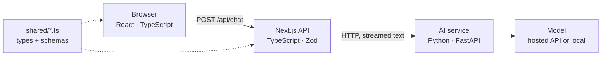

If you build web applications, the browser already decided one language for you: JavaScript. TypeScript is the version of JavaScript most teams now write, and once you're writing it in the browser, a reasonable question follows: should the server be TypeScript too, or Python, or Go?

This article makes the case for TypeScript where it is strong, and is equally plain about where Python or Go is the better tool. Every example in it was run: TypeScript 6.0.3 on Node.js 26, Python 3.15 with Pydantic and mypy, and Go 1.27.

## What the three languages are

**TypeScript** is JavaScript with a type system on top. A *type* describes the shape of a value: "a string", or "an object with an `id` and a `priceCents`". You write `.ts` files, the TypeScript compiler (`tsc`) checks them, and the types are then removed, leaving plain JavaScript that browsers and Node.js run. The handbook says it directly: [type annotations never change the runtime behavior of your program](https://www.typescriptlang.org/docs/handbook/2/basic-types.html#erased-types). TypeScript 7.0, released in July 2026, [rewrote the compiler in Go](https://devblogs.microsoft.com/typescript/announcing-typescript-7-0/) for much faster checking; the language itself didn't change.

**Python** is a general-purpose language known for readable code. It dominates machine learning, data analysis and automation. Type hints are optional and, in the words of the Python docs, [the runtime does not enforce them](https://docs.python.org/3/library/typing.html); separate tools such as mypy check them.

**Go** is a compiled, statically typed language. Its compiler checks every type before the program builds, produces a single native executable, and has lightweight concurrent functions called *goroutines* built into the language. Much cloud-native tooling, including Kubernetes and Terraform, is written in Go.

None of these is "the best language". The right choice depends on four things: what the application does, which libraries you need, what your team already knows, and how you deploy it.

## One language across frontend and backend

Browsers run JavaScript (and WebAssembly), so any web interface ends up as JavaScript. TypeScript's first advantage follows from that: it is the only one of the three that runs natively on both sides.

With a framework like Next.js, React components and server code live in one project. A [Route Handler](https://nextjs.org/docs/app/api-reference/file-conventions/route) is a file such as `app/api/products/route.ts` that exports functions taking a standard web `Request` and returning a `Response`. jithendar.com works this way: the pages, the admin area and the JSON APIs under `src/app/api/` are all one TypeScript codebase in `www/`, with one `package.json`, one test runner and one type check (`npm run typecheck`).

The alternative, a TypeScript frontend with a Python or Go backend, is common and often correct. It does mean two toolchains, two sets of data models that must agree, and a contract between them that no single compiler checks. That cost is worth paying when the backend needs something only Python or Go does well. It is pure overhead when the backend mostly reads a database and returns JSON.

## Shared types and API contracts

Here is a product type that both the React page and the API route import:

```ts
// shared/product.ts: imported by both the React page and the API route.
import { z } from "zod";

// One schema is the runtime check; the type is inferred from it.
export const Product = z.object({
  id: z.string().min(1),
  name: z.string().min(1),
  priceCents: z.number().int().nonnegative(),
  inStock: z.boolean(),
});
export type Product = z.infer<typeof Product>;

// A discriminated union: callers must check `ok` before reading `product`.
export type ProductResponse =
  | { ok: true; product: Product }
  | { ok: false; field: string };

export function parseProduct(raw: unknown): ProductResponse {
  const result = Product.safeParse(raw); // runtime validation
  if (!result.success) {
    return { ok: false, field: result.error.issues[0]?.path.join(".") ?? "body" };
  }
  return { ok: true, product: result.data };
}
```

If someone renames `priceCents` to `price`, every component and route that still reads `priceCents` fails `tsc` before anything is deployed. In a split-language system, the same rename is discovered by a failing integration test, or by a user.

Notice why the type comes from a [Zod](https://zod.dev/) schema instead of a plain `type` declaration. Because types are erased, nothing checks a JSON body against `Product` at runtime. A request from a browser, a webhook or another service is just `unknown` data until something validates it. Zod is a validation library that does that check and also gives you the matching TypeScript type through `z.infer`, so the two can't drift apart.

jithendar.com shows both sides of this boundary. The practice "assist" route validates its input with a Zod union before using it ([`assist/route.ts`](https://github.com/mrjithendar/jithendar.com/blob/be1287a26e41b3618522d7ecbab50d314a6e5c9b/www/src/app/api/practice/problems/%5Bslug%5D/assist/route.ts), lines 9–12):

```ts
const input = z.union([
  z.object({ action: z.literal("hint"), level: z.number().int().min(1).max(10), sessionId: z.uuid().nullish() }),
  z.object({ action: z.literal("solution"), confirm: z.literal(true), sessionId: z.uuid().nullish() }),
]);
```

The client for the site's Python code-execution service, on the other hand, hand-copies the Python models as TypeScript types and ends with `return data as T` (`executor-client.ts`, line 70). `as` tells the compiler "trust me", so if the Python service renamed a field, `tsc` would stay green. Shared types only protect you inside one TypeScript program.

Across languages you need a shared contract, and Python and Go have good options. [OpenAPI](https://www.openapis.org/) describes HTTP APIs in a file that tools turn into typed clients; FastAPI generates one automatically (the executor turns it off with `openapi_url=None`). [Protocol Buffers](https://protobuf.dev/) do the same for gRPC with generated code in all three languages. TypeScript's advantage is that inside a full-stack TypeScript app you get this for free, without a generation step.

## Developer experience

The TypeScript checker also runs inside your editor as a *language service*. It powers autocomplete, "go to definition", and "rename symbol", which updates every use across the project. Here are two deliberate mistakes:

```ts
const res = parseProduct({ id: "p1", name: "Mug", priceCents: 1299, inStock: true });

// Mistake 1: reading `product` without checking `ok`.
console.log(res.product.name);

if (res.ok) {
  // Mistake 2: a typo in a field name.
  console.log(res.product.priceCent);
}
```

`tsc` rejects both before the code runs:

```text
mistakes.ts(6,17): error TS2339: Property 'product' does not exist on type 'ProductResponse'.
  Property 'product' does not exist on type '{ ok: false; field: string; }'.
mistakes.ts(10,27): error TS2551: Property 'priceCent' does not exist on type '{ id: string; name: string; priceCents: number; inStock: boolean; }'. Did you mean 'priceCents'?
```

The first error comes from a *union type*, a value that can be one of several shapes, and *narrowing*: inside `if (res.ok)`, TypeScript [knows which shape you have](https://www.typescriptlang.org/docs/handbook/2/narrowing.html).

To be fair to the others: mypy catches the same typo in Python (`"Product" has no attribute "price_cent"; maybe "price_cents"?`), and with a `TypedDict` union it also catches mistake 1. The difference is that mypy is optional. Run the file without it and Python executes happily until that line, then raises `AttributeError`. Go's compiler refuses the typo with no opt-out (`type *Product has no field or method PriceCent`). Go has no discriminated unions, though, so the Go version of mistake 1 compiles and then crashes with a nil pointer panic.

This is where TypeScript is distinctive. Its type system was designed to describe JavaScript as people actually write it: objects whose shape depends on a field, optional properties, string literal values. Frontend state is full of these:

```ts
type ChatState =
  | { status: "idle" }
  | { status: "streaming"; text: string }
  | { status: "error"; message: string };
```

The compiler makes sure the UI never reads `text` while it's showing an error. React's own docs [cover typing components and hooks this way](https://react.dev/learn/typescript).

## Web ecosystem and development speed

For web work, TypeScript's ecosystem is the largest of the three: React, Next.js and thousands of UI, auth and data-fetching libraries on npm, most of them shipping their own types. Node.js also implements many browser APIs (`fetch`, `Request`, `Response`, web streams), so code that talks HTTP looks the same on both sides. The streaming route later in this article uses only those standard APIs.

For a small team, one language removes a lot of context switching. The person fixing a form can follow the data into the API route and the database query without changing editors, idioms or test frameworks.

The trade-off is dependency quality. npm makes it easy to install small packages that pull in many others, and every one of them is code you run. Practical habits help: commit the lockfile, pin versions (62 of jithendar.com's 65 direct dependencies use exact versions), run [`npm audit`](https://docs.npmjs.com/cli/v11/commands/npm-audit), and prefer well-maintained libraries over clever small ones. Go's standard library covers HTTP and JSON well; the Go example below imports nothing outside it. Python's PyPI has the same supply-chain questions as npm.

## Asynchronous APIs and interactive applications

Most web backends spend their time *waiting*: for a database, another API or a model to respond. That is called I/O-bound work. `async`/`await` lets a function pause at each wait without blocking anything else. In Node.js, one thread runs your JavaScript and an *event loop* hands it the next ready piece of work.

That model fits interactive apps, such as an AI chat interface that shows the answer word by word. Here is a Next.js Route Handler that validates the user's message, forwards it to a Python AI service, and streams the reply straight back:

```ts
// app/api/chat/route.ts
import { z } from "zod";

const ChatRequest = z.object({
  message: z.string().trim().min(1).max(2000),
});

export async function POST(req: Request): Promise<Response> {
  const parsed = ChatRequest.safeParse(await req.json().catch(() => null));
  if (!parsed.success) {
    return Response.json({ error: "message is required" }, { status: 400 });
  }

  const upstream = await fetch(`${process.env.AI_SERVICE_URL}/v1/chat`, {
    method: "POST",
    headers: { "Content-Type": "application/json" },
    body: JSON.stringify(parsed.data),
    signal: req.signal, // stop the model call if the user closes the tab
  });
  if (!upstream.ok || !upstream.body) {
    return Response.json({ error: "AI service unavailable" }, { status: 502 });
  }

  // Pass the stream through without waiting for the full answer.
  return new Response(upstream.body, {
    headers: { "Content-Type": "text/plain; charset=utf-8" },
  });
}
```

And the browser side reads it with the same [Streams API](https://developer.mozilla.org/en-US/docs/Web/API/Streams_API):

```ts
export async function streamChat(
  message: string,
  onText: (chunk: string) => void,
  baseUrl = "",
): Promise<void> {
  const res = await fetch(`${baseUrl}/api/chat`, {
    method: "POST",
    headers: { "Content-Type": "application/json" },
    body: JSON.stringify({ message }),
  });
  if (!res.ok || !res.body) throw new Error(`chat failed: HTTP ${res.status}`);

  const reader = res.body.pipeThrough(new TextDecoderStream()).getReader();
  for (;;) {
    const { done, value } = await reader.read();
    if (done) break;
    onText(value);
  }
}
```

For two-way, long-lived connections, such as an operations dashboard that pushes alerts as they fire, browsers offer [WebSockets](https://developer.mozilla.org/en-US/docs/Web/API/WebSockets_API), and the same TypeScript message types can describe both ends.

None of this makes TypeScript faster or better at concurrency. Python's [asyncio](https://docs.python.org/3/library/asyncio.html) gives you the same `async`/`await` style, and the Python service in this example streams with it. Go's goroutines handle huge numbers of concurrent connections and use every CPU core by default, while a Node.js process runs JavaScript on one thread. The real advantage is narrower: the async model and web APIs are identical in the browser and on the server, so streaming code reads the same on both sides.

## TypeScript for AI-powered products

Most of the code in an AI product isn't the model. It's the chat interface, sign-in, rate limits, prompt assembly, calls to model APIs, checking what comes back, streaming, and logging cost. That is web application work, and TypeScript is good at it.

jithendar.com's practice tutor is an example. It calls an OpenAI-compatible API or Gemini directly with `fetch` from TypeScript, then treats the model's answer as untrusted input and parses it with a Zod schema (`tutor.ts`, lines 55 and 181):

```ts
const answerShape = z.object({ summary: z.string(), points: z.array(z.string()).max(8), next_step: z.string(), code: z.string() });
// ...
answer = answerShape.parse(JSON.parse(result.text.replace(/^```(?:json)?\s*|\s*```$/g, "")));
```

Training models, fine-tuning, embedding pipelines, notebooks and scientific computing are different. That ecosystem (PyTorch, NumPy, pandas, Hugging Face) is in Python, and TypeScript has no real equivalent. So a common design keeps each language where it is strongest:



The TypeScript side owns users, sessions and the UI. The Python side owns the model work, behind one small HTTP contract. Here is that Python service, with the model replaced by a stub so it runs offline:

```python
import asyncio
from collections.abc import AsyncIterator

from fastapi import FastAPI
from fastapi.responses import StreamingResponse
from pydantic import BaseModel, Field

app = FastAPI()


class ChatRequest(BaseModel):
    message: str = Field(min_length=1, max_length=2000)


async def generate(message: str) -> AsyncIterator[str]:
    for word in ["Checking", " recent", " latency", " for:", f" {message}"]:
        await asyncio.sleep(0.05)  # stands in for waiting on the model
        yield word


@app.post("/v1/chat")
async def chat(req: ChatRequest) -> StreamingResponse:
    return StreamingResponse(generate(req.message), media_type="text/plain")
```

In testing, the TypeScript route above received this answer in several chunks and passed them through intact. jithendar.com's practice platform has the same shape, though its Python service runs learners' code rather than a model.

## The same API response in three languages

Here is the same task in each language: take untrusted JSON for a product and return either `{ "ok": true, "product": ... }` or `{ "ok": false, "field": "<the bad field>" }`. All three were fed the same four inputs (one valid; `priceCents` as the string `"19.99"`; an empty `name`; a missing `inStock`) and printed identical output. The TypeScript version is `parseProduct` above. Python, with Pydantic in strict mode so `"19.99"` isn't quietly converted:

```python
class Product(BaseModel):
    model_config = ConfigDict(strict=True)

    id: str = Field(min_length=1)
    name: str = Field(min_length=1)
    price_cents: int = Field(alias="priceCents", ge=0)
    in_stock: bool = Field(alias="inStock")


def parse_product(raw: object) -> Ok | Err:  # Ok and Err are TypedDicts
    try:
        product = Product.model_validate(raw)  # runtime validation
    except ValidationError as exc:
        loc = exc.errors()[0]["loc"]
        return {"ok": False, "field": ".".join(str(part) for part in loc)}
    return {"ok": True, "product": product.model_dump(by_alias=True)}
```

Go, with only the standard library:

```go
type Product struct {
	ID         string `json:"id"`
	Name       string `json:"name"`
	PriceCents int    `json:"priceCents"`
	InStock    *bool  `json:"inStock"` // pointer, so a missing field is nil, not false
}

func parseProduct(raw []byte) ProductResponse {
	var p Product
	// Decoding checks JSON types at runtime: "19.99" cannot go into an int.
	if err := json.Unmarshal(raw, &p); err != nil {
		var typeErr *json.UnmarshalTypeError
		if errors.As(err, &typeErr) {
			return ProductResponse{Field: typeErr.Field}
		}
		return ProductResponse{Field: "body"}
	}
	// Missing fields become zero values, so required rules are written by hand.
	switch {
	case p.ID == "":
		return ProductResponse{Field: "id"}
	case p.Name == "":
		return ProductResponse{Field: "name"}
	case p.PriceCents < 0:
		return ProductResponse{Field: "priceCents"}
	case p.InStock == nil:
		return ProductResponse{Field: "inStock"}
	}
	return ProductResponse{OK: true, Product: &p}
}
```

The Go version is longer because Go's [`encoding/json`](https://pkg.go.dev/encoding/json) checks types but not "required" or "non-empty", so those rules are spelled out. Some teams prefer that explicitness, so length tells you little. What matters is *when* each mistake is caught:

| Mistake | TypeScript + Zod | Python + Pydantic | Go + encoding/json |
| --- | --- | --- | --- |
| Typo in a field name in your code | Compile time (`tsc`) | Static check if you run mypy; otherwise runtime `AttributeError` | Compile time |
| Reading `product` without checking `ok` | Compile time | Static check with mypy | Not caught; nil pointer panic at runtime |
| `"19.99"` where a number is expected | Runtime (schema) | Runtime (strict mode) | Runtime (decoder) |
| Empty `name` or missing `inStock` | Runtime (schema) | Runtime (model) | Runtime (hand-written checks) |

Bad *data* is always a runtime problem, in every language. Bad *code* is where the type systems differ.

| | TypeScript | Python | Go |
| --- | --- | --- | --- |
| Runs in the browser | Yes (compiles to JavaScript) | No, apart from niche WebAssembly ports | No, apart from WebAssembly |
| Type system | Static, structural, erased at runtime; deliberately allows escapes (`any`, `as`) | Dynamic; optional hints checked by separate tools | Static, checked by the compiler, no opt-out |
| Full-stack code reuse | Types, schemas and helpers shared with the UI | Shared through OpenAPI or generated clients | Shared through OpenAPI, Protocol Buffers or generated clients |
| AI/ML ecosystem | Model API clients, UI and orchestration | The standard for training, data and research | Small |
| Concurrency | `async`/`await` on one event loop; worker threads for CPU work | `asyncio`, threads, processes | Goroutines and channels across all cores |
| Deployment | Needs Node.js (or Deno or Bun) plus `node_modules` | Needs a Python interpreter plus packages | One self-contained binary |
| Best suited to | Web apps, APIs behind them, dashboards, AI product layers | ML, data analysis, automation, scripting | Infrastructure tools, CLIs, high-concurrency services |

## Where Python or Go is a better choice

**Choose Python** for machine learning, data analysis and notebooks, where the libraries simply don't exist elsewhere. It's also the better choice for automation and scripting: a short Python script runs anywhere Python is installed, with no build step and a big standard library.

**Choose Go** for infrastructure tools and CLIs. You build one binary per platform by setting [`GOOS` and `GOARCH`](https://go.dev/doc/install/source), with no runtime to install on the target machine. Kubernetes itself, and its main client library client-go, are written in Go. Go also suits backend services that juggle many concurrent connections and need to use every core in one process.

**TypeScript's limitations** are real:

- **It needs a runtime.** Every deployment ships Node.js (or Deno or Bun) and a `node_modules` folder, which is bigger and has more moving parts than one Go binary.
- **It needs a type-checking step.** Node.js can now run `.ts` files directly, but it only [strips the types; "no type checking is performed"](https://nodejs.org/api/typescript.html), and features like `enum` aren't supported that way. You still run `tsc` in CI.
- **It isn't built for CPU-heavy work.** Long computations block the event loop and stall every other request. The Node.js docs [say plainly not to do this](https://nodejs.org/en/learn/asynchronous-work/dont-block-the-event-loop); use [worker threads](https://nodejs.org/api/worker_threads.html) or move the work to another service.
- **Its types can be bypassed.** `any` and `as` switch checking off, as the executor client above shows. Code review has to watch for them.

## A practical decision guide

TypeScript is a strong default when the product is mostly a web interface plus the APIs behind it, when one small team owns both, and when the backend's job is reading and writing data, calling other services and streaming results.

Choose Python or Go when the core work is something TypeScript's ecosystem doesn't do well: models and data for Python, standalone tools and heavily concurrent services for Go.

Five concrete cases:

- **A personal website or blog.** TypeScript with Next.js. One codebase covers pages, admin and API; jithendar.com is built this way.
- **An SRE dashboard.** A TypeScript frontend. If the backend mainly aggregates Prometheus, Kubernetes and cloud APIs, keep it TypeScript and share the types. If you also need a collector agent on every node, write that part in Go.
- **An AI assistant.** TypeScript for the UI and API layer. If you only call hosted model APIs, that may be all you need. If you run your own retrieval, embeddings or models, put that in a Python service behind a small contract, as in the diagram above.
- **An automation script** that rotates logs or calls a few APIs on a schedule: Python (or shell). No build, no `node_modules`.
- **A Kubernetes CLI.** Go: one binary to hand to colleagues, plus the official client libraries.

## Recommendation

Start from where your users meet the product. If that's a browser, and the backend mostly moves data between people, databases and other services, TypeScript on both sides gives you one language, compile-time checks on your own code, and types shared between UI and API. Validate everything that crosses a boundary with a schema, because types disappear at runtime.

When a part of the system needs model training, data science or a single deployable binary, give that part to Python or Go, and connect it with an explicit contract rather than hand-copied types. Most real products end up with a mix.

For a side-by-side look at the three languages' syntax, errors and concurrency, see [Python vs Go vs TypeScript](/blog/python-vs-go-vs-typescript). [Python vs TypeScript](/blog/python-vs-typescript) goes deeper on those two, and [Learning TypeScript with a real project](/blog/learning-typescript-real-project-jithendar-com) walks through this site's own code. For the Python side of AI services, see [FastAPI and FastMCP for AI projects](/blog/fastapi-and-fastmcp-ai-projects).
