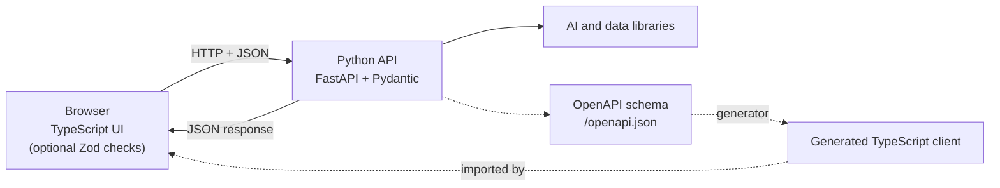

# Python vs TypeScript article

Status: **draft for author review, not published.** Written 2026-11-03 against `jithendar.com` dc249e8, `moks` ef6908a and `roboshop-ai` c81e85a. All three commits are on `origin/master`, and the files cited were clean in the working tree.

| Asset | Location |
| --- | --- |
| Article | `content/blog/python-vs-typescript.mdx` (`status: review`, no `publishedAt`) |
| Figure | `public/images/python-vs-typescript/typescript-python-architecture.svg` (hand-written SVG, 720 × 330, with `<title>` and `<desc>`) |
| Example checker | `verify_examples.py` (this folder) |

## SEO and publishing metadata

The content schema has no excerpt or keyword field, so those live here, as for earlier drafts.

| Field | Value |
| --- | --- |
| H1 (`title`, 84 chars) | Python vs TypeScript: What They Have in Common, How They Differ, and When I Use Each |
| SEO title (`seoTitle`, 60) | Python vs TypeScript: Similarities, Differences and Examples |
| Meta description (`description` and `seoDescription`, 155) | Python vs TypeScript examples side by side: shared ideas, type systems, runtime traps and tooling, with real code from jithendar.com, MOKS and RoboShop AI. |
| Slug | `python-vs-typescript` |
| Excerpt | Python and TypeScript share more than you might expect, and both erase their types before the code runs. This guide puts runnable Python vs TypeScript examples side by side, explains the runtime traps, and shows where each language runs in jithendar.com, MOKS and RoboShop AI. |
| Primary keyword | Python vs TypeScript |
| Secondary keywords | Python and TypeScript similarities; Python vs TypeScript examples |
| Category | `ai-engineering` (**placeholder**: no existing category fits a language comparison; the sibling TypeScript draft uses `devops-sre` for the same reason) |
| Content type | `tutorial` |
| Internal links | `/blog/roboshop-ai-architecture`, `/blog/fastapi-and-fastmcp-ai-projects` (both live on 2026-11-03), and `https://jithendar.com/python-practice` written as an absolute URL because `tests/links.test.ts` does not know the `/python-practice` route |
| `related` | `blog/fastapi-and-fastmcp-ai-projects`, `blog/roboshop-ai-architecture`, `blog/moks-rag-and-skills-design` (all live) |
| Length | About 10,900 words of prose and tables, 15,600 including code |

Live posts are stored in PostgreSQL, so after review the owner pastes the approved draft into the editor, as with earlier drafts.

## Verified project files used

| Repository | File | Used for |
| --- | --- | --- |
| jithendar.com | `www/AGENTS.md`, `www/docs/CONTENT_MODEL.md` | Article format, draft mechanism, rules |
| jithendar.com | `www/package.json`, `www/tsconfig.json`, `www/.nvmrc`, `www/Dockerfile`, `www/next.config.ts` | TypeScript 6.0.3, Next.js 16.4.3, React 19.3.1, Zod 4.6.7, Node 26, `strict`, `noUncheckedIndexedAccess`, no `ignoreBuildErrors` |
| jithendar.com | `www/node_modules/next/dist/docs/01-app/03-api-reference/05-config/02-typescript.md` | `next build` fails on type errors by default |
| jithendar.com | `.github/workflows/ci-jithendar-com.yml`, `.github/workflows/ci-practice-executor.yml` | CI runs lint, typecheck, test, build; executor CI on Python 3.13 with pytest |
| jithendar.com | `executor/pyproject.toml`, `executor/Dockerfile`, `executor/sandbox/Dockerfile` | Python 3.13 (sandbox also 3.12), FastAPI 0.162.0, Pydantic 2.14.2, exact pins |
| jithendar.com | `executor/app/models.py` (lines 1, 35–47), `executor/app/main.py` (lines 49, 77–78) | Pydantic contract, FastAPI route, `openapi_url=None` |
| jithendar.com | `www/src/lib/practice/executor-client.ts` (lines 1, 29–39, 63–70) | TypeScript mirror, `server-only`, `data as T` |
| jithendar.com | `www/src/lib/practice/submissions.ts` (lines 24–33), `www/src/lib/practice/evaluator.ts` (`buildJob`), `www/src/app/api/practice/run/route.ts` | Zod validation of browser input, camelCase to snake_case mapping |
| moks | `frontend/package.json`, `frontend/tsconfig.json`, `frontend/src/api.ts` | TypeScript 5.9.3, Vite 8.3.5, React 19.3.1, `tsc --noEmit && vite build`, parameter property in `ApiError` |
| moks | `backend/pyproject.toml`, `backend/requirements.txt`, `Dockerfile`, `.github/workflows/ci.yml` | Python 3.12, FastAPI 0.162.0, Pydantic 2.14.2, LangGraph 1.2.19, `moks` CLI entry point, Node build stage copied into the Python image |
| moks | `backend/moks/main.py` (static file serving), `backend/moks/velero.py` (lines 321–324), `backend/moks/connectors/cloudwatch.py` (lines 70–77) | Same-origin UI, `asyncio.gather`, `asyncio.to_thread` |
| moks | `reranker/requirements.txt` | `torch==2.15.0+cpu` |
| roboshop-ai | `package.json`, `services/web/frontend/package.json`, `services/web/frontend/tsconfig.json`, `services/web/frontend/scripts/build.mjs`, `services/web/Dockerfile` | TypeScript 7.0.2, `tsc` emits to `dist/` with `noEmitOnError`, nginx image, `node --test`, `unittest` |
| roboshop-ai | `services/web/frontend/src/paths.ts` (lines 29–36, 53–57) | `validFx` type guard |
| roboshop-ai | `services/*/Dockerfile`, `services/catalogue-service/package.json`, `services/payment-service/package.json` | Python 3.14 and 3.13 images; catalogue and payment are plain `.mjs` JavaScript |
| roboshop-ai | `node_modules/typescript/package.json` | TypeScript 7.0.2 ships per-platform native binaries |

File counts in the article come from `git ls-files` at the commits above.

## Sources for version-sensitive claims

| Claim | Source (checked 2026-11-03) |
| --- | --- |
| TypeScript annotations are erased and never change runtime behaviour; `tsc` emits despite errors unless `noEmitOnError` | https://www.typescriptlang.org/docs/handbook/2/basic-types.html |
| TypeScript 7.0 is a native port written in Go, released 2026-07-08, designed to type-check like 6.0, installed as `typescript` with `tsc` | https://devblogs.microsoft.com/typescript/announcing-typescript-7-0/ |
| Node type stripping on by default since 22.18 and 23.6, stable since 24.12 and 25.2; no type checking; ignores `tsconfig.json`; enums, runtime namespaces and parameter properties unsupported; `.ts` extension required in imports; `--experimental-transform-types` removed in 26.0 | https://nodejs.org/api/typescript.html |
| Node worker threads help CPU-bound work, not I/O | https://nodejs.org/api/worker_threads.html |
| Vite transpiles TypeScript with Oxc and does not type-check | https://vite.dev/guide/features |
| Python runtime does not enforce annotations; `object` versus `Any` | https://docs.python.org/3/library/typing.html |
| `asyncio.gather`, `asyncio.to_thread` (I/O-bound, GIL note), `TaskGroup` added in 3.11 | https://docs.python.org/3/library/asyncio-task.html |
| Free-threaded build since 3.13, not the default | https://docs.python.org/3/howto/free-threading-python.html |
| Free-threaded build officially supported in 3.14 (PEP 779) | https://docs.python.org/3/whatsnew/3.14.html |
| BigInt: no JSON serialization, no mixing with number, division truncates | https://developer.mozilla.org/en-US/docs/Web/JavaScript/Reference/Global_Objects/BigInt |
| Pydantic converts compatible input (for example `'123'` to `int`) and raises `ValidationError` | https://pydantic.dev/docs/validation/latest/concepts/models/ |
| Zod `parse` throws, `safeParse` returns a result union, `z.infer` | https://zod.dev/basics |

Stated from general knowledge, not fetched this session: FastAPI serves `/openapi.json` by default; Node stops on unhandled rejections by default (this one was confirmed by running Node 26, which exited with code 1); `Object.groupBy` in Node 22 and later; Python's `HTTPError` subclasses `URLError`; dict insertion order. Each is long-standing documented behaviour, but check them if you want a cited source for every line.

## Validation

| Command | Result |
| --- | --- |
| `python3 docs/knowledge-sharing/python-vs-typescript/verify_examples.py --python <venv with pydantic 2.14.2 and mypy 2.4.1> --tsc node_modules/typescript/bin/tsc --tsc ../../roboshop-ai/node_modules/typescript/bin/tsc` | **Pass.** 44 example groups: 88 programs ran (CPython 3.11.9, Node 26.13.0) and matched their `Output:` comments; every "Same output" pair matched; mypy clean except the 3 lines marked "a type checker flags this line", which do error; `tsc` 6.0.3 and 7.0.2, each with `strict` and with `strict` plus `noUncheckedIndexedAccess`, clean; 9 project excerpts identical to the cited lines at the cited commits |
| Exercise 5 with no server listening | Both print `server unavailable` (run by hand) |
| `npx vitest run` (whole suite) | 428 passed, 1 failed: `article-route` cover-image test took 66 s under load (other sessions were running); rerun alone, `tests/article-route.test.tsx` passes 8 of 8 |
| `tests/content.test.ts`, `editor-workflow.test.ts`, `links.test.ts`, `images.test.ts`, `responsive-content.test.tsx` | Pass for this article (an earlier run showed a broken `/python-practice` link in another draft, `python-tutorial-beginners-real-projects.mdx`, which is not part of this work) |
| SVG | `xmllint --noout` passes; rendered in headless Chrome and inspected |
| `npm run lint`, `npm run typecheck`, `npm run build` | Not run: no application code changed (content, a static SVG and a docs script only) |

## Limitations

- **Python version.** Only CPython 3.11.9 is installed on this machine and Docker was not running, so the Python examples ran on 3.11, not on the 3.12, 3.13 and 3.14 versions the projects use. The examples avoid 3.12-only syntax. None of the behaviours shown changed between 3.11 and 3.14, but they were not executed on those versions.
- **No benchmarks.** The article makes no speed claims and explains what a fair benchmark would need.
- **No motivations.** The repositories do not record why each language was chosen, so the article describes where each language is used. The title's "When I Use Each" is answered by observation; add your reasons if you want them in.
- **OpenAPI client generation** is described as an option. No project uses it, and it was not tested.
- **The figure is a proposal**, not a diagram of any existing project. It is a hand-written SVG because the site does not render Mermaid in published posts. An uncommitted `src/components/MermaidBlock.tsx` appeared from parallel work during this session; if that lands, the Mermaid source below could replace the SVG.

## Notes for the owner (found while researching)

- `www/AGENTS.md` lists TypeScript 5.9, but `www/package.json` pins 6.0.3. The article uses 6.0.3.
- `tests/links.test.ts` does not know the live `/python-practice` route (the sibling TypeScript draft's README reports the same).
- The executor's TypeScript mirror is maintained by hand (`openapi_url=None`), and nothing checks that `JobRequest` in Python and TypeScript stay in sync. A small contract test would catch drift.
- No repository configures a Python linter, formatter or type checker, although some files carry `# noqa` comments.
- Sibling drafts written the same day overlap with this one: `learning-typescript-real-project-jithendar-com.mdx` and `python-tutorial-beginners-real-projects.mdx`. Once they are published, cross-link them from "How do you move from one language to the other?".

## Figure source (Mermaid)

